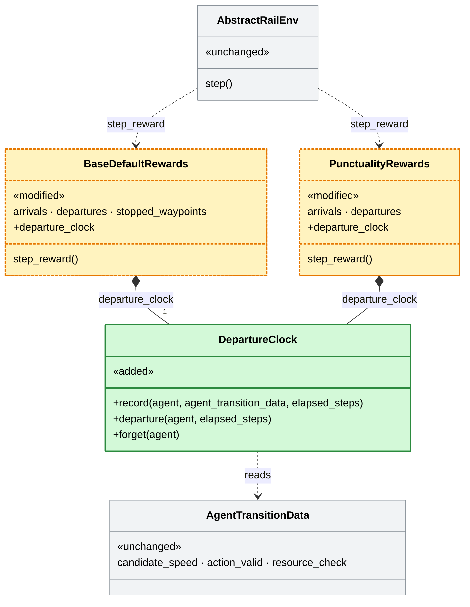
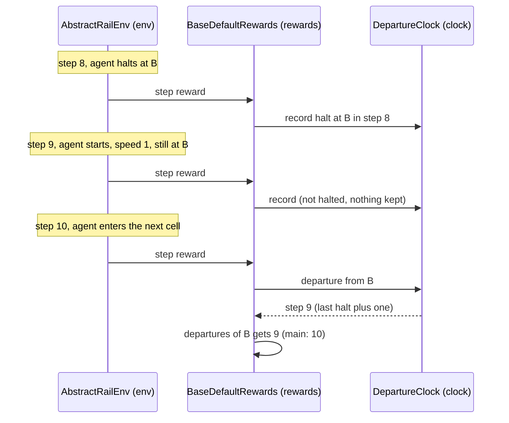
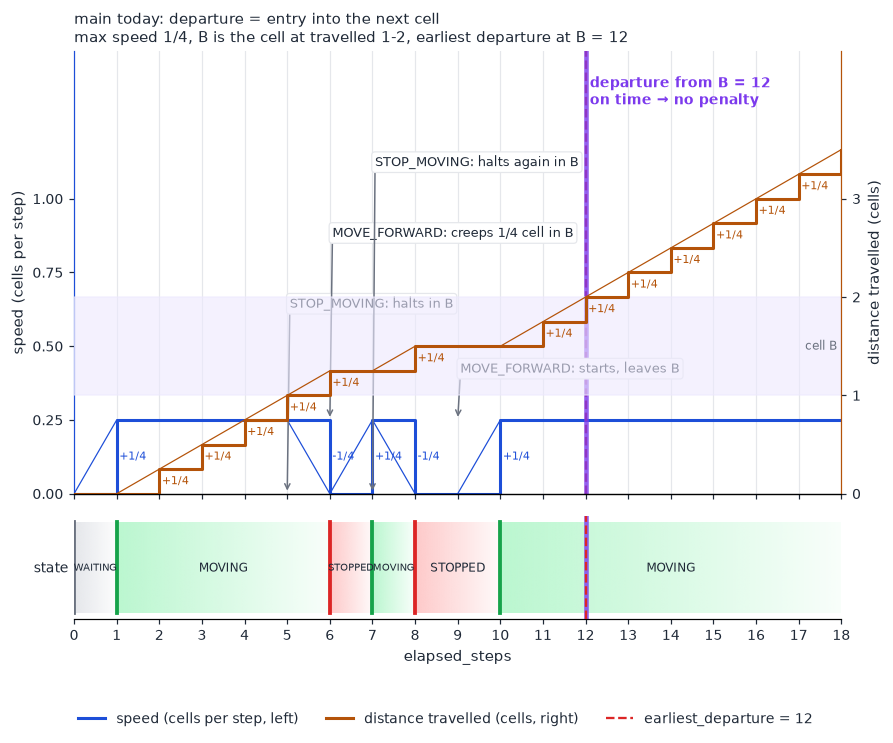
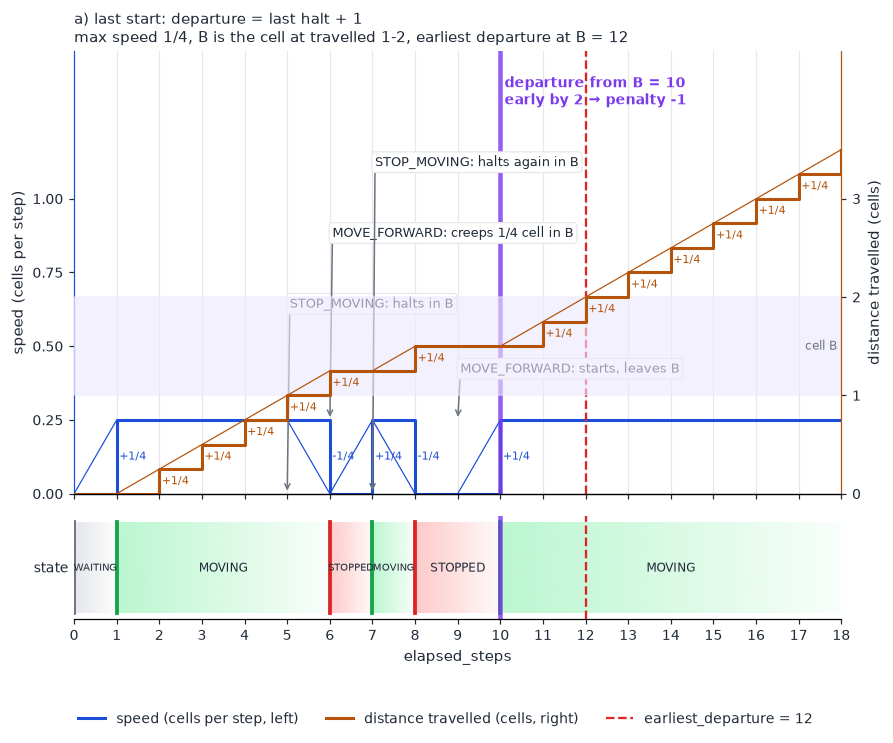
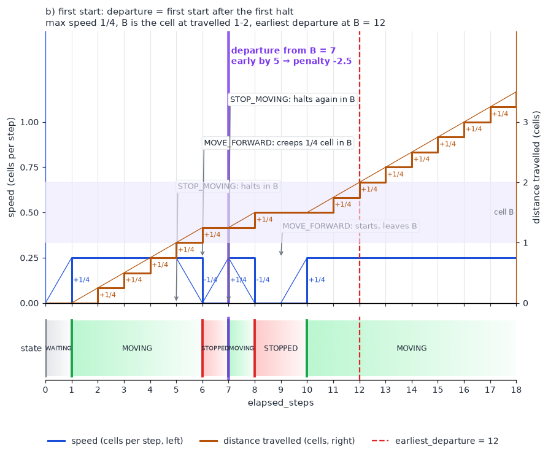

# Departure from a stop is the step the agent starts moving (#554)

> **Status:** plan of 2026-11-23, draft. Based on `main` 4856ebfe (planned on ac932d16; line numbers in
> `rewards.py` from line 250 on are one higher on 4856ebfe). Issue
> [#554](https://github.com/flatland-association/flatland-rl/issues/554) ("Early departure at intermediate stops is
> penalized one step late since D1 (#496).", chenkins, 2026-10-30, milestone 5.0.0). Branch
> `554-early-departure-intermediate-stops`, PR [#585](https://github.com/flatland-association/flatland-rl/pull/585). Open questions: none (§9.1).
>
> **Why:** since D1 ([#496](https://github.com/flatland-association/flatland-rl/pull/496)) an agent that starts
> moving from a halt enters the next cell only `ceil(1 / max_speed)` steps later. The rewards still date the
> departure at that cell entry. So an agent can start one step (at speed 1/2: two steps) before its earliest
> departure without the early departure penalty, and `PunctualityRewards` counts it as on time.

## 1. Introduction and goals

*What the change is for: the requirements, the qualities that matter, who has a stake, and what it leaves out.*

### 1.1 Requirements overview (functional requirements)

*The issue's text and the numbered requirements the rest of the plan refers to.*

> `BaseDefaultRewards` and `PunctualityRewards` record a departure from a stop in the step the agent enters the next
> cell (`rewards.py`, `step_reward()`), and check it against the stop's earliest departure: `departure - ed` for the
> `INTERMEDIATE_EARLY_DEPARTURE` penalty, `departure >= ed` for punctuality.
>
> Since D1 (#496 […]), an agent starting from a full stop covers no distance in that step: it reaches its speed, but
> enters the next cell only `ceil(1 / max_speed)` steps later. In 4.3.0 an agent at speed 1 entered the next cell in
> the step it started moving. So the recorded departure now lags the actual start, and an agent can start moving
> before its earliest departure without penalty […]
>
> **Expected behavior:** The departure from a stop is the step the agent starts moving (the first step with
> speed > 0 after halting), as at the initial stop, where the agent enters the map in the step of its earliest
> departure. Then moving on in step `ed` gives no penalty, and moving on in step `ed - 1` is penalized, independent
> of the agent's speed and acceleration - as in 4.3.0 at speed 1 […]
>
> - Affected: `BaseDefaultRewards` (`INTERMEDIATE_EARLY_DEPARTURE`, and so `DefaultRewards`, `ECML2026Rewards`), and
>   `PunctualityRewards` (`departure >= ed` at the initial and intermediate stops). […]
> - Found while generalizing `ShortestPathPolicy` to serve intermediate stops (#528): it moves on in step `ed` and
>   is not affected by the fix.

Requirements:

- **REQ-1** A departure from an entry point where the agent halted is recorded as the first step with speed > 0
  after the halt, not as the step it enters the next cell.
- **REQ-2** `BaseDefaultRewards` (and so `DefaultRewards`, `ECML2026Rewards`, `BasicMultiObjectiveRewards`,
  `DelayRewards`) penalizes a move-on in step `ed - 1` and not one in step `ed`, at any speed and acceleration.
- **REQ-3** `PunctualityRewards` counts an intermediate stop left in step `ed` as on time and one left in step
  `ed - 1` as not on time, with the same departure as REQ-1.
- **REQ-4** The issue's reproduction prints the expected output (`[9]`, `-0.5`; `[10]`, `0.0`; `[11]`, `0.0`).
- **REQ-5** Departures from cells where the agent did not halt (rolling through) and arrivals stay as on `main`.

### 1.2 Quality goals (non-functional requirements)

*The few qualities the design must reach, each with a concrete scenario.*

| ID | Priority | Quality goal | Scenario |
|---|---|---|---|
| NFR-1 | 1 | Speed independence | The issue's corridor at max speed 1 and 1/2 gives the same recorded departures (`9`, `10`, `11`) and rewards. |
| NFR-2 | 2 | Step cost | `step_reward()` does one dict lookup and at most one dict write more per agent and step; no extra pass over agents or waypoints. |

### 1.3 Stakeholders

*Who asks for the change, decides on it, reviews it or works with the result, and what they expect.*

| Role | Name | Expectations |
|---|---|---|
| Issue author, maintainer | chenkins | Rewards match the 4.3.0 semantics of a departure at any speed, in 5.0.0. |
| Competition and benchmark users | ECML 2026 participants, FAB evaluations (`ECML2026Rewards`, `PunctualityRewards`) | An early move-on is penalized; scores of on-time policies don't change. |
| Policy authors | `ShortestPathPolicy` ([#528](https://github.com/flatland-association/flatland-rl/pull/528)), flatland-baselines' `DeadLockAvoidancePolicy` | No change in env dynamics; only reward values for early move-ons. |

### 1.4 Follow-ups (not in this PR)

*What this PR leaves out, why, and where it goes later.*

| Follow-up | Why not in this PR | From | Findings | Issue |
|---|---|---|---|---|
| `PunctualityRewards` counts at most one intermediate stop as on time (the `break` at `rewards.py:610` leaves the loop over all stops). | Own issue, older than D1; neighbouring code in the same method, see C-3. | §3 | - | [#555](https://github.com/flatland-association/flatland-rl/issues/555) |
| Earliest departure at the origin evaluated in the rewards only; the initial departure would then be the map entry step. | Own issue; changes the env, not only the bookkeeping. This plan's rule (DP-1) carries over unchanged. | §2.1 | - | [#559](https://github.com/flatland-association/flatland-rl/issues/559) |
| flatland-book `environment/environment/rewards.ipynb` (formerly `rewards.md`): say that the actual departure $d_j$ is the step the agent starts moving from its halt. | Another repo; the book PR runs an example against flatland-rl `main`, so it merges after this PR. | §4.3 | - | [flatland-book#64](https://github.com/flatland-association/flatland-book/pull/64) |
| Rewards' arrival and departure bookkeeping after restoring a mid-episode snapshot. | Unchanged behaviour: rewards are not persisted (`persistence.py:205`), so the bookkeeping starts empty after a restore, on `main` too. | §2.2 | - | - |

## 2. Constraints

*What limits the design from outside: platform, organisation and conventions.*

| ID | Constraint | Kind | Explanation |
|---|---|---|---|
| C-1 | Rewards read only this step's signals | technical | `step_reward()` derives everything from `AgentTransitionData` and the agent, state-machine-independent (`rewards.py:197-216`); the rewards keep their own per-episode bookkeeping (`arrivals`, `departures`, `stopped_waypoints`, `rewards.py:183-187`). |
| C-2 | Env dynamics unchanged | technical | D1 ([#496](https://github.com/flatland-association/flatland-rl/pull/496), "1a. Agent starts moving from a full stop") stays; only the rewards' bookkeeping adapts. |
| C-3 | Parallel 5.0.0 branches in `rewards.py` | organisational | [#555](https://github.com/flatland-association/flatland-rl/issues/555) changes `PunctualityRewards.end_of_episode_reward()` (`rewards.py:597-610`); [#519](https://github.com/flatland-association/flatland-rl/issues/519) the collision / invalid action branch of `BaseDefaultRewards.step_reward()` (`rewards.py:233-264`) and possibly `__init__`; [#544](https://github.com/flatland-association/flatland-rl/issues/544) the `CANCELLATION`/`TARGET_NOT_REACHED` terms (`rewards.py:297-306`). This plan's hunks must stay apart from them (§11.1, S-1). |
| C-4 | Conventions | conventions | `AGENTS.md`: Conventional Commits, test docstrings in domain vocabulary ("Testing patterns"), `NamedTuple` for structured data, a class rather than closures for state with several methods, no `TODO` referring to the closed issue. |
| C-5 | flatland-baselines stays green | organisational | Its tests run against the local `flatland-rl` before the change is called done (workspace rule). |

### 2.1 Limitations

*What the built code gets wrong or ignores, each with the TODO or issue that tracks it.*

- The initial stop keeps its departure at the cell exit when the agent did not halt there: the agent enters the map
  moving, and the env does not let it enter before its earliest departure, so `departure >= ed` holds either way.
  With [#559](https://github.com/flatland-association/flatland-rl/issues/559) the map entry step would become the
  initial departure.
- Unit tests that call `step_reward()` with `agent_transition_data=None` get no halt (as no other signal), so their
  departure stays at the cell exit, as on `main` (`rewards.py:191-197`).

### 2.2 Assumptions

Not checked in code; they hold by construction of `AbstractRailEnv.step()` (`rail_env.py:855`, the only caller of
`step_reward()`).

- `step_reward()` is called once per agent and step, in step order, after the position and speed are committed.
- An agent is on one entry point at a time, so one pending halt per agent is enough; leaving the entry point
  consumes it.
- A step in which the agent halts is never the step it enters the next cell: after a halt (speed 0) D1 covers no
  distance in the next step, so the departure is at least the halt step + 1.
- Rewards objects are not persisted; a restored snapshot starts with empty bookkeeping (as on `main`).

## 3. Context and scope (checked 2026-11-23 on `main` ac932d16)

*The code on the base branch that the change works in, as it is before the change, and where the change stops.*

- **`BaseDefaultRewards.step_reward()`** (`flatland/envs/rewards.py:189-270`): on a new entry point it appends
  `elapsed_steps` to `arrivals[current]` and, if the agent came from an on-map entry point, to
  `departures[old]` (`rewards.py:222-229`); when the agent leaves the map (target with removal) also to
  `departures[old]` (`rewards.py:230-231`). `is_stopped_now` (`rewards.py:212`) excludes malfunctions and feeds
  `stopped_waypoints` (`rewards.py:219-220`), which decides whether a stop is served.
- **`BaseDefaultRewards._agent_done_or_max_episode_steps_reward()`** (`rewards.py:282-338`): per intermediate stop
  served, pairs arrivals with departures and takes the best window; early departure
  `intermediate_early_departure_penalty_factor * min(departure - ed, 0)` (`rewards.py:330-331`).
- **`PunctualityRewards.step_reward()`** (`rewards.py:562-580`): records the first arrival per entry point and the
  departure from `old_entry_point` in the same step; ignores `agent_transition_data`.
  **`end_of_episode_reward()`** (`rewards.py:582-624`): initial stop on time if `departure >= ed` (`rewards.py:592`),
  intermediate if `arrival <= la and departure >= ed` (`rewards.py:605`); the `break` at `rewards.py:610` is
  [#555](https://github.com/flatland-association/flatland-rl/issues/555).
- **D1 in `rail_env.py`:** a halted agent given a moving action gets its new speed (`_candidate_speed()`,
  "acceleration or start moving", `rail_env.py:1308-1313`) but its distance advances by the pre-step speed 0; it
  crosses into the next cell `ceil(1 / max_speed)` steps later. A malfunction sets the candidate speed to 0
  (`rail_env.py:1320-1321`); a denied crossing forces speed 0 (`rail_env.py:813-830`).
- **Who reads `departures`:** only `rewards.py` itself and `tests/test_rewards.py`. Nothing in `benchmarks/`,
  `notebooks/`, `examples/` or flatland-baselines reads it. `tests/flatland/envs/graph/test_graph_rail_env.py`
  runs the three reward classes on `GraphRailEnv` (same `step()`, string entry points).
- **Stored data:** `tests/test_flatland_regression_episodes.py::test_episode` is skipped on `main`
  (`tests/test_flatland_regression_episodes.py:80`, D1). `benchmarks/benchmark_episodes.py` runs all episodes with
  `skip_rewards=True`. flatland-baselines' `test_policy_grid_runner_evaluator.py` pins `PunctualityRewards` scores
  (`(9, 14)`, `(14, 14)`) on legacy envs without intermediate stops; `test_intermediate_stops.py` pins only
  success rates.

Reproduction on `main` ac932d16 (the issue's script, corridor A - B - C, `ed` 10 at B), at speed 1 and with the
speed set to 1/2:

```
speed 1:   move from B in step 9: departure recorded [10], total reward 0.0
           move from B in step 10: departure recorded [11], total reward 0.0
           move from B in step 11: departure recorded [12], total reward 0.0
speed 1/2: move from B in step 9: departure recorded [11], total reward 0.0
           move from B in step 10: departure recorded [12], total reward 0.0
           move from B in step 11: departure recorded [13], total reward 0.0
```

Trace at speed 1, move from B in step 9 (after each step): step 8 halted at B (speed 0), step 9 still at B with
speed 1 and distance 0, step 10 at the next cell. At speed 1/2: step 9 at B speed 1/2 distance 0, step 10 distance
1/2, step 11 next cell. With a malfunction at B (steps 7-9, MOVE from step 7 on), the agent starts in step 10 and
`main` records 11.

**Scope:** the change dates the departure in the two reward classes' `step_reward()`. It doesn't change the env,
the arrivals, the comparisons in the end-of-episode evaluation, or which stops count as served.

## 4. Solution strategy

*The fundamental choices and why, the rules the design follows, how it is verified, and the design of each part.*

| Quality goal | Scenario | Solution approach | Details |
|---|---|---|---|
| NFR-1 Speed independence | Same departures at speed 1 and 1/2 | Date the departure by the last halt (speed 0) at the entry point, + 1, instead of by the crossing; the crossing lag no longer enters. | §4.3, Q-1, Q-3 |
| NFR-2 Step cost | One lookup, one write | One pending halt per agent, overwritten while halted, consumed when leaving. | §4.3, Q-2 |

### 4.1 Design principles

*The rules the design follows, each with its decision, the concepts it reuses instead of building new ones, and what
is not new on purpose.*

- **DP-1 A departure is the first step with speed > 0 after the last halt at the entry point.** The step the
  agent leaves the cell only stands for it when the agent did not halt there (REQ-5). (Q-1)
- **DP-2 Halted means speed 0 after this step, whatever the cause.** A voluntary stop, a denied crossing and a
  malfunction all count, so a malfunction at the stop never dates the departure before it. Whether the stop is
  served stays with `stopped_waypoints` (malfunctions excluded), unchanged. (Q-3)
- **DP-3 The rewards keep the bookkeeping, from this step's signals.** No new field in `EnvAgent` or
  `AgentTransitionData`; the halt is read from `candidate_speed` and `movement_allowed`, as `is_stopped_now`
  already is (C-1). (Q-2)
- **DP-4 One rule for both reward classes.** `BaseDefaultRewards` and `PunctualityRewards` share the helper, so
  their departures agree. (Q-2)

Reused concepts:

| Need | Reused concept | Instead of |
|---|---|---|
| Halt signal | `new_speed_zero` and `movement_allowed` from `AgentTransitionData` (`rewards.py:204-207`) | `agent.speed_counter.speed` (hand-built test agents keep arbitrary speeds), or `is_stopped_now` (excludes malfunctions, DP-2) |
| Where departures are kept | The existing `departures` lists, same keys and shape | A second `starts` list beside `departures` |
| Comparison with the earliest departure | `departure - ed` and `departure >= ed`, unchanged | Subtracting `ceil(1 / max_speed)` from the crossing step (wrong with acceleration < max speed, denied crossings and malfunctions) |

Not new on purpose: no new reward term or parameter, no change to `DefaultPenalties`, to the env or to
`AgentTransitionData`, to arrivals or to the served-stop rule.

### 4.2 Verification

*How each requirement and quality goal is shown to work: tests, CI checks, before and after screenshots.*

No screenshots: nothing visible changes. The plots of §6.2 show the rule. Results on 4856ebfe with S-1 (2026-11-25).

| ID | Requirement | Test or check | Result | Screenshots |
|---|---|---|---|---|
| REQ-1 | Departure is the start step | New test in `tests/test_rewards.py`: the issue's corridor driven through `env.step()`, move from B in step 9, 10, 11, at max speed 1 and 1/2; `departures[0][B]` is `[9]`, `[10]`, `[11]`. Plus a malfunction at B (start in step 10 → `[10]`). | `test_rewards_early_departure_dated_by_the_start_from_the_halt` (6 cases) passes; `test_rewards_early_departure_malfunction_at_the_stop_counts_as_halt` (Q-3) and `test_rewards_early_departure_last_halt_counts` (Q-1, the run of §6.2: departure 10, penalty -1) pass. All 10 new cases fail with `main`'s `rewards.py`. | - |
| REQ-2 | Early departure penalty | Same test: `DefaultRewards` total `-0.5`, `0.0`, `0.0`. | Passes, at speed 1 and 1/2. | - |
| REQ-3 | Punctuality | Same corridor with `PunctualityRewards`: move in step 9 gives `(2, 3)`, in step 10 `(3, 3)`. | `test_punctuality_early_departure_dated_by_the_start_from_the_halt` passes. | - |
| REQ-4 | Issue's reproduction | The script of §3 on the branch. | Covered by REQ-1's test (the same corridor and steps). | - |
| REQ-5 | Rolling through and arrivals unchanged | Existing tests of `tests/test_rewards.py` with `agent_transition_data=None` or a moving signal (e.g. `test_departure_only_when_moving`, `test_multicell_station_*`) keep their expectations. | Pass. `test_rewards_intermediate_intermediate_early_departure_penalty` halted and left in the same step 5; it now halts in step 4, as an env run would (S-1). | - |
| NFR-1 | Speed independence | REQ-1's test, parametrized by speed. | Passes at speed 1 and 1/2; Q-1's test at 1/4. | - |
| NFR-2 | Step cost | Review: one `dict.pop` per crossing, one assignment per halted step. | As planned (`DepartureClock.departure()`/`record()`). | - |
| - | Neighbours | `tests/test_rewards.py`, `tests/flatland/envs/graph/test_graph_rail_env.py`, flatland-baselines' `deadlock_avoidance_heuristic/tests -m "not slow"`. | With S-1: the 8 test modules that use the reward classes (`test_rewards.py`, `test_graph_rail_env.py`, `test_flatland_edge_lengths.py`, `test_flatland_envs_persistence.py`, `test_flatland_envs_rail_env.py`, `test_flatland_states_edge_cases.py`, `test_multi_speed.py`, `trajectories/test_trajectories.py`) 461 passed, 3 skipped; flatland-baselines' `deadlock_avoidance_heuristic/tests -m "not slow"` 28 passed, 50 skipped, 1 xfailed; flake8 nothing new. | - |

### 4.3 Date the departure by the last halt (REQ-1–REQ-5; Q-1–Q-3)

*One part of the change: what changes and why, with the requirements and decisions it implements.*

- A small helper in `rewards.py` (Q-2) keeps, per agent handle, the pending halt `(entry_point, step)`:
  - `record(agent, agent_transition_data, elapsed_steps)`: if the agent is on the map and halted this step
    (`candidate_speed == 0 or not movement_allowed`, DP-2), store `(agent.current_entry_point, elapsed_steps)`.
    A later halt at the same entry point overwrites it (Q-1 a)).
  - `departure(agent, elapsed_steps)`: pop the pending halt; if it is at `agent.old_entry_point`, return its step
    + 1, else `elapsed_steps` (rolled through, REQ-5).
- `BaseDefaultRewards.step_reward()` appends `departure(...)` instead of `elapsed_steps` at both places
  (`rewards.py:229`, `rewards.py:231`), then calls `record(...)`. Order matters: the departure from the old entry
  point is taken before this step's halt at the new one is recorded.
- `PunctualityRewards.step_reward()` does the same at `rewards.py:578`, and drops a pending halt when the agent
  moves to an entry point it has visited before (no departure is recorded there, `rewards.py:571`).
- Docstrings: `BaseDefaultRewards`' parameter `intermediate_early_departure_penalty_factor` and the
  `PunctualityRewards` class docstring say that the departure is the step the agent starts moving from its halt.

Issue's example, speed 1, `ed` 10 at B, move from B in step 9: halt at B recorded in step 8, the agent enters the
next cell in step 10, `departure` returns 8 + 1 = 9, penalty `0.5 * (9 - 10) = -0.5`.

## 5. Building block view

*The components the change adds or changes: an overview, why the system is split this way, what each is responsible
for, the important interfaces, and the planned data model.*

### 5.1 Rewards in `rewards.py`

*One white box: its building blocks, why it is split this way, and the interfaces between them.*



Notation: [UML class diagram in Mermaid](https://mermaid.js.org/syntax/classDiagram.html); grey «unchanged», yellow
«modified», green «added», new members with a leading `+`.

**Motivation:** the two reward classes keep separate bookkeeping today and must agree on the departure (DP-4); a
shared helper holds the one rule. `DefaultRewards`, `ECML2026Rewards`, `BasicMultiObjectiveRewards` and
`DelayRewards` delegate to `BaseDefaultRewards` and change with it.

**Contained building blocks:**

| Component | Responsibility | Change |
|---|---|---|
| `DepartureClock` | Remembers where and when an agent last halted, and turns it into the departure step when the agent leaves. Not for deciding whether a stop is served (`stopped_waypoints`) or for arrivals. | 🟩 added: both reward classes date a departure the same way. |
| `BaseDefaultRewards` | Per-step and end-of-episode penalties of the default reward (punctuality, cancellation, collisions). Not for env dynamics. | 🟨 modified: a move-on before the earliest departure is penalized at any speed. |
| `PunctualityRewards` | Counts the stops served on time. Not a penalty. | 🟨 modified: a stop left before its earliest departure is not on time, at any speed. |
| `AbstractRailEnv.step()` | Commits position and speed, then calls `step_reward()` per agent. | ⬜ unchanged |

**Important interfaces:** none changed. `Rewards.step_reward()` keeps its signature; `departures` keeps its keys and
shape, only its values for halted entry points move earlier.

## 6. Runtime view

*How the components work together at runtime: the flows and modes the change adds or changes, when it changes behaviour.*

### 6.1 Halt, start and leave a stop (REQ-1; Q-1, Q-3)

*One flow or mode, as a sequence or state diagram.*



Notation: [sequence diagram in Mermaid](https://mermaid.js.org/syntax/sequenceDiagram.html). `PunctualityRewards`
calls the clock the same way.

### 6.2 Departure after halt, creep and halt, by rule (REQ-1, REQ-2; Q-1)

*The same run, with the departure dated by `main` and by the two options of Q-1.*

One agent, max speed 1/4, stop B is the cell at distance travelled 1-2, B's earliest departure is 12. The agent
enters B in step 5 and halts (speed 0 from step 6), creeps 1/4 cell in step 7, halts again from step 8, starts in
step 10 (two steps before the earliest departure) and reaches the next cell in step 12. Plots by
[`plot_departure_rules.py`](early-departure-intermediate-stops/plot_departure_rules.py), a real `RailEnv` run drawn
with `plot_trajectory()` of flatland-book's
[Speed Profiles](https://flatland-association.github.io/flatland-book/environment/environment/speed_profiles.html)
page; the purple line is the departure, the red dashed line B's earliest departure.

| Rule | Departure from B | Early departure penalty | Plot |
|---|---|---|---|
| `main`: entry into the next cell | 12 | none: counted on time, 2 steps after the start (the bug) | [departure-main.png](early-departure-intermediate-stops/departure-main.png) |
| a) last start: last halt + 1 (decided) | 10 | `0.5 * (10 - 12) = -1`: early by 2 | [departure-a.png](early-departure-intermediate-stops/departure-a.png) |
| b) first start after the first halt | 7 | `0.5 * (7 - 12) = -2.5`: the creep counts, also if the agent leaves on time | [departure-b.png](early-departure-intermediate-stops/departure-b.png) |

  

Speed, distance and states are the same in all three plots; only the departure moves. a) and `main` agree when the
agent leaves at speed 1 without creeping, apart from the one-step lag of #554.

## 8. Crosscutting concepts

*What the change introduces that other code will follow, and what it changes for existing callers.*

### 8.1 New patterns

*What is new compared with the base branch.*

Compared with `main`. What is reused, and what is not new on purpose, is in §4.1.

| ID | New | Defined in |
|---|---|---|
| PAT-1 | A departure from a halt is the first step with speed > 0 after the last halt; rewards that book departures use the shared helper. | §4.1 DP-1, §4.3 |

### 8.2 Breaking changes

*What breaks for whom, and the migration path.*

None for callers: no signature, parameter or format changes. Changed values:

- **Reward values** of `BaseDefaultRewards` and its delegates: an agent that starts moving from a halted
  intermediate stop before its earliest departure now gets `INTERMEDIATE_EARLY_DEPARTURE`, one step (speed 1) or
  `ceil(1 / max_speed)` steps earlier than on `main`. Policies that move on in step `ed` or later are not affected.
  Intended (the fix); no migration. Scores computed on `main` since D1 for policies that move on early are too
  good.
- **`PunctualityRewards`:** such stops are no longer on time.
- **`departures` contents** (public attribute, read only in `tests/test_rewards.py`): for entry points where the
  agent halted, values move to the start step. Tests updated in S-1.
- **Stored data:** none affected. The regression episodes are skipped on `main` and `benchmark_episodes.py` skips
  rewards (§3); flatland-baselines pins `PunctualityRewards` only on envs without intermediate stops.

S-1 is marked breaking (`fix(rewards)!:` with a `BREAKING CHANGE:` footer), as #555's fix: release-please lists the
changed reward values apart in the 5.0.0 notes (decided 2026-11-25).

## 9. Decisions

*The decisions behind the plan: the questions still open, the decisions taken, and how each review finding was settled.*

### 9.1 Open questions

*Choices not made yet, each with its options and a proposal.*

~~**(Q-1) An agent starts, halts again at the same stop and starts later: which start is the departure?**~~
- a) The last start before it leaves (last halt + 1). A creep forward that ends in a halt does not count as a
  departure; the agent is still at the stop.
- b) The first start after the first halt. Penalizes the creep, but then the departure is dated before the agent's
  final dwell.

*Proposal:* a). The issue's wording "the first step with speed > 0 after halting" reads as after the last halt; it
matches a denied crossing (speed forced to 0) followed by a later start. Who decides: chenkins (issue author).

✅ **Decided 2026-11-25:** a), the last start, after comparing the three rules in the plots of §6.2.

~~**(Q-2) Where does the shared rule live?**~~
- a) A small class in `rewards.py` (working name `DepartureClock`), one instance per reward object, with `record()`
  and `departure()`; the pending halt as a `NamedTuple`. Follows `AGENTS.md` (a class for state with several
  methods, `NamedTuple` for structured data).
- b) The same few lines inline in both `step_reward()`s. Fewer names, but two copies of one rule (DP-4).
- c) A field in `EnvAgent` or `AgentTransitionData` set by the env. Puts reward bookkeeping into the env (C-1, C-2).

*Proposal:* a). The name is open (`DepartureClock`, `HaltTracker`, …).

✅ **Decided 2026-11-25:** a), a helper class in `rewards.py`, named `DepartureClock`.

~~**(Q-3) Does a malfunction at a stop count as a halt for the departure?**~~
- a) Yes: speed 0 for any reason (voluntary stop, denied crossing, malfunction) is a halt (DP-2). An agent that
  halts at B, malfunctions and starts after `ed` is not penalized. Prototype: malfunction in steps 7-9, start in
  step 10, departure 10.
- b) No, only `is_stopped_now` (malfunctions excluded, as for "served"). Then the departure is dated after the last
  voluntary halt, before the malfunction, and an agent that waited out a malfunction past `ed` is penalized.

*Proposal:* a). The served-stop rule stays as it is.

✅ **Decided 2026-11-25:** a), any speed 0 is a halt. Documented in the docstrings of `DepartureClock` and of the
two reward classes, and pinned by its own test (a malfunction at the stop, then a start after the earliest departure).

### 9.2 Decision log

*Every decision by date, with why it was taken and what follows from it.*

| Date | Decision | Why | Consequences |
|---|---|---|---|
| 2026-10-30 | ✅ Fix the rewards' bookkeeping, not the env: D1's start-from-halt timing stays ([#554](https://github.com/flatland-association/flatland-rl/issues/554), "Expected behavior"). | The issue asks for the departure to be the step the agent starts moving; D1 is a deliberate 5.0.0 change ([#496](https://github.com/flatland-association/flatland-rl/pull/496)). | Only `rewards.py` changes (C-2, §3 Scope). |
| 2026-11-25 | ✅ Q-1: the departure is the last start, the last halt at the entry point + 1. | A creep that ends in a halt is not a departure; b) would penalise it even when the agent leaves on time (§6.2 plots). | DP-1; S-1's halt-creep-halt test. |
| 2026-11-25 | ✅ Q-2: a helper class `DepartureClock` in `rewards.py`, used by both reward classes. | One rule in one place (DP-4); inline copies drift, an env field puts reward bookkeeping into the env (C-1, C-2). | New class and `NamedTuple` (§8.1); S-1. |
| 2026-11-25 | ✅ Q-3: any speed 0 is a halt, malfunctions included; documented and tested on its own. | An agent that waits out a malfunction at the stop and leaves after the earliest departure must not be penalised. | DP-2; S-1's malfunction test; the served-stop rule is unchanged. |

### 9.3 Code Review Findings

*Findings from code reviews, PR comments and TODOs, with their status and the commits that fix them.*

PR [#585](https://github.com/flatland-association/flatland-rl/pull/585), based on `main` 4856ebfe, checked at
bda8bb7e on 2026-11-25: no code review yet, no PR review or conversation comments, no TODOs added.

| Fixed | ID | Source | Category | Severity | Finding | Commit message |
|---|---|---|---|---|---|---|

## 10. Glossary

*The domain and technical words the plan uses, with their code symbols.*

- **Halt** (`candidate_speed == 0 or not movement_allowed`, on map): the agent has speed 0 after this step, for any
  reason. Not "served" (`stopped_waypoints`, `is_stopped_now`), which excludes malfunctions.
- **Departure** (`departures[handle][entry_point]`): the step an agent leaves an entry point; after this change the
  first step with speed > 0 after its last halt there, else the step it enters the next cell. Not the arrival at
  the next cell.
- **Earliest departure** (`ed`, `agent.waypoints_earliest_departure[j]`): the timetable's earliest allowed
  departure from stop `j`. Enforced by the env only at the origin (map entry).
- **Early departure penalty** (`DefaultPenalties.INTERMEDIATE_EARLY_DEPARTURE`):
  `intermediate_early_departure_penalty_factor * min(departure - ed, 0)` per served intermediate stop.
- **D1** ([#496](https://github.com/flatland-association/flatland-rl/pull/496)): acceleration and braking with the
  pre-step speed; a start from a halt covers no distance in that step.

## 11. Execution plan and status

*The commits that build the change, in order, and which of them are done: the source of the PR's status.*

### 11.1 Steps

*One row per commit: what it does, the findings it fixes, its message, and its SHAs once committed.*

| ID | Findings | Step | Category | Severity | Commit message | Commit(s) | Needs | Blocked by |
|---|---|---|---|---|---|---|---|---|
| ✅ S-1 | - | Add the departure helper to `rewards.py`, use it in `BaseDefaultRewards.step_reward()` and `PunctualityRewards.step_reward()`, update the two docstrings (§4.3). New tests: the issue's corridor at speed 1 and 1/2, move in `ed - 1`, `ed`, `ed + 1`, for `DefaultRewards` and `PunctualityRewards`, plus a malfunction at the stop and a halt-start-halt-start case (Q-1). Update hand-built tests that record a halt and leave in the same step (`test_rewards_intermediate_intermediate_early_departure_penalty`: halt one step earlier, so the expected `-66` holds). Place new tests next to the related ones, not at the end of `tests/test_rewards.py` (C-3, #555 also adds tests there). Keep the `__init__` addition after `stopped_waypoints` and the call sites inside the departure block, away from the collision branch (#519). | bug | medium | `fix(rewards)!: date the departure from a stop by the step the agent starts moving.` | c4866467 | - | - |

Run before calling S-1 done: `tests/test_rewards.py`, `tests/flatland/envs/graph/test_graph_rail_env.py`, flake8,
and flatland-baselines' `deadlock_avoidance_heuristic/tests -m "not slow"`.

## 12. Change inventory

*Every file the change adds, modifies, renames or removes, and what stays unchanged on purpose.*

### 12.1 New files

*The files the change adds, and what each adds.*

| File | Adds |
|---|---|
| `docs/plans/early-departure-intermediate-stops.md` | This plan. |
| `docs/plans/early-departure-intermediate-stops/departure-main.png`, `departure-a.png`, `departure-b.png` | The plots of §6.2. |
| `docs/plans/early-departure-intermediate-stops/plot_departure_rules.py` | The script that makes them from a `RailEnv` run and flatland-book's `plot_trajectory()`. |

### 12.2 Modified files

*The files the change modifies, and what changes in each.*

| File | Changes |
|---|---|
| `flatland/envs/rewards.py` | New helper class `DepartureClock` (`record()`, `departure()`, `forget()`, Q-2) and its pending-halt `NamedTuple` `PendingHalt`; attribute `departure_clock`; `BaseDefaultRewards.__init__`/`step_reward()` and `PunctualityRewards.__init__`/`step_reward()` use it; docstrings of `intermediate_early_departure_penalty_factor` and `PunctualityRewards`. |
| `tests/test_rewards.py` | New tests of §4.2; `test_rewards_intermediate_intermediate_early_departure_penalty` (and any other hand-built test that halts and leaves in the same step) set up as the env would run it. |

Unchanged on purpose: `rail_env.py`, `AgentTransitionData`, `EnvAgent`, `DefaultPenalties`, the reward parameters,
`end_of_episode_reward()` of both classes (the `break` of
[#555](https://github.com/flatland-association/flatland-rl/issues/555) included), the regression episodes.
