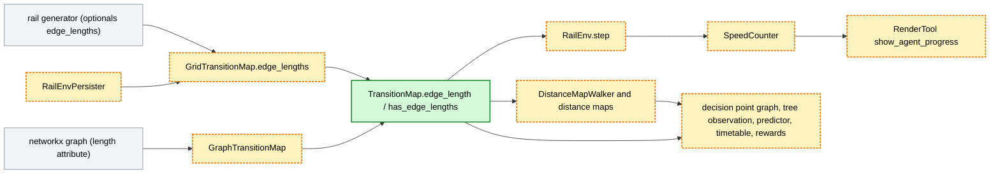
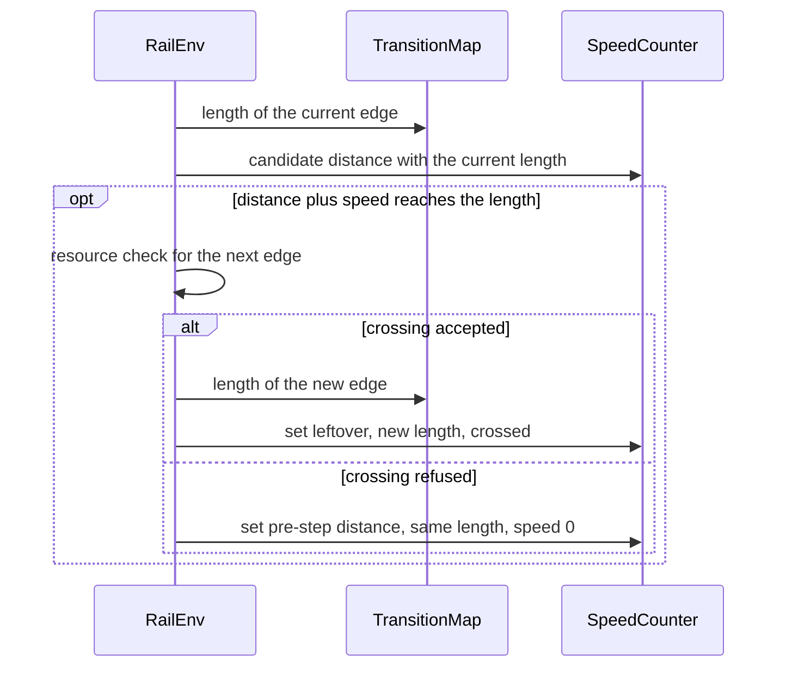

# Edges of different lengths in the grid and graph model (#526)

> **Status:** plan of 2026-11-13, built by 2026-11-11. Based on `main` 40ee6582 (with #545); `main` has moved on to
> 3e30f9ef (#566) since. Issue [#526](https://github.com/flatland-association/flatland-rl/issues/526) ("Introduce edge
> lengths."). Branch `526-edge-lengths`, PR [#542](https://github.com/flatland-association/flatland-rl/pull/542).
> Written after the implementation, from the branch, the PR description and its review threads. No open questions
> (§9.1). Findings: F-1–F-14, F-16 and F-17 fixed, F-15 taken over by a follow-up.
>
> **Why:** every edge between two consecutive entry points is one step long at full speed. Real track sections differ
> in length, so the time to pass them can't be modelled. With edge lengths, a long section takes longer to pass,
> and distances, timetables, observations and predictions follow.

## 1. Introduction and goals

*What the change is for: the requirements, the qualities that matter, who has a stake, and what it leaves out.*

### 1.1 Requirements overview (functional requirements)

*The issue's text and the numbered requirements the rest of the plan refers to.*

> Introduce edge lengths.

The issue's body is the empty issue template. The requirements below are taken from the PR description.

Requirements:

- **REQ-1** Every edge `(u, v)` between consecutive entry points can have a length, in the grid and in the graph
  model. Lengths are whole numbers or exact fractions of at least 1. Edges without a length have length 1.
- **REQ-2** An agent needs `edge_length / speed` steps to pass an edge. It crosses at most one edge boundary per step,
  and the leftover distance of a step carries into the next edge.
- **REQ-3** The consumers of distances use the lengths: distance map and shortest paths, decision point graph, tree
  observation, shortest path predictor, timetable generator and rewards (travel time on the shortest path).
- **REQ-4** Edge lengths are persisted with the env, loaded back, and copied from the grid to the graph model.
- **REQ-5** Without edge lengths, the env behaves as on `main`: same movement, timetables, rewards and
  observations; the regression episodes replay unchanged.
- **REQ-6** Rendering can show how far an agent has got along its edge.

### 1.2 Quality goals (non-functional requirements)

*The few qualities the design must reach, each with a concrete scenario.*

| ID | Priority | Quality goal | Scenario |
|---|---|---|---|
| NFR-1 | 1 | Reproducible | Three edges of length 11/10 sum to exactly 33/10, on every platform; a float length is rejected with `ValueError`. |
| NFR-2 | 2 | Compatible | An env without edge lengths replays the recorded regression episodes unchanged, and old pickles load with length 1. |
| NFR-3 | 3 | Grid and graph agree | A random grid env with random edge lengths and its `GraphRailEnv.from_rail_env` copy give the same positions and distances in every step. |
| NFR-4 | 4 | No slowdown without lengths | Without edge lengths, the distance map and the step stay on integer arithmetic; the CI profiling of the PR shows no regression. |

### 1.3 Stakeholders

*Who asks for the change, decides on it, reviews it or works with the result, and what they expect.*

| Role | Name | Expectations |
|---|---|---|
| Author, maintainer | chenkins | Edge lengths without changing the behaviour of existing envs. |
| Reviewer | CleverManu | Correct distances at edge boundaries; found the lost step of a refused crossing (F-13, F-14). |
| Users of the speed internals | `flatland-baselines`, custom env code | Know what breaks (§8.2). |
| flatland-book | maintainers | Take over the step contract and illustrate edge lengths (§1.4). |

### 1.4 Follow-ups (not in this PR)

*What this PR leaves out, why, and where it goes later.*

| Follow-up | Why not in this PR | From | Findings | Issue |
|---|---|---|---|---|
| Illustrate edge lengths for users. | The flatland-book illustrates them, not a notebook here (Q-7). | Q-7 | F-15 | [flatland-book#42](https://github.com/flatland-association/flatland-book/pull/42) |
| Option for `sparse_rail_generator` to generate edge lengths (e.g. longer edges on straight track between cities) into `optionals["edge_lengths"]`. | This PR adds edge lengths to the models and their consumers; generating them is a feature on top. Custom rail generators can already return them. | §4.3 | - | untracked |
| `EnvAgent.get_travel_time_on_shortest_path` divides the step onto the map by the agent's speed, so slow agents' cancellation and target-not-reached penalties are too high; opt-in flag, default unchanged. | Not related to edge lengths: the travel time is wrong without them too (Q-4). | Q-4 | - | [#544](https://github.com/flatland-association/flatland-rl/issues/544) |
| The flatland-book page "Design by Contract" takes over the changes of `design_by_contract.md` and `snippet.tex` from #545 and this PR. | Another repo (Q-6). | Q-6 | F-16 | [flatland-book#42 (comment)](https://github.com/flatland-association/flatland-book/pull/42#discussion_r4541978571) |
| Remove `design_by_contract.md` and `snippet.tex`, point their 13 references at the book page, and note in `AGENTS.md` that contract changes need a flatland-book PR. | Waits for the book page to be published with 5.0.0 (Q-6). | Q-6 | F-16 | [flatland-book#42 (comment)](https://github.com/flatland-association/flatland-book/pull/42#discussion_r4541978571) |

## 2. Constraints

*What limits the design from outside: platform, organisation and conventions.*

| ID | Constraint | Kind | Explanation |
|---|---|---|---|
| C-1 | Grid and graph are parallel implementations of one rail-network abstraction. | technical | `AGENTS.md`, "Grid and graph are parallel implementations": a feature goes into `flatland/core/` and both models. |
| C-2 | Speed and distance are `Fraction`s, `None` while off map. | technical | `AGENTS.md`, "Speed/distance are `Fraction`s": lengths must compose with them without floats. |
| C-3 | The `SpeedCounter` formulas are the single source of the accel/brake/crossing math. | technical | `step()` and its postconditions use the same formulas, so the length goes into the formulas, not next to them. |
| C-4 | `design_by_contract.md` is the contract of the collect phase until the book takes it over. | convention | Changes to the step's branches are written there first (Q-6). |
| C-5 | Generated timetables and rewards must not change for envs without edge lengths. | organisational | Benchmarks and regression episodes depend on them. |
| C-6 | A PR closing an issue leaves no TODO or comment referencing it. | convention | `AGENTS.md`, "Conventions". |

### 2.1 Limitations (`AGENTS.md`, "Edge lengths")

*What the built code gets wrong or ignores, each with the TODO or issue that tracks it.*

- Edge lengths are set once per `reset()`. Changing them afterwards does not update the distance map, the timetable or
  the on-map agents' `speed_counter.edge_length` (documented on `GridTransitionMap.edge_lengths`; no issue: by
  design, Q-1).
- Timetables are a heuristic: +1 per segment, the total divided by the speed, segment lengths rounded up to whole
  steps (documented in `timetable_generator`; Q-4).
- Rendering draws agents at whole cells; only the opt-in progress bar shows the position along a long edge (no
  issue).
- `sparse_rail_generator` generates no edge lengths (follow-up, untracked).

### 2.2 Assumptions

*What must hold for the design to be correct, but is not checked in code.*

Not checked in code; they hold by construction of `MIN_EDGE_LENGTH = MAX_SPEED` and of `validated_edge_length()`.

- No agent is faster than `MAX_SPEED` (1). Observations and `_pseudo_fractional` assume speeds of at most 1.
- Rail generators that return `optionals["edge_lengths"]` key them by edges of the rail they return (checked by the
  `edge_lengths` setter, which raises `ValueError` otherwise).
- Nothing changes the edge lengths between `reset()` and the end of the episode.

## 3. Context and scope (checked 2026-11-13 on `main` 40ee6582)

*The code on the base branch that the change works in, as it is before the change, and where the change stops.*

Context:

- `flatland/envs/step_utils/speed_counter.py`: `SEGMENT_LENGTH = Fraction(1)` is the length of every edge.
  `distance_after_crossing`, `distance_without_crossing` and `cached_cell_exit` use it. `SpeedCounter.set(speed,
  distance, crossed=False)` takes the cell entry from `crossed` (#545).
- `flatland/envs/rail_env.py`: the collect phase (`_candidate_entry_points`, `_candidate_speed`,
  `_candidate_distance`) and the distribute phase (resource check, then `SpeedCounter.set()`); pre- and
  postcondition checks use the same formulas. `design_by_contract.md` is their contract.
- `flatland/core/transition_map.py`: `TransitionMap` with `GridTransitionMap` and `GraphTransitionMap`
  (`flatland/envs/graph/rail_graph_transition_map.py`, aliases `GridNode = str`, `GridEdge = Tuple[str]`).
- Distance maps: `flatland/core/distance_map.py`, `distance_map_walker.py` (BFS over unit edges, `int` distances),
  `flatland/envs/grid/distance_map.py` (float numpy array), `flatland/envs/graph/distance_map.py`.
- Consumers: `graph_simplification.py` (decision point graph), `observations.py` (`TreeObsForRailEnv`),
  `predictions.py` (`ShortestPathPredictorForRailEnv`, `times_per_cell`), `timetable_generators.py`, rewards via
  `EnvAgent.get_travel_time_on_shortest_path`.
- Persistence: `persistence.py` (`RailEnvPersister`), rail generators' `rail_from_file`, and `SpeedCounter`'s
  `__getstate__`/`__setstate__`.
- Rendering: `rendertools.py`, `graphics_pil.py`, `graphics_layer.py`.

Scope: the change adds the length to the transition maps and passes it through the speed formulas and every distance
consumer. It does not change how agents choose actions, the resource check, or the line generators. What it leaves
out is in §1.4.

## 4. Solution strategy

*The fundamental choices and why, the rules the design follows, how it is verified, and the design of each part.*

| Quality goal | Scenario | Solution approach | Details |
|---|---|---|---|
| NFR-1 Reproducible | Lengths sum exactly. | `int` or `Fraction` only, floats rejected; exact grid distances (Q-2). | §4.3, §4.4 |
| NFR-2 Compatible | Regression episodes replay. | Default length 1, `has_edge_lengths()` fast paths, timetables rounded to whole steps (Q-4). | §4.4, §4.6 |
| NFR-3 Grid and graph agree | Parity test. | One `TransitionMap.edge_length(u, v)` for both models; `from_rail_env` copies the lengths. | §4.3 |
| NFR-4 No slowdown | CI profiling. | Integer BFS without edge lengths; graph lengths validated once. | §4.4 |

### 4.1 Design principles

*The rules the design follows, each with its decision, the concepts it reuses instead of building new ones, and what
is not new on purpose.*

- **DP-1 The rail owns the lengths.** Lengths live on the transition map, next to the topology they describe. They come
  from the rail generator (grid) or the graph's `length` attribute, not from the env's constructor. (Q-1)
- **DP-2 One accessor for every consumer.** Consumers ask `TransitionMap.edge_length(u, v)` and `has_edge_lengths()`;
  none reads the grid dict or the graph attribute directly. (Q-1)
- **DP-3 Exact numbers only.** Lengths are `int` or `Fraction`, floats are rejected where lengths come in. (Q-2)
- **DP-4 At most one boundary per step.** `MIN_EDGE_LENGTH = MAX_SPEED`, so a step's distance fits into the shortest
  edge. (Q-8)
- **DP-5 Explicit length, no silent default.** The speed formulas and `SpeedCounter.set()` take the edge length as an
  argument without default; off map it is `None`.
- **DP-6 Unit lengths reproduce `main`.** Without lengths, every path stays on integer arithmetic and the old
  algorithms. (Q-4)
- **DP-7 The caller decides the crossing.** `SpeedCounter.set()` gets `crossed` from `RailEnv.step()`, as on `main`
  after #545; a refused crossing keeps the distance on the same edge. (Q-5)

Reused concepts:

| Need | Reused concept | Instead of |
|---|---|---|
| Hand lengths from generation to the env | Rail generator `optionals` (as `distance_map`) | A `RailEnv(edge_lengths=...)` constructor argument |
| Lengths in the graph model | networkx edge attribute `length` | A separate length table |
| Weighted distances | `DistanceMapWalker`'s backward BFS, made label-correcting | A second walker with Dijkstra and a heap |
| Exact arithmetic | `Fraction`, as speed and distance | Floats with tolerances |
| Persistence | `RailEnvPersister`'s msgpack dict, a new key | A new file format |
| Valid edges | The edges of `GraphTransitionMap.grid_to_digraph` (`has_edge`) | A new edge enumeration |

Not new on purpose: the `RailEnv` constructor and `DistanceMap.reset()` signatures, the line generators, the resource
check, the observation shapes, the timetable heuristic.

### 4.2 Verification

*How each requirement and quality goal is shown to work: tests, CI checks, before and after screenshots.*

Screenshots: none; the only visible change is the opt-in progress bar, checked by a rendering test.

| ID | Requirement | Test or check | Result | Screenshots |
|---|---|---|---|---|
| REQ-1 | Lengths per edge, ≥ 1, int or Fraction | `test_edge_lengths_default_and_validation`, `test_edge_lengths_reject_non_edges`, `test_validated_edge_length_*`, `test_graph_edge_length_attribute` | ✅ | - |
| REQ-2 | `edge_length / speed` steps, one boundary per step | `test_long_edge_takes_longer`, `test_long_edge_overshoot_carried_into_next_edge`, `test_distance_after_crossing`, `test_speed_counter_is_cell_entry_*` | ✅ | - |
| REQ-3 | Consumers use the lengths | `test_grid_distance_map_sums_edge_lengths`, `test_weighted_walk_*`, `test_decision_point_graph_edge_length`, `test_tree_obs_distances_sum_edge_lengths`, `test_shortest_path_predictor_*`, `test_travel_time_on_shortest_path_with_edge_lengths`, `test_timetable_*` | ✅ | - |
| REQ-4 | Persisted, loaded, copied to the graph | `test_edge_lengths_persisted`, `test_speed_counter_pickle_round_trip`, `test_speed_counter_old_pickle_defaults_to_unit_edge_length`, `test_grid_graph_parity_with_edge_lengths` | ✅ | - |
| REQ-5 | Unchanged without lengths | regression episodes (`tests/test_flatland_regression_episodes.py`), `test_weighted_walk_with_unit_lengths_matches_bfs`, the existing test suite | ✅ | - |
| REQ-6 | Agent progress rendering | `test_render_agent_progress` | ✅ | - |
| NFR-1 | Reproducible | `test_grid_distance_map_sums_edge_lengths` (3 × 11/10), `test_validated_edge_length_rejects_non_int_or_fraction` | ✅ | - |
| NFR-2 | Compatible | regression episodes, old pickle test | ✅ | - |
| NFR-3 | Grid and graph agree | `test_grid_graph_parity_with_edge_lengths`, `test_grid_has_edge_matches_graph_edges`, `tests/flatland/envs/graph/test_graph_rail_env.py` | ✅ | - |
| NFR-4 | No slowdown | CI profiling comments on the PR | ✅ | - |

All tests named here are in `tests/test_flatland_edge_lengths.py` unless a path is given.

### 4.3 Lengths on the transition map (REQ-1, REQ-4; Q-1, Q-2, Q-3, Q-8)

- `flatland/core/transition_map.py` defines `EdgeLength`, `Distance`, `DEFAULT_EDGE_LENGTH = 1`, `MAX_SPEED = 1`,
  `MIN_EDGE_LENGTH = MAX_SPEED`, `validated_edge_length()`, and `TransitionMap.edge_length(u, v)` /
  `has_edge_lengths()` (default 1 and `False`).
- Grid: `GridTransitionMap.edge_lengths` (`{(u, v): length}`, keys `GridEdge`); the setter checks `has_edge(u, v)` and
  validates each length. `RailEnv.reset()` sets it from the rail generator's `optionals["edge_lengths"]`.
- Graph: `GraphTransitionMap` reads and validates the `length` edge attributes once on construction; the attribute is
  optional (Q-3). Its aliases are renamed to `GraphNode` / `GraphEdge`. `GraphRailEnv.from_rail_env` copies the grid
  lengths.
- Persistence: `(u, v, length)` triples under `edge_lengths` in the env dict; `rail_from_file` returns them as
  optionals. `SpeedCounter` persists its `edge_length`; old pickles get 1.

### 4.4 Distances (REQ-3; Q-2, Q-4)

- `DistanceMapWalker` walks backward from each target with a label-correcting BFS: an entry point is queued again when
  a shorter distance over `edge_length(u, v)` is found. Without lengths it is a plain BFS with `int` distances.
- The grid distance map is an object array of exact `int` / `Fraction` with lengths, a float array as before without.
  `shortest_path_length()` is the sum of edge lengths plus 1, reproducing `len(shortest_path)`.
- Decision point graph edges sum the collapsed edge lengths; the tree observation's distances are sums of edge
  lengths; the shortest path predictor stays `edge_length / speed` steps per edge, carrying overshoot.
- Timetables round segment lengths up to whole steps; the heuristic stays (Q-4).

### 4.5 Speed and crossing (REQ-2; Q-5, Q-8)

- `SEGMENT_LENGTH` is gone. `distance_after_crossing`, `distance_without_crossing` and `cached_cell_exit` take the
  edge length; the leftover after a crossing wraps by `% MAX_SPEED`.
- `SpeedCounter.set(speed, distance, edge_length, crossed=False)` tracks the edge length (`None` off map).
- `rail_env.py` passes the new edge's length for an accepted candidate. A refused crossing keeps the pre-step distance
  and edge length, with speed 0 (Q-5). `AgentTransitionData.edge_length` keeps the pre-step length for that branch.
- `design_by_contract.md` shows the edge length in the formulas, `cell_exit` and `set()`.

### 4.6 Rendering (REQ-6)

- `RenderTool(show_agent_progress=True)` (PILSVG and PGL renderers) draws a bar at the bottom of each on-map agent's
  cell: `speed_counter.distance / speed_counter.edge_length`.

## 5. Building block view

*The components the change adds or changes: an overview, why the system is split this way, what each is responsible
for, the important interfaces, and the planned data model.*

### 5.1 Edge lengths from generation to the consumers

*One white box: its building blocks, why it is split this way, and the interfaces between them.*

Notation: [flowchart in Mermaid](https://mermaid.js.org/syntax/flowchart.html); green added, yellow modified, grey
unchanged. Arrows point from the provider of the lengths to the code that reads them.

**Motivation:** the lengths belong to the rail (DP-1), so both models keep them on their transition map, and every
consumer reads them through one accessor (DP-2). The speed counter only holds the length of the agent's current edge,
as it holds its distance on it.

**Contained building blocks:**

| Component | Responsibility | Change |
|---|---|---|
| `TransitionMap` | The rail topology of both models. Not for agent state or distances. | 🟨 modified: answers how long each edge is (1 unless given). |
| `GridTransitionMap` | The grid's topology. Not for computing distances. | 🟨 modified: holds the grid's edge lengths and rejects lengths for edges that don't exist. |
| `GraphTransitionMap` | The graph's topology. Not for computing distances. | 🟨 modified: reads the graph's optional `length` attributes. |
| `RailEnvPersister` | Saves and loads envs. Not for validating rails. | 🟨 modified: saved envs keep their edge lengths. |
| `SpeedCounter` | An agent's speed and distance on its current edge. Not for deciding whether a crossing is allowed. | 🟨 modified: an agent needs longer on a long edge. |
| `RailEnv` | Steps the agents. Not for storing the lengths. | 🟨 modified: moves agents along edges of any length. |
| `DistanceMapWalker` and distance maps | Distances from every entry point to the targets. Not for choosing paths. | 🟨 modified: distances are sums of edge lengths. |
| Decision point graph, tree observation, shortest path predictor, timetable generator, rewards | Read distances. Not for computing them. | 🟨 modified: observations, predictions and timetables follow the lengths. |
| `RenderTool` | Draws the env. Not for game logic. | 🟨 modified: can show how far an agent is along its edge. |

**Important interfaces:**

- `TransitionMap.edge_length(u, v) -> EdgeLength` and `has_edge_lengths() -> bool`, called by `RailEnv`, the
  distance map walker, the decision point graph, the tree observation and the predictor.
- Rail generator return value: `optionals["edge_lengths"] = {(u, v): length}`, read by `RailEnv.reset()`.
- `SpeedCounter.set(speed, distance, edge_length, crossed=False)`, called by `RailEnv.step()`, the loaders and tests.

## 6. Runtime view

*How the components work together at runtime: the flows and modes the change adds or changes, when it changes behaviour.*

### 6.1 A step on an edge of length L (REQ-2; Q-5)

*One flow or mode, as a sequence or state diagram.*

Notation: [sequence diagram in Mermaid](https://mermaid.js.org/syntax/sequenceDiagram.html).

Without a crossing, the agent's distance grows by its speed and the edge length stays.

## 8. Crosscutting concepts

*What the change introduces that other code will follow, and what it changes for existing callers.*

### 8.1 New patterns

*What is new compared with the base branch.*

Compared with `main` 40ee6582. What is reused, and what is not new on purpose, is in §4.1.

| ID | New | Defined in |
|---|---|---|
| PAT-1 | Edge lengths as an optional rail generator output (`optionals["edge_lengths"]`). | §4.3, Q-1 |
| PAT-2 | `TransitionMap.edge_length(u, v)` / `has_edge_lengths()` as the only way to read lengths. | §4.3, DP-2 |
| PAT-3 | `EdgeLength` / `Distance` types and `validated_edge_length()`; floats rejected. | §4.3, Q-2 |
| PAT-4 | Label-correcting backward BFS for weighted distances. | §4.4 |
| PAT-5 | Exact object-array grid distance map with edge lengths. | §4.4, Q-2 |
| PAT-6 | `MAX_SPEED` / `MIN_EDGE_LENGTH` speed limit. | §4.5, Q-8 |

### 8.2 Breaking changes

*What breaks for whom, and the migration path.*

None for envs without edge lengths: `RailEnv(...)` keeps its signature and defaults, and behaviour, timetables and
rewards stay as on `main` (NFR-2). Breaking for code using the speed and distance internals (`flatland-baselines`
mentions `SEGMENT_LENGTH` only in test comments):

- **`SEGMENT_LENGTH` removed** from `speed_counter.py`. Migration: `DEFAULT_EDGE_LENGTH` or `MAX_SPEED` from
  `flatland.core.transition_map`.
- **Speed formulas need the edge length:** `distance_after_crossing`, `distance_without_crossing`, `cached_cell_exit`
  and `SpeedCounter.set()` take `edge_length` without default. Migration: pass
  `rail.edge_length(current, next)`, `DEFAULT_EDGE_LENGTH`, or `None` off map.
- **Distances can be `Fraction`s:** distance map values, `shortest_path_length()` and the decision point graph's
  lengths. With edge lengths, the grid distance map is an object array; code doing numeric array operations converts it
  first. Timetable entries stay whole steps.
- **Graph aliases renamed:** `rail_graph_transition_map.GridNode` / `GridEdge` are now `GraphNode` / `GraphEdge`;
  `GridNode` / `GridEdge` in `flatland.core.transition_map` now mean grid entry points and edges. Migration: rename
  the imports.

## 9. Decisions

*The decisions behind the plan: the questions still open, the decisions taken, and how each review finding was settled.*

### 9.1 Open questions

*Choices not made yet, each with its options and a proposal.*

✅ ~~**(Q-1) Where do the lengths come from: the `RailEnv` constructor, or the rail?**~~ **Decided 2026-10-20:** from
the rail generator's optionals (grid) and the graph's `length` attribute, stored on the transition map (F-1).

✅ ~~**(Q-2) Which number types are allowed for lengths?**~~ **Decided 2026-10-21:** `int` and `Fraction` only, floats
rejected; grid distances exact (F-3).

✅ ~~**(Q-3) Is the graph's `length` edge attribute required?**~~ **Decided 2026-10-21:** optional, default 1, as a
documented design decision (F-9).

✅ ~~**(Q-4) Fix the timetable's travel time heuristic, or keep it?**~~ **Decided 2026-10-21:** keep it, rounding
segment lengths up to whole steps; the rewards' travel time goes to #544.

✅ ~~**(Q-5) How do #545's refused crossings combine with edge lengths?**~~ **Decided 2026-11-11:** keep #545's
behaviour on edges of any length: a refused crossing keeps the distance on the same edge, `set()` gets `crossed`
(F-13, F-14).

✅ ~~**(Q-6) Where is the step contract kept: `design_by_contract.md` here, the flatland-book page, or both?**~~
**Decided 2026-11-11:** a), the flatland-book page becomes the single source; this PR updates the file, the book takes
it over, a later PR removes it (F-16). Both follow-ups are tracked in [flatland-book#42 (comment)](https://github.com/flatland-association/flatland-book/pull/42#discussion_r4541978571), no issue.

✅ ~~**(Q-7) Illustrate edge lengths in the graph notebook?**~~ **Decided 2026-11-11:** no, the flatland-book
illustrates them (F-15).

✅ ~~**(Q-8) How short may an edge be?**~~ **Decided 2026-10-21:** at least `MAX_SPEED` (1), so an agent crosses at
most one boundary per step and the leftover wraps by `% MAX_SPEED` (F-5, F-6).

### 9.2 Decision log

*Every decision by date, with why it was taken and what follows from it.*

| Date | Decision | Why | Consequences |
|---|---|---|---|
| 2026-10-20 | ✅ Q-1: lengths from the rail generator, stored on the transition map. | They describe the rail; a constructor argument would bypass generators and persistence. | `RailEnv` and `DistanceMap.reset()` keep their signatures; all consumers use `edge_length()` (S-7). |
| 2026-10-21 | ✅ Q-2: `int` / `Fraction` only. | Floats make results platform- and order-dependent. | `validated_edge_length()`, exact grid distance map (S-19–S-21); breaking for numeric array code (§8.2). |
| 2026-10-21 | ✅ Q-3: graph `length` optional. | Existing graphs keep working. | Default 1 (S-23). |
| 2026-10-21 | ✅ Q-4: keep the timetable heuristic. | Changing it changes every generated timetable. | Rounded segment lengths (S-13); #544 for rewards. |
| 2026-10-21 | ✅ Q-8: `MIN_EDGE_LENGTH = MAX_SPEED`. | At most one boundary per step keeps the step's one-crossing logic. | `% MAX_SPEED` wrap (S-22). |
| 2026-11-11 | ✅ Q-5: #545 extended to edge lengths. | #545 fixed the lost step of a refused crossing that the reviewer found here. | Merge 52ffcc2e; `set()` takes `crossed`. |
| 2026-11-11 | ✅ Q-6: the book holds the contract. | Two copies drift (#545 already had to correct Table 4a). | S-28 here; book take-over and removal are follow-ups. |
| 2026-11-11 | ✅ Q-7: illustration in the book. | The book is the user documentation. | Follow-up with flatland-book#42. |

### 9.3 Code Review Findings

*Findings from code reviews, PR comments and TODOs, with their status and the commits that fix them.*

PR [#542](https://github.com/flatland-association/flatland-rl/pull/542), branch based on `main` 40ee6582. All findings
come from PR review threads (F-1–F-17), added between 2026-10-19 and 2026-11-13. Their line numbers refer to the commit
each comment was made on, named in the finding (66615a0 is a commit from before a rebase). The PR adds no TODOs, and
no code review findings were recorded. ✅ in Fixed marks a finding fixed on the branch, ⏭️ one taken over by a
follow-up (§1.4), `⚠️` one resolved on GitHub without a code change and without a reason, and ❌ next to ✅ one fixed
in the code whose PR comment is not resolved on GitHub yet. "resolved" in Source marks threads resolved on GitHub.

| Fixed | ID | Source | Category | Severity | Finding | Commit message |
|---|---|---|---|---|---|---|
| ✅ | F-1 | [PR comment](https://github.com/flatland-association/flatland-rl/pull/542#discussion_r4315744031), resolved | design | high | `flatland/core/distance_map.py:70` (66615a0): edge lengths passed to `DistanceMap.reset()` are bad design; they should come from the rail generator. Fixed in 125c9b15: rail generator `optionals["edge_lengths"]`, stored on the transition map. | refactor(env): edge lengths from rail generator optionals, stored on the transition map. |
| ✅ | F-2 | [PR comment](https://github.com/flatland-association/flatland-rl/pull/542#discussion_r4322646194), resolved | design | medium | `flatland/core/distance_map.py:192` (66615a0): why is `edge_length` optional in the shortest path reconstruction? Fixed in 125c9b15, f1b02e31: all code reads `rail.edge_length()`, one walk for unit and weighted lengths. | refactor(distance map): unify unit and weighted distance map walk on a label-correcting backward BFS (#526) |
| ✅ | F-3 | [PR comment](https://github.com/flatland-association/flatland-rl/pull/542#discussion_r4322667036), resolved | correctness | high | `flatland/core/distance_map.py:279` (66615a0): float lengths and distances risk non-reproducible results. Fixed in 041171db, e83fd617, 560d1397: `EdgeLength` / `Distance` types, floats rejected, exact grid distances. | fix(edge lengths): reject float edge lengths and keep int lengths as int. |
| ✅ | F-4 | [PR comment](https://github.com/flatland-association/flatland-rl/pull/542#discussion_r4322682508), resolved | docs | low | `flatland/core/distance_map_walker.py:92` (66615a0): suggested docstring wording "the minimum sum of edge lengths to reach the target". Fixed in f1b02e31. | refactor(distance map): unify unit and weighted distance map walk on a label-correcting backward BFS (#526) |
| ✅ | F-5 | [PR comment](https://github.com/flatland-association/flatland-rl/pull/542#discussion_r4335334660), resolved | correctness | medium | `flatland/envs/step_utils/speed_counter.py:222` (6008a6d6): the wrap `(distance + pre_speed - edge_length) % 1` in `distance_after_crossing` is dodgy. Fixed in c029683f, f45babb4: the leftover wraps by `% MAX_SPEED`, speed is defined as distance per step. | refactor(speed counter): wrap the leftover after crossing an edge by MAX_SPEED. |
| ✅ | F-6 | [PR comment](https://github.com/flatland-association/flatland-rl/pull/542#discussion_r4335362683), resolved | docs | low | `flatland/envs/step_utils/speed_counter.py:230` (6008a6d6): the docstring's "never returns exactly the new edge's length, modulo in [0, 1)" is dodgy as well. Fixed in c029683f: the docstring says when the modulo changes the leftover. | refactor(speed counter): wrap the leftover after crossing an edge by MAX_SPEED. |
| ✅ | F-7 | [PR comment](https://github.com/flatland-association/flatland-rl/pull/542#discussion_r4335373398), resolved | docs | low | `flatland/envs/step_utils/speed_counter.py:249` (6008a6d6): "None (off map) in, None out" is unclear. Fixed in 1385f2d4: the formulas name the argument that is `None` off map. | docs(speed counter): say which argument is None off map in the speed and distance formulas. |
| ✅ | F-8 | [PR comment](https://github.com/flatland-association/flatland-rl/pull/542#discussion_r4335396919), resolved | design | medium | `flatland/envs/step_utils/speed_counter.py:357` (6008a6d6): drop `_pseudo_fractional` for a loaded edge length, and persist the full length dict rather than one length. Fixed in 125c9b15, e83fd617: lengths persisted with the rail, loaded lengths validated by `validated_edge_length()`. | fix(edge lengths): reject float edge lengths and keep int lengths as int. |
| ✅ | F-9 | [PR comment](https://github.com/flatland-association/flatland-rl/pull/542#discussion_r4335422536), resolved | docs | low | `flatland/envs/graph_rail_env.py:89` (6008a6d6): highlight not enforcing the `length` attribute as a design decision. Fixed in 8ebc3038. | docs(graph): document optional length edge attribute as design decision. |
| ✅ | F-10 | [PR comment](https://github.com/flatland-association/flatland-rl/pull/542#discussion_r4335444019), resolved | correctness | medium | `flatland/envs/observations.py:255` (01703142): enforce int or Fraction, no float edge lengths. Fixed in e83fd617. | fix(edge lengths): reject float edge lengths and keep int lengths as int. |
| ✅ | F-11 | [PR comment](https://github.com/flatland-association/flatland-rl/pull/542#discussion_r4335483226), resolved | correctness | medium | `flatland/envs/predictions.py:166` (01703142): `steps_on_edge` is never reset to 0. It is carried over on purpose, as the env carries the leftover distance. Fixed in 90e4b4f8: comment, and a test comparing the predictor with the env on fractional lengths. | docs(predictions): explain carried-over steps in the shortest path predictor. |
| ✅ | F-12 | [PR comment](https://github.com/flatland-association/flatland-rl/pull/542#discussion_r4335501786), resolved | docs | low | `flatland/envs/rail_env.py:940` (01703142): suggested comment wording for the `SpeedCounter` contract check. Fixed in 95d32e72, which also checks the edge length off map. | refactor(env): check edge length off map in the SpeedCounter contract invariant. |
| ✅ | F-13 | [PR comment](https://github.com/flatland-association/flatland-rl/pull/542#discussion_r4364079744), resolved | bug | high | `flatland/envs/step_utils/speed_counter.py:237` (be8cd305): an agent waiting at the exit of its edge loses a step when it crosses. Not related to edge lengths; fixed on `main` by #545. Fixed in 52ffcc2e: merged, and extended to edge lengths. | Merge main into 526-edge-lengths: denied crossings keep the distance (#545). |
| ✅ | F-14 | [PR comment](https://github.com/flatland-association/flatland-rl/pull/542#discussion_r4364127389), resolved | bug | high | `flatland/envs/step_utils/speed_counter.py:249` (be8cd305): with `distance == edge_length` (crossing prevented) and `pre_speed == MAX_SPEED`, the next distance is 0, not `MAX_SPEED`. Same cause as F-13. Fixed in 52ffcc2e: a refused crossing keeps the pre-step distance. | Merge main into 526-edge-lengths: denied crossings keep the distance (#545). |
| ✅ | F-16 | [PR comment](https://github.com/flatland-association/flatland-rl/pull/542#discussion_r4470281894), resolved | docs | medium | `design_by_contract.md:1` (be8cd305): the step contract is kept twice, here and in the flatland-book page. Decided a) (Q-6). Fixed in 7549edf7 for this PR's part: the file shows the edge lengths. The book's take-over and the removal of the file are follow-ups (§1.4). | docs(design-by-contract): pass the edge length in the signatures of the distance formulas and cell_exit. |
| ✅ ❌ | F-17 | [PR comment](https://github.com/flatland-association/flatland-rl/pull/542#discussion_r4561357863) | docs | low | `flatland/envs/step_utils/speed_counter.py:148` (52ffcc2e): explains why `set()` needs `crossed` since #545. No change asked for. `set()`'s design comment says the same, but `AGENTS.md`, "Edge lengths", named `SpeedCounter.set(speed, distance, edge_length)` without `crossed`. Fixed in 8f1247b6 (S-29): `AGENTS.md` names `crossed` and why the caller passes it. | docs(agents): name the crossed flag of SpeedCounter.set(). |
| ⏭️ | F-15 | [PR comment](https://github.com/flatland-association/flatland-rl/pull/542#discussion_r4410693260), resolved | docs | low | `flatland/envs/step_utils/speed_counter.py:8` (be8cd305): illustrate edge lengths in the graph notebook. Taken over by the flatland-book (Q-7, chenkins, 2026-11-11), see §1.4. | docs: illustrate edge lengths. |

Issue references: the PR closes [#526](https://github.com/flatland-association/flatland-rl/issues/526). No TODO or
comment in the `main..HEAD` diff references it (the `(#526)` in commit subjects is not code).

## 10. Glossary

*The domain and technical words the plan uses, with their code symbols.*

| Term (code) | Meaning, and what it is not |
|---|---|
| Entry point (`GridNode`, `GraphNode`) | A network position: `((row, col), direction)` in the grid, a node id in the graph. Not a cell. |
| Edge (`GridEdge`, `GraphEdge`) | The pair `(u, v)` of an entry point and its successor; an agent on the map is on the edge (current entry point, next entry point). |
| Edge length (`EdgeLength`, `edge_length(u, v)`) | How far an agent travels on an edge before it crosses into the next; `int` or `Fraction`, at least `MIN_EDGE_LENGTH`. Not a number of cells. |
| Distance (`Distance`, `speed_counter.distance`) | A sum of edge lengths (distance map), or how far an agent is along its edge (speed counter). |
| Speed | Distance per step, at most `MAX_SPEED`; `1 / speed` steps pass an edge of length 1. Not steps per cell. |
| Crossing (`crossed`) | Moving from one edge into the next in a step; refused by an invalid action or the resource check. |
| Leftover | The distance a crossing step carries into the new edge, wrapped by `% MAX_SPEED`. |

## 11. Execution plan and status

*The commits that build the change, in order, and which of them are done: the source of the PR's status.*

### 11.1 Steps

*One row per commit: what it does, the findings it fixes, its message, and its SHAs once committed.*

| ID | Findings | Step | Category | Severity | Commit message | Commit(s) | Needs | Blocked by |
|---|---|---|---|---|---|---|---|---|
| ✅ S-1 | - | Edge lengths in grid and graph model; speed formulas take the length; `SpeedCounter` tracks and persists it. | feature | high | feat(env): allow for different edge lengths in grid and graph model (#526) | 9883bd94 | - | - |
| ✅ S-2 | - | Distance map and decision point graph use edge lengths; `shortest_path_length()`. | feature | high | feat(distance map): take edge lengths into account in distance map and decision point graph (#526) | 2ba8b926 | S-1 | - |
| ✅ S-3 | - | Tree observation and shortest path predictor use edge lengths. | feature | medium | feat(observations): take edge lengths into account in tree observation and shortest path predictor (#526) | 1df0ff19 | S-2 | - |
| ✅ S-4 | - | Opt-in agent progress rendering. | feature | low | feat(rendering): show agent progress along edges with non-unit lengths (#526) | aacca4a6 | S-1 | - |
| ✅ S-5 | F-2, F-4 | One label-correcting backward BFS for unit and weighted lengths. | refactor | medium | refactor(distance map): unify unit and weighted distance map walk on a label-correcting backward BFS (#526) | f1b02e31 | S-2 | - |
| ✅ S-6 | - | Test that actions are partitioned between prohibited actions and outgoing edges; docstring fix. | test, docs | low | test(graph): verify actions are partitioned between prohibited actions and outgoing edges | 58b010f1, f013db84 | S-1 | - |
| ✅ S-7 | F-1, F-2, F-8 | Lengths from rail generator optionals, stored on the transition map; persisted with the rail. | refactor | high | refactor(env): edge lengths from rail generator optionals, stored on the transition map | 125c9b15 | S-5 | - |
| ✅ S-8 | - | Type hints, constants next to `TransitionMap`, `GridNode` / `GridEdge` aliases (graph's renamed), unreachable guard dropped. | refactor, style | low | style: add and correct type hints for edge length code | 9654b0a7, 8df56d44, 28ffa496, 6e92aa1c | S-7 | - |
| ✅ S-9 | - | `SpeedCounter.set()` requires `edge_length`. | refactor | low | refactor(speed counter): make edge_length explicit in SpeedCounter.set | d2302d84 | S-8 | - |
| ✅ S-10 | - | Reject lengths for non-existent edges (`has_edge`). | fix | medium | fix(transition map): reject edge lengths for non-existent edges | 20320dcd | S-7 | - |
| ✅ S-11 | - | Document the set-once workflow of edge lengths. | docs | low | docs(transition map): document edge lengths workflow and distance map reset after changing them | a6f076c4 | S-7 | - |
| ✅ S-12 | - | Graph lengths validated once on construction. | perf | low | perf(graph): validate graph edge lengths once and cache has_edge_lengths | 5148dc6a, f8c09922 | S-7 | - |
| ✅ S-13 | - | Timetable entries stay whole steps. | fix, test | high | fix(timetable): keep timetable entries whole steps with edge lengths | 3c3ffda0, 923113b2 | S-2 | - |
| ✅ S-14 | - | Explain the +1 of `shortest_path_length()` and the timetable heuristic. | docs | low | docs(distance map): explain the +1 in shortest_path_length | 545f544b, 144f6f84 | S-13 | - |
| ✅ S-15 | - | `AGENTS.md`: edge lengths and issue reference conventions. | docs | low | docs(agents): document edge lengths and issue reference conventions. | 6008a6d6 | S-13 | - |
| ✅ S-16 | - | Comment on per-walk distances. | docs | low | docs(distance map): simplify comment on per-walk distances. | 14373420 | S-5 | - |
| ✅ S-17 | - | `AGENTS.md`: simple syntax in comments and docs. | docs | low | docs(agents): prefer simple syntax in comments and docs. | 01703142 | - | - |
| ✅ S-18 | - | `_walk_to_target` returns its per-walk distances. | refactor | low | refactor(distance map): return per-walk distances from _walk_to_target and convert at the caller. | 2b3ea453 | S-5 | - |
| ✅ S-19 | F-3 | `EdgeLength` and `Distance` type aliases. | refactor | low | refactor(edge lengths): add EdgeLength and Distance type aliases. | 041171db | S-8 | - |
| ✅ S-20 | F-3, F-8, F-10 | Reject float lengths, keep int lengths `int`. | fix | high | fix(edge lengths): reject float edge lengths and keep int lengths as int. | e83fd617 | S-19 | - |
| ✅ S-21 | F-3 | Exact grid distances, `_exact_fraction` dropped. | refactor | high | refactor(distance map): keep grid distances exact and drop _exact_fraction. | 560d1397 | S-20 | - |
| ✅ S-22 | F-5, F-6 | `MAX_SPEED` / `MIN_EDGE_LENGTH`, leftover wraps by `% MAX_SPEED`, speed defined. | refactor, docs | low | refactor(speed counter): wrap the leftover after crossing an edge by MAX_SPEED. | c029683f, f45babb4 | S-19 | - |
| ✅ S-23 | F-7, F-9, F-11 | Docs: `None` arguments off map, optional graph `length`, predictor's carried-over steps with a test. | docs, test | low | docs(speed counter): say which argument is None off map in the speed and distance formulas. | 1385f2d4, 8ebc3038, 90e4b4f8 | S-22 | - |
| ✅ S-24 | F-12 | Contract invariant checks the edge length off map. | refactor | low | refactor(env): check edge length off map in the SpeedCounter contract invariant. | 95d32e72 | S-9 | - |
| ✅ S-25 | - | `AGENTS.md` corrections. | docs | low | docs(agents): Python 3.11-3.14 in the tox matrix notes. | e7533397, 98e2f93c, 2d425979, 14b204e5, d78b7d16, 82504507 | S-15 | - |
| ✅ S-26 | - | Graph distance map values typed as `Distance`. | style | low | style(graph): type graph distance map values as Distance. | be8cd305 | S-19 | - |
| ✅ S-27 | F-13, F-14 | Merge `main` with #545; refused crossings keep the distance on edges of any length. | merge | high | Merge main into 526-edge-lengths: denied crossings keep the distance (#545). | 52ffcc2e | S-26 | - |
| ✅ S-28 | F-16 | `design_by_contract.md` shows the edge length in the formulas and `cell_exit`. | docs | low | docs(design-by-contract): pass the edge length in the signatures of the distance formulas and cell_exit. | 7549edf7 | S-27 | - |
| ✅ S-29 | F-17 | `AGENTS.md`, "Edge lengths": name `SpeedCounter.set(speed, distance, edge_length, crossed)` and say that the caller passes the crossing. | docs | low | docs(agents): name the crossed flag of SpeedCounter.set(). | 8f1247b6 | S-27 | - |

### 11.2 Rebase and merge

*How the branch is rebased or merged when it builds on other open PRs, and the known conflicts.*

- The branch merged `main` 40ee6582 (with #545) in 52ffcc2e; its message lists the resolved conflicts
  (`speed_counter.py`, `rail_env.py`, `design_by_contract.md`, tests).
- `main` is at 3e30f9ef (#566, malfunction reproducibility) since. Before merging the PR, bring the branch up to date
  again; #566 touches malfunction generation, not the files of the speed and distance code.

## 12. Change inventory

*Every file the change adds, modifies, renames or removes, and what stays unchanged on purpose.*

### 12.1 New files

*The files the change adds, and what each adds.*

| File | Adds |
|---|---|
| `tests/test_flatland_edge_lengths.py` | Tests of the formulas, validation, persistence, parity, distances, observations, predictor, timetable, rewards and rendering with edge lengths. |
| `docs/plans/edge-lengths.md` | This plan. |

### 12.2 Modified files

*The files the change modifies, and what changes in each.*

| File | Changes |
|---|---|
| `flatland/core/transition_map.py` | `EdgeLength`, `Distance`, `GridNode`, `GridEdge`, constants, `validated_edge_length()`, `edge_length()`, `has_edge_lengths()`, `GridTransitionMap.edge_lengths` and `has_edge()`. |
| `flatland/core/distance_map.py`, `distance_map_walker.py`, `entry_point_distance_map.py` | Label-correcting walk over edge lengths, `shortest_path_length()`, exact distances. |
| `flatland/envs/grid/distance_map.py`, `flatland/envs/graph/distance_map.py` | Object array of exact distances with lengths; `Distance` values. |
| `flatland/envs/graph/rail_graph_transition_map.py`, `graph_rail_env.py`, `graph_simplification.py`, `graph_rendering.py` | `length` attribute, `GraphNode` / `GraphEdge`, lengths copied from the grid, decision point graph lengths. |
| `flatland/envs/step_utils/speed_counter.py`, `env_utils.py`, `agent_utils.py` | Formulas and `set()` take the edge length; `SEGMENT_LENGTH` removed; persisted length. |
| `flatland/envs/rail_env.py`, `rail_generators.py`, `persistence.py` | Lengths from optionals; passed to the speed counter; persisted. |
| `flatland/envs/observations.py`, `predictions.py`, `timetable_generators.py`, `rail_env_shortest_paths.py` | Consumers use the lengths. |
| `flatland/utils/rendertools.py`, `graphics_pil.py`, `graphics_layer.py` | `show_agent_progress`. |
| `AGENTS.md`, `design_by_contract.md` | Edge lengths documented. |
| `tests/` (8 files) | Existing tests pass the edge length. |

Unchanged on purpose: the `RailEnv` constructor, `DistanceMap.reset()`, line generators, the resource check, observation
shapes, the persisted format of envs without lengths.
