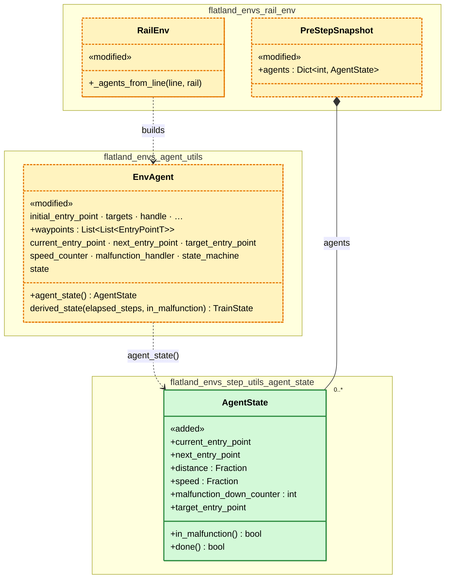

# Extract the agent state and make `EnvAgent` generic (#549, #527)

> **Status:** plan of 2026-11-12, revised 2026-11-13, draft. Based on `main` 8a4261a5. Issues
> [#549](https://github.com/flatland-association/flatland-rl/issues/549) ("Extract agent state.", chenkins, scope
> extended 2026-11-04) and [#527](https://github.com/flatland-association/flatland-rl/issues/527) ("Make `EnvAgent`
> generic.", chenkins). Branch `549-extract-agent-state`, PR
> [#571](https://github.com/flatland-association/flatland-rl/pull/571). Open questions: none (§9.1).
>
> **Why:** the flatland-book models an agent as static data (route, timetable, max speed) plus an *agent state*
> (entry points, distance, speed, malfunction, done), but the code has no such concept: the state is spread over
> `EnvAgent`'s attributes, "configuration" still names it in comments, and `agent.state` (the `TrainState`) is
> silently wrong in two cases. `EnvAgent` also still carries grid-only types (`Waypoint`, `Grid4TransitionsEnum`)
> although `GraphRailEnv` uses it with string entry points.

## 1. Introduction and goals

*What the change is for: the requirements, the qualities that matter, who has a stake, and what it leaves out.*

### 1.1 Requirements overview (functional requirements)

*The issue's text and the numbered requirements the rest of the plan refers to.*

#549, shortened (the full table of lines is in the issue):

> As modelled in https://github.com/flatland-association/flatland-book/pull/39/changes
>
> Leftover "configuration" wording after the Configuration -> EntryPoint rename (main 3a66efe9). [...] Suggest
> rewording to "agent state" / "entry points".
>
> Extending the scope of this issue - `agent.state` and the derived state:
> 1. Unwrapped: `EnvAgent.state` falls back to `derived_state()` without `elapsed_steps`, so `WAITING` and
>    `READY_TO_DEPART` are indistinguishable.
> 2. Wrapped: `RailEnvStateMachineWrapper` updates the state machine after `step()` returns, so `agent.state` read
>    inside `step()` [...] is the state after the previous step. Before 5.0.0 it was the state after the current
>    step. Not tested, not in the changelog.
> 3. The `derived_state()` docstring still refers to the wrapper's "one-shot `_get_observations` swap", which no
>    longer exists.
>
> Proposal: with the extracted agent state, deprecate reading `agent.state` from code that may run unwrapped or
> inside `step()` (warn) and point to `derived_state(elapsed_steps)`; document the one-step lag of the wrapped
> `agent.state` in the wrapper's docstring and the changelog, with a test; fix the stale docstring.

#527:

> remove references to Waypoint and grid positions, make it generic. Keep it feasible for `Cython`.

flatland-book PR #39 (closed, `key-concepts/simulation_model.md`): "Agent State: Configuration, offset, speed,
malfunction_counter, done" (grid), "Edge, offset, speed, malfunction counter, done" (graph).

Requirements:

- **REQ-1** No "configuration" in comments, docstrings or identifiers where it means entry points or the agent state
  (#549's table, plus the two `.pxd` parameters and `snippet.tex`'s "agent state/configuration" found in §3).
- **REQ-2** The agent state is one named concept in the code (`AgentState`), with the fields of the formal model
  (`design_by_contract.md`, `snippet.tex`) and the book: current and next entry point (`c = (p, p')`), distance
  (`d`), speed (`s`), malfunction counter (`m`) and target reached (`θ`), read from an `EnvAgent` in one call
  (#549, title; Q-1, Q-2).
- **REQ-3** Where `agent.state` is wrong is documented (`EnvAgent.state`'s docstring, release notes), pointing to
  `derived_state(elapsed_steps)`; flatland's own code no longer reads `agent.state` and passes `elapsed_steps` to
  `derived_state()` where it knows it (#549 point 1; Q-3: docs only, no warning).
- **REQ-4** The one-step lag of the wrapped `agent.state` inside `step()` is documented in the wrapper's docstring and the
  release notes, and pinned by a test (#549 point 2).
- **REQ-5** `derived_state()`'s docstring describes the current wrapper (#549 point 3).
- **REQ-6** `EnvAgent` has no grid-only types: `waypoints` holds entry points, the grid construction lives in `RailEnv`
  (#527; Q-4).
- **REQ-7** The extracted agent state stays easy to compile with Cython (C-6); compiling it is a follow-up together
  with `step()` (#527; Q-5, revisited 2026-11-13).

### 1.2 Quality goals (non-functional requirements)

*The few qualities the design must reach, each with a concrete scenario.*

| ID | Priority | Quality goal | Scenario |
|---|---|---|---|
| NFR-1 | 1 | No change to the step results | Regression episodes (`tests/test_flatland_regression_episodes.py`) and the persistence fixtures pass unchanged. |
| NFR-2 | 2 | No slower `step()` | `examples/flatland_performance_profiling.py` with `check_step_pre_post_conditions=False` keeps its time: no new object per agent and step on the hot path. |
| NFR-3 | 3 | Callers keep working | Code reading `agent.current_entry_point`, `agent.speed_counter`, … needs no change (Q-1). |

### 1.3 Stakeholders

*Who asks for the change, decides on it, reviews it or works with the result, and what they expect.*

| Role | Name | Expectations |
|---|---|---|
| Author, issue owner | chenkins | Code and the flatland-book use the same model and words. |
| Reviewers | flatland-rl maintainers | Small, reviewable commits; breaking changes named. |
| Policy and benchmark authors | flatland-baselines, competition participants | the `agent.state` pitfalls are documented; the `agent.waypoints` change is announced (§8.2). |

### 1.4 Follow-ups (not in this PR)

*What this PR leaves out, why, and where it goes later.*

| Follow-up | Why not in this PR | From | Findings | Issue |
|---|---|---|---|---|
| Drop or redefine `WAITING`/`READY_TO_DEPART` (earliest departure moves to the rewards). | Behaviour change of its own; this plan only documents. | Q-3 | - | [#559](https://github.com/flatland-association/flatland-rl/issues/559) |
| Adapt flatland-baselines to `waypoints` as entry points (`_always_first_waypoint_from_flexible_groups`). | Another repo; needs this PR merged. | §8.2 | - | - |
| Compile `step()` with its data structures (`AgentState`, `SpeedCounter`, `MalfunctionHandler`, the step loop of `rail_env.py`) with Cython. | Pays off only when the whole `step()` is compiled: measured 2026-11-12, moving the fields into a compiled `AgentState` read from interpreted `rail_env.py` makes a step 6-13 % slower, a compiled loop saves at most 3-4 %. | Q-5, C-6 | - | [#206](https://github.com/flatland-association/flatland-rl/issues/206) |
| Grid-free persistence (`Agent` tuple, `to_agent()`, legacy loaders). | Pickles name `flatland.envs.agent_utils.Agent` by path and its fields; a format change. | Limitations | - | - |
| Update flatland-book `key-concepts/simulation_model.md` ("Configuration" → entry point, agent state as built). | Another repo. | §3 | - | - |

## 2. Constraints

*What limits the design from outside: platform, organisation and conventions.*

| ID | Constraint | Kind | Explanation |
|---|---|---|---|
| C-1 | Pickled envs and trajectories | Technical | `RailEnvPersister` pickles `Agent` positionally (`agent_utils.py`); fixtures in `tests/` and `episodes/` must still load. |
| C-2 | Cython pure-Python mode | Technical | Compiled modules stay plain `.py` with a `.pxd` (`AGENTS.md`, "Cython-accelerated hot paths"); `cdef class` fields must be declared. |
| C-3 | Release notes from the PR title | Organisational | release-please reads the squashed PR title: a breaking change needs `!` and a `BREAKING CHANGE` note. |
| C-4 | flatland-baselines pins flatland-rl | Organisational | Run its unit tests before calling a change done (`env.flatland-rl-ref` in its `checks.yaml`). |
| C-5 | Test docstrings in domain words | Convention | `AGENTS.md`, "Docstrings for tests that step `RailEnv`". |
| C-6 | Easy cythonization | Technical | Data structures of `step()` stay compilable in Cython's pure-Python mode: fixed fields, no `attrs`, no `Generic` base, so a `.pxd` can be added later without changing callers (Q-5). |

### 2.1 Limitations (`EnvAgent.state`'s and `derived_state()`'s docstrings)

*What the built code gets wrong or ignores, each with the TODO or issue that tracks it.*

- Persistence stays grid-only: `Agent`, `EnvAgent.to_agent()`, `load_env_agent()` and
  `EnvAgent.load_legacy_static_agent()` keep `position`/`direction` fields (§1.4).
- `EnvAgent.get_shortest_path()` still returns the grid distance map's `Waypoint`s (`rail_env_shortest_paths.py`,
  compiled); it only passes them through (§4.5).
- `agent.state` on a wrapped env read inside `step()` still lags one step; it is documented and tested, not fixed
  (Q-3).
- `agent.state` on an unwrapped env (and `derived_state()` without `elapsed_steps`) still cannot tell `WAITING`
  from `READY_TO_DEPART`, without a warning; its docstring says so (Q-3, #559).

### 2.2 Assumptions

*What must hold for the design to be correct, but is not checked in code.*

Not checked in code; they hold by construction of `AbstractRailEnv.step()`.

- `step()` is the only writer of the agent state's fields during an episode; effects generators write
  `malfunction_handler` only, at the points `derived_state()`'s docstring names.
- An `AgentState` is a snapshot: it is read after `step()`'s distribute phase or between steps, as
  `derived_state()` is.
- `target_entry_point is not None` is equivalent to "done" (`handle_done_state()` sets it exactly once).

## 3. Context and scope (checked 2026-11-13 on `main` 8a4261a5)

*The code on the base branch that the change works in, as it is before the change, and where the change stops.*

- `EnvAgent` (`flatland/envs/agent_utils.py`, `@attrs`, `Generic[EntryPointT]`, `# TODO …/issues/527`): static
  fields (`initial_entry_point`, `targets`, `waypoints: List[List[Waypoint]]`, timetable, `handle`) and dynamic ones
  (`current_entry_point`, `next_entry_point`, `old_entry_point`, `target_entry_point`, `speed_counter` with
  `speed`/`distance`/`max_speed`, `malfunction_handler`, `state_machine`, `moving`, `arrival_time`) side by side.
  Callers read the dynamic fields directly: `.current_entry_point` 109× in `flatland/`, 383× in `tests/`, 29× in
  flatland-baselines; `.speed_counter` 56×/386×/1×.
- `PreStepAgentSnapshot` (`flatland/envs/rail_env.py:43`, `NamedTuple`): `speed`, `current_entry_point`,
  `next_entry_point`, `done`, `in_malfunction`, `distance`: close to the formal model's agent state, which has the
  counter `m` and the target `θ` where it has `in_malfunction` and `done`; built per agent
  only when `check_step_pre_post_conditions` is on (its docstring: one object per agent and step cost 5-8 %).
- `EnvAgent.state` falls back to `derived_state()` without `elapsed_steps` while `state_machine.is_live` is
  `False` (unwrapped). `derived_state()` docstring mentions the removed "one-shot `_get_observations` swap".
- `_StateMachineUpdateMixin.step()` (`rail_env_state_machine_wrapper.py`) updates the state machine after
  `super().step()`; the wrapper's docstring says nothing in the returned tuple depends on `agent.state`, but a
  custom observation builder or reward reading it sees the previous step.
- flatland's own `agent.state` readers: `rail_env.py:590` (only an error message), `malfunction_generators.py:259`,
  `evaluators/evaluator_callback.py:43`, `rail_env_policies.py:56`. flatland-baselines: `set_path_policy.py:90`
  and `DeadLockAvoidancePolicy` (wrapped, per its comments).
- `RailEnvPersister.load_new()` (`persistence.py:230-236`, new on `main` since 3b7f0b81, #541): loading a file saved
  mid-episode with state machine updates starts each state machine from `agent.derived_state()` without
  `elapsed_steps`. An off-map agent whose earliest departure has come is restored as `WAITING`, not
  `READY_TO_DEPART`; if it enters the map on the next step, the state machine goes only to `READY_TO_DEPART`, so
  the wrapper's state/position sync check or `_check_derived_state_matches_state_postcondition` should fail. Not
  reproduced yet (S-3 adds the test).
- "configuration" meaning entry points: `rail_env.py:790, 920, 926, 1042` (the issue's 918/924/1040 moved by 2),
  `tests/test_flatland_rail_agent_status.py:312, 338-344`, `tests/trajectories/test_trajectories.py:219`, and
  `step_utils/state_machine.pxd`'s `update_if_reached(self, configuration, targets)` and
  `state_position_sync_check(self, configuration, …)`, whose `.py` already says `entry_point`; `snippet.tex:24, 80`
  ("agent state/configuration update candidates").
- Grid-only parts of `agent_utils.py`: `Waypoint` in `waypoints` and `get_shortest_path()`'s type,
  `EnvAgent.from_line()` (`Grid4TransitionsEnum` targets; called only by `RailEnv._agents_from_line()`),
  `__str__` (`position`/`direction`), `Agent`/`to_agent()`/`load_env_agent()`/`load_legacy_static_agent()`,
  `_filter_valid_target_entry_points()`, `with_direction()`. `GraphRailEnv._agents_from_line()` already builds
  `EnvAgent[str]` with string waypoints. `Rewards._sanitize_waypoints()` converts `Waypoint` to tuples (`# TODO
  …/issues/527 … drop these methods`). `Waypoint.position` readers: `malfunction_effects_generators.py:229, 271`,
  `rail_env_policies.py`, `utils/rendertools.py:191`, `timetable_generators.py:66-74` (builds per-leg `EnvAgent`s from
  `waypoints[i][0].position`), `persistence.py:360` (wraps legacy bare `Waypoint`s), flatland-baselines.

Scope: the change adds a value type for the agent state, rewords comments, documents and tests the
lag, and moves grid-only code out of `EnvAgent`. It does not change where the state is stored, the step semantics,
the state machine or the persisted formats.

## 4. Solution strategy

*The fundamental choices and why, the rules the design follows, how it is verified, and the design of each part.*

| Quality goal | Scenario | Solution approach | Details |
|---|---|---|---|
| No change to the step results | regression episodes | The agent state is read from the existing fields; no field moves. | §4.3, Q-1 |
| No slower `step()` | profiling script | `AgentState` is only built where `PreStepAgentSnapshot` is built today. | §4.3 |
| Callers keep working | `agent.current_entry_point` | Storage stays on `EnvAgent`; `AgentState` is a view. | Q-1 |

### 4.1 Design principles

*The rules the design follows, each with its decision, the concepts it reuses instead of building new ones, and what
is not new on purpose.*

- **DP-1 The agent state is a value, read from the agent.** `EnvAgent` keeps storing its fields; `agent.agent_state()`
  returns an immutable snapshot. No delegating properties, no change for the many direct readers. (Q-1)
- **DP-2 Only what changes during an episode is agent state.** Route, timetable, `max_speed` and `handle` are static and
  stay out; `old_entry_point`, `arrival_time` and `moving` are history or bookkeeping and stay out. The fields and
  their names follow the formal model of `design_by_contract.md` and `snippet.tex`. (Q-2)
- **DP-3 `derived_state()` is the way to read a `TrainState`.** `agent.state` stays for wrapped envs and the
  state-machine tests; its docstring says when it is wrong, without a warning. (Q-3)
- **DP-4 Grid knowledge lives in the grid env.** `EnvAgent` is generic over `EntryPointT`; `RailEnv` builds grid agents
  as `GraphRailEnv` builds graph agents. Persistence stays grid-only (§2.1). (Q-4)
- **DP-5 Cython-ready, compiled later.** `AgentState` lives in its own module `step_utils/agent_state.py` as a plain
  class with fixed fields (`__slots__`), no `attrs`, not `Generic` (a `cdef class` cannot inherit from
  `typing.Generic`), so a `.pxd` can make it a `cdef class` without changing callers (C-6). It is compiled together
  with `step()`, not alone. This diverges on purpose from `AGENTS.md`'s "prefer `NamedTuple`" and "use `attrs`":
  neither can become a `cdef class`. (Q-5)

Reused concepts:

| Need | Reused concept | Instead of |
|---|---|---|
| A value for the agent state | `PreStepAgentSnapshot`'s role: `AgentState` replaces it in the post-step checks | a second, parallel class |
| `derived_state()` at a known step | `derived_state(elapsed_steps=env._elapsed_steps)`, as `get_info_dict()` calls it | a new flag or a stored step on the agent |
| `TrainState` from the agent state | `EnvAgent.derived_state()` | a new method on `AgentState` |
| Grid agent construction | `GraphRailEnv._agents_from_line()`'s shape, in `RailEnv._agents_from_line()` | `EnvAgent.from_line()` with grid types |
| Waypoints as entry points | `Waypoint._to_tuple()`, as in `Rewards._sanitize_waypoint()` | a new converter |
| A Cython-ready value type | `TrainStateMachine`'s pure-Python mode (plain `.py`, fixed fields, a `.pxd` added later) | `attrs` or `NamedTuple`, which cannot become a `cdef class` |
| The agent state's fields and names | The formal model: `c_i^t = (p, p')`, `d_i^t`, `s_i^t`, `m_i^t`, `θ_i^t` (`design_by_contract.md` Table 4a, `snippet.tex`) | new names, or the six fields of `PreStepAgentSnapshot` |

Not new on purpose: no new persisted field or format, no new env flag, no change to `RailEnvStateMachineWrapper`'s
behaviour, no new dependency.

### 4.2 Verification

*How each requirement and quality goal is shown to work: tests, CI checks, before and after screenshots.*

Screenshots: none, nothing visible changes.

| ID | Requirement | Test or check | Result | Screenshots |
|---|---|---|---|---|
| REQ-1 | No "configuration" for entry points | `grep -rn -i configuration flatland tests` lists only the unrelated hits of #549 | | - |
| REQ-2 | `AgentState` | new `test_agent_state_*` in `tests/test_flatland_envs_agent_utils.py`: values after `reset()`, on map, in malfunction (counter), at target; post-condition checks use it | | - |
| REQ-3 | `agent.state` documented | review of `EnvAgent.state`'s docstring and the PR's `BREAKING CHANGE` note; `grep -rn "agent\.state\b" flatland` finds only docstrings; test: save mid-episode with an off-map agent past its earliest departure, load with state machine updates, step it onto the map: no error, `agent.state == derived_state(elapsed_steps)` | | - |
| REQ-4 | Lag documented and tested | test: an observation builder records `agent.state` and `derived_state()` inside `step()` on a wrapped env; they differ by one step | | - |
| REQ-5 | Docstring | review | | - |
| REQ-6 | Generic `EnvAgent` | no `Waypoint`/`Grid4TransitionsEnum` in `EnvAgent`'s body except `get_shortest_path()`'s return type (§2.1); full suite; flatland-baselines tests | | - |
| REQ-7 | `AgentState` Cython-ready | review: `__slots__`, no `attrs`, not `Generic`; a local `cythonize` of the module with a draft `.pxd` compiles (not committed) | | - |
| NFR-1 | Step results unchanged | `tests/test_flatland_regression_episodes.py`, persistence tests | | - |
| NFR-2 | No slower `step()` | `tox -e py3.13-profiling` before/after | | - |
| NFR-3 | Callers keep working | full suite unchanged apart from the waypoint readers of S-6; flatland-baselines tests (S-7) | | - |

### 4.3 The agent state (REQ-2, REQ-7; Q-1, Q-2, Q-5)

*One part of the change: what changes and why, with the requirements and decisions it implements.*

- `AgentState` in `flatland/envs/step_utils/agent_state.py`, the formal model's agent state (Q-2):

  | Field | Model (`design_by_contract.md`, `snippet.tex`) | From `EnvAgent` |
  |---|---|---|
  | `current_entry_point`, `next_entry_point` | `c_i^t = (p, p')`, `⊥` off map | `current_entry_point`, `next_entry_point` |
  | `distance` | `d_i^t` | `speed_counter.distance` |
  | `speed` | `s_i^t` | `speed_counter.speed` |
  | `malfunction_down_counter` | `m_i^t` (`0` for `⊥`) | `malfunction_handler.malfunction_down_counter` |
  | `target_entry_point` | `θ_i^t` (`None` until the target is reached) | `target_entry_point` |

  Plain class with `__slots__`, read-only after construction, `__eq__` and `__repr__` written out (DP-5).
  `in_malfunction` (`malfunction_down_counter > 0`) and `done` (`target_entry_point is not None`) are properties,
  so the post-step checks keep reading them.
- It replaces `PreStepAgentSnapshot` in `rail_env.py`.
- `EnvAgent.agent_state() -> AgentState` builds it from the live fields.
- `_capture_pre_step_snapshot()` calls `agent.agent_state()` instead of building the tuple itself.
- Tests that collect `(current_entry_point, distance, speed)` tuples (`test_flatland_rail_agent_status.py:338`) use
  `agent.agent_state()`.

### 4.4 `agent.state` and `derived_state()` (REQ-3–REQ-5; Q-3)

*One part of the change: what changes and why, with the requirements and decisions it implements.*

- `EnvAgent.state`'s docstring: unwrapped it cannot tell `WAITING` from `READY_TO_DEPART`; wrapped, read inside
  `step()`, it is the state after the previous step; both: use `agent.derived_state(env._elapsed_steps)`. No
  warning (Q-3).
- flatland's own readers (§3) switch to `derived_state(…)`, with `elapsed_steps` where they know it.
- `RailEnvPersister.load_new()` passes `env._elapsed_steps` to `derived_state()` when it starts the state machines
  of a mid-episode file (§3), with the test of §4.2.
- Wrapper docstring: inside `step()` (observation builders, predictors, rewards, `on_episode_step_end`),
  `agent.state` is the state after the previous step; use `derived_state()`. PR title with `!` and a
  `BREAKING CHANGE` note, since 4.3.0 behaved differently.
- `derived_state()`'s docstring: replace the "one-shot `_get_observations` swap" sentences with the post-step update
  of §3.

### 4.5 Generic `EnvAgent` (REQ-6; Q-4)

*One part of the change: what changes and why, with the requirements and decisions it implements.*

- `EnvAgent.waypoints: List[List[EntryPointT]]`: `RailEnv._agents_from_line()` converts the `Line`'s `Waypoint`s
  with `_to_tuple()`; `Line` itself keeps `Waypoint`. `Rewards._sanitize_waypoints()` and its TODO go;
  `.position`/`.direction` readers use `[0]`/`[1]`.
- `EnvAgent.from_line()` moves into `RailEnv._agents_from_line()`; `EnvAgent.to_line()` converts back to `Waypoint`.
- `__str__` prints entry points, not `position`/`direction`.
- Unchanged: `get_shortest_path()` (passes the distance map's paths through, §2.1) and the module-level grid helpers
  `virtual_entry_point()`/`with_direction()`, which observations use on grid agents.
- Persistence converts at its boundary: `to_agent()` writes `Waypoint`s, `load_env_agent()` reads them back to tuples,
  so pickles keep their format.

## 5. Building block view

*The components the change adds or changes: an overview, why the system is split this way, what each is responsible
for, the important interfaces, and the planned data model.*

### 5.1 Agents in `flatland/envs`

*One white box: its building blocks, why it is split this way, and the interfaces between them.*

Notation: [UML class diagram in Mermaid](https://mermaid.js.org/syntax/classDiagram.html); `_` in namespace names
stands for `.`. Green «added», yellow dashed «modified» (new members with a leading `+`).

**Motivation:** the agent state becomes a value of its own (§4.1, Q-1), next to the agent that stores it, so the
pre-step snapshot and tests share one type with the formal model's names (Q-2), ready for a later Cython build (DP-5); grid construction moves to the grid env (Q-4).

**Contained building blocks:**

| Component | Responsibility | Change |
|---|---|---|
| `AgentState` | What changes about one agent during an episode, as one value. Not the agent's route or timetable, and not the `TrainState` (that is `derived_state()`). | 🟩 added: callers and tests read an agent's state in one call and compare it as a whole. |
| `EnvAgent` | One train: its static data and its live state. Not grid-specific; not the place for persistence formats. | 🟨 modified: `waypoints` are entry points on grid and graph alike; `agent.state` says in its docstring where it is wrong. |
| `RailEnv` | The grid env; builds its agents from a grid `Line`. | 🟨 modified: builds grid agents itself, as `GraphRailEnv` does. |
| `PreStepSnapshot` | The pre-step values the post-step checks compare with. Not used for control flow. | 🟨 modified: holds `AgentState`s. |
| `RailEnvStateMachineWrapper` | Keeps `agent.state_machine` live for code that needs it. Not needed for observations, rewards or infos. | 🟨 modified: its docstring states the one-step lag inside `step()`. |
| `Rewards` | Computes the rewards. | 🟨 modified: reads waypoints as entry points directly. |
| `RailEnvPersister` | Saves and loads envs; the pickle format stays grid-only. Not where the agent state is defined. | 🟨 modified: an env saved mid-episode and loaded with state machine updates continues with the right train states; waypoints are converted at load and save. |
| Readers of `agent.state` and `waypoints` (malfunction generators, evaluator callback, shortest path policy, timetable generators, renderer) | Use the agent's train state or stops. Not part of the agent model. | 🟨 modified: same results, read through `derived_state()` and entry points. |

**Data model:** JSON example omitted: the persisted formats do not change (§4.5). `agent.agent_state()` after a
crossing, illustrative: `AgentState(current_entry_point=((3, 8), 1), next_entry_point=((3, 9), 1),
distance=Fraction(1, 2), speed=Fraction(1, 2), malfunction_down_counter=0, target_entry_point=None)`.

What changes, and why:

| | Change |
|---|---|
| 🟩 | An agent's changing values can be read as one snapshot, with the names of the flatland-book. |
| 🟨 | An agent's stops are the same kind of value as its position, on grid and graph. |
| 🟨 | The documentation of `agent.state` says where it gives a wrong answer and names the right call. |

Kept small on purpose:

- No move of the fields into `AgentState`: hundreds of direct readers, and the hot path would pay for properties.
- No `old_entry_point`, `arrival_time`, `moving` or `max_speed` in `AgentState`: not in the formal model's agent
  state (Q-2).
- No Cython build in this PR: only with the whole `step()` (Q-5, §1.4).
- No new persisted field: `AgentState` is derived.

## 8. Crosscutting concepts

*What the change introduces that other code will follow, and what it changes for existing callers.*

### 8.1 New patterns

*What is new compared with the base branch.*

Compared with `main` 8a4261a5. What is reused, and what is not new on purpose, is in §4.1.

| ID | New | Defined in |
|---|---|---|
| PAT-1 | `AgentState` value and `EnvAgent.agent_state()` | §4.3, Q-1 |
| PAT-2 | A Cython-ready plain value class (`__slots__`, fixed fields, not `Generic`) as the rule for step data structures | §4.3, DP-5, C-6 |
| PAT-3 | Waypoints converted to entry points at the grid env's boundary (`_agents_from_line`, persistence) | §4.5, Q-4 |

### 8.2 Breaking changes

*What breaks for whom, and the migration path.*

None for callers reading the agent's fields: they stay where they are. Visible changes:

- **`EnvAgent.waypoints` holds entry point tuples on the grid**, not `Waypoint`s (S-6). Breaks readers of
  `.position`/`.direction`: flatland's own (§3, migrated in S-6) and flatland-baselines' `set_path_policy.py`
  (follow-up §1.4, same-named branch per the workspace rule). Pickles keep `Waypoint`s (§4.5).
- **`EnvAgent.from_line()` is removed** (S-6). Only caller is `RailEnv._agents_from_line()`; grep of
  flatland-baselines finds none. Migration: `RailEnv._agents_from_line()`.
- **`AgentState` is not `Generic` and has `__slots__`** (S-2, DP-5): `AgentState[...]` subscripts and new
  attributes are not available, so a later `cdef class` changes nothing for callers.
- **Documented, not new:** the one-step lag of the wrapped `agent.state` inside `step()` changed between 4.3.0 and
  `main`; this PR names it in the release notes (S-5).
- **`PreStepAgentSnapshot` replaced** by `AgentState` (S-2): `in_malfunction` and `done` become properties of
  `malfunction_down_counter` and `target_entry_point`. Private to the post-step checks, no users outside
  `rail_env.py` and its tests.

## 9. Decisions

*The decisions behind the plan: the questions still open, the decisions taken, and how each review finding was settled.*

### 9.1 Open questions

*Choices not made yet, each with its options and a proposal.*

~~**(Q-1) What does "extract" mean: a value read from the agent, or a new home for the fields?**~~ **Decided
2026-11-13:** a), a value: `agent.agent_state()` returns an `AgentState` snapshot; the fields stay on `EnvAgent`
(DP-1, §4.3).
- a) Value: `AgentState` snapshot built by `agent.agent_state()`; the fields stay on `EnvAgent`. No breaking change,
  no hot-path cost.
- b) Home: `EnvAgent.agent_state` owns `current_entry_point`, `speed_counter`, …; `EnvAgent` keeps delegating
  properties. Matches the book literally; a property per attribute read on the hot path, and `attrs` converters
  and pickling need rework.
- c) Home without delegation: every caller changes (hundreds of lines in tests and baselines).

Measured 2026-11-12 (70 agents, 300×300, checks off, 200 random steps, 0.60 ms per step, 2576 field reads and 210
writes per step): a) +0 %; b) about +13 % per step (property read 35 ns, write 65 ns, against 9 ns); c) about +6 %
(22 ns, 26 ns), since `rail_env.py` stays interpreted. A compiled `step()` loop could save at most 3-4 % on these
accesses (§1.4).

*Proposal was:* a).

~~**(Q-2) Which fields are the agent state?**~~ **Decided 2026-11-13:** b), the formal model's fields as in the
book, `design_by_contract.md` and `snippet.tex` (§4.3).
- a) The six of `PreStepAgentSnapshot`: entry points, distance, speed, `in_malfunction`, `done`.
- b) As the book: also the malfunction down-counter, and `target_entry_point` instead of `done`.

*Proposal was:* a).

~~**(Q-3) How is reading `agent.state` deprecated?**~~ **Decided 2026-11-12:** c), docs only: no warning;
`EnvAgent.state`'s docstring, the wrapper's docstring and the release notes say when it is wrong (§4.4).
- a) `DeprecationWarning` only when it falls back unwrapped (where it is wrong); the in-step lag of the wrapped env
  is documented and tested, not warned (`EnvAgent` cannot know it is inside `step()`).
- b) Warn on every read, wrapped or not: also hits the state-machine tests and `Replay` (167 reads in `tests/`).
- c) No warning, docstrings only.

*Proposal was:* a).

~~**(Q-4) How far does #527 go in this PR?**~~ **Decided 2026-11-12:** a), as phase 2 of this PR (§4.5).
- a) Waypoints as entry points, `from_line()` into `RailEnv`, generic `__str__`; persistence converts at its
  boundary and stays grid-only.
- b) Only type annotations (`List[List[WaypointT]]`), grid keeps `Waypoint` objects. No break, but the TODO in
  `Rewards` stays.
- c) Separate PR for #527.

*Proposal was:* a).

~~**(Q-5) What does "feasible for Cython" require now?**~~ ~~**Decided 2026-11-12:** b), compile now.~~
**(Q-5) revisited, decided 2026-11-13:** a), Cython-ready but not compiled in this PR; easy cythonization stays a
constraint (C-6), compiling follows with the whole `step()` (§1.4). Reason: the measurements of 2026-11-12 (Q-1).
- a) `AgentState` as a plain class with `__slots__` and fixed fields (a `.pxd` can make it a `cdef class` later);
  `EnvAgent` stays `attrs`.
- b) Compile `AgentState` now (`ext-modules`, `.pxd`, `cython_ext` tests).
- c) `NamedTuple`, like `PreStepAgentSnapshot` today: cheapest, but cannot become a `cdef class`.

*Proposal was:* a).

### 9.2 Decision log

*Every decision by date, with why it was taken and what follows from it.*

| Date | Decision | Why | Consequences |
|---|---|---|---|
| 2026-11-12 | ✅ Q-3: `agent.state` is documented, not deprecated with a warning. | No noise for wrapped users (state-machine tests, `Replay`, flatland-baselines); #559 may remove the `WAITING`/`READY_TO_DEPART` case anyway. Not taken: a warning on the fallback or on every read. | S-4 is a docs commit; the unwrapped pitfall stays silent (§2.1). |
| 2026-11-12 | ✅ Q-4: #527 in this PR, as phase 2: waypoints as entry points, grid construction in `RailEnv`. | 5.0.0 is breaking anyway; the agent state is only generic if the agent is. Not taken: annotations only, a separate PR. | Breaking for `Waypoint.position` readers (§8.2); flatland-baselines follow-up (§1.4). |
| 2026-11-12 | ~~✅ Q-5: `AgentState` is compiled with Cython in this PR.~~ Replaced on 2026-11-13. | ~~#527 asks for Cython feasibility; compiling proves it.~~ | ~~New `ext-modules` entry and `.pxd`.~~ |
| 2026-11-13 | ✅ Q-1: the agent state is a value read from the agent (`agent.agent_state()`); the fields stay on `EnvAgent`. | No breaking change and no cost in `step()`: measured 2026-11-12, b) home with forwarding +13 %, c) home without forwarding +6 % per step while `rail_env.py` stays interpreted. Not taken: b), c). | DP-1; S-2 unblocked; moving the fields can be revisited with the Cython follow-up (§1.4). |
| 2026-11-13 | ✅ Q-2: the agent state has the formal model's fields: entry points, distance, speed, malfunction counter, target entry point (§4.3). | One model in the book, `design_by_contract.md`, `snippet.tex` and the code. Not taken: the six fields of `PreStepAgentSnapshot`. | `in_malfunction`/`done` become derived properties; the post-step checks keep reading them (S-2). |
| 2026-11-13 | ✅ Q-5 revisited: no Cython build in this PR; easy cythonization is constraint C-6. | Compiling pays off only with the whole `step()` and its data structures (measured 2026-11-12: compiled fields read from interpreted code are slower). Not taken: compile `AgentState` alone. | DP-5, PAT-2; follow-up "Compile `step()`" (§1.4); no `.pxd`, no `ext-modules` change. |

### 9.3 Code Review Findings

*Findings from code reviews, PR comments and TODOs, with their status and the commits that fix them.*

PR #571, no review or conversation comments yet (checked 2026-11-13). TODOs referring to the issues on `main`
8a4261a5: `agent_utils.py:236` (#527, S-6), `rewards.py:85`
(#527, S-6).

| Fixed | ID | Source | Category | Severity | Finding | Commit message |
|---|---|---|---|---|---|---|

## 10. Glossary

*The domain and technical words the plan uses, with their code symbols.*

- **Entry point** (`EntryPointT`): an agent's network position: `((row, col), direction)` on the grid, a node id on
  the graph. Not a "configuration" (the pre-4.4 name).
- **Agent state** (`AgentState`): what changes about an agent during an episode: current and next entry point,
  distance, speed, malfunction counter, target reached (`c`, `d`, `s`, `m`, `θ` in `design_by_contract.md` and
  `snippet.tex`). Not the `TrainState`, and not `EnvAgent` itself.
- **Train state** (`TrainState`, `agent.state`, `derived_state()`): the mode of a train (`WAITING`, …, `DONE`),
  derived from the agent state, earliest departure and elapsed steps. Not the agent state.
- **Wrapped env** (`RailEnvStateMachineWrapper`): an env whose `step()` also drives `agent.state_machine`; unwrapped,
  `state_machine.is_live` is `False`.
- **Waypoint** (`Waypoint`, `EnvAgent.waypoints`): a stop's alternatives, as entry points. `Waypoint` stays the grid
  `Line`'s and the pickles' type.

## 11. Execution plan and status

*The commits that build the change, in order, and which of them are done: the source of the PR's status.*

### 11.1 Steps

*One row per commit: what it does, the findings it fixes, its message, and its SHAs once committed.*

#### Phase 1: extract the agent state (#549) 💡

| ID | Findings | Step | Category | Severity | Commit message | Commit(s) | Needs | Blocked by |
|---|---|---|---|---|---|---|---|---|
| 💡 S-1 | - | Reword "configuration" (§3 list, `.pxd` parameter names) | style | low | `refactor(env): replace the leftover "configuration" wording with entry point and agent state.` |  | - | - |
| 💡 S-2 | - | `AgentState` (`step_utils/agent_state.py`), `EnvAgent.agent_state()`, use in `_capture_pre_step_snapshot()` and tests | design | medium | `feat(env): extract the agent state into AgentState.` |  | - | - |
| 💡 S-3 | - | flatland's own `agent.state` readers use `derived_state()`; `RailEnvPersister.load_new()` passes `elapsed_steps` (test first); fix `derived_state()`'s stale docstring | correctness | medium | `fix(env): read derived_state() with the elapsed steps instead of agent.state in flatland's own code.` |  | - | - |
| 💡 S-4 | - | `EnvAgent.state`'s docstring: when it is wrong, and `derived_state(elapsed_steps)` instead | docs | low | `docs(env): document when agent.state is wrong and point to derived_state().` |  | S-3 | - |
| 💡 S-5 | - | Wrapper docstring on the in-step lag, test with an observation builder | test-coverage | medium | `test(env): pin the one-step lag of agent.state read inside step() on a wrapped env.` |  | - | - |

#### Phase 2: generic `EnvAgent` (#527) 💡

| ID | Findings | Step | Category | Severity | Commit message | Commit(s) | Needs | Blocked by |
|---|---|---|---|---|---|---|---|---|
| 💡 S-6 | - | `waypoints` as entry points; `from_line()` into `RailEnv._agents_from_line()`; persistence converts; drop `Rewards._sanitize_waypoints()`; generic `__str__` | design | medium | `refactor(env)!: store EnvAgent.waypoints as entry points and build grid agents in RailEnv.` |  | S-2 | - |
| 💡 S-7 | - | Run flatland-baselines tests; branch `549-extract-agent-state` there if they fail (§1.4) | test-coverage | medium | - (no commit in this repo) |  | S-6 | - |

PR title (release-please): `feat(env)!: extract the agent state and make EnvAgent generic.`, with a `BREAKING
CHANGE` note for §8.2.

## 12. Change inventory

*Every file the change adds, modifies, renames or removes, and what stays unchanged on purpose.*

### 12.1 New files

*The files the change adds, and what each adds.*

| File | Adds |
|---|---|
| `flatland/envs/step_utils/agent_state.py` | `AgentState` (S-2). |

### 12.2 Modified files

*The files the change modifies, and what changes in each.*

| File | Changes |
|---|---|
| `flatland/envs/agent_utils.py` | `EnvAgent.agent_state()`; docstring of `state`; `derived_state()` docstring; `waypoints` typed `List[List[EntryPointT]]`; `from_line()` removed; generic `__str__`; `to_agent()`/`load_env_agent()` convert waypoints; TODO #527 removed (S-2-S-4, S-6). |
| `flatland/envs/rail_env.py` | `PreStepAgentSnapshot` replaced by `AgentState`; wording at 790/920/926/1042; collect's `agent.state` → `derived_state()`; `RailEnv._agents_from_line()` builds grid agents (S-1-S-3, S-6). |
| `flatland/envs/rail_env_state_machine_wrapper.py` | Docstring: one-step lag inside `step()` (S-5). |
| `flatland/envs/step_utils/state_machine.pxd` | Parameter names `configuration` → `entry_point` (S-1). |
| `snippet.tex` | "agent state/configuration update candidates" → "agent state update candidates" (S-1). |
| `flatland/envs/malfunction_generators.py`, `flatland/evaluators/evaluator_callback.py`, `flatland/envs/rail_env_policies.py` | `agent.state` → `derived_state(…)` (S-3); waypoints as tuples (S-6). |
| `flatland/envs/rewards.py` | `_sanitize_waypoints()`/`_sanitize_waypoint()` and TODO removed (S-6). |
| `flatland/envs/malfunction_effects_generators.py`, `flatland/utils/rendertools.py`, `flatland/envs/timetable_generators.py` | Waypoints read as tuples (S-6). |
| `flatland/envs/persistence.py` | `load_new()` starts state machines from `derived_state(env._elapsed_steps)` (S-3); legacy waypoint normalisation yields tuples (S-6). |
| `tests/test_flatland_envs_persistence.py` | Mid-episode load test of §4.2 REQ-3 (S-3). |
| `tests/test_flatland_envs_agent_utils.py` | `AgentState` tests and the lag test (S-2, S-5). |
| `tests/test_flatland_rail_agent_status.py`, `tests/trajectories/test_trajectories.py` | Wording; `configurations` → `agent_state()` (S-1, S-2). |

Unchanged on purpose: `Line` and line generators (keep `Waypoint`), `Waypoint`, the `Agent` tuple and pickle
format, `TrainStateMachine`, `GraphRailEnv`, `get_shortest_path()`, `virtual_entry_point()`/`with_direction()`,
`design_by_contract.md` (no step semantics change; `AgentState` takes
its names), `pyproject.toml`'s `ext-modules` (Q-5).
