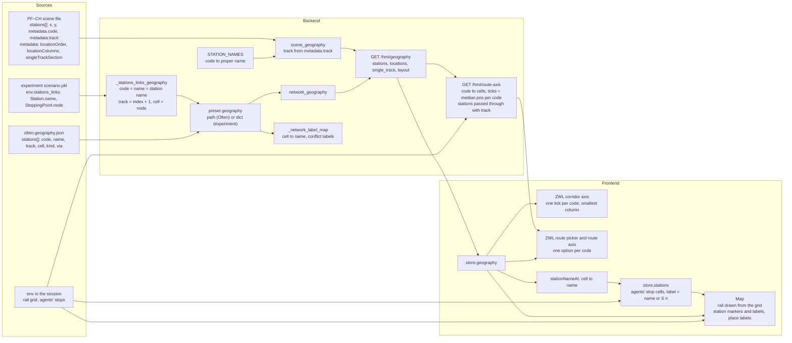
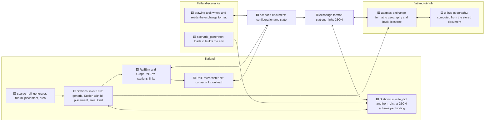
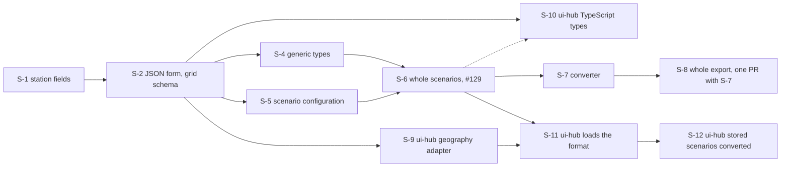

# A general, graph-aware exchange format: drawing tool, `RailEnv`, `GraphRailEnv` and `.pkl` to flatland-ui-hub scenarios

> **Status:** plan of 2026-11-11, scope broadened 2026-11-12, revised 2026-11-13 against the decided book plan and 2026-11-14, draft;
> nothing built. Based on flatland-rl `main` `e1cc8109a` (rebased 2026-11-14 from `3a66efe9`; the newer commits do not touch
> `stations_links`, but `RailEnvPersister` now saves `skip_state_machine_update` and starts state machines from the
> derived state on load, ba95f933f and 397137458, and the rail has edge lengths, PR [#542](https://github.com/flatland-association/flatland-rl/pull/542); the
> scenario's configuration carries both, §4.10; checked 2026-11-14); branch `docs/flatland-scenario-exchange-format`, PR [#572](https://github.com/flatland-association/flatland-rl/pull/572).
> Depends on flatland-book's plan [`docs/plans/stations-links-logical-model.md`](https://github.com/flatland-association/flatland-book/blob/2f599ca/docs/plans/stations-links-logical-model.md) (flatland-book PR
> [#45](https://github.com/flatland-association/flatland-book/pull/45), all its questions decided; the model's decisions on gates, links, gate links, area, tracks, producer data, graph and
> visualization) and on flatland-rl [#145](https://github.com/flatland-association/flatland-rl/issues/145) (consistent generator type hints) and [#242](https://github.com/flatland-association/flatland-rl/issues/242) (generic
> serialization of all generators); implements [#129](https://github.com/flatland-association/flatland-rl/issues/129) (state and configuration representation). Split out of flatland-scenarios PR
> [#39](https://github.com/flatland-association/flatland-scenarios/pull/39) (its plan's Q-4), which decided it out of
> scope there; the PR #39 plan's decisions this plan relies on are restated where they are used; read against flatland-scenarios PR #39 at `150782e` and flatland-ui-hub
> [#164](https://github.com/flatland-association/flatland-ui-hub/pull/164) (merged, `c33028f`). No issue. All questions decided.
>
> **Why:** stations and links are written in three repos, each with its own converter: the drawing tool's export,
> flatland-rl's `StationsLinks`, and flatland-ui-hub's station geography. The converters lose data (ids, areas, grid
> placement, gates) and rely on grid conventions written down nowhere. One exchange format, owned by flatland-rl,
> removes the converters and works for the grid and the graph representation. Broadened on 2026-11-12 from stations
> and links to whole scenarios: the drawing tool, `RailEnv`, `GraphRailEnv` and `.pkl`s convert to and from it, and
> flatland-ui-hub builds its scenarios from it, so no repo keeps its own scenario converter either.

## 1. Introduction and goals

*What the change is for: the requirements, the qualities that matter, who has a stake, and what it leaves out.*

### 1.1 Requirements overview (functional requirements)

*The issue's text and the numbered requirements the rest of the plan refers to.*

There is no issue. The goal was set on 2026-11-11 while revising the PR #39 plan: the drawing tool's export and
the `StationsLinks` model are the same, with a loss-free, revertible adapter in flatland-ui-hub; a graph-aware, general
exchange format that is agnostic of flatland-ui-hub's internals. REQ-7 was added the same day: the format
holds everything flatland-ui-hub needs to draw stations, so its adapter stays small.

Requirements:

- **REQ-1 One format, no converters in between:** the drawing tool's export is the exchange format (Q-5), its station
   part the JSON form of `StationsLinks` and validates against its schema; flatland-scenarios' Python code reads and writes it with
   flatland-rl's own (de)serialization, the drawing tool by the schema (DP-1).
- **REQ-2 General:** only what every producer can fill is in the core model; the producer's own key is `Station.id`, the
   placement is the optional, generic `Station.placement` (book plan Q-12 d)); no field exists for one producer or consumer only.
- **REQ-3 Graph-aware:** the format works with `RailEnv` (grid) and `GraphRailEnv` (graph).
- **REQ-4 Agnostic of flatland-ui-hub's internals:** flatland-ui-hub maps the format to its station geography with an
   adapter of its own that loses nothing and can be reverted.
- **REQ-5 Loss free in every hop:** drawing tool ↔ exchange format ↔ `StationsLinks` ↔ flatland-ui-hub's adapter, also
   for stations no timetable serves.
- **REQ-6 Explicit conventions:** the grid conventions of §3 are written down where the format is defined.
- **REQ-7 Everything flatland-ui-hub needs to draw stations is in the format,** defined in flatland-rl as general
   concepts (display name, track numbers, kinds of stopping places, places along a line, single-track sections, …),
   not as flatland-ui-hub's fields (§4.8). flatland-ui-hub then only needs a small adapter, and converts its stored
   scenarios to the format (S-9–S-12).
- **REQ-8 Every open point of flatland-book's stations and links page is covered** (its "Open points and possible
   extensions", 2026-11-12, flatland-book PR [#44](https://github.com/flatland-association/flatland-book/pull/44)):
   each is designed here, a question here, or decided in flatland-book's plan `docs/plans/stations-links-logical-model.md` (§4.9). Added on 2026-11-12.
- **REQ-9 One format for whole scenarios:** drawing tool export ↔ exchange format, `RailEnv` ↔ exchange format,
   `GraphRailEnv` ↔ exchange format, `.pkl` ↔ exchange format, and exchange format → flatland-ui-hub scenario. A
   scenario holds the rail (grid or graph), the stations and links, the lines and timetables, and the generators'
   configuration (§4.10). Added on 2026-11-12.
- **REQ-10 Implements [#129](https://github.com/flatland-association/flatland-rl/issues/129):** a human-readable, machine-diffable representation, backwards compatibility and
  versioning, a schema, (de)serialization fast and small enough (benchmarked), and state normalized apart from
  configuration (§4.10). Added on 2026-11-12. Split into REQ-11, REQ-12, NFR-2, NFR-4 and NFR-5 on 2026-11-13. The book plan has the same goals (its REQ-6, REQ-7, NFR-4–NFR-7); this plan implements them.
- **REQ-11 Schema:** the format has a JSON schema, one per binding (grid; graph; graph with geographic coordinates;
  book plan Q-13), next to the model in flatland-rl; every document a producer writes validates against it, and the
  schema names the extension points (book plan NFR-4). Added on 2026-11-13.
- **REQ-12 Versioning:** every document carries the format's semver `version` at the top (book plan REQ-7, §8.3); a
  reader reads its major version, converts older ones it supports, and refuses others with a message naming the
  version (Q-6, answered). How the format evolves, worked through with `Track` (2.0.0 without it, 2.1.0 adds it,
  flatland-ui-hub's track extension promoted into it): the book plan's §8.3. Added on 2026-11-13.

### 1.2 Quality goals (non-functional requirements)

*The few qualities the design must reach, each with a concrete scenario.*

| ID | Priority | Quality goal | Scenario |
|---|---|---|---|
| NFR-1 | 1 | Loss free | Export → load → export gives the same JSON; `from_geography(to_geography(x), base=x) == x` in flatland-ui-hub (Q-7 b)). |
| NFR-2 | 2 | Backwards compatibility | `.pkl`s written before still load; older drawing tool exports still import; a document of an older format `version` still reads, converted on load (REQ-12). |
| NFR-3 | 3 | Generality | A `GraphRailEnv` and a `sparse_rail_generator` env carry the same format as a drawn env. |
| NFR-4 | 4 | Human-readable, machine-diffable | The JSON form is the readable one; a binary encoding (NFR-5) need not be readable, but converts to JSON and back loss free, both ways. A person reads a scenario file in JSON without tools, and changing one station, link or train changes only the lines of that element in a `git diff` (stable key order, deterministic output, one element per line or block). So that later, snapshots can be stored as increments against a base (e.g. per step in evaluation trajectories, §1.4). Added on 2026-11-13. |
| NFR-5 | 5 | Speed and size | (De)serializing a scenario is fast and small enough for the uses of `.pkl` today (loading envs in evaluation, storing trajectories): benchmarked against `.pkl` and `.mpk` on the ECML2026 scenarios, budgets set once a use drops `.pkl` as its cache (Q-15 c), §1.4). Added on 2026-11-13. |
| NFR-6 | 6 | Extensible by producers | The format defines its extension points (book plan NFR-4, Q-13): a producer or consumer adds its own data without a change in flatland-rl, without conflicting with core fields or other owners, and without breaking readers that do not know it. Added on 2026-11-13. |

### 1.3 Stakeholders

*Who asks for the change, decides on it, reviews it or works with the result, and what they expect.*

| Role | Name | Expectations |
|---|---|---|
| Reviewer of PR #39 | `chenkins` | One exchange format instead of converters. |
| Author of PR #39 and flatland-ui-hub #164 | Manuel Meyer (`CleverManu`) | Stations of drawn scenarios in flatland-ui-hub without loss. |
| flatland-rl maintainers | - | Decide the questions of §9.1; the model itself is decided in the book plan (C-8). |
| flatland-ui-hub maintainers | - | Check that §4.8 covers their visualization; build the small adapter, load and convert the stored scenarios (S-9–S-12). |

The repos and their roles:

| Party | Role | Today | Target |
|---|---|---|---|
| flatland-rl | owns the format; `sparse_rail_generator` produces it; `RailEnv`, `GraphRailEnv` and `RailEnvPersister` consume it | `StationsLinks` dataclasses, no JSON form, grid conventions implicit | `StationsLinks` 2.0.0 with a JSON form, one generated schema per binding and the conventions (§4.3, §4.4) |
| Drawing tool | produces and consumes it | its own station export: a `stations` list with `city_position`, `city_orientation`, a rectangle `area` and `edges` (§5.1) | writes and reads the exchange format (§4.5) |
| flatland-scenarios `scenario_generator` | consumes it, builds the env | converts the export to `StationsLinks` | loads the exchange format with flatland-rl's (de)serialization (§4.5) |
| flatland-ui-hub | consumes it | reads `env.stations_links` from the `.pkl` into its geography, losing gates, the station's cells and links | a small, loss-free, revertible adapter from the exchange format to its geography (§4.7, S-9) |


### 1.4 Follow-ups (not in this PR)

*What this PR leaves out, why, and where it goes later.*

| Follow-up | Why not in this PR | From | Findings | Issue |
|---|---|---|---|---|
| Links and fibres drawn in the drawing tool. | The tool does not capture lines between station areas yet; the format already has links. | PR #39 | - | - |
| Stations in simplified graphs (`DecisionPointGraph`). | Merged nodes can swallow a station's cells. | §4.6 | - | - |
| Incremental snapshots: a state stored as a diff against a base snapshot (e.g. per step in evaluation trajectories). | Needs a diffable format first (NFR-4) and the state document (Q-20 b)); the increment format is its own design. | NFR-4, Q-20 | - | - |
| A check in `StationsLinks` that a station's pins are complete (book plan REQ-5): every transition from its area to outside starts at a listed pin; next to a check of unique gate and pin names. | Needs the station area (book plan Q-4 b), Q-8) and the transition map; the drawing tool's own check is in the book plan's drawing tool draft (row below). | §2.2 | - | - |
| Links from the grid include loops of the line back to the own station, as a `Link` whose two gates are in that station, or one gate to itself (book plan Q-19). | Producers derive links from the transition map only later (book plan Q-5); today sparse makes no link for such a loop. | §4.9 | - | - |
| Both producers fill `gate_links`, and `Chain` in `stations_links.py`: a gate link bundles the fibres through a station between two of its gates, stored like links (book plan Q-6, Q-9 d)); a chain alternates links and gate links. | Code in flatland-rl and both producers; the class and the field land before S-2's release (Q-17 a)), the producers fill them later. Book plan draft: [`issue-flatland-rl-gate-links-and-chains.md`](https://github.com/flatland-association/flatland-book/blob/2f599ca/docs/plans/stations-links-logical-model/issue-flatland-rl-gate-links-and-chains.md). | Q-13 | - | - |
| Gates by the corridor rule in the drawing tool (book plan Q-1–Q-3, Q-2 a)), e.g. ECML2026 station 25's north side split into `N1` (to station 26) and `N2` (to station 27); its export's `area` then holds every track inside the rectangle, a through track included, with its pins (book plan REQ-5). | Code in flatland-scenarios; starts from one gate per side (PR #39's S-19). Book plan draft: [`issue-flatland-scenarios-drawing-tool-gates.md`](https://github.com/flatland-association/flatland-book/blob/2f599ca/docs/plans/stations-links-logical-model/issue-flatland-scenarios-drawing-tool-gates.md). | PR #39 plan Q-2 c), Q-13 | - | - |
| `Track` (number, extent, platform) referenced by stopping points, in the format's 2.1.0: `Station.tracks`, `StoppingPoint.track`; flatland-ui-hub's track extension promoted into them (book plan §8.3). | A later minor version; the first schema stays without it (book plan Q-11 d), Q-16). Book plan draft: [`issue-flatland-rl-track.md`](https://github.com/flatland-association/flatland-book/blob/2f599ca/docs/plans/stations-links-logical-model/issue-flatland-rl-track.md). | Q-9 | - | - |
| `sparse_rail_generator`'s docstring of its returned hints (`rail_generators.py:272-276` at `v4.3.0`) lists `num_agents` and `agent_start_targets_cities`, which are not returned, and leaves out `city_positions`; fix it to the three keys `city_positions`, `train_stations`, `city_orientations`. | Unrelated to the format; a small docs fix. | §3 conventions 9-10 | - | - |
| `sparse_rail_generator`: gates split by the corridor rule (1,075 of 8,640 gates fail it today) and links derived from the grid, loops back to the own station included (book plan Q-2 a), Q-5, Q-19). | A generator change of its own. Book plan draft: [`issue-flatland-rl-sparse-gates-and-links.md`](https://github.com/flatland-association/flatland-book/blob/2f599ca/docs/plans/stations-links-logical-model/issue-flatland-rl-sparse-gates-and-links.md). | Q-13 | - | - |
| A priority on fibres, a future extension: an optional field, absent meaning normal; until then extension data. | No producer needs one yet (book plan Q-10). Book plan draft: [`issue-flatland-rl-fibre-priority.md`](https://github.com/flatland-association/flatland-book/blob/2f599ca/docs/plans/stations-links-logical-model/issue-flatland-rl-fibre-priority.md). | §4.9 | - | - |
| Drawing geographic placements: `graph/graph_rendering.py:get_positions` derives positions from grid cells only. | Rendering, not the format (book plan Q-12). | §4.3 | - | - |
| A protobuf adapter (`.proto` messages, binary encoding), §4.4. | A possible implementation, chosen after S-6's benchmark (Q-15). | §4.4, §4.10 | - | - |
| Budgets for speed and size, and `.pkl` dropped as the loaded format (no cache). | No use needs it yet; this plan keeps `.pkl` as a cache everywhere (Q-15 c)). | Q-15, NFR-5 | - | - |
| flatland-hmi loads scenarios from the exchange format. | Another repo; it reads `.pkl`s, which stay readable. | §8.2 | - | - |
| A generator for scheduled malfunctions in flatland-rl; until then they are `flatland-scenarios` extension data. | Not needed for the format; flatland-scenarios PR #39 designs them. | §4.10 | - | - |
| The Gotthard scenario with rail: its sections as links, its traffic as lines and timetables. | flatland-ui-hub has no rail for it yet. | §4.10, T-8 | - | - |

## 2. Constraints

*What limits the design from outside: platform, organisation and conventions.*

| ID | Constraint | Kind | Explanation |
|---|---|---|---|
| C-1 | flatland-rl owns the format | organisational | Model, JSON form and schema live in flatland-rl; flatland-scenarios and flatland-ui-hub follow its releases (`env.flatland-rl-ref` in flatland-scenarios' `checks.yml`). |
| C-2 | Names settled first | organisational | Stopping points per track and several gates per side (PR #39 plan Q-2) change what a name means; they are settled before the format is frozen. All are decided (2026-11-11): one stopping point per track (Q-1 b)), its node the track's middle platform cell (Q-5 a)), one gate per side keyed `N`, `E`, `S`, `W` (Q-2 b)), the tool derives stopping points, edges and gates and does not read them back (Q-3 a)); built in PR #39 as S-18–S-20. The gates are revisited by the corridor rule (book plan Q-1–Q-3): one gate per side is the split's starting point. |
| C-3 | flatland-ui-hub consumes the outputs | organisational | Its experiment fixtures (`backend/app/fixtures/plan-b/*/`) are built from the drawing tool's outputs and change with every format change (PR #39); flatland-ui-hub converts them itself (S-12). |
| C-4 | Pickled `.pkl`s | technical | `RailEnvPersister` pickles `stations_links`; new fields need defaults, and removed or retyped ones (`Station.edges`, cells at level-free crossings) a conversion on load, so old `.pkl`s load (§8.2). |
| C-5 | Model decisions first | organisational | flatland-book's plan `docs/plans/stations-links-logical-model.md` decides what the model holds (gates, links, gate links, area, tracks, producer data, graph, visualization; its Q-1–Q-19, all decided 2026-11-13); the format follows it (C-8). |
| C-6 | Generators typed and serializable | technical | The configuration part of a scenario serializes the rail, line, timetable and effects generators. That needs a base class and type hints for every generator ([#145](https://github.com/flatland-association/flatland-rl/issues/145)) and their generic serialization, class name and state, incl. effects generator and resource map ([#242](https://github.com/flatland-association/flatland-rl/issues/242)). Today `RailEnvPersister.get_full_state` stores the effects generator's `__getstate__()` only, and the other generators not at all. |
| C-7 | State and configuration model | organisational | [#129](https://github.com/flatland-association/flatland-rl/issues/129) asks for a normalized data model separating state and configuration; this plan implements it for the exchange format (REQ-10). |
| C-8 | Builds on the book plan | organisational | flatland-book's plan `docs/plans/stations-links-logical-model.md` decides the model (gates, links, gate links, area, tracks, types, terms); this plan builds the format and the code on it and stays compatible. Where this plan has a question the book plan also asks, the book plan's answer holds. |

### 2.1 Limitations

*What the built code gets wrong or ignores, each with the TODO or issue that tracks it.*

Nothing is built yet. By design, the built code will not handle:

- Stations in simplified graphs (`DecisionPointGraph`): merged nodes can swallow a station's resources (§4.6, §1.4).
- `sparse_rail_generator`'s links record the lines as drawn, not what is reachable on the grid, until links are derived
  from the grid (book plan Q-5, §1.4).
- A reader of an older minor version that writes a newer document back drops the fields it does not know (book plan
  §8.3); readers must not rewrite newer files.
- A `.pkl` converted to the format loses what is derived (distance map, caches, the agents' `TrainState`, §4.10); it is
  computed again on load.
- Generators stored by class name only cannot regenerate the scenario; parameters are stored only when the scenario is
  to be regenerated (Q-16).
- Scheduled malfunctions are extension data until flatland-rl has a generator for them (§1.4).
- The Gotthard scenario becomes a stations-only document; its sections, routes and traffic stay flatland-ui-hub's (§1.4).
- The drawing tool writes no links and gate links until its gates and links follow-up (§1.4).
- `to_geography` alone loses data (§4.7); only with the stored document as `base` is the adapter loss free.
- Older drawing tool exports convert one way (T-7); the old formats are not written any more.
- A `.pkl` with 2.0.0 `stations_links` does not load in an older flatland-rl (no forward compatibility, §8.2).
- `.mpk` files have no hop of their own: they reach the format through `RailEnvPersister`'s loading and the `.pkl` hop.

### 2.2 Assumptions

*What must hold for the design to be correct, but is not checked in code.*

Not checked in code; they hold by construction of the producers.

- Gate and pin names are unique across all stations, since `Link.from_gate`/`to_gate` and `Fibre.from_pin`/`to_pin`
  refer to them by name; this is a requirement on every producer, `StationsLinks` does not check it. Both producers
  meet it by qualifying names with a unique station name that contains no `.` (`<station>.<gate>`,
  `<station>.<gate>.<index>`): `sparse_rail_generator` names stations `A`, `B`, …; the drawing tool checks names when
  a user names a station and refuses a JSON export with duplicates, but not on import or in the stations text area
  (flatland-book's "Logical Model" assumption, PR [#44](https://github.com/flatland-association/flatland-book/pull/44)).
- Stations are disjoint.
- A station's pins are complete: every transition from its area to outside starts at a pin of one of its gates (book
  plan REQ-5). Checked only where a station has an area; a check in `StationsLinks` is a follow-up (§1.4).
- Every move has its reverse at the same resource (the double-vertex assumption, book plan §2.2), so a pin's or a
  stopping point's resource fixes its entry points; it holds for grids, graphs converted from them and the OSM import
  of flatland-scenarios PR #36.
- Trains are points: a stopping point is one resource, valid in both directions (book plan §2.2).
- One stopping point per track (§3 convention 6) until `Track` (2.1.0): flatland-ui-hub's `track` is the index + 1.
- `Station.name` (flatland-ui-hub's `code`) is unique and stable across versions of a scenario.
- The random state (numpy's `MT19937` key and position) and the seed history restore the same random numbers in every
  supported numpy version.
- Every generator's state is JSON-serializable once [#242](https://github.com/flatland-association/flatland-rl/issues/242) is done.
- The fixtures' `.pkl`s load in the current flatland-rl, so they can be converted (T-1, S-12).
- A generator rebuilds the same env from the configuration and the seed; S-5's round trip relies on it.
- The envs the old `scenario_generator` builds are the correct references for the converter (T-7).
- A plan-b folder's `draw.json`, `generator.json`, `config.json` and `scenario.pkl` describe the same scenario, so S-12
  can merge them into one document.

## 3. Context and scope (checked 2026-11-11 on flatland-rl `v4.3.0`, flatland-scenarios `150782e`, flatland-ui-hub `c33028f`)

*The code on the base branch that the change works in, as it is before the change, and where the change stops.*

Context: `flatland/envs/stations_links.py` (dataclasses, no JSON form), `sparse_rail_generator._extract_stations_links`,
`AbstractRailEnv.stations_links` (always `None` in `GraphRailEnv`), the drawing tool's station export and
`stations_to_stations_links` of PR #39, and flatland-ui-hub's `_stations_links_geography`
(`app/core/experiment_scenarios.py`).

Implicit conventions today:

Flatland's stations_links model is drawn as a graph (`FlatlandNode`, `FlatlandEdge` in flatland-book), but its
implementation and this PR's export rely on grid conventions that are written down nowhere. In `GraphTransitionMap`
(`flatland/envs/graph/rail_graph_transition_map.py`) a node is a cell entered in a direction, `"(r, c, d)"`, an edge
`(u, v)` is the occupation of `u`'s cell until `v` is entered, and a resource is a cell `"(r, c)"` (`"(r, c, d % 2)"`
on a level-free crossing; `GraphRailEnv._grid_resource_map`). So a cell is neither a graph node nor a graph edge, but
a resource with up to four nodes.

| # | Where | Implicit convention | With the graph |
|---|---|---|---|
| 1 | `Pin.node`, `StoppingPoint.node` (`IntVector2D`) | a "node" is a cell `(row, col)`, without direction | a graph node has a direction; decided: a resource, valid in both directions (Q-3) |
| 2 | `Station.edges`, `Fibre.edges` (`List[IntVector2D]`) | an "edge" is a cell (a resource) | a graph edge is a node pair; the name says the opposite |
| 3 | gate keys `N/E/S/W` (`_gate_name`: "Facing direction (Grid4…)") | a compass side; whether the side of the pins or the heading of a leaving train is unstated | the graph has headings, no sides |
| 4 | `Grid4TransitionsEnum` N=0, E=1, S=2, W=3; N is `row - 1` (`get_new_position`) | screen orientation, row 0 at the top | not stated in the model |
| 5 | `(row, col)` tuples | row first | not stated in the model |
| 6 | stopping point index (`_stopping_point_name`) | the track number: one stopping point per track. A convention only: the model has no track (no `Track` class, no field), and flatland-book shows tracks only in example names ("Station A Track 0"); it holds by construction of the producers (`sparse_rail_generator`, the drawing tool from PR #39 S-18), not by the model's structure | - |
| 7 | pin index ("track number within the gate") | order along the side, unstated | - |
| 8 | `GraphRailEnv.from_rail_env` | does not carry `stations_links` over | the graph env has no stations |
| 9 | `agents_hints.city_positions` | a cell `(row, col)` | - |
| 10 | `agents_hints.city_orientations` (`sparse_rail_generator`) | the heading to the closest neighbour city, 0-3; the tracks run along its axis (`d`, `(d + 2) % 4`) | - |
| 11 | export: `r`, `c`, `node: [r, c]`, `area: [r0, c0, r1, c1]` | rows and columns, inclusive | - |
| 12 | export: `city_orientation` 0/1 | an axis: 0 N-S, 1 E-W; the same axis as 10, never 2 or 3 | - |
| 13 | export: gate key | the side the track leaves the area through, i.e. the heading of a leaving train; `E1`, `E2` numbered along the border until PR #39 S-19, then one gate per side | - |
| 14 | export: stopping point index | row-major order of platform cells, not a track, until PR #39 S-18; then the track (PR #39 plan Q-1 b)) | - |
| 15 | tool: `exits[].side` | the side a pin leaves through; not exported | - |


Scope: whole scenarios (REQ-9, broadened 2026-11-12). First the stations and links model, its JSON form, its
producers (drawing tool, `sparse_rail_generator`) and consumers (`scenario_generator`, `RailEnv`, `GraphRailEnv`,
flatland-ui-hub), S-1, S-2, S-4, whose context is above; then the rail, lines, timetables, generators and state (S-5, S-6,
§4.10), whose context is `RailEnvPersister` and the generators (C-6); then the repos switching to it (S-7–S-12).

## 4. Solution strategy

*The fundamental choices and why, the rules the design follows, how it is verified, and the design of each part.*

| Quality goal | Scenario | Solution approach | Details |
|---|---|---|---|
| Loss free | Round trips give the same data | One format with a JSON form owned by flatland-rl; ui-hub's adapter tested for reversibility | §4.4, §4.7 |
| Generality | flatland-ui-hub draws stations from the format alone | Visualization concepts as general fields, not ui-hub fields | §4.8 |
| Compatibility | Old `.pkl`s and exports load | Optional fields with defaults; 1.x pickles converted on load; older exports converted by an external converter (Q-5) | §4.3, §4.5, §8.2 |
| Generality | Graph and generated envs carry the format | A generic placement; generic in the env's resource and coordinate types (book plan Q-12 d)) | §4.3, §4.6 |

### 4.1 Design principles

*The rules the design follows, each with its decision, the concepts it reuses instead of building new ones, and what
is not new on purpose.*

- **DP-1 flatland-rl owns the format; the schema is the contract.** Model, JSON form and schemas live in flatland-rl.
  Python code reads and writes through flatland-rl's (de)serialization; code in other languages (the drawing tool,
  flatland-ui-hub's frontend) writes and reads by the schema (book plan Q-13). (§9.2)
- **DP-2 The core model is general.** Producer-specific data is either the generic `id` or the optional, generic
  `placement`, typed by the env's `CoordinateT` (book plan Q-12 d)). (§9.2)
- **DP-3 Consumers adapt, the format does not.** flatland-ui-hub's internals stay behind its adapter. (§9.2)
- **DP-4 The book plan decides the model.** Where both plans ask the same, the book plan's answer holds; this plan
  builds the format and the code (C-8).
- **DP-5 Derive, don't store.** What follows from the stored data is not a field: entry points and transitions from
  the resources, a bounding box from the outline, `agents_hints` from `stations_links`, a corridor and a single-track
  section from the links (book plan Q-14, Q-15).
- **DP-6 Configuration apart from state; JSON canonical.** A scenario's configuration and its state are separate parts
  ([#129](https://github.com/flatland-association/flatland-rl/issues/129)); binary encodings encode the same document,
  without a model of their own (§4.10).
- **DP-7 Old formats are retired by a converter, not kept by readers.** An external, one-way converter turns them
  into the format once; readers read only the format (Q-5, S-7, S-12).
- **DP-8 Store the document, compute the views.** A lossy view (flatland-ui-hub's geography) is computed on load and
  applied back onto the stored document (Q-7 b)); `.pkl` is a cache of the document, not a source (S-11).
- **DP-9 Deterministic output.** Stable key order and one element per line or block, so writing twice gives the same
  bytes and a change gives a small diff (NFR-4).
- **DP-10 Parts are documents.** An embedded part (`stations_links`) is a complete document with its own `version` and
  `binding`, and its schema is reused by `$ref` (Q-16).
- **DP-11 Exact values.** Fractions as strings (`"1/3"`), never floats (Q-16).

Reused concepts:

| Need | Reused concept | Instead of |
|---|---|---|
| Stations and links | `flatland.envs.stations_links` | a format of the drawing tool's own |
| Graph lookups | `GraphResourceMap` (graph node → resource) | a station index in the graph |
| Old envs | `RailEnvPersister` (pickle, msgpack `.mpk`): `.pkl` stays readable, converted on load, and a cache (§4.10) | dropping `.pkl` support |
| Grid to graph | `GraphRailEnv._grid_resource_map` | a mapping of the format's own |
| Entry points of a pin or stopping point | `TransitionMap` and `ResourceMap` | storing entry points |
| Generators in a scenario | their generic serialization by class name and state ([#242](https://github.com/flatland-association/flatland-rl/issues/242)) | a scenario-specific generator format |
| Placement on sparse | `city_positions`, `city_orientations` | a new computation |
| A binary encoding | msgpack, already used by `RailEnvPersister` | a new dependency |
| The agents' `TrainState` | `EnvAgent.derived_state()` | storing state machines |
| The rail on grid | `RailEnvPersister`'s transitions per cell, rows of 16-bit numbers (Q-16) | a rail format of the exchange's own |
| A graph converted from a grid | `GraphTransitionMap.grid_to_digraph` | converting stored documents |
| The benchmark | `benchmarks/bench_persistence.py` of PR [#97](https://github.com/flatland-association/flatland-rl/pull/97) | a new benchmark |
| A part's schema in the scenario's | JSON Schema `$ref` | copying the part's schema |
| TypeScript types | generated from the schemas (e.g. `json-schema-to-typescript`) | hand-written types |
| Speeds and distances | `Fraction`, as `SpeedCounter` holds them | floats |
| Edge lengths | `RailEnvPersister`'s `edge_lengths` (PR #542), its numerator and denominator as one fraction string | a length field of the format's own |
| The state | `RailEnvPersister.get_full_state` / `set_full_state` | collecting the env's fields anew |
| 1.x pickles | Python's `__setstate__` | a migration script |
| The random state | numpy's `MT19937` bit generator state | re-seeding |
| Versions | semver, as the book plan's §8.3 | a version scheme of the format's own |
| The flatland-rl a consumer reads | its pinned `env.flatland-rl-ref` (C-1) | reading `main` |

Not new on purpose: `agents_hints` (derivable from `stations_links`, kept for the generators); `.pkl` and `.mpk`
(still read and written); protobuf (a possible implementation, not a step, §4.4).

### 4.2 Verification

*How each requirement and quality goal is shown to work: tests, CI checks, before and after screenshots.*

| ID | Requirement | Test or check | Result | Screenshots |
|---|---|---|---|---|
| REQ-1 | One format | the drawing tool's export validates against the schema; `scenario_generator` builds envs from it with flatland-rl's reader (`from_exchange`) | - | - |
| REQ-2 | General | `sparse_rail_generator` fills `id`, `placement` (with `outline`) and `area`; a `Station` without them stays valid | - | - |
| REQ-3 | Graph-aware | converting a `RailEnv`'s stations links maps every resource to the graph's resource (`_grid_resource_map`); `from_rail_env` keeps `stations_links` | - | - |
| REQ-4 | ui-hub agnostic | the schema has no ui-hub field; T-9 | - | - |
| REQ-5 | Loss free | T-4, T-6 | - | - |
| REQ-6 | Explicit conventions | docstring and schema descriptions | - | - |
| REQ-7 | Everything ui-hub draws | every row of §4.8's table has a field or a derivation; T-8 | - | - |
| REQ-8 | flatland-book's open points | every open point of the page has a row in §4.9: designed, a question, or decided in the book plan | - | - |
| REQ-9 | Whole scenarios | each hop of §4.10: T-1–T-3, T-6–T-9 | - | - |
| REQ-10 | Implements #129 | the objectives of #129 checked off through REQ-11, REQ-12, NFR-2, NFR-4, NFR-5; state apart from configuration (§4.10) | - | - |
| REQ-11 | Schema | a test validates every document the producers write (sparse, the drawing tool's examples, the book plan's example files) against its binding's schema; a document with an owner's extension validates; a document whose `binding` or resources belong to another binding is refused | - | - |
| REQ-12 | Versioning | a document of the current version, of an older supported one (converted) and of an unknown one (refused with its version named) | - | - |
| NFR-1 | Loss free | the round-trip matrix below, T-1–T-9 | - | - |
| NFR-2 | Backwards compatibility | a 1.x `.pkl` loads, its `edges` as `area` and a level-free crossing cell as the resource of its axis (§8.2); an older drawing tool export converts (T-7); an older format version reads (REQ-12) | - | - |
| NFR-3 | Generality | a `GraphRailEnv` and a `sparse_rail_generator` env carry the same format as a drawn env | - | - |
| NFR-4 | Human-readable, machine-diffable | T-5; writing the same scenario twice gives identical bytes; changing one station's name in an ECML2026 scenario gives a `git diff` limited to that station's lines and the references to it | - | - |
| NFR-5 | Speed and size | a benchmark (time to write and read, file size, raw and gzipped) against `.pkl` and `.mpk` on the ECML2026 scenarios, in S-6, with no budgets yet (Q-15 c)) | - | - |
| NFR-6 | Extensible by producers | a document with an owner's extension validates (REQ-11), reads the same core in a reader that ignores it, and keeps it in a round trip | - | - |

**Round-trip matrix.** Every representation of a scenario, its fixtures, the check, and what "equal" means; the rows
are referenced above. What the format leaves out as derived is listed in §4.10; what maps 1:1 between flatland-ui-hub's
files and the format is shown side by side in [`side-by-side.html`](flatland-scenario-exchange-format/side-by-side.html)
([screenshot](flatland-scenario-exchange-format/side-by-side.png)).

| ID | Representation | Fixtures | Check | Equal means | Step |
|---|---|---|---|---|---|
| T-1 | `.pkl` (`RailEnvPersister`) | the regression episodes, ECML2026, flatland-ui-hub's plan-b `scenario.pkl` and `olten.pkl` | `.pkl` → exchange → `.pkl` | the full state equal except what is derived (distance map, caches, `agent_positions`, `TrainState`); replaying the recorded actions gives the same trajectory | S-6 |
| T-2 | `RailEnv` in memory | `sparse_rail_generator` envs, the tutorial at step 0 and step 10 (§4.10) | env → exchange → env | as T-1 | S-6 |
| T-3 | `GraphRailEnv` | `from_rail_env` of T-2's envs | env → exchange → env; the grid and the graph document of one env | as T-1; both documents give the same trajectory | S-6 |
| T-10 | State document (Q-20) | the tutorial: configuration once, a state document at steps 0, 5 and 10 | configuration + state → env, against T-2's env at that step; a state joined with another configuration, or another binding | the same env; the mismatch refused | S-6 |
| T-4 | `stations_links` alone | sparse, the book plan's `example-*.json`, all three bindings | `from_dict(to_dict(x)) == x`; valid against its binding's schema | equal objects | S-2, S-4 |
| T-5 | Binary encoding | all documents of T-1–T-4 | JSON → binary → JSON and binary → JSON → binary | identical documents | S-6 |
| T-6 | Drawing tool export, the exchange format | flatland-scenarios' examples, flatland-ui-hub's plan-b folders | export → load → export | identical bytes | S-8 |
| T-7 | Drawing tool export, the three older generations | flatland-scenarios' fixtures, plan-b `draw.json`/`generator.json` | old → converter → env, against the envs the old `scenario_generator` built, saved as test fixtures before S-8 | same grid, agents, timetable and stations; one way, the old format is retired | S-7, S-8 |
| T-8 | flatland-ui-hub's stored files | `olten.geography.json`, a PF–CH scene with its plan, the Gotthard topology's operating points (its other parts stay flatland-ui-hub's), plan-b folders, ECML2026 | file → exchange → file (back to the old file only for the check, S-12) | equal, apart from the fields the side-by-side marks as derived | S-12 |
| T-9 | flatland-ui-hub's computed geography | plan-b, Olten | exchange → geography → exchange with `base`; the geography against today's `_stations_links_geography` | the same document; the same geography as today | S-9, S-11 |

### 4.3 `Station.id`, `Station.placement` and `Station.area` (REQ-2, REQ-5, REQ-6)

*Make the model hold everything the export holds, and write the grid conventions down, without grid fields in the
core model.*

- `stations_links.py`'s module docstring states the grid binding's conventions (§3: 3-7, 10, 12-13): a resource is a
  cell `(row, column)`, at a level-free crossing `((r, c), d % 2)`; Grid4 directions with N = `row - 1`; a gate key
  names the side its pins lie on and the heading of a leaving train, numbered (`E1`, `E2`) where the corridor rule
  splits a side (book plan Q-1–Q-3; one gate per side, PR #39's S-19, is the split's starting point); one stopping point
  per track, its index the track number, until `Track` in 2.1.0 (§1.4).
- New fields:

| Field | Holds | Export field | `sparse_rail_generator` |
|---|---|---|---|
| `Station.id: Optional[int]` | the producer's own key; not the name | `id` | the city index |
| `Station.placement: Optional[Placement[CoordinateT]]` | where the station is drawn (book plan Q-12 d)); `CoordinateT` is bound by the env: grid and converted graph `(r, c)`, a geographic graph `(lat, lon)` | - | always set |
| `Placement.position: CoordinateT` | the reference position; grid: the reference cell, as `agents_hints` | `city_position` | `city_positions[i]` |
| `Placement.orientation: float` | a bearing in degrees clockwise from north; `b` and `b + 180` are the same axis; grid `0`, `90`, `180`, `270` | `city_orientation` (× 90) | `city_orientations[i] * 90` |
| `Placement.outline: Optional[List[CoordinateT]]` | the drawn shape, a polygon, vertices clockwise, the first not repeated (book plan Q-12, Q-14); a bounding box is derived from it | `area` `[r0, c0, r1, c1]` (its corners) | the city square's corners |
| `Station.area: Optional[Set[ResourceT]]` | the station's rail resources (book plan Q-8, Q-14 b)); replaces `Station.edges`, which is removed | `edges` (the rail inside the rectangle; a through track the tool leaves out today is added, book plan REQ-5) | the rail cells of the city's square (equal to today's `edges` on all 4,320 stations checked) |
| `Station.display_name: Optional[str]` | the name shown to people; `name` stays the key (book plan Q-15) | - | - |
| `Station.kind: Optional[str]` | `station` (absent), `stop`, `junction`, `crossover`, `portal`, or `<owner>:<value>` (book plan Q-15) | - | - |
| `StationsLinks.gate_links: List[GateLink]` | the fibres through a station between two of its gates (book plan Q-6); added by the book plan's gate links issue, its class and field before S-2's release (Q-17 a)); filled by producers later | - | `[]` |
| `StationsLinks.version: str`, `extensions` on every element, `extensions_used` at the top | the semver version and the owners' extension data (book plan §8.3) | the colour as `drawing-tool` extension | `"2.0.0"` |

- Mapping (S-7's converter): PR #39's export entry and `Station` map one to one, except the rectangle (to
  `placement.outline`) and `edges` (to `area`); the pin keys change between `int` and JSON strings. `agents_hints` becomes derivable from `stations_links` (`city_positions = [s.placement.position …]`,
  `train_stations = [[(sp.node, i) …] …]`).
- Compatibility: a 1.x `.pkl` (no `version`) converts on load (§8.2): a missing field reads its default
  (`__setstate__`), `edges` becomes `area`, a bare cell at a level-free crossing the resource of its axis (from the
  transition map). Readers of `name` and `stopping_points` (flatland-ui-hub, flatland-hmi) are unaffected.
- The patches checked on 2026-11-11 ([flatland-rl](flatland-scenario-exchange-format/flatland-rl-station-fields.patch),
  [flatland-scenarios](flatland-scenario-exchange-format/flatland-scenarios-station-fields.patch)) implement the dropped
  `GridStation`; S-1 and S-8 redo them for `placement` and `area`.


### 4.4 The JSON form in flatland-rl (REQ-1, REQ-5, REQ-11)

*Give `StationsLinks` a JSON form owned by flatland-rl, so no party writes its own converter.*

Examples of the JSON form are in the book plan's material (C-8, [its folder](https://github.com/flatland-association/flatland-book/blob/2f599ca/docs/plans/stations-links-logical-model/)):
`example-grid.json`, `example-graph.json`, `example-graph-geo.json`, flatland-ui-hub's view `example-ui-hub.json`, and one
example per flatland-ui-hub format (`example-ui-hub-*.json`, its §8.4).

- `StationsLinks.to_dict()` and `StationsLinks.from_dict(d)` (or module functions): the dataclasses as JSON objects,
  tuples as lists, pin keys as strings, `None` fields left out; `version`, `binding` and `extensions_used` at the top
  (Q-6, book plan §8.3), then `stations`, `links`, `gate_links`.
- One JSON schema per binding (`grid`, `graph`, `graph-geo`), generated from the generic dataclasses (book plan Q-13),
  e.g. `flatland/envs/schemas/stations_links.<binding>.schema.json`: each fixes the root `binding` and the resource and
  coordinate types, so a document mixing bindings is invalid; the conventions of §3 in its descriptions. A closed core
  with `extensions` objects keyed by owner, the owners declared in `extensions_used` (book plan §8.3). The schema is the
  contract (DP-1).
- Older versions: there is no JSON before 2.0.0; 1.x exists only as pickles, converted on load (§8.2).
- Round trip: `from_dict(to_dict(x)) == x` for every `StationsLinks`, including those of `sparse_rail_generator`.
- The schema does not require a `Link`'s two gates to be in different stations, nor different gates: a loop of the line
  back to the own station is a `Link` (book plan Q-19).


**Possible implementation: protobuf with its JSON mapping.** The model as `.proto` messages, the JSON form as
protobuf's canonical JSON mapping ([docs](https://protobuf.dev/programming-guides/json/)), the binary encoding as a
compact second form (NFR-5). Compatible with the decided extension points (book plan §8.3), checked 2026-11-13 with
protobuf 7.36.2 (`json_format`) on a `Station` with two owners' extensions:

- `extensions` as `map<string, google.protobuf.Struct>` reads and writes exactly the decided JSON
  (`"extensions": {"drawing-tool": {"color": "#1c7ed6"}, ...}`): a `Struct` is an arbitrary JSON object, so each owner's
  data passes through unchanged; its schema is checked by the JSON schema, not by protobuf.
- `stations`, `gates`, `pins` as `map<string, …>` (pin keys `"0"`, `"1"` as today); `version` and `binding` as strings.

Caveats, each with what it takes:

- **Unknown core fields:** the JSON parser rejects them (`has no field named …`); with `ignore_unknown_fields` it drops
  them, so a JSON round trip by an older reader loses a newer minor version's fields (binary keeps unknown fields).
  Fine under the semver rule (a reader writes only its own version), but readers must not rewrite newer files.
- **`null` in `extensions_used`:** a `map<string, string>` rejects `null` (an owner without a schema); either
  `map<string, google.protobuf.Value>` or `""` instead of `null`.
- **Resources:** grid resources are `[r, c]` or `[[r, c], axis]`, a union of array shapes protobuf has no type for.
  The model (tuples in Python) and its JSON form (arrays) stay as decided; only the adapter at the boundary maps,
  as `RailEnvPersister` does for `.pkl` and `.mpk` today. Two ways:
  - The adapter maps: a typed message `GridResource {row, col, axis}` for the binary encoding; the JSON keeps coming
    from flatland-rl's `to_dict`/`from_dict` (S-2), not from protobuf's `json_format`, which would write objects.
  - The library maps: `google.protobuf.ListValue` for resources, so `json_format` writes the decided arrays itself;
    protobuf does not type them, the JSON schema checks them.
- **Defaults and names:** proto3 leaves out default values (`"orientation": 0.0` disappears) unless written with
  `always_print_fields_with_no_presence`; multi-word names become lowerCamelCase (`stoppingPoints`) unless written
  with `preserving_proto_field_name`. Both options keep the decided form.
- **Determinism (NFR-4):** map entries are written in the implementation's order (the test wrote `flatland-ui-hub`
  before `drawing-tool`); deterministic output needs `sort_keys`.

So protobuf fits with three choices: `Struct` for extensions, `Value` or `""` for undeclared schemas, and for
resources a typed message mapped by the adapter or `ListValue` mapped by the library. The model, its JSON form and
every reader of the JSON stay unchanged; only the protobuf adapter is new. The JSON schema stays the contract (book plan Q-13); a `.proto` would be generated
from the same generic classes as the schemas, or kept next to them.

### 4.5 The drawing tool and the scenario generator use the exchange format (REQ-1)

*Remove the converters in flatland-scenarios.*

The exchange format replaces the drawing tool's export format (Q-5): the tool writes and reads the format only, and
an external converter turns older exports into it. In one step, S-8, once the format covers whole scenarios (S-6):
the export becomes a scenario document (§4.10), with no in-between shape (Q-18 c)).

- The drawing tool writes `stations_links` (§5.1) inside its scenario document (S-8), with `id`, `placement`, `area` and the
  station fields it writes today, and reads it back: `id`, `name`, the outline (its rectangle) and the stopping point nodes, as today; the derived
  fields (`gates`, `area`, names) stay derived: the tool computes them from the drawing on every export, as in PR #39. It keeps what it reads and does not edit (`display_name`, `kind`, other owners' extension data) and
  writes it back unchanged (NFR-6).
- `scenario_generator` builds envs from the document with flatland-rl's reader and derives `agents_hints` from it;
  `stations_to_stations_links` and its per-format branches go away.
- Older exports are converted by an external converter, a command-line script in flatland-scenarios (e.g.
  `scenario_generator/convert_export.py`): the flat per-cell format, the `station_cells` format and PR #39's export
  (`stations` list) in, the exchange format out (S-7). Neither the tool nor `scenario_generator` reads the old formats
  any more; the stored fixtures are converted once with it. S-7 and S-8 land in one
  flatland-scenarios PR: S-7 first, then S-8 with the converted fixtures, so every commit reads its own fixtures.


### 4.6 Graph-native stations links (REQ-3, Q-1–Q-4)

*Make `stations_links` usable with `GraphRailEnv`.*

Today: `stations_links` lives on `AbstractRailEnv` (`rail_env.py:217`), so `GraphRailEnv` has the attribute, but it is
always `None`: `GraphRailEnv.from_rail_env` and `from_graph` take no stations, and only `RailEnv` sets it from its
rail generator (`rail_env.py:1676`).

- **Every field a resource** (book plan Q-14 revisited and Q-17, decided 2026-11-13). A pin's
  and a stopping point's `node`, a fibre's `edges`, the station area (book plan Q-8) and a track's extent and platform
  hold resources of the env's resource type, a placement's position and outline coordinates of its coordinate type:
  `StationsLinks(Generic[ResourceT, CoordinateT])`, with `CoordinateT` a new type parameter of `AbstractRailEnv`. Grid: the cell `(r, c)`, or
  `((r, c), d % 2)` at a level-free crossing; graph: what `GraphResourceMap` maps a node to (`"(r, c)"`,
  `"(r, c, d % 2)"` when converted from a grid). On grid this is today's cells except at level-free crossings. Entry
  points and transitions are not stored: they follow from the resources through the transition map and the
  resource map, under the double-vertex assumption (every move has its reverse at the same resource, book plan
  §2.2). A stopping point is valid in both directions (trains are points, book plan §2.2). `Station.edges` is removed:
  the area holds the station's rail resources, the outline the drawn shape (book plan Q-14 b), decided 2026-11-13).
  A fibre's `edges` keeps its name.
  Neither the refactoring nor an issue for it exists in flatland-rl yet (`main` `e1cc8109a`, checked 2026-11-14); the issue's
  draft is flatland-book PR #45's [`issue-flatland-rl-generic-stations-links.md`](https://github.com/flatland-association/flatland-book/blob/2f599ca/docs/plans/stations-links-logical-model/issue-flatland-rl-generic-stations-links.md). The
  table of the type parameters for grid and graph is in the book plan, §3.1.
- **Entry point lookups.** A helper returns the entry points and transitions of a pin (inward and outward), a
  stopping point or a fibre, from its resources via the env's resource map and transition map, e.g. to route a
  train to a stopping point.
- **Carry over.** `GraphRailEnv.from_rail_env` converts `rail_env.stations_links`: every resource with
  `_grid_resource_map` (`(r, c)` → `"(r, c)"`, `((r, c), d % 2)` → `"(r, c, d % 2)"`); `from_graph` takes an
  optional `stations_links`.
- **Gate keys** stay opaque strings in the model; `N`, `E`, `S`, `W` are the grid's convention (§4.3), and a non-grid
  producer may use any key.
- **Persistence:** `stations_links` is saved with the env, as for `RailEnv` (Q-4); a `GraphRailEnv` in the exchange
  format (S-6, §4.10).
- **Simplified graphs** (`DecisionPointGraph`) are not covered (§2.1).


### 4.7 flatland-ui-hub's adapter (REQ-4; S-9 in flatland-ui-hub)

*Map the exchange format to flatland-ui-hub's internals and back, without losing anything.*

Today flatland-ui-hub reads `env.stations_links` from the `.pkl` into its geography: one row per stopping point with
`code` and `name` (the station name), `track` (the stopping point's index + 1), `cell` (its node) and
`kind: "platform"` (`_stations_links_geography`). No flatland-ui-hub code reads `track` (flatland-ui-hub `main` `fd0c70c`, checked 2026-11-11): the ZWL axis
and route picker collapse a station's entries by `code`, and names are looked up by `cell`. Writing `track` assumes one stopping point per track, as
`sparse_rail_generator` makes them; the drawing tool makes one per platform cell until PR #39 plan Q-1 b) (decided
2026-11-11: one per track) is built. Gates, pins,
the area, the placement and links are dropped, and the geography cannot be turned back into `StationsLinks`.

- **A small adapter in flatland-ui-hub**, e.g. `to_geography(stations_links)` and `from_geography(geography, base)`,
  reading and writing the exchange format through
  flatland-rl's (de)serialization (§4.4). Small, because every field the geography needs is in the format (§4.8);
  the adapter only renames and reshapes.
- **What the geography does not show** stays in the stored exchange document (Q-7 b)); until flatland-ui-hub stores
  documents (S-11), `base` is the env's `stations_links`, read from the `.pkl` and converted on load: the geography is computed from
  it on load and not stored; `from_geography(geography, base)` applies the geography onto the stored document, so
  `from_geography(to_geography(x), base=x) == x`. The exchange format gets no field for flatland-ui-hub. `to_geography` drops:

  | Level | Dropped | Why the geography has no place for it |
  |---|---|---|
  | Document | `version`, `binding`, `extensions_used` | the geography has no header |
  | Station | `id` | rows are keyed by `code` (`Station.name`) |
  | Station | `placement` (`position`, `orientation`, `outline`) | rows have only a platform `cell`; a station without stopping points keeps the column of its `position` as `locations[].col`, losing the row, the orientation and the outline |
  | Station | `area` | the map draws the rail from the env's grid |
  | Station | `gates` with their pins (names, keys, nodes) | nothing reads gates |
  | Station | `kind` `junction`, `crossover` and `<owner>:<value>` | the geography knows `platform`, `stop`, `portal` |
  | Station | other owners' `extensions` (e.g. the drawing tool's colour) | only flatland-ui-hub's own `via` has a field |
  | Station | whether `display_name` was set | an absent `display_name` is written as `name = code`; on the way back both read as set |
  | Stopping point | its `name` | rebuilt only when it is `<station>.<index>`; the index comes back from `track` |
  | Links | every `Link` with its fibres (gates, pins, `edges`) | `single_track` and `layout` are derived from them one way; links cannot be rebuilt from them |
  | Gate links | every `GateLink` | nothing reads them |
- Built and tested in flatland-ui-hub as S-9; loading scenarios from the format is S-11, converting the stored ones S-12
  (the side-by-side of §4.2 shows what each stored file maps to).

### 4.8 What flatland-ui-hub draws, as general concepts (REQ-7)

*Everything flatland-ui-hub's station visualization reads, and where it lives in the exchange format.*

Every scenario format, of all producers and generations, is mapped to the model in the book plan's §8.4, with
flatland-ui-hub's view in its `example-ui-hub.json`. flatland-ui-hub draws stations from three sources today, all in one shape (`stations`, `locations`, `single_track`,
`layout`; `app/core/station_names.py` and `app/core/experiment_scenarios.py` at `c33028f`): the PF–CH scene files
(SBB codes, names, track numbers per platform cell, places along the line with their column, the single-track
section), hand-written network sidecars (`backend/app/fixtures/olten/olten.geography.json`: also `kind`
`platform`/`stop`/`portal` and `via`) and `env.stations_links` (§4.7).

Where each field comes from and what reads it (flatland-ui-hub `main` `fd0c70c`, checked 2026-11-11).
`GET /hmi/geography` (`backend/app/api/hmi.py:478-499`) picks one source per session: the PF–CH scene file through
`scene_geography` (`app/core/station_names.py:54-97`), else the preset's `geography` through `network_geography`
(`station_names.py:100-125`): a path for Olten, the dict `_stations_links_geography(env)` builds from the `.pkl` for
an experiment scenario (`app/core/experiment_scenarios.py:139-162`, attached at `:264`).



Notation: [Mermaid flowchart](https://mermaid.js.org/syntax/flowchart.html); boxes are data sources, functions or
views, arrows the data they hand on.

| Field | PF–CH scene | Olten | Experiment `.pkl` | Read by |
|---|---|---|---|---|
| `cell` | `[y, x]` of the scene station | hand-written | `StoppingPoint.node` | `stationNameAt` (cell to name, `session.store.ts:497`), which labels `store.stations` on the map and in the timetable; the map's `stationRef` (`flatland-map.component.ts:1553`); route-axis (a code's cells); `_network_label_map` (conflict labels) |
| `code` | `metadata.code` (SBB code) | hand-written (`OL`, `P-BASEL`) | `Station.name` | ZWL corridor axis: one tick per code at its smallest column (`zwl-axis.ts:55-79`); route picker: one option per code (`zwl.component.ts:232-245`); route-axis: from/to by code, tick at the median position per code (`hmi.py:563-569`) |
| `name` | `STATION_NAMES[code]`, else the scene's spelling | hand-written | `Station.name` (as `code`) | axis ticks, route picker, labels |
| `track` | `metadata.track` | hand-written | stopping point index + 1 | nothing: typed (`models.ts:151,201`) and passed through `/hmi/geography` and `/hmi/route-axis`, read by no code |
| `kind` | - | `platform`, `stop`, `portal` | always `platform` | route picker ("towards …" for portals), route-axis ticks (major only for stations) |
| `locations` | `locationOrder`, `locationColumns` | empty | empty | ZWL corridor axis (minor ticks for places without tracks), map place labels (`flatland-map.component.ts:305-317`), `sectionForCell` |
| `single_track` | `singleTrackSection` | empty | empty | ZWL single-track band, place labels |
| `layout` | `corridor` (set in `hmi.py`) | `network` | `corridor` | ZWL: column axis for a corridor, route axis for a network |

Not from the geography: the map's rail (the env's grid) and its station markers (`store.stations`,
`session.store.ts:433-457`: the trains' stop cells, else start and target, named by `stationNameAt`, else `S-1`, `S-2`,
…). No code adds tracks, cells or other elements to the map from the geography. Several stopping points on one
track give more entries with the same `code` and different cells; the ZWL and the route picker collapse them by
`code`, so they show as one station.

The format takes each of these as a general concept, so any producer can fill it and any consumer can read it:

| flatland-ui-hub field | Meaning | In the exchange format | Status |
|---|---|---|---|
| `stations[].cell` | a platform cell | `StoppingPoint.node` | exists |
| `stations[].name` | the place's display name ("Ziegelbrücke", "Olten") | `Station.display_name` (`name` stays the short key) | new (Q-8, answered) |
| `stations[].code` | a short code ("ZB", "OL", "P-BASEL") | `Station.name` | exists |
| `stations[].track` | the track number of a platform, 1-based; carried, but read by no flatland-ui-hub code today | the stopping point's `Track` and its number (book plan Q-11 d)), in the format's 2.1.0 (book plan Q-16, §8.3) | future (Q-9) |
| `stations[].kind` | `platform`, `stop` (a halt without platform tracks), `portal` (where trains enter and leave the network) | `Station.kind` (`station`, `stop`, `junction`, `crossover`, `portal`; `platform` maps to `station`) | new (Q-10, answered) |
| `stations[].via` | the route a portal leads to ("Hauenstein-Basistunnel") | flatland-ui-hub's extension data on the portal station (`extensions.flatland-ui-hub.via`); the destination is the portal's `display_name` | extension (Q-10, answered) |
| `locations[]` (`code`, `name`, `col`) | places along a line, in order, also places without tracks (Mühlehorn, Murg) | stations without stopping points, ordered along the line; the column from `Station.placement.position` | new: stations without stopping points (Q-11, answered) |
| `single_track` | the places of a single-track section | derived: a link whose fibres are one track | derived from links |
| `layout` (`corridor`, `network`) | how the ZWL lays the stations out | derived: a chain of links is a corridor | derived (Q-12, answered) |
| `stations[].basis` | where a name comes from (a note for maintainers) | flatland-ui-hub's extension data on the stopping point (`extensions.flatland-ui-hub.basis`), as in the book plan's Olten example | extension |

Not new on purpose: no field names flatland-ui-hub's internals (`code`, `col`, `layout` strings); the adapter maps
them.

### 4.9 flatland-book's open points (REQ-8)

*Where each open point of the stations and links page is designed or decided.*

| Open point (flatland-book) | Where | Status |
|---|---|---|
| **Tracks:** an explicit track number on `StoppingPoint`, for platforms whose tracks are not numbered from 0 in order | Q-9, §4.8 | decided in the book plan: a `Track` element (book plan Q-11 d)) in the format's 2.1.0 (book plan Q-16) |
| **Producer data:** a producer's own station key and its placement (position, orientation, bounding box) | §4.3 (`Station.id`, `Station.placement`), REQ-2 | decided in the book plan (Q-12 d)); the station area is the book plan's Q-4 b), Q-8 and Q-14 b) (decided: the station's rail resources, replacing `edges`); the drawn shape is `Placement.outline`, a bounding box is derived from it; the placement is `Station.placement` (book plan Q-12 d)) |
| **Exchange:** a JSON form and schema for `StationsLinks` | §4.4, §4.5, Q-5, Q-6 | designed; Q-5, Q-6 answered. The JSON form also carries the stored gate links (below); a fibre priority is a future extension (book plan Q-10) |
| **Graph:** stations and links in `GraphRailEnv`, cells generalized to the env's resources (book plan Q-14 revisited, Q-17); directions of stopping points; the resource of a level-free crossing cell | §4.6, Q-1–Q-4 | designed; Q-1–Q-4 answered |
| **Gate links:** `0..` or `1..` per station; every pin to every pin or only some; symmetric or directed; a gate's pins to the same neighbouring stations | Q-13, decided in the book plan (Q-1–Q-9) | decided (book plan Q-9 d): no rule, the gate links' fibres record which pins connect) |
| **Visualization:** display name, kinds of stations (stop, portal), places without tracks, line layout | §4.8, Q-8, Q-10, Q-11, Q-12 | decided in the book plan (Q-15) |

Also from the book plan, not on the page's list yet (flatland-book's plan adds them in its step S-3), and part of the format:

- **Gates by the corridor rule:** a gate is the pins on one side that link to the same gates along the line, not
  necessarily adjacent (book plan Q-1 d), Q-3 b)); producers split where they break it (book plan Q-2 a)). PR #39 plan's Q-2
  b) (one gate per side) is the split's starting point (its Q-2 revisited, decided 2026-11-13), see §4.3.
- **Fibres from the grid:** one fibre per connected pin pair, `edges` the cells of all routes, one link per unordered
  gate pair (book plan Q-5); all connections, none left out (book plan Q-7 c)); a priority to mark bad ones is a future
  extension, an optional field added later, absent meaning normal (book plan Q-10).
- **Gate links stored like links:** a `GateLink` bundles the fibres from a pin of one gate through the station to a
  pin of another gate of the same station, stored in `StationsLinks` next to the links (book plan Q-6).
- **Unique gate and pin names:** an assumption of the model (§2.2), stated on the page.
- **Loops back to the own station:** a `Link` like any other, between two gates of that station or from one gate to
  itself; fibres cover wayside infrastructure "between two connection pins of two stations (potentially the same)"
  (book plan Q-19). The schema allows it (§4.4); links derived from the grid include them (§1.4).
- **Complete pins:** every transition from a station's area to outside starts at a pin of one of its gates (book
  plan REQ-5); an assumption here (§2.2), checked where a station has an area (§1.4).

### 4.10 Scenarios: drawing tool, `RailEnv`, `GraphRailEnv`, `.pkl` ↔ exchange format → flatland-ui-hub (REQ-9, REQ-10)

*Extend the format from stations and links to whole scenarios, normalized into configuration and state.*

A scenario in the exchange format has two parts ([#129](https://github.com/flatland-association/flatland-rl/issues/129)'s normalization):

- **Configuration:** what builds the env: the rail (grid with level-free positions, or graph), `stations_links`
  (§4.3-§4.4), the lines and timetables, and the generators (rail, line, timetable, effects) by class name, with
  their parameters only when the scenario is to be regenerated (Q-16), serialized generically by class name and state ([#242](https://github.com/flatland-association/flatland-rl/issues/242), on the base classes of [#145](https://github.com/flatland-association/flatland-rl/issues/145)), plus
  `max_episode_steps`, the seed and `skip_state_machine_update` (whether the env runs its state machines; saved by
  `RailEnvPersister` since ba95f933f).
- **Header:** `format` (`"flatland-scenario"`), `version`, `binding`, `extensions_used` (Q-16).
- **State:** what changes while it runs: agents (positions, states, malfunctions), elapsed steps, random states,
  `dones`; empty for a scenario that has not started.

| Hop | Direction | How | Today |
|---|---|---|---|
| Drawing tool export | ↔ | the format replaces the export (§4.5, Q-5, S-8); its grid, overpasses, lines and timetables become the configuration | its own export; flatland-scenarios converts it (`scenario_generator`) |
| `RailEnv` | ↔ | `to_exchange(env)` / `from_exchange(d)`, configuration and state | `RailEnvPersister.get_full_state` / `set_full_state` (a dict of numpy and pickled objects) |
| `GraphRailEnv` | ↔ | the same, with a graph rail and generic stations links (§4.6) | `stations_links` always `None`; no persistence (Q-4) |
| `.pkl` | ↔ | load with `RailEnvPersister`, write the format; and back, so old `.pkl`s convert and `.pkl` stays a cache | pickled full state |
| flatland-ui-hub scenario | ↔ | flatland-ui-hub builds its scenario (geography, timetable, experiment fixtures) from the format with its adapter (§4.7, S-9, S-11); its stored files convert to the format, and back only for the check T-8 (S-12) | built from `.pkl`s and the drawing tool's outputs with its own converters |

[#129](https://github.com/flatland-association/flatland-rl/issues/129)'s objectives:

| Objective | In the format |
|---|---|
| human-readable, machine-diffable (NFR-4) | JSON, deterministic key order, cells as lists; generators by class name (Q-16) |
| backwards compatibility and versioning (NFR-2, REQ-12) | `version` at the top (Q-6); readers convert older versions; old `.pkl`s convert on load and through `RailEnvPersister` (§8.2) |
| schema (REQ-11) | one JSON schema per binding for the scenario, the stations and links part as today (§4.4); a state document with a schema of its own per binding, for small snapshots (Q-20 b), below) |
| performance and size (NFR-5) | benchmarked against `.pkl` and `.mpk` for the ECML2026 scenarios (S-6); no budgets yet (Q-15 c)) |
| normalization | configuration and state apart, as above |

Candidates for a fast and compact encoding (NFR-5), next to the readable JSON (NFR-4), each measured in S-6's
benchmark:

| Encoding | Data model | Extension points (book plan §8.3) | Notes |
|---|---|---|---|
| JSON, gzipped | the JSON form itself | unchanged | the baseline; readable and diffable before compression |
| msgpack ([spec](https://msgpack.org/)) | the JSON data model in binary (maps, arrays, strings, numbers, `null`) | unchanged: the same document, encoded, no schema change | already in flatland-rl: `RailEnvPersister` writes `.mpk` with `msgpack` and `msgpack_numpy` (`persistence.py`); no schema of its own, the JSON schema validates the decoded document |
| protobuf binary | `.proto` messages | with `Struct` for extensions (above) | needs the `.proto` and the choices above; keeps unknown fields in binary; smallest for typed data |
| `.pkl` | Python objects | n/a | today's format; not an exchange format (Python only, unsafe to load from others) |

A binary encoding needs no reader for people: it encodes the same document as the JSON form, so every binary file
converts to JSON and back without loss, and the other way round (NFR-4). An encoding that cannot (e.g. protobuf
dropping unknown fields in its JSON mapping, §4.4) is configured until it can, or not taken.

**Examples.** One scenario in three forms: flatland-ui-hub's plan-b `tutorial` (drawn with the drawing tool, two
stations `A` and `B`, two trains meeting on the single track, a passing loop between), built as a `RailEnv` and
stepped 10 steps with `MOVE_FORWARD` (both trains then stand head to head at `(2, 12)` and `(2, 13)`). The documents show the
shape decided for S-5 and S-6 (Q-16), written by
[`make_scenario_examples.py`](flatland-scenario-exchange-format/make_scenario_examples.py) from the real env, not by flatland-rl code:

| Example | Replaces | Content |
|---|---|---|
| [`example-scenario-grid.json`](flatland-scenario-exchange-format/example-scenario-grid.json) | the `.pkl` of `RailEnvPersister` | configuration (rail as transitions per cell, `stations_links` with binding `grid`, lines and timetables per train, `max_episode_steps`, seed, generators by class) and state at step 10 (entry points, speeds and distances as fractions, malfunction counters, `dones`, random state, effects generator state) |
| [`example-scenario-graph.json`](flatland-scenario-exchange-format/example-scenario-graph.json) | nothing yet: a `GraphRailEnv` has no persistence | the same scenario after `GraphRailEnv.from_rail_env`: rail as nodes `"(r, c, d)"` with their resource and prohibited actions, edges with their actions; `stations_links` with binding `graph`, resources `"(r, c)"`; entry points as node ids; no rail generator, the graph is stored |
| [`example-scenario-ui-hub-tutorial.json`](flatland-scenario-exchange-format/example-scenario-ui-hub-tutorial.json) | flatland-ui-hub's `fixtures/plan-b/tutorial/` files below | the grid example's configuration, not started (`state` empty), with the drawing tool's own data and the scheduled malfunctions as extensions; its links and gate links are the book plan's `example-ui-hub-plan-b.json`, worked out from the rail, as the tool writes them after its gates and links follow-up (§1.4) |

An excerpt of the grid example (lists shortened with `…`):

```json
{
 "format": "flatland-scenario", "version": "1.0.0", "binding": "grid", "extensions_used": {},
 "configuration": {
  "rail": {"width": 25, "height": 6, "transitions": [[0, 0, …], [0, …, 16386, 1025, 1025, 1025, 4608, …], …], "level_free_positions": [],
           "edge_lengths": [[[[2, 4], 1], [[2, 5], 1], "11/10"], …]},
  "stations_links": {"version": "2.0.0", "binding": "grid", "stations": {"A": {…}, "B": {…}}, "links": […], "gate_links": […]},
  "lines": [
   {"handle": 0, "waypoints": [[{"position": [2, 3], "direction": 1}], [{"position": [2, 21], "direction": 1}, {"position": [2, 21], "direction": 3}]],
    "earliest_departures": [0, null], "latest_arrivals": [null, 18], "max_speed": "1"}, …],
  "max_episode_steps": 40, "seed": 42, "skip_state_machine_update": false,
  "generators": {"rail": {"cls": "flatland.envs.rail_generators.RailFromGridGen"}, "line": {…}, "timetable": {…}, "effects": {…}}
 },
 "state": {
  "elapsed_steps": 10,
  "random": {"seed": 42, "seed_history": [2801977900917998311, 42], "np_random_state": {"bit_generator": "MT19937", "key": [624 numbers], "pos": 80, …}},
  "agents": [
   {"handle": 0, "entry_point": {"position": [2, 12], "direction": 1}, "old_entry_point": {"position": [2, 11], "direction": 1},
    "target_entry_point": null, "moving": false, "speed": "1", "distance": "0", "arrival_time": null,
    "malfunction_down_counter": 0, "num_malfunctions": 0}, …],
  "dones": {"0": false, "1": false, "__all__": false},
  "effects": {"cls": "flatland.envs.malfunction_effects_generators.MalfunctionEffectsGenerator", "specs": {…}}
 }
}
```

The scenario's `binding` and its embedded `stations_links`'s are the same: `scenario.<binding>.schema.json` refers to
`stations_links.<binding>.schema.json`, whose `binding` is fixed (Q-13), so a document mixing them fails validation;
`from_exchange` checks the two are equal for readers that do not validate. A mismatch would make the stations refer to
resources the rail does not have (graph node ids on a grid, grid positions read as latitude and longitude).

A snapshot needs only the state (Q-20 b)). Next to the scenario document, the **state document** holds one state
alone: `{"format": "flatland-scenario-state", "version", "binding", "configuration_hash", "state": {…}}`, validated by
`scenario-state.<binding>.schema.json`, whose `state` is the scenario schema's `state` by `$ref`. `configuration_hash`
is `sha256:` and the hex SHA-256 of the configuration in canonical JSON (sorted keys, no whitespace, UTF-8), so a
state cannot be joined with another configuration. `to_exchange(env, part="state")` writes it;
`from_exchange(configuration, state)` joins a configuration and a state document, and refuses a state whose hash or
binding does not match. A trajectory then stores its configuration once and one state document per snapshot. The
scenario document keeps its optional `state`, so a single file still holds a whole started scenario. Increments
against a previous state are a follow-up (§1.4) on top of the state document.

Left out of the state, since derived or caches (DP-5): the distance map (most of a `.pkl`'s size, Q-15),
`dev_pred_dict`, `dev_obs_dict`, `agent_positions`, the agents' `TrainState` and state machine signals (derived by
`EnvAgent.derived_state()`), `next_entry_point`, the speed counter's `edge_length` (the length of the agent's edge, from
the rail).

`edge_lengths` (PR #542) is optional and absent when every edge has length 1: on grid, one `[u, v, length]` per edge
with another length, `u` and `v` entry points `[[r, c], d]`, the length an `int` or a fraction string (DP-11), as
`RailEnvPersister` stores it as numerator and denominator; on graph, the edge's `length` attribute.

flatland-ui-hub's experiment folder (`backend/app/fixtures/plan-b/<id>/`, flatland-ui-hub #164) with the format:

| File | Today | With the format |
|---|---|---|
| `scenario.pkl` | the env, pickled | replaced: the scenario document `scenario.flatland.json`; `.pkl` written again as a cache (S-11) |
| `draw.json` | the drawing tool's export | replaced: the scenario document (Q-5), overpasses as `rail.level_free_positions`; the tool's own data (lines and timetables by station name, which the configuration holds by position, train categories, cell size) as `drawing-tool` extension |
| `generator.json` | the export plus `malfunctions` | replaced: as `draw.json`; `malfunctions.scheduled` as `flatland-scenarios` extension until flatland-rl has a generator for scheduled malfunctions |
| `config.json` | `malfunctions.scheduled`, `seed` | replaced: `seed` in the configuration, malfunctions as above |
| `scenario.json`, `scenario.schema.json` | the intro card (`id`, `title`, `description`, `image`, `source`, `seconds_per_step`, `locked`) and its schema | kept: flatland-ui-hub's own presentation data, not part of a scenario |
| `scenario.png` | the card's image | kept |

The other flatland-ui-hub fixtures (book plan §8.4): `olten.geography.json` and `olten.pkl` become one scenario
document, the geography's rows its stations with flatland-ui-hub's extension (`track`, `basis`, `via`); the PF–CH
`*.scene.json` become scenario documents (rail and stations), their `*.plan.json` the lines and timetables; the
Gotthard topology's operating points become stations of binding `graph-geo` (S-12), its other parts stay
flatland-ui-hub's until it has rail (§1.4); the ECML2026 pickles are converted like any `.pkl`.

**What flatland-ui-hub reads, block by block** (flatland-ui-hub `fd0c70c`, checked 2026-11-14): per flavour, each file
or block of a file, the code that reads it, what flatland-ui-hub makes of it, and where it sits in the exchange format
(S-11, S-12). `GET /hmi/geography` is the one station source for the map's names, the ZWL (time-distance diagram)
axis, the route picker and the impact assessment; the env drives the simulation.

| Flavour | File: block (excerpt) | Read by | Goes into (flatland-ui-hub) | Exchange format |
|---|---|---|---|---|
| plan-b folder (`tutorial`, `uc2-1`…`uc2-4`) | `scenario.pkl`: the env | `experiment_scenarios` via `RailEnvPersister.load_new` | the session's env: rail, agents, timetables, scheduled malfunctions | `configuration` and `state`; the `.pkl` a cache (S-11) |
| | `scenario.pkl`: `env.stations_links.stations[name].stopping_points[i].node` | `_stations_links_geography` | `/hmi/geography` rows `{code: name, name, track: i + 1, cell: node, kind: "platform"}`, `layout: "corridor"` | `configuration.stations_links`, through the adapter (S-9) |
| | `generator.json`: `gridDimensions`, `timetables[i].name` | `_load_train_names` | train names in handle order (`G4`, `IC3`, …), checked against the `.pkl`'s size and train count | the `drawing-tool` extension (the tool's timetables by name) |
| | `scenario.json`: `title`, `description`, `image`, `source`, `seconds_per_step`, `locked` | `experiment_scenarios` (`ScenarioMeta`, `scenario.schema.json`) | the intro card, the pace, "locked" (no disturbances or live malfunctions) | unchanged: flatland-ui-hub's own file |
| | `draw.json`, `config.json` | not read | kept to rebuild the `.pkl` with `scenario_generator` | the document itself (Q-5); `seed` → `configuration.seed`, `malfunctions.scheduled` → the `flatland-scenarios` extension |
| Olten (`olten`, `olten-dense`, `olten-disrupted`, `olten-partially-closed`) | `olten*.pkl`: the env | `env_factory` via `RailEnvPersister.load_new` | the session's env | `configuration` and `state`; the `.pkl` a cache |
| | `olten.geography.json`: `{"layout": "network", "stations": [{"code": "OL", "name": "Olten", "track": 1, "cell": [37, 7], "kind": "platform", "basis": "…"}], "locations": [], "single_track": []}` | `network_geography` | `/hmi/geography` as it is | `configuration.stations_links`, `track` and `basis` as `flatland-ui-hub` extension (S-12) |
| | `disturbances_tour/*.json` | `list_disturbances` | the disturbances a session can pick | not covered: flatland-ui-hub's files |
| PF–CH (`pf-ch-corridor`, `-stops`, `-wn-wal-conflict`, `-wn-wal-long-approach`) | `*.scene.json`: `cells` (`{"x": 0, "y": 0, "kind": "dead-end", "connections": ["E"]}`) | `infrastructure_scene_adapter` | the env's rail | `configuration.rail` (S-12) |
| | `*.scene.json`: `agents` (`start`, `target`, `speed`, `metadata.from`/`to`) | `infrastructure_scene_adapter` | the trains, their start, target and stops | `configuration.lines` |
| | `*.scene.json`: `stations` (`{"x": 17, "y": 0, "metadata": {"station": "Siebnen-Wangen", "code": "SIB", "track": 1}}`), `metadata.locationOrder`, `locationColumns`, `singleTrackSection` | `scene_geography` (names from `STATION_NAMES`) | `/hmi/geography` rows `{code, name, track, cell}`, places by column, the single-track section, `layout: "corridor"` | `configuration.stations_links` (book plan §8.4), `track` as `flatland-ui-hub` extension |
| | `*.plan.json`: `trainruns` (`{"0": [{"scheduled_at": 6, "position": [3, 12], "direction": 1}, …]}`) | `plans.load_plan` | the plan policy's route and timing per train (`env._trainrun_plan`) | `configuration.lines` and timetables, the run per cell as `flatland-ui-hub` extension |
| | `disturbances*/*.json` | `list_disturbances` | the disturbances a session can pick | not covered: flatland-ui-hub's files |
| Gotthard | `gotthard.topology.json`: `operatingPoints` (`{"id": "GD", "name": "Arth-Goldau", "kind": "station", "kmBG": 8.864, "lat": 47.049, "lon": 8.549, "route": "north"}`), `portals`, `sections`, `routes`, `crossovers` | not read at run time: only `scripts/generate_gotthard.py` and `tests/test_gotthard_fixtures.py` | no session yet | `operatingPoints` → stations of binding `graph-geo` (S-12); the rest stays flatland-ui-hub's (§1.4) |
| | `gotthard.traffic.json`: `volumes`, `passenger`, `freight` | as above | no session yet | stays flatland-ui-hub's |
| ECML2026 (`ecml2026-scene1-level0`) | `ecml2026_scene1_level0.pkl`: the env | `env_factory` via `RailEnvPersister.load_new` | the session's env; no `/hmi/geography` names (no sidecar) | `configuration` and `state`, its `stations_links` included |
| | `stations.pkl` | not read | - | stations through the `.pkl`'s `stations_links`, or the book plan's `stations.pkl` mapping (its §8.4) |

## 5. Building block view

*The components the change adds or changes: an overview, why the system is split this way, what each is responsible
for, the important interfaces, and the planned data model.*

### 5.1 Stations and links across the repos

*One white box: its building blocks, why it is split this way, and the interfaces between them.*



Notation: [Mermaid flowchart](https://mermaid.js.org/syntax/flowchart.html); 🟩 added, 🟨 modified, ⬜ unchanged,
compared with flatland-rl `main`, flatland-scenarios PR #39 and flatland-ui-hub at
[#164](https://github.com/flatland-association/flatland-ui-hub/pull/164). There is no converter between the drawing
tool and `StationsLinks` any more: both use the exchange format. flatland-ui-hub's geography is reached only through
its adapter.


**Motivation:** one owner of the format (§4.1), so producers and consumers stay in step without converters.

**Contained building blocks:**

| Component | Responsibility | Change |
|---|---|---|
| `StationsLinks` 2.0.0 (flatland-rl) | The stations and links of an env, for every representation. Not lines or timetables. | 🟨 modified: carries a station's id, placement, area, display name and kind, works on grid and graph alike, and documents its conventions. |
| JSON form and schemas (flatland-rl) | The exchange format between repos and on disk, one schema per binding. Not a UI format. | 🟩 added: every repo reads and writes stations the same way. |
| `RailEnvPersister` (flatland-rl) | Saves and loads one env snapshot as a pickle, a cache of the scenario document. Not for exchange between repos. | 🟨 modified: envs saved before keep loading, their stations converted; a `.pkl` converts to the scenario document and back. |
| Scenario document (flatland-rl) | A whole scenario, its configuration and state, in the exchange format, with one schema per binding. Not a cache. | 🟩 added: an env is saved, shared and diffed as JSON. |
| Generators (flatland-rl) | Build the rail, lines, timetables and effects. Not stored data. | 🟨 modified: a scenario names them by class, with their parameters when it is to be regenerated. |
| `sparse_rail_generator` (flatland-rl) | Generates rail and stations. | 🟨 modified: its stations carry id, placement and area. |
| Export converter (flatland-scenarios) | Turns the drawing tool's older exports into the exchange format, once. Not a reader kept for later. | 🟩 added: older drawings keep working after the switch. |
| Drawing tool | Draws stations and exports them. Not for simulating. | 🟨 modified: writes and reads the exchange format. |
| `scenario_generator` | Builds envs from the drawing tool's export. | 🟨 modified: builds envs from the scenario document with flatland-rl's reader. |
| `GraphRailEnv` | The graph representation of an env. | 🟨 modified: has stations and links. |
| flatland-ui-hub adapter (S-9) | Maps the exchange format to ui-hub's geography and back. Not part of the format. | 🟩 added in flatland-ui-hub: ui-hub shows drawn stations without loss. |
| flatland-ui-hub scenario loading (S-11) | Builds a session from a stored scenario. Not the intro card. | 🟨 modified: scenarios load from the exchange format, `.pkl` only as a cache. |
| flatland-ui-hub fixtures and their converters (S-12) | The stored scenarios. | 🟨 modified: one format for all of them, checked to lose nothing. |
| flatland-ui-hub types (S-10) | The frontend's types of stations and scenarios. | 🟨 modified: generated from flatland-rl's schemas, so they stay in step. |

**The exchange format**, one station, values illustrative (a station as PR #39's drawing tool exports it). Compared with PR #39's
export entry:

```diff
-"stations": [                                                         // removed: a list of export entries
-  {
-    "id": 3, "name": "Ziegelbrücke",
-    "city_position": [3, 4], "city_orientation": 1,                   // moved to placement
-    "area": [2, 3, 4, 5],                                             // moved to placement.outline, as its corners
-    "edges": [[2, 3], [2, 4], [2, 5], [3, 3], [3, 4], [3, 5]],        // moved to area
+"stations_links": {                                                   // added: StationsLinks in its JSON form, at configuration.stations_links
+  "version": "2.0.0",                                                 // added: format version, semver (book plan §8.3)
+  "binding": "grid",                                                  // added: fixed by the grid binding's schema
+  "extensions_used": {},                                              // added: owners of extension data (book plan §8.3)
+  "stations": {
+    "Ziegelbrücke": {                                                 // modified: keyed by name, as StationsLinks
+    "name": "Ziegelbrücke", "id": 3,
+    "placement": {"position": [3, 4], "orientation": 90.0,           // added: Placement (book plan Q-12 d))
+                  "outline": [[2, 3], [2, 5], [4, 5], [4, 3]]},       // the rectangle's corners, clockwise from north-west
+    "area": [[2, 3], [2, 4], [2, 5], [3, 3], [3, 4], [3, 5]],          // added: the station's rail cells (book plan Q-14 b))
     "stopping_points": [{"name": "Ziegelbrücke.0", "node": [2, 4]}, {"name": "Ziegelbrücke.1", "node": [3, 4]}],
     "gates": {"W": {"name": "Ziegelbrücke.W", "pins": {"0": {"name": "Ziegelbrücke.W.0", "node": [2, 3]},
                                                       "1": {"name": "Ziegelbrücke.W.1", "node": [3, 3]}}},
               "E": {"name": "Ziegelbrücke.E", "pins": {"0": {"name": "Ziegelbrücke.E.0", "node": [2, 5]},
                                                       "1": {"name": "Ziegelbrücke.E.1", "node": [3, 5]}}}}
-  }
-]
+    }
+  },
+  "links": [],                                                        // added: the format's links, empty until the tool draws them
+  "gate_links": []                                                    // added: empty until producers make them (§1.4)
+}
```

Removed: the list form, the top-level `city_position`, `city_orientation` (now `placement`), the rectangle `area`
(now `placement.outline`) and `edges` (now `area`, the rail cells only). Lines and
timetables refer to stations by `id` (`Station.id`) in the tool's own data (the `drawing-tool` extension); the
configuration's lines hold waypoints by position and direction (§4.10). The object sits at `configuration.stations_links` of
the scenario document (§4.10), next to the grid, lines and timetables (Q-18 c)).

## 8. Crosscutting concepts

*What the change introduces that other code will follow, and what it changes for existing callers.*

### 8.1 New patterns

*What is new compared with the base branch.*

Compared with flatland-rl `main`. What is reused, and what is not new on purpose, is in §4.1.

| ID | New | Defined in |
|---|---|---|
| PAT-1 | A JSON form and schema for a flatland-rl data model, used by other repos | §4.4 |
| PAT-2 | A data model generic in the env's resource and coordinate types (`StationsLinks[ResourceT, CoordinateT]`, `Placement[CoordinateT]`), one binding per env type | §4.3, §4.6 |
| PAT-3 | Loss-free, revertible adapters at a consumer's edge | §4.7 |
| PAT-4 | One JSON schema per binding, generated from the generic dataclasses, the root `binding` fixed by it | §4.4 |
| PAT-5 | A semver `version`, a closed core and `extensions` keyed by owner (book plan §8.3) | §4.4 |
| PAT-6 | Converting an older pickled model on load (`__setstate__`) | §8.2 |
| PAT-7 | A scenario as configuration and state, generators serialized by class name and state | §4.10 |
| PAT-8 | Nested versioned documents: a scenario document embeds a complete `stations_links` document, its schema by `$ref` | §4.10, Q-16 |
| PAT-9 | A lossy view applied onto a stored base (`from_geography(geography, base)`) | §4.7, Q-7 |
| PAT-10 | A document with a `.pkl` cache, rebuilt when missing, older than the document or written by another flatland-rl version | §4.10, S-11 |
| PAT-11 | A one-way external converter that retires an old format | §4.5, S-7 |
| PAT-12 | Types generated from the schemas, with a check in CI that they are current | S-10 |
| PAT-13 | Owner-prefixed enum values (`<owner>:<value>`), read as the default by readers that don't know them | §4.3 |
| PAT-14 | Exact numbers as fraction strings | §4.10, Q-16 |
| PAT-15 | A `format` string at the root naming the kind of document (`flatland-scenario`), next to its `version` | §4.10 |
| PAT-16 | Golden fixtures: the envs the old code builds are saved before the old code is removed, and the new path is checked against them | T-7, S-7 |
| PAT-17 | Converter and switch in one PR, the converter's commits first, so every commit reads its own fixtures | §4.5, S-7, S-8 |
| PAT-18 | Rollout across repos in waves, each consumer moving only on a released and pinned flatland-rl | §11.2 |
| PAT-19 | A state document bound to its configuration by a content hash of the canonical JSON | §4.10, Q-20 |

The model's own patterns (gates by the corridor rule, derived entry points, places as stations) are in the book plan's
§8.1.

### 8.2 Breaking changes

*What breaks for whom, and the migration path.*

For callers of `Station(...)`: those passing `edges` break (`sparse_rail_generator`, flatland-scenarios'
`stations_to_stations_links`); the other fields are new, optional and at the end, so keyword and positional callers
without `edges` keep working. What breaks, for whom, and the migration:

| Change | Who is affected | Migration | Step |
|---|---|---|---|
| `Station.edges` removed, `Station.area` instead | flatland-scenarios' tests (`test_flatland_generators.py:86,127`, `model/test_scenario.py:63`); no other code reads `edges`; `sparse_rail_generator` and `stations_to_stations_links` write it | 1.x pickles convert `edges` to `area` on load; the tests assert on `area` | S-1, S-8 |
| A cell at a level-free crossing becomes `((r, c), d % 2)` in pins, stopping points, areas and fibres | readers comparing a stored node with a bare cell there | 1.x pickles convert on load (the axis from the transition map) | S-4 |
| `StationsLinks` generic, `AbstractRailEnv` gets the type parameter `CoordinateT` | subclasses of `AbstractRailEnv` and type checks naming its parameters | `RailEnv` binds it; `GraphRailEnv` stays generic | S-4 |
| Gates split by the corridor rule: `N` becomes `N1`, `N2`, so pin and gate names change | lines, timetables and tests naming a gate of a split side | none: names come from the producer; documents written before keep their names | follow-ups (§1.4) |
| Links per gate pair, derived from the grid on sparse | readers counting `sparse_rail_generator`'s links | none: a generator change, its own follow-up | §1.4 |
| Drawing tool export replaced by the exchange format (Q-5), all at once (Q-18 c)): its station part becomes `stations_links` (`edges` and the rectangle with it), the rest the scenario document; `city_orientation` (an axis, 0 or 1) becomes a bearing in degrees, and `area` keeps its key but holds the rail resources instead of the rectangle | flatland-scenarios' readers and fixtures, flatland-ui-hub's import | the external converter turns older exports into the format; the tool and `scenario_generator` read only the format | S-7, S-8 |
| `.pkl` no longer the exchange format between repos | flatland-ui-hub, flatland-hmi (read `.pkl`s) | `.pkl` stays readable and a cache (§4.10); flatland-ui-hub loads the format (S-11), flatland-hmi in a follow-up | S-6, S-11 |
| flatland-ui-hub's stored scenarios | flatland-ui-hub | converted once to the exchange format, each conversion checked file → exchange → file (T-8) before the old files go | S-12 |
| `.pkl`s written with 2.0.0 `stations_links` (new types, `version`) | older flatland-rl reading new files (§2.1) | none: no forward compatibility; a reader needs the flatland-rl that wrote the file | S-1, S-4 |
| flatland-scenarios' `stations_to_stations_links` removed | its callers in flatland-scenarios | `StationsLinks.from_dict` | S-8 |
| flatland-ui-hub's `_stations_links_geography` replaced, `draw.json`, `generator.json`, `config.json` removed from the fixture folders, `scenario.pkl` a cache | flatland-ui-hub's code and tests reading them | the adapter (S-9) and the scenario document (S-11, S-12) | S-9, S-11, S-12 |
| flatland-ui-hub's PF–CH `*.scene.json`/`*.plan.json`, `olten.geography.json` and the Gotthard operating points converted | `station_names.py`, `hmi.py` and their tests | read the scenario documents (S-12) | S-12 |
| `GraphRailEnv.stations_links` set (was always `None`), carried over by `from_rail_env` | code testing it for `None` | none needed: `None` stays valid for graphs without stations | S-4 |
| flatland-ui-hub's hand-written station and scenario types in `models.ts` replaced by generated ones | the frontend's readers of them | regenerated with each flatland-rl pin bump, checked in CI | S-10 |

## 9. Decisions

*The decisions behind the plan: the questions still open, the decisions taken, and how each review finding was settled.*

### 9.1 Open questions

*Choices not made yet, each with its options and a proposal.*

Q-1–Q-7 were A-Q1 to A-Q7 in the PR #39 plan's former Appendix A. Decided by the flatland-rl maintainers; Q-7 by
flatland-ui-hub's. Where the book plan answers a question, its answer holds (C-8). Open: none.

- ~~**(Q-1)** Resource type:~~ ✅ generic `StationsLinks[ResourceT]`, or always cells, converted on the fly for the graph?
  Answered 2026-11-13 by the book plan's Q-14 (revisited) and Q-17: generic, `StationsLinks[ResourceT, CoordinateT]`,
  every rail field a resource (§4.6).
- ~~**(Q-2)** Level-free crossings:~~ ✅ a station or fibre cell that is a level-free crossing has two resources
  (`"(r, c, d % 2)"`); which one does it hold? Answered 2026-11-13 by the book plan's §3.1: the resource of the track's
  axis, `((r, c), d % 2)` (graph `"(r, c, d % 2)"`); a fibre or station crossing both axes holds both.
- ~~**(Q-3)** Direction of a stopping point:~~ ✅ a `Waypoint` has a direction, a stopping point does not. Keep stopping
  points direction-free ("any node of the cell"), or add the allowed directions? Answered 2026-11-13 by the book plan's
  Q-17: direction-free, a resource valid in both directions (trains are points).
- ~~**(Q-4)** Persistence of a `GraphRailEnv` with `stations_links`: `RailEnvPersister` handles `RailEnv` only.~~ ✅
  Answered 2026-11-13 by the book plan's Q-14: `stations_links` is saved with the env, as for `RailEnv`; a
  `GraphRailEnv` in the exchange format (S-6, §4.10).
- ~~**(Q-5)** Where the exchange format sits in the drawing tool's export: a new `stations_links` key next to `grid`,
  `lines`, …, or the export's `stations` list replaced in place?~~ ✅ Decided 2026-11-13: neither, the exchange
  format replaces the export format; an external converter turns older exports into it (§4.5, S-7).
- ~~**(Q-6)** Versioning: a `version` field in the JSON form, and how a reader treats an unknown version.~~ ✅
  Answered 2026-11-13 by the book plan's Q-13 (its §8.3): a semver `version`; optional additions minor, removals and
  renames major, names never reused; a reader reads its major, converts older ones it supports, refuses others.
- ~~**(Q-7)** Where flatland-ui-hub's adapter keeps what its geography does not show: extra fields of the geography, or
  the exchange format kept next to it?~~ ✅ Decided 2026-11-13: b) the exchange document is stored, the geography
  computed from it on load; `from_geography(geography, base)` applies the geography onto the stored document (§4.7).
- ~~**(Q-8)** Display name:~~ ✅ Answered 2026-11-13 by the book plan's Q-15: `Station.display_name` next to `name`,
  which stays the short key of the qualified names; the open rail formats (GTFS, NeTEx, railML, OSM) keep a key apart
  from a display name too (book plan Q-15's table). The question as it was: a `Station.label` next to `name`, or the
  display name as `name`?
- ~~**(Q-9)** Track numbers:~~ ✅ Answered 2026-11-12 by the book plan's Q-11 d): a `Track` element with its number,
  stopping points refer to it; by its Q-16 (2026-11-13) a later version of the format, not the first one; the form is
  decided then (options with examples in its Q-16). The question as it was: `StoppingPoint.track`, or the index, since stopping points are per track (PR #39 plan Q-1, decided b))?
- ~~**(Q-10)** Kinds and portals:~~ ✅ Answered 2026-11-13 by the book plan's Q-15: `Station.kind` (`station`
  default, `stop`, `junction`, `crossover`, `portal`; `<owner>:<value>` for a producer's own), a portal a station
  whose `display_name` is its destination; its route (`via`) is flatland-ui-hub's extension data, since `Link` has no
  name. The question as it was: portals as stations of kind `portal`, or as gates at the grid's border?
- ~~**(Q-11)** Places without tracks:~~ ✅ Answered 2026-11-13 by the book plan's Q-15: stations without stopping
  points, area and gates (Mühlehorn, Murg on PF–CH), placed by `placement`; the diagram gets `0..` gates and stopping
  points. The question as it was: such stations, or a separate `Location`?
- ~~**(Q-12)** Layout:~~ ✅ Answered 2026-11-13 by the book plan's Q-15: derived from the links (a chain is a
  corridor), no field. The question as it was: derived, or an explicit `StationsLinks.layout`?
- ~~**(Q-13)** `GateLink` and `Chain`:~~ ✅ **Decided 2026-11-12** in flatland-book's plan `docs/plans/stations-links-logical-model.md` (the question numbers below are
  the book plan's): gates by the
  corridor rule along the line (its Q-1 d), Q-18 b), pins on one side, not necessarily adjacent, Q-3 b)), producers
  split where it fails (Q-2 a)); a `GateLink` corresponds to a `Link` within one station and is stored like links,
  with fibres (Q-6); fibres per connected pin pair from the grid, all of them (Q-5, Q-7 c)); the
  station area as data, a set of resources (Q-4 b), Q-8); no rule for gate links (Q-9 d)). The fibre priority is a
  future extension there (Q-10). The question as it was: the multiplicity of gate links, whether every pin of one
  gate must reach every pin of the other through the station, symmetric or directed, and whether a gate must be split
  where its pins lead to different stations. The checks behind the decision (sparse: the all-to-all rule fails with
  three rails between cities, 1,075 of 8,640 gates fail the corridor rule, sparse's `Link`s differ from the grid for
  3,627 of 11,982 pins; ECML2026: 10 of 71 gates fail, splitting gives 84 gates and none fails) are in the book plan's
  Q-1–Q-3 and Q-5; the test of the all-to-all rule is
  [`flatland-rl-sparse-gates-connect-all-pins.patch`](flatland-scenario-exchange-format/flatland-rl-sparse-gates-connect-all-pins.patch).

- ~~**(Q-14)** Old saved envs after S-4:~~ ✅ Answered 2026-11-13 by the book plan's §8.3: a) with d)'s marker. A
  pickle without `version` is 1.x, read as 1.0.0 and converted on load: missing fields read their defaults, `edges`
  becomes `area` (S-1), a level-free crossing cell the resource of its axis, from the transition map (S-4); new files
  carry `version`. The question as it was: convert on load, keep the old types, drop `stations_links` from old files,
  or a version marker.

- ~~**(Q-15)** Budgets for speed and size (NFR-5): how much slower and larger than `.pkl` may the format be, and for
  which uses (loading an env for evaluation, storing a trajectory per step)?~~ ✅ Decided 2026-11-13: c), see below.
  - a) Relative to `.pkl`: e.g. at most 2× the load time and, gzipped, at most the `.pkl`'s size.
  - b) Absolute: e.g. an ECML2026 scenario loads in under 1 s and takes under 1 MB gzipped.
  - c) No budget: report the benchmark, decide when a use needs it.
  - The encodings measured are the candidates of §4.10: JSON gzipped, msgpack, protobuf binary, against `.pkl`.

  ✅ Decided 2026-11-13: c). Early results are in the draft PR [#97](https://github.com/flatland-association/flatland-rl/pull/97) (closed, not merged; `benchmarks/bench_persistence.py`,
  `sparse_rail_generator` 200×200, 100 agents, one save and load, mean of 20 runs, 2024-12-19, after profiling):

  | Variant | Time | Size |
  |---|---|---|
  | `RailEnvPersister` (`.pkl`, distance maps included) | 0.13 s | 122 MB |
  | `get_state` + msgpack | 0.16 s | 42 MB |
  | `get_state` + pickle | 0.22 s | 41 MB |
  | `get_state` + JSON (2024-12-17, dropped later: `dev_obs_dict` has int keys) | 0.38 s | 41 MB |

  122 MB matches the distance maps (100 agents × 200 × 200 × 4 directions × 8 bytes = 122 MiB): derived data, which the
  exchange format leaves out (DP-5). S-6 reuses the benchmark on the ECML2026 scenarios, adds gzip and protobuf, and
  reports the numbers.

- ~~**(Q-16)** Shape of the scenario document (§4.10's examples): one `version` or one per part; the grid's rail dense
  or as cells with rail; fractions as strings or pairs; generators with or without parameters.~~ ✅ Decided 2026-11-13:
  - the scenario document has its own `version` (`"format": "flatland-scenario"`, `1.0.0`) and embeds a complete
    `stations_links` document with its own `version` and `binding`, its schema reused by `$ref`;
  - the grid's rail dense, as rows of 16-bit transitions per cell, as `RailEnvPersister` writes them;
  - speeds and distances as fraction strings (`"1/3"`);
  - generators by class name when the document holds what they generated, with their parameters when the scenario is
    to be regenerated (#242).

- ~~**(Q-17)** Is `gate_links` part of 2.0.0?~~ ✅ Decided 2026-11-14: a) in 2.0.0. The book plan's gate links issue
  lands its `GateLink` class and the field before S-2's release; producers fill it later (its derivation in sparse,
  the drawing tool's links follow-up), until then it is empty. Not taken: b), `gate_links` in 2.1.0.

- ~~**(Q-18)** The drawing tool's export between S-3 and S-8, while the format covers whole scenarios only from S-6.~~
  ✅ Decided 2026-11-14: c) no S-3; the tool switches only with S-8, S-7 converting older exports into whole scenario
  documents at once. Not taken: a) the tool's keys and `stations_links` side by side until S-8 (Q-5's rejected option
  for a time); b) a scenario document from S-3 on, with the tool's other data as a `drawing-tool` extension.

- ~~**(Q-19)** Which binding a `GraphRailEnv`'s scenario document gets, since its class does not tell `graph` from
  `graph-geo`.~~ ✅ Decided 2026-11-14: b) the env carries it. `AbstractRailEnv.binding` is `grid` for `RailEnv`; a
  `GraphRailEnv`'s builder sets `graph` (`from_rail_env`) or `graph-geo` (a native graph with `(lat, lon)`, e.g. the
  OSM import of flatland-scenarios PR #36), and `to_exchange` writes it to the scenario and its `stations_links`
  (equal, §4.10). Not taken: a) the caller passes it to `to_exchange` (each caller must know it); c) guessed from
  the placements (fails for planar coordinates).

- ~~**(Q-20)** A schema of its own for the state, so a snapshot holds only the env's dynamic part. #129 asks to
  normalize state apart from configuration and names incremental snapshots (e.g. per step in evaluation) as a later
  use. The plan splits the document into `configuration` and `state` (§4.10) and leaves derived data out of the
  state, but has one scenario schema per binding, and a document always carries its configuration: a per-step
  snapshot repeats the rail, the stations and links and the timetables every step.~~ ✅ Decided 2026-11-14: b) (§4.10).
  - a) As now: one document, `state` optional; a snapshot is a whole document. Simple; snapshots stay large
    (the rail grows with the grid, PR #97's 200 × 200 case).
  - b) Two documents: the scenario document as now (configuration, optionally a state), and a state document of its
    own (`format` `flatland-scenario-state`, its own `version`, schema `scenario-state.<binding>.schema.json`) that
    names the configuration it belongs to by a content hash. A trajectory stores the configuration once and a state
    per snapshot; `from_exchange(configuration, state)` joins them, refusing a state whose hash does not match.
  - c) b), and increments (a state as a diff against a previous one) in the same step.

  *Proposal:* b): the split already exists in S-5 and S-6, so the extra schema is small and keeps snapshots to the
  dynamic part; increments stay the follow-up of §1.4, built on b)'s state document. Needed before S-6.

### 9.2 Decision log

*Every decision by date, with why it was taken and what follows from it.*

| Date | Decision | Why | Consequences |
|---|---|---|---|
| 2026-11-11 | ✅ Out of scope for PR #39; future work (PR #39 plan Q-4). | flatland-rl changes and a pin bump; PR #39's export already holds everything. | This plan. |
| 2026-11-11 | ~~✅ v2 (`Station.id`, `GridStation`) instead of v1 (grid fields directly on `Station`).~~ Revisited 2026-11-13 by the book plan's Q-12 d): a generic `Station.placement` instead of `GridStation`. | The core model must stay usable without a grid. | §4.3. |
| 2026-11-11 | ✅ One general, graph-aware exchange format: the drawing tool's export and `StationsLinks` are the same; flatland-ui-hub adapts with a loss-free, revertible adapter. | Converters in every repo drift apart and lose data; ui-hub's internals must not shape the format. | §1.1, §4.4-§4.7; the former step "stations_links to export" is replaced by the JSON form. |
| 2026-11-11 | ~~✅ The format holds everything flatland-ui-hub needs to draw stations, as general concepts defined in flatland-rl; flatland-ui-hub only adds a small adapter and converts its stored scenarios, both as follow-ups. Plan moved to flatland-rl.~~ Revisited 2026-11-14: the adapter and the conversion are steps S-9 and S-12 | flatland-rl owns the format, so ui-hub's needs must be expressible there without its internals; ui-hub's own work stays in its repo. | REQ-7, §4.8, Q-8–Q-12; the former step S-5 became two follow-ups, since 2026-11-14 steps S-9 and S-12. |
| 2026-11-11 | ✅ Splitting gates by destination is a follow-up of this plan, not of PR #39 (PR #39 plan Q-2 decided b), c) moved here). | Whether a gate must lead to one station depends on the gate rule of Q-13, and it only matters once the tool draws links. | Follow-up in §1.4, decided with Q-13. |
| 2026-11-11 | ✅ The sparse all-to-all check stays a patch in this plan's material, not a test in `tests/` yet. | It fails for three rails between cities, so as a test it needs `xfail` until Q-13 decides whether the rule is required. | Patch `flatland-rl-sparse-gates-connect-all-pins.patch`; a follow-up for the generator (§1.4). |
| 2026-11-12 | ✅ Scope broadened to whole scenarios: drawing tool, `RailEnv`, `GraphRailEnv`, `.pkl` ↔ exchange format → flatland-ui-hub scenario; depends on flatland-book's plan `docs/plans/stations-links-logical-model.md`, [#145](https://github.com/flatland-association/flatland-rl/issues/145), [#242](https://github.com/flatland-association/flatland-rl/issues/242); implements [#129](https://github.com/flatland-association/flatland-rl/issues/129). | Stations alone leave every repo its own scenario converter; the model is decided once in the book plan; generators must be typed and serializable before a scenario's configuration can be. | REQ-9, REQ-10; §4.10; steps S-5, S-6; the follow-up "Export a whole env in the drawing tool's format" is now in scope (§4.10). |
| 2026-11-12 | ✅ The plan covers every open point of flatland-book's stations and links page (REQ-8, §4.9); Q-13 follows flatland-book's plan `docs/plans/stations-links-logical-model.md`. | The page's open points and this format must not drift apart; the gate and link rules are decided once, in the book plan. | §4.9; Q-13 decided; §4.3's "one gate per side" revisited; follow-ups for gate links, the destination split and sparse updated. |
| 2026-11-13 | ✅ Carried over from the book plan: its Q-19 (a loop of the line back to the own station is a `Link`) and REQ-5 (a station's pins are complete). | The format and the model must agree with the gate definition. | The schema allows a `Link` within one station (§4.4); §2.2 assumption and two follow-ups (§1.4); §4.9. |
| 2026-11-13 | ✅ Q-8, Q-10–Q-12 answered by the book plan's Q-15: `Station.display_name`, `Station.kind`, places without tracks as stations without stopping points, layout derived; a portal's `via` stays flatland-ui-hub's extension data. | The book plan decides the model (C-8); the open rail formats keep a key apart from a display name. | §4.8's table and S-2's visualization fields follow; flatland-ui-hub's adapter maps `code` ↔ `name`, `name` ↔ `display_name`. |
| 2026-11-13 | ✅ Q-1–Q-4 and Q-14 answered by the book plan: `StationsLinks[ResourceT, CoordinateT]`; the axis's resource at a level-free crossing; stopping points direction-free; `stations_links` saved with the env; 1.x pickles converted on load, new files carry `version`. | The book plan decides the model and its versions (C-8). | §4.6, §8.2; S-1 and S-4 convert old pickles. |
| 2026-11-13 | ✅ The schema is the contract (DP-1, book plan Q-13): one schema per binding, generated from the generic dataclasses, the root `binding` fixed by it; code in other languages writes by the schema. | Python's (de)serialization cannot serve the drawing tool (JavaScript) or flatland-ui-hub's frontend (TypeScript); a mixed document must be refused. | §4.4; S-2 (grid) and S-4 (graph, graph-geo); TypeScript types (S-10). |
| 2026-11-13 | ✅ Q-5: the exchange format replaces the drawing tool's export format; an external converter turns older exports into it. | One format for every repo; the tool and `scenario_generator` lose their per-generation branches, and the converter is run once per stored export. | §4.5, §8.2; S-7 (converter), S-8 (whole export); S-3, the station part first, was dropped on 2026-11-14 (Q-18 c)). |
| 2026-11-13 | ✅ Q-15 c): no budget yet; S-6 reports the benchmark, reusing PR #97's. | PR #97's early numbers show msgpack and JSON within 3× of `.pkl` once derived data is left out. | S-6; budgets set before `.pkl` is replaced anywhere. |
| 2026-11-13 | ✅ Q-7 b): flatland-ui-hub stores the exchange document; its geography is computed on load, `from_geography` applies it onto the stored document. | The geography stays as it is; nothing is stored twice and nothing is lost. Not taken: a), extra fields in the geography, which repeat station data per platform row and copy the format into flatland-ui-hub's. | §4.7, NFR-1; the geography adapter's draft (flatland-book PR #45). |
| 2026-11-13 | ✅ Q-16: the scenario document has its own `version` and embeds a complete `stations_links` document; the grid's rail dense; fractions as strings; generators by class, with parameters only to regenerate. | Each part stays valid on its own and its schema is reused; dense rows match `.pkl` and `.mpk` and keep the converter trivial; fractions stay exact. Not taken: one version; rail as cells with rail; `[num, den]`. | §4.10's examples; S-5, S-6. |
| 2026-11-13 | ✅ The issues about `StationsLinks` itself (station fields, JSON form and schemas, generic types, flatland-ui-hub's geography adapter) are drafted in flatland-book PR #45, next to the model's other follow-ups; this plan drafts those about scenarios and the repos using them. | The book plan decides the model, its JSON form, schema and versions (its title, Q-13, §8.3); one place per kind of issue. | §11.2; §11.2 links the book drafts of S-1, S-2, S-4 and S-9. |
| 2026-11-13 | ✅ Carried over from the book plan's Q-14 b): `Station.edges` is removed, `Station.area` holds the station's rail resources, an optional `Placement.outline: List[CoordinateT]` the drawn shape. | `edges` equals the area's rail on all 4,320 sparse stations and is read by no code; one meaning of the area for grid and graph. | §4.3's field table, §4.5 (the drawing tool exports the outline, `area` derived), §4.6, S-1 and S-4; old `.pkl`s convert `edges` to `area`. |
| 2026-11-14 | ✅ flatland-ui-hub's work becomes steps of this plan: the geography adapter (S-9), generated types (S-10), loading scenarios from the format (S-11), converting the stored ones (S-12). | The round trips T-8 and T-9 need an owner and an order; the work follows from the format's steps, not from a decision of flatland-ui-hub's. | §1.4's three flatland-ui-hub rows removed; §11.2's waves 3, 6 and 7. |
| 2026-11-14 | ✅ Q-19 b): the env carries its binding (`AbstractRailEnv.binding`), set by the builder; `to_exchange` writes it. | The builder knows whether its coordinates are grid positions or `(lat, lon)`; the writer and later readers of the env need no extra argument. Not taken: a) a `binding` argument per call, c) a guess from the placements. | S-4 adds the attribute, S-6 writes it; the scenario's and `stations_links`'s bindings stay equal (§4.10). |
| 2026-11-14 | ✅ Q-18 c): no in-between export; the drawing tool switches to the exchange format with S-8, S-3 is dropped, S-7 and S-8 land in one flatland-scenarios PR. | One switch for the tool and its fixtures, no interim shape to convert again; the cost is a later switch, after #129's release. Not taken: a) side-by-side keys, b) a scenario shell with the tool's data as extension. | §4.5, §5.1, S-7, S-8, §11.2; the S-3 draft removed. |
| 2026-11-14 | ✅ Q-17 a): `gate_links` is part of 2.0.0; the book plan's gate links issue lands the class and the field before S-2's release, producers fill them later. | The class is small, the book plan's examples already carry it, and 2.1.0 stays free for `Track`. Not taken: b), a minor version right after 2.0.0. | S-2 needs the class; §11.2's wave 2. |
| 2026-11-14 | ✅ Q-20 b): a state document of its own (`flatland-scenario-state`, schema `scenario-state.<binding>.schema.json`), naming its configuration by a SHA-256 of the canonical JSON; `from_exchange(configuration, state)` joins them. | #129 asks for state apart from configuration and small snapshots; the split of S-5 and S-6 already exists, so one small schema keeps a snapshot to the env's dynamic part. Not taken: a) whole documents per snapshot (the rail repeated every step), c) increments now (their own design). | §4.10, PAT-19, S-6 (no longer blocked); increments stay a follow-up (§1.4). |

### 9.3 Code Review Findings

*Findings from code reviews, PR comments and TODOs, with their status and the commits that fix them.*

None yet.

## 10. Glossary

*The domain and technical words the plan uses, with their code symbols.*

| Term (code) | Meaning, and what it is not |
|---|---|
| Exchange format | A scenario in JSON: configuration (rail, `StationsLinks` 2.0.0, lines, timetables, generators) and state (§4.10); what the drawing tool writes and every repo reads. Not flatland-ui-hub's geography, not a pickle. |
| Configuration, state | What builds an env, and what changes while it runs ([#129](https://github.com/flatland-association/flatland-rl/issues/129)). |
| State document (`flatland-scenario-state`) | One state alone, naming its configuration by `configuration_hash`, for snapshots (Q-20). Not a scenario document, which always holds the configuration. |
| Placement (`Station.placement`) | Where a station is drawn: `position` (the env's `CoordinateT`: `(r, c)` or `(lat, lon)`), `orientation` (a bearing) and an optional `outline` (the drawn shape). Not the area, which holds rail resources. |
| Station id (`Station.id`) | The producer's own key (the drawing tool's station id, the city index). Not the name. |
| Resource (`ResourceT`) | What a train occupies: on grid a cell `(r, c)`, or `((r, c), d % 2)` at a level-free crossing; on a graph converted from a grid `"(r, c)"` or `"(r, c, d % 2)"`. Not a graph node. |
| Binding | The resource and coordinate types of one env type (`grid`, `graph`, `graph-geo`), named by the document's root `binding` and fixed by its schema. |
| Version, extensions | The format's semver `version`; an owner's own data on an element, under `extensions.<owner>`, declared in `extensions_used` (book plan §8.3). Not core fields. |
| Area (`Station.area`) | The station's rail resources (book plan Q-14 b)); replaces `Station.edges`. Not the drawn rectangle. |
| Graph node (`GraphTransitionMap`) | A cell entered in a direction, `"(r, c, d)"`. |
| Gate link (`GateLink`, class and field in 2.0.0 (Q-17), filled by follow-ups, §1.4) | The fibres from a pin of one gate through the station to a pin of another gate of the same station, like a `Link` within one station (book plan Q-6, Q-9 d): no all-to-all rule). Not a `Link`, which runs on the line. |
| Link (`Link`) | The fibres on the line between the same two gates, of two stations or of one station whose line loops back to it (book plan Q-19). Not routes through a station. |
| Chain (`Chain`, not implemented) | A sequence of `Link`s through stations; at each station in between, the arriving and the leaving link end at gates a gate link connects. |
| Gate key | The side of the station its pins lie on, and the heading of a leaving train: `N`, `E`, `S`, `W`; a side split by the corridor rule gets `N1`, `N2`, … (book plan Q-2 a), Q-3 b); revisits PR #39 plan Q-2 b), one gate per side). |
| Geography (flatland-ui-hub) | ui-hub's internal station rows (`code`, `name`, `track`, `cell`, `kind`, `via`), places (`locations`), `single_track` and `layout`. Not part of the format. |
| Portal | Where trains enter or leave the network at its border, e.g. towards Basel. Not a station with platforms. |
| Display name (`Station.display_name`, Q-8) | The name shown to people ("Ziegelbrücke"). Not the key `name` ("ZB"), which qualified names use. |

## 11. Execution plan and status

*The commits that build the change, in order, and which of them are done: the source of the PR's status.*

### 11.1 Steps

*One row per commit: what it does, the findings it fixes, its message, and its SHAs once committed.*

S-1–S-4 were A1-A4 in the PR #39 plan's former Appendix A (S-3 dropped 2026-11-14, Q-18 c); A5, flatland-ui-hub's adapter, is S-9 now). The steps span flatland-rl,
flatland-scenarios and flatland-ui-hub.

| ID | Findings | Step | Category | Severity | Commit message | Commit(s) | Needs | Blocked by |
|---|---|---|---|---|---|---|---|---|
| 💡 S-1 | - | Docstring conventions, `Station.id`, `Station.placement` (`Placement` generic in a module `CoordinateT`, with `outline`), `Station.area` (replacing `edges`), `Station.display_name`, `Station.kind`; `sparse_rail_generator` fills id, placement and area; 1.x pickles load, `edges` as `area` (§4.3, §8.2). Repo: flatland-rl. Verification: `tests/test_flatland_envs_sparse_rail_generator.py`; an old `.pkl` loads with `area`. | feature | - | feat(stations_links): add station ids, placements, areas, display names and kinds, and document the grid conventions. |  | PR #39 S-18, S-19 (the conventions it documents) | - |
| 💡 S-2 | - | JSON form: `to_dict`/`from_dict` with `version`, `binding`, `extensions`, `extensions_used`; `gate_links` (Q-17); the grid binding's schema, generated from the dataclasses (§4.4). Repo: flatland-rl. Verification (T-4): round trip for hand-written and `sparse_rail_generator` stations; the schema validates them and the book plan's `example-grid.json`, accepts an owner's extension and refuses a graph document. | feature | - | feat(stations_links): add a JSON form and a generated schema for stations and links. |  | S-1, the gate links issue's `GateLink` class and field (Q-17 a)) | - |
| 💡 S-7 | - | External converter: a command-line script turns the drawing tool's older exports (flat per-cell, `station_cells`, PR #39's `stations` list) into whole scenario documents of the exchange format (grid, stations, lines, timetables); the stored fixtures converted with it, in one PR with S-8, S-7 first (§4.5); the envs the old `scenario_generator` builds saved first as T-7's fixtures. Repo: flatland-scenarios. Verification (T-7): every older fixture converts, validates against the scenario schema of the grid binding and builds the same env as before. | feature | - | feat(scenario_generator): convert older drawing tool exports to the exchange format. |  | S-6 released | - |
| 💡 S-4 | - | Generic stations links and `CoordinateT` on `AbstractRailEnv` (every rail field a resource, book plan Q-14 revisited, Q-17; issue draft [`issue-flatland-rl-generic-stations-links.md`](https://github.com/flatland-association/flatland-book/blob/2f599ca/docs/plans/stations-links-logical-model/issue-flatland-rl-generic-stations-links.md)), resource lookups, `GraphRailEnv` carries `stations_links`, `AbstractRailEnv.binding` set by each builder (Q-19), the graph and graph-geo schemas, 1.x pickles' level-free crossing cells converted on load (§4.6, §8.2). Repo: flatland-rl. Verification (T-4): converting a `RailEnv`'s stations links maps every resource to the graph's resource; `from_rail_env` keeps `stations_links`; level-free crossings hold the axis's resource, also in an old `.pkl`; the book plan's `example-graph.json` and `example-graph-geo.json` validate and round-trip. | feature | - | feat(graph): type stations and links by the env's resource and coordinate types, and carry them into GraphRailEnv. |  | S-1, S-2 | - |
| 💡 S-5 | - | Scenario configuration: serialize rail, line, timetable and effects generators generically into the format, by class name (parameters only to regenerate, Q-16), with the rail's edge lengths (PR #542), `max_episode_steps`, the seed and `skip_state_machine_update`, and the configuration's schema with the stations and links schema by `$ref` (§4.10). Repo: flatland-rl. Verification: configuration → env → configuration is unchanged, also with fractional edge lengths, for `sparse_rail_generator` envs and the ECML2026 scenarios. | feature | - | feat(persistence): add scenario configuration to the exchange format. |  | S-2 | [#145](https://github.com/flatland-association/flatland-rl/issues/145), [#242](https://github.com/flatland-association/flatland-rl/issues/242) |
| 💡 S-6 | - | Scenario state and the hops of §4.10: `RailEnv`, `GraphRailEnv` and `.pkl` ↔ exchange format; schema, version, the state document with its configuration hash (Q-20), saving `.mpk` repaired (on `main` it fails on sets, `StationsLinks` and `SpeedCounter`, tracked in #129), benchmark against `.pkl`/`.mpk` ([#129](https://github.com/flatland-association/flatland-rl/issues/129)). `.pkl` stays readable and a cache. Repo: flatland-rl. Verification (T-1–T-3, T-5, T-10): env → format → env reproduces the episode; every `.pkl` of the regression episodes converts and back; benchmark recorded. | feature | - | feat(persistence): exchange whole scenarios, configuration and state, in one versioned format. |  | S-4, S-5 | - |
| 💡 S-8 | - | The drawing tool writes and reads whole scenarios in the exchange format: the grid, `stations_links` (`id`, `name`, `placement` with the rectangle as `outline`, `area`, stopping points and the tool's gates; links and gate links empty), lines and timetables as configuration; `scenario_generator` builds envs with flatland-rl's reader, `stations_to_stations_links` and the per-format branches go away; fields and extension data it does not edit written back unchanged; bump `env.flatland-rl-ref` (§4.5, §4.10, Q-18 c)). Repo: flatland-scenarios. Verification (T-6): export → load → export is unchanged, also for a document with `display_name`, `kind` and another owner's extension; converted older fixtures build the same envs; `pytest scenario_generator competitions`. | feature | - | feat(scenario_generator): replace the drawing tool's export with the exchange format. |  | S-6 released, S-7 (one PR with it, §4.5) | - |
| 💡 S-9 | - | flatland-ui-hub's geography adapter: `to_geography`, `from_geography(geography, base)`, replacing `_stations_links_geography` (§4.7, Q-7 b); draft [`issue-flatland-ui-hub-geography-adapter.md`](https://github.com/flatland-association/flatland-book/blob/2f599ca/docs/plans/stations-links-logical-model/issue-flatland-ui-hub-geography-adapter.md) in flatland-book PR #45). Repo: flatland-ui-hub. Verification (T-9): exchange → geography → exchange with `base` gives the same document for plan-b and Olten; the geography equals today's. | feature | - | feat(geography): compute the station geography from flatland-rl's exchange format, loss free. |  | S-2 released | - |
| 💡 S-10 | - | TypeScript types generated from flatland-rl's schemas, used where the frontend reads stations and scenarios: the stations and links schemas first, the scenario schemas once S-6 is released (regenerated with every flatland-rl pin bump) (draft [`issue-flatland-ui-hub-typescript-types.md`](flatland-scenario-exchange-format/issue-flatland-ui-hub-typescript-types.md)). Repo: flatland-ui-hub. Verification: the generated types are current with the pinned flatland-rl (a check in CI); the frontend builds. | build | - | build(frontend): generate the exchange format's types from flatland-rl's schemas. |  | S-2 released | - |
| 💡 S-11 | - | Load scenarios from the exchange format, `.pkl` as a cache; folders without a document load as today (draft [`issue-flatland-ui-hub-load-scenarios.md`](flatland-scenario-exchange-format/issue-flatland-ui-hub-load-scenarios.md)). Repo: flatland-ui-hub. Verification (T-9): a session built from the tutorial's document equals one built from its `scenario.pkl`; the same geography as today. | feature | - | feat(scenarios): load scenarios from flatland-rl's exchange format, with the pickle as a cache. |  | S-6 released, S-9 | - |
| 💡 S-12 | - | Convert the stored scenarios (plan-b folders, Olten, PF–CH, Gotthard, ECML2026) with one converter per format, each checked file → exchange → file, then remove the old files (draft [`issue-flatland-ui-hub-convert-fixtures.md`](flatland-scenario-exchange-format/issue-flatland-ui-hub-convert-fixtures.md)). Repo: flatland-ui-hub. Verification (T-8): every stored scenario round trips; the sessions built from the converted documents equal those built before. | refactor | - | refactor(fixtures): store flatland-ui-hub's scenarios in flatland-rl's exchange format. |  | S-11 | - |

### 11.2 Issues per repo and order

*The issues that carry the steps and follow-ups out in each repo, and the order to implement them in.*

The drafts are in this plan's material (flatland-book's drafts for the model's follow-ups in its plan's folder); none
is created on GitHub yet. Each issue needs what its Needs column names; the waves order them, issues in one wave can run in parallel.

| Wave | Repo | Issue (draft) | Step | Needs |
|---|---|---|---|---|
| 0 | flatland-book | the model and its JSON form on paper: [#44](https://github.com/flatland-association/flatland-book/pull/44) (the stations and links page), [#45](https://github.com/flatland-association/flatland-book/pull/45) (the logical-model plan, examples, the page's open points); no code | - | - |
| 1 | flatland-rl | the book plan's [station fields: id, placement with outline, area replacing `edges`, display name and kind](https://github.com/flatland-association/flatland-book/blob/2f599ca/docs/plans/stations-links-logical-model/issue-flatland-rl-station-fields.md) | S-1 | wave 0 merged, PR #39 merged |
| 2 | flatland-rl | [A JSON form and a generated schema for `StationsLinks`](https://github.com/flatland-association/flatland-book/blob/2f599ca/docs/plans/stations-links-logical-model/issue-flatland-rl-stations-links-json.md), then a release | S-2 | wave 1; the `GateLink` class and field of the book plan's gate links issue (Q-17 a)) |
| 3 | flatland-rl | [Type `stations_links` by the env's resource and coordinate types](https://github.com/flatland-association/flatland-book/blob/2f599ca/docs/plans/stations-links-logical-model/issue-flatland-rl-generic-stations-links.md) | S-4 | wave 2 |
| 3 | flatland-ui-hub | [Station geography from the exchange format, loss free](https://github.com/flatland-association/flatland-book/blob/2f599ca/docs/plans/stations-links-logical-model/issue-flatland-ui-hub-geography-adapter.md) | S-9 | wave 2 released |
| 3 | flatland-ui-hub | [TypeScript types generated from flatland-rl's schemas](flatland-scenario-exchange-format/issue-flatland-ui-hub-typescript-types.md) | S-10 | wave 2 released; the scenario types once wave 5 is released |
| 4 | flatland-rl | [Scenario configuration in the exchange format](flatland-scenario-exchange-format/issue-flatland-rl-scenario-configuration.md) | S-5 | wave 2, [#145](https://github.com/flatland-association/flatland-rl/issues/145), [#242](https://github.com/flatland-association/flatland-rl/issues/242) |
| 5 | flatland-rl | [#129](https://github.com/flatland-association/flatland-rl/issues/129) (exists): scenario state, the hops `RailEnv`, `GraphRailEnv`, `.pkl` ↔ format, the benchmark; then a release | S-6 | S-4, S-5 |
| 6 | flatland-scenarios | [Convert older drawing tool exports to the exchange format](flatland-scenario-exchange-format/issue-flatland-scenarios-convert-exports.md) | S-7 | wave 5 released; one PR with S-8, S-7 first |
| 6 | flatland-scenarios | [Drawing tool: export whole scenarios in the exchange format](flatland-scenario-exchange-format/issue-flatland-scenarios-scenario-export.md) | S-8 | wave 5 released, S-7 |
| 6 | flatland-ui-hub | [Load scenarios from the exchange format, `.pkl` as a cache](flatland-scenario-exchange-format/issue-flatland-ui-hub-load-scenarios.md) | S-11 | wave 5 released, S-9 |
| 7 | flatland-ui-hub | [Convert the stored scenarios to the exchange format](flatland-scenario-exchange-format/issue-flatland-ui-hub-convert-fixtures.md) | S-12 | S-11 |
| any, after wave 2 | flatland-rl | the model's follow-ups ([gate links and chains](https://github.com/flatland-association/flatland-book/blob/2f599ca/docs/plans/stations-links-logical-model/issue-flatland-rl-gate-links-and-chains.md) (its class and field before wave 2's release, Q-17 a)), [sparse gates and links](https://github.com/flatland-association/flatland-book/blob/2f599ca/docs/plans/stations-links-logical-model/issue-flatland-rl-sparse-gates-and-links.md), [checks](https://github.com/flatland-association/flatland-book/blob/2f599ca/docs/plans/stations-links-logical-model/issue-flatland-rl-stations-links-checks.md), [fibre priority](https://github.com/flatland-association/flatland-book/blob/2f599ca/docs/plans/stations-links-logical-model/issue-flatland-rl-fibre-priority.md), [`Track`](https://github.com/flatland-association/flatland-book/blob/2f599ca/docs/plans/stations-links-logical-model/issue-flatland-rl-track.md), 2.1.0) | follow-ups (§1.4) | wave 2 |
| any, after wave 6 | flatland-scenarios | [Drawing tool: gates by the corridor rule, complete pins, links](https://github.com/flatland-association/flatland-book/blob/2f599ca/docs/plans/stations-links-logical-model/issue-flatland-scenarios-drawing-tool-gates.md) | follow-up (§1.4) | S-8 |



Notation: [Mermaid flowchart](https://mermaid.js.org/syntax/flowchart.html); an arrow means "needed before".

Every issue about `StationsLinks` itself is drafted in flatland-book PR #45 and linked here: the station fields
(S-1), the JSON form and schemas (S-2), the generic types (S-4), flatland-ui-hub's geography adapter, gate links and
chains, the drawing tool's gates, area and links (after S-8), sparse gates and links, checks, fibre priority, `Track`.
This plan drafts the issues about scenarios and the repos using them: S-5, S-7, S-8, S-10–S-12; S-6 is #129.

## 12. Change inventory

*Every file the change adds, modifies, renames or removes, and what stays unchanged on purpose.*

### 12.1 New files

*The files the change adds, and what each adds.*

| File | Adds |
|---|---|
| flatland-rl `flatland/envs/schemas/stations_links.grid.schema.json` | the grid binding's schema, generated (S-2) |
| flatland-rl `flatland/envs/schemas/stations_links.graph.schema.json`, `stations_links.graph-geo.schema.json` | the graph bindings' schemas, generated (S-4) |
| flatland-rl `flatland/envs/schemas/scenario.<binding>.schema.json` | the scenario's schemas: configuration (S-5), state (S-6), the stations and links schema by `$ref` |
| flatland-rl `flatland/envs/schemas/scenario-state.<binding>.schema.json` | the state document's schemas, the state by `$ref` to the scenario schema (S-6, Q-20) |
| flatland-rl `flatland/envs/scenario_exchange.py` | the scenario document: configuration (S-5) and state (S-6) to and from the format, `to_exchange`/`from_exchange` |
| flatland-rl `tests/envs/test_scenario_exchange.py` | T-1–T-3, T-5 (S-5, S-6) |
| flatland-rl `benchmarks/bench_persistence.py` | the benchmark of PR #97 on the ECML2026 scenarios, JSON gzipped, msgpack, protobuf against `.pkl`/`.mpk` (S-6) |
| flatland-scenarios `scenario_generator/convert_export.py` | the external converter for older exports (S-7) |
| flatland-scenarios tests next to `scenario_generator`'s | T-7 for the converter (S-7), T-6 for the export (S-8) |
| flatland-ui-hub backend tests | T-9 for the adapter (S-9), the session check of S-11, T-8 for the converted fixtures (S-12) |
| flatland-rl `tests/envs/test_stations_links_exchange.py` | round trips, schema validation, old pickles (S-2, S-4) |

### 12.2 Modified files

*The files the change modifies, and what changes in each.*

| File | Changes |
|---|---|
| flatland-rl `flatland/envs/stations_links.py` | conventions docstring, `Station.id`, `placement`, `area`, `display_name`, `kind`, `__setstate__` for 1.x (S-1); `to_dict`/`from_dict`, `version`, `binding`, extensions (S-2); generic in the resource and coordinate types, entry point lookups (S-4) |
| flatland-rl `flatland/envs/rail_generators.py` | `sparse_rail_generator` fills `id`, `placement` and `area` (S-1), resources instead of cells, the axis at level-free crossings (S-4); generators serializable by class name and state (S-5) |
| flatland-rl `flatland/envs/line_generators.py`, `timetable_generators.py`, the effects generators | serializable by class name and state (S-5) |
| flatland-rl `flatland/envs/rail_env.py` | `AbstractRailEnv`'s type parameter `CoordinateT` and its `binding` (S-4, Q-19) |
| flatland-rl `flatland/envs/persistence.py` | 1.x `stations_links` converted on load (S-1, S-4); `.pkl` ↔ exchange format (S-6) |
| flatland-rl `flatland/envs/graph_rail_env.py` | carries `stations_links`, its builders set `binding` (S-4, Q-19); its edges' `length` in the format (S-6) |
| flatland-scenarios `scenario_generator/flatland_environment_drawing_tool.html` | writes and reads the exchange format: whole scenarios with their stations (S-8) |
| flatland-scenarios `scenario_generator/flatland_integration/flatland_generators.py` | loads whole scenarios with flatland-rl's reader; converters removed (S-8) |
| flatland-scenarios `tests/test_flatland_generators.py`, `model/test_scenario.py` | assert on `area` instead of `edges` (S-8) |
| flatland-scenarios `.github/workflows/checks.yml` | `env.flatland-rl-ref` bump (S-8) |
| flatland-scenarios fixtures (`examples/`, `competitions/`) | converted with S-7's converter, the old envs saved as T-7's fixtures (S-7, S-8) |
| flatland-rl `tests/test_flatland_envs_sparse_rail_generator.py` | the station fields of sparse (S-1) |
| flatland-ui-hub `backend/app/core/station_names.py`, `backend/app/api/hmi.py` | the PF–CH geography from the scenario document (S-12) |
| flatland-ui-hub CI workflow | the check that the generated types are current (S-10) |
| flatland-ui-hub `backend/app/core/experiment_scenarios.py` | the geography adapter replaces `_stations_links_geography` (S-9); scenarios loaded from the format (S-11) |
| flatland-ui-hub `backend/app/core/env_factory.py` | envs built from scenario documents, `.pkl` as a cache (S-11) |
| flatland-ui-hub `frontend/src/…/models.ts` and its readers of stations | generated types (S-10) |
| flatland-ui-hub `backend/app/fixtures/{plan-b,olten,pf_ch,gotthard,ecml2026}/` | converted to scenario documents, old files removed (S-12) |
| flatland-ui-hub `backend/scripts/` | one converter per stored format (S-12) |

Unchanged on purpose: `agents_hints`, the behaviour of the generators, `RailEnvPersister`'s `.pkl` and `.mpk` structure (the types inside `stations_links` change with S-1 and S-4, converted on load, §8.2). flatland-ui-hub's intro cards (`scenario.json`, its schema and image).

Material: the scenario examples of §4.10 and their script [`make_scenario_examples.py`](flatland-scenario-exchange-format/make_scenario_examples.py); the side-by-side of flatland-ui-hub's files and the format (§4.2) and its script [`make_side_by_side.py`](flatland-scenario-exchange-format/make_side_by_side.py); the issue drafts of §11.2 (those about `StationsLinks` itself are in flatland-book PR #45); the patches checked for S-1 on 2026-11-11 (they implement the dropped `GridStation`, §4.3) and the sparse gate check (Q-13) in [`flatland-scenario-exchange-format/`](flatland-scenario-exchange-format/), checked on 2026-11-11 (§4.3, §9.1); the draft of the flatland-rl issue for S-4, [`issue-flatland-rl-generic-stations-links.md`](https://github.com/flatland-association/flatland-book/blob/2f599ca/docs/plans/stations-links-logical-model/issue-flatland-rl-generic-stations-links.md) (2026-11-13, not created on GitHub yet).
