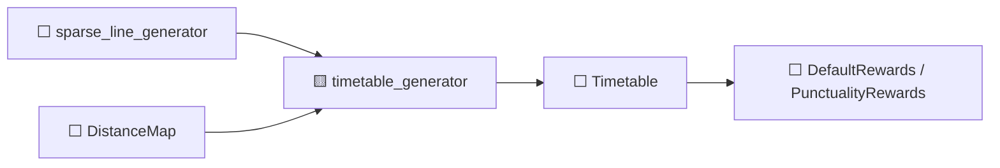

# Timetables a single agent can keep: intermediate times divided by the speed (#569)

> **Status:** plan of 2026-11-27, draft. Based on `main` 4856ebfe. Issue
> [#569](https://github.com/flatland-association/flatland-rl/issues/569) ("timetable_generator: intermediate waypoint
> times ignore the agent's speed", chenkins, found while reviewing
> [#542](https://github.com/flatland-association/flatland-rl/pull/542)). Branch `569-intermediate-times-speed`, PR not
> opened yet. Open questions: none; Q-1–Q-7 decided 2026-11-27. Extended on 2026-11-27 (Q-6): a single agent must be
> able to keep the timetable, so the route through the stops and the start in step 1 are fixed here too, and the
> rounding is per segment (Q-2 revisited).
>
> **Why:** `timetable_generator` divides an agent's total travel time by its speed, but not the times at its
> intermediate waypoints. For a slow agent with intermediate stops, the timetable plans too little time between two
> stops, and the window at each stop is too wide: an agent that arrives at a stop at its latest arrival can't reach the
> next one on time, while the earliest departure never holds it back. Two more causes, at every speed, keep a single
agent from its timetable (§3): the timetable plans each segment from the first listed direction at a stop, wherever
the route arrives, and counts from step 0 for an earliest departure of 0, while the agent enters the map in step 1.

## 1. Introduction and goals

*What the change is for: the requirements, the qualities that matter, who has a stake, and what it leaves out.*

### 1.1 Requirements overview (functional requirements)

*The issue's text and the numbered requirements the rest of the plan refers to.*

> `timetable_generator` divides an agent's total travel time by its speed, but not the times between intermediate
> waypoints. For agents with `max_speed < 1` and intermediate waypoints, the intermediate earliest departures and
> latest arrivals are too tight: at speed 1/2 a segment of length 4 takes 8 steps, but the timetable allows 4. […]
>
> - Divide each segment length by the agent's speed for the intermediate times, rounded up to whole steps:
>   `int(np.ceil(l / agent_speed))`.
> - Update `timetable_generator`'s docstring (the travel time heuristic) and the note in `AGENTS.md` ("intermediate
>   waypoint times not" divided by the speed).
> - List it as a breaking change: generated timetables change for slow agents with intermediate waypoints.
>
> Minimal testing requirements: an agent with `max_speed = 1/2` and an intermediate waypoint: the time between its
> waypoints is the segment length divided by 1/2, rounded up. An agent at full speed, or without intermediate
> waypoints: its timetable stays as before.

"Too tight" is the time between two consecutive waypoints. Seen at each waypoint on its own, the same error makes the
window too wide (§3). Both are fixed by the same change.

Requirements:

- **REQ-1** The earliest departure and latest arrival at each intermediate waypoint are the start's earliest departure
  plus, and the target's latest arrival minus, the travel times of the segments, each divided by the agent's max speed
  and rounded up to whole steps on its own (`ceil(l / max_speed)`, as the issue asked; Q-2 revisited).
- **REQ-2** Agents without intermediate waypoints keep their timetable exactly.
- **REQ-5** The segments follow one route through the stops: each stop's entry point (position and direction, as the
  rewards serve a stop) is chosen jointly over the whole route, the shortest one (Q-6).
- **REQ-6** For an earliest departure of 0, the intermediate times count from step 1, the first step the agent can
  enter the map (Q-6).
- **REQ-7** A single agent without malfunctions, accelerating to its max speed in one step, can keep the timetable: it
  enters each stop at least one step before the stop's earliest departure, halts, starts again at the earliest
  departure and reaches the target by its latest arrival, without penalty. Documented in the docstring and in a new
  flatland-book page (Q-6, Q-7).
- **REQ-3** `timetable_generator`'s docstring and the note in `AGENTS.md` describe the new behaviour; only the +1 per
  segment stays a heuristic (Q-1, Q-3).
- **REQ-4** It is listed as a breaking change (Q-4).

### 1.2 Quality goals (non-functional requirements)

*The few qualities the design must reach, each with a concrete scenario.*

| ID | Priority | Quality goal | Scenario |
|---|---|---|---|
| NFR-1 | 1 | Keepable times | A single agent that drives the shortest route through its stops at max speed, halting one step at each, departs each stop at its earliest departure and reaches the target by its latest arrival (REQ-7). |
| NFR-2 | 2 | Exact arithmetic | Speeds that are not 1/n (`Fraction(3, 4)`) give the same times on every platform: `max_speed` is a `Fraction`, so the division and `math.ceil` are exact, without float rounding. |

### 1.3 Stakeholders

*Who asks for the change, decides on it, reviews it or works with the result, and what they expect.*

| Role | Name | Expectations |
|---|---|---|
| Issue author, maintainer | chenkins | Timetables that slow agents with stops can keep; the heuristic documented where it stays. |
| Users generating envs with intermediate stops | benchmark and research users (`env_generator(line_length=3)`, flatland-baselines' intermediate stop tests) | Told by the breaking change that generated timetables of slow agents with stops change. |

### 1.4 Follow-ups (not in this PR)

*What this PR leaves out, why, and where it goes later.*

| Follow-up | Why not in this PR | From | Findings | Issue |
|---|---|---|---|---|
| flatland-book page on the timetable generator: the guarantee in a box, how the times are computed, speed profiles of one line at several speeds with the earliest and latest times. | Other repo; written alongside, on flatland-book's branch `569-timetable-generator`, which pins flatland-rl to this branch until it is merged. | Q-7 | - | - |
| Plan for the env's acceleration and braking deltas, so the guarantee holds for all of them. | Needs an interface decision (passing the deltas to timetable generators) and a route simulation with the `SpeedCounter` formulas. | §2.1 | - | [#587](https://github.com/flatland-association/flatland-rl/issues/587) |
| Agents done at the target before serving a stop on the way. | Changes `step()`'s contract (env, not timetable). | §2.1 | - | [#557](https://github.com/flatland-association/flatland-rl/issues/557) (measurements added as a comment) |
| One travel time method for the timetable and the rewards (`get_travel_time_on_shortest_path()` generalised to a source and targets, cumulative rounding), with #544's opt-in for the step onto the map; decide there whether the timetable follows it. | Changes `EnvAgent` and `rewards.py`, the files of the open reward PRs #584 and #585 (and #571 rebuilds `EnvAgent`). #544 is an opt-in, not a breaking change; it would be swept into this one. | Q-3 | - | [#544](https://github.com/flatland-association/flatland-rl/issues/544) (proposal added as a comment) |

## 2. Constraints

*What limits the design from outside: platform, organisation and conventions.*

| ID | Constraint | Kind | Explanation |
|---|---|---|---|
| C-1 | `AGENTS.md` (§ edge lengths) calls the travel times a heuristic "not to be 'fixed'". | convention | Added with #542 (6008a6d6, 2026-10-21) to keep that PR from changing timetables on the side. This change is the deliberate fix of #569 and rewrites the note (Q-1). |
| C-2 | Timetable entries are whole steps. | technical | `test_timetable_with_intermediate_waypoints_is_whole_steps` (`tests/test_flatland_edge_lengths.py:761`) checks it, also with fractional edge lengths. |
| C-3 | Saved envs keep their timetables. | technical | The timetable is stored in the env pickle and in recorded episodes; only newly generated timetables change. |
| C-4 | Other 5.0.0 fixes in parallel. | organisational | #584 and #585 change `rewards.py` and `test_rewards.py`, #586 the malfunction durations, #571 `EnvAgent`. This change touches none of their files. |

### 2.1 Limitations

*What the built code gets wrong or ignores, each with the TODO or issue that tracks it.*

Limitations (`timetable_generator`'s docstring):

- The +1 per segment of `shortest_path_length()` is divided by the speed. For the first segment it stands for the step
  onto the map, which takes one step at any speed, so slow agents get some extra slack; at intermediate waypoints it
  stands roughly for the halt at the stop. Tracked in [#544](https://github.com/flatland-association/flatland-rl/issues/544).
- A generated line whose shortest route to a stop passes the target cell can't be kept: the agent is done at the
  target before serving the stop (25 of 150 single-agent runs, also on `main`). Not a timetable problem; tracked in
  [#557](https://github.com/flatland-association/flatland-rl/issues/557) (point 1, measurements added as a comment).
- Acceleration and braking are not planned for: the guarantee needs the default `acceleration_delta=1` and
  `braking_delta=-1`; the timetable generator doesn't get the env's deltas. Tracked in
  [#587](https://github.com/flatland-association/flatland-rl/issues/587).
- The start's routing flexibility is ignored: the route starts at the first entry point of the start group, as the env
  does.
- A stop whose listed entry points can't be reached counts in any direction at its positions (the rewards never
  count it as served); a segment with nothing reachable counts 0, as an unreachable target does.

### 2.2 Assumptions

*What must hold for the design to be correct, but is not checked in code.*

Not checked in code; they hold by construction of `timetable_generator` and `SpeedCounter`.

- `agent.speed_counter.max_speed` is a `Fraction` when the timetable is generated (`validated_max_speed()` converts
  every max speed).
- The segment lengths are whole numbers (`_shortest_path_length_or_zero()` rounds them up), so the division is exact.

## 3. Context and scope (checked 2026-11-27 on `main` 4856ebfe)

*The code on the base branch that the change works in, as it is before the change, and where the change stops.*

`flatland/envs/timetable_generators.py`, `timetable_generator()`:

- Lines 69-94: one length per segment (between consecutive waypoints) and agent, from a distance map built with one
  fake agent per segment: `_shortest_path_length_or_zero()`, the sum of the edge lengths plus 1, rounded up.
- Line 98: the total, `sum(segments) / max_speed`, sets `max_episode_steps`, the departure window, and the latest
  arrival at the target (`agent_travel_time_max`, with a 1.3 buffer and the mean path delay).
- Lines 120-131: the intermediate times add (`ed += l`) and subtract (`la -= l`) the raw segment lengths, not divided
  by the speed.
- The docstring (lines 38-44) documents this, ending with "slow agents' intermediate waypoint times are relatively
  tight"; the issue took "too tight" from there.

Example: speed 1/2, segments 5 and 7, earliest departure 10, latest arrival at the target 46.

| | Start | Stop 1 | Target |
|---|---|---|---|
| Earliest departure, `main` | 10 | 15 | – |
| Earliest departure, after | 10 | **20** | – |
| Latest arrival, `main` | – | 39 | 46 |
| Latest arrival, after | – | **32** | 46 |

The agent can't be at stop 1 before step 20, so 15 never holds it back; arriving at stop 1 at 39, it needs 14 steps
and reaches the target at 53, 7 steps late.

History: the total has been divided by the speed since the first timetable generator (13808a1b, 2021). The
intermediate times came with the multi-stop schedules of #124 (24525189, 2025-03-10); its test,
`test_timetable_generator_intermediate`, runs all agents at speed 1, where both ways agree. No reason for leaving out
the speed is given; it looks like an oversight.

Measured on 2026-11-27, a single agent without malfunctions on generated lines (15 seeds, 2 or 3 stops less one,
speeds 1, 3/4, 1/2, 1/3, 1/4), driving the shortest route through its stops, halting at each and starting at the
earliest departure. On `main` with only the division by the speed:

- Lines where all is well: the agent enters each stop `ceil(1 / speed)` steps before the stop's earliest departure
  (1 at speed 1: arrive, halt one step, start), and reaches the target 42 to 166 steps before its latest arrival.
- Start at 0 (3 lines at speed 1): one step late at the first stop. The agent enters the map in step 1 at the earliest
  ([#559](https://github.com/flatland-association/flatland-rl/issues/559)), the times counted from 0.
- Direction at the stops (5 of 25 lines, every speed): 5 to 400 steps late. Each segment is planned from the first
  listed entry point of its stop, but to any direction at the next stop, so the segments don't join into one route; a
  stop listed in one direction is only served in that direction (`DefaultRewards` matches entry points).
- Cumulative rounding at 3/4 (2 lines): one step short after a stop. Rounding the sum can give a segment fewer whole
  steps than the agent needs from a halt.

Neighbours: the intermediate times feed the intermediate stop penalties of `DefaultRewards` and `PunctualityRewards`
(`flatland/envs/rewards.py`), which read `waypoints_earliest_departure`/`waypoints_latest_arrival`. Envs from
`env_generator()` have slow agents by default (`speed_ratios` 1, 1/2, 1/3, 1/4) and intermediate waypoints with
`line_length=3` or more; the default `line_length=2` has none.

Scope: the segment lengths (one route through the stops) and the intermediate times in `timetable_generator()`
change, plus its docstring, the `AGENTS.md` note and the tests. With the segment lengths, the total, and with it
`max_episode_steps`, the departure window and the target's latest arrival, change for lines with stops. The rewards are
unchanged.

## 4. Solution strategy

*The fundamental choices and why, the rules the design follows, how it is verified, and the design of each part.*

| Quality goal | Scenario | Solution approach | Details |
|---|---|---|---|
| NFR-1 | Waypoint times an agent can keep | One route through the stops; each segment's time divided by the speed and rounded up; counted from the step the agent can enter the map. | §4.3, §4.4 |
| NFR-2 | Exact times for any speed | `Fraction` arithmetic and `math.ceil`. | §4.3 |

### 4.1 Design principles

*The rules the design follows, each with its decision, the concepts it reuses instead of building new ones, and what
is not new on purpose.*

- **DP-1 The times are those of a single agent driving the route.** Each segment starts from a halt, so its time is
  its length divided by the speed, rounded up on its own; the first counts from the step the agent can enter the map.
  The total keeps dividing the unrounded sum by the speed, for `max_episode_steps` and the latest arrival. (Q-1, Q-2
  revisited, Q-6)
- **DP-3 The route is one route.** The entry point at each stop is chosen over the whole route, as the agent leaves a
  stop in the direction it arrived in, and a stop is served at its listed entry points only. (Q-6)
- **DP-2 The +1 per segment stays as it is.** It is divided by the speed with its segment, as the total does today;
  whether to count it exactly is #544's question, for timetable and rewards together. (Q-3)

Reused concepts:

| Need | Reused concept | Instead of |
|---|---|---|
| Segment lengths | `DistanceMap` with one fake agent per entry point to reach, as before per segment | `get_k_shortest_paths()` per pair of entry points (slower) |
| Exact division | `max_speed` as `Fraction` (`validated_max_speed()`) | Float division with a tolerance |

Not new on purpose: no new parameter or flag (Q-1), no change to `Timetable`, the line generators or the rewards.
The earliest departure itself stays as drawn, 0 included (#559 decides about the alias).

### 4.2 Verification

*How each requirement and quality goal is shown to work: tests, CI checks, before and after screenshots.*

Screenshots: none, nothing visible changes.

| ID | Requirement | Test or check | Result | Screenshots |
|---|---|---|---|---|
| REQ-1 | Times divided by the speed, rounded per segment | `test_timetable_intermediate_times_divided_by_speed[0.5, 0.75]` (`tests/test_flatland_envs_timetable_generator.py`): the same lines (three segments) at speed 1 and at the lower speed; each segment takes `ceil(length / speed)`. | ✅ | - |
| REQ-2 | No intermediate waypoints unchanged | `test_timetable_generator` passes unchanged. `test_timetable_generator_intermediate` gets new values: agents 1, 8 and 9 reach their stop in its listed direction only on a longer route; agents 2 and 3 list a direction at the stop that can't be reached (any direction counts, agent 3's target then can't be reached and counts 0). | ✅ | - |
| REQ-5, REQ-6, REQ-7 | A single agent keeps the timetable | `test_timetable_can_be_kept_by_a_single_agent` (16 cases: 4 lines × speeds 1, 3/4, 1/2, 1/4; a start at 0, stops reached in the other direction): enters each stop before its earliest departure, starts at it, arrives by the latest arrival, no penalty. All 16 fail on `main`. Measured beyond the test: the 125 lines of §3, all kept, margin `ceil(1 / speed)` at each stop. | ✅ | - |
| REQ-3 | Docs | Docstring and `AGENTS.md` reviewed against the code. | | - |
| REQ-4 | Breaking change | `!` and `BREAKING CHANGE:` footer in S-1. | | - |
| NFR-1 | Keepable times | `test_timetable_can_be_kept_by_a_single_agent`. | ✅ | - |
| NFR-2 | Exact arithmetic | `test_timetable_with_intermediate_waypoints_is_whole_steps` passes, also with fractional edge lengths; `test_timetable_segments_scale_with_edge_lengths` expects the times divided by the speed. | ✅ | - |

Measured on the branch with the whole change (route through the stops, per-segment rounding, step 1), on 2026-11-27:
flatland-rl (`-m "not slow"`) 1403 passed, 58 skipped; flatland-baselines unchanged (seed 1003 fails as on `main`, see
below).

Measured on a copy of `main` 4856ebfe with the first version of the fix (division only), on 2026-11-27:

- flatland-rl (`-m "not slow"`): 1 failed, 1397 passed, 58 skipped. The one failure is
  `test_timetable_segments_scale_with_edge_lengths`, which expected the undivided times and is updated in S-1. The
  tests on generated envs with stops and slow agents (`env_generator(line_length=3)` in the malfunction effects and
  policy tests) don't pin timetable values. The regression episodes replay saved timetables (C-3).
- flatland-baselines (`deadlock_avoidance_heuristic/tests`, `-m "not slow"`): no change. Seed 1003 of
  `test_policy_runner.py` fails with and without the fix alike (reward -19 in both), as the baselines checkout is
  calibrated for #586; its intermediate stop test doesn't pin timetable values.

### 4.3 Intermediate times (REQ-1, REQ-2; Q-1, Q-2, Q-3)

*One part of the change: what changes and why, with the requirements and decisions it implements.*

Lines 120-129 become:

```python
speed = agent_speeds[agent.handle]  # a Fraction, so the division and ceil are exact
steps = [math.ceil(length / speed) for length in shortest_path_segment_lengths[agent.handle]]
start = max(earliest_departure, 1)  # the agent enters the map in step 1 at the earliest
eds = [earliest_departure] + [start + done for done in itertools.accumulate(steps)]
las = [latest_arrival - sum(steps[i:]) for i in range(len(steps))] + [latest_arrival]
```

followed by the existing `eds[-1] = None`, `las[0] = None`. Without intermediate waypoints there is one segment, and
only the start's earliest departure and the target's latest arrival remain, which don't change.

### 4.4 One route through the stops (REQ-5; Q-6)

*One part of the change: what changes and why, with the requirements and decisions it implements.*

`_segment_lengths_through_stops()` replaces the fake agent per segment: one fake agent per distinct entry point to
reach (each listed entry point of a stop, the targets as one set), deduplicated over the agents, in one `DistanceMap`.
A dynamic programme over the stops keeps the shortest route to each entry point of the stop so far, with its segment
lengths; the route to the closest target wins. A stop none of whose listed entry points is reachable falls back to any
valid direction at its positions; a segment with nothing reachable counts 0, as before.

## 5. Building block view

*The components the change adds or changes: an overview, why the system is split this way, what each is responsible
for, the important interfaces, and the planned data model.*

### 5.1 Timetable generation

*One white box: its building blocks, why it is split this way, and the interfaces between them.*



Notation: 🟩 added, 🟨 modified, ⬜ unchanged; arrows: data flow.

**Motivation:** the fix stays inside the generator, which already has the segment lengths and the speeds (DP-1).

**Contained building blocks:**

| Component | Responsibility | Change |
|---|---|---|
| `timetable_generator` | Plans each agent's earliest departures, latest arrivals and the episode length from the shortest route through its stops. Not for rewards or for checking that agents keep the timetable. | 🟨 modified: a single agent can keep the times at its stops, at any speed. |

## 8. Crosscutting concepts

*What the change introduces that other code will follow, and what it changes for existing callers.*

### 8.1 New patterns

*What is new compared with the base branch.*

Compared with `main` 4856ebfe. What is reused, and what is not new on purpose, is in §4.1.

| ID | New | Defined in |
|---|---|---|
| ~~PAT-1~~ | ~~Cumulative rounding of travel times.~~ Replaced by per-segment rounding (Q-2 revisited), as on `main` for whole lengths. | §4.3 |
| PAT-2 | The route through the stops as a dynamic programme over the stops' entry points, on one distance map with a row per entry point to reach. | §4.4, Q-6 |

### 8.2 Breaking changes

*What breaks for whom, and the migration path.*

None for the API: no signature, parameter or format changes.

- **Generated timetables:** for agents with intermediate waypoints, the times at the stops change: later earliest
  departures and earlier latest arrivals for slow agents, longer segments where the route arrives at a stop in another
  direction than its first listed one (also the total, `max_episode_steps`, the departure window and the target's
  latest arrival), and one step later for an earliest departure of 0. Affects anyone generating envs with
  `line_length` ≥ 3 (`env_generator()`'s default speeds include slow agents), and their rewards. Saved envs and
  recorded episodes keep their timetables (C-3). No compatibility flag (Q-1); migration: re-calibrate values pinned to
  generated envs with intermediate stops (S-1; `test_timetable_generator_intermediate`).
- **Timetable generation time:** one distance map row per distinct stop entry point instead of one per agent and
  segment.

## 9. Decisions

*The decisions behind the plan: the questions still open, the decisions taken, and how each review finding was settled.*

### 9.1 Open questions

*Choices not made yet, each with its options and a proposal.*

✅ ~~**(Q-1) Fix it and change the `AGENTS.md` rule, keep the heuristic, or make it opt-in?**~~
**Decided 2026-11-27:** fix it, and rewrite the note so that only the +1 per segment stays a heuristic.

✅ ~~**(Q-2) Round per segment, `ceil(l / speed)`, or cumulatively?**~~
~~**Decided 2026-11-27:** cumulatively, as the code stays as simple (§4.3).~~
**(Q-2) revisited 2026-11-27:** per segment. With Q-6 a single agent must keep the times, and cumulative rounding left
it one step short after a stop at speed 3/4 (2 of 25 lines): rounding the sum can give a segment fewer whole steps
than the agent needs from a halt. Per segment, the times drift from the total by up to one step per segment, within the latest arrival's buffer.

✅ ~~**(Q-3) The +1 per segment: divide it by the speed with its segment, or not?**~~
**Decided 2026-11-27:** divide it with its segment, consistent with the total today; #544 decides about exactness, for
timetable and rewards together, in its own PR after #584 and #585.

✅ ~~**(Q-4) Breaking change?**~~
**Decided 2026-11-27:** yes, `fix(timetables)!:` with a `BREAKING CHANGE:` footer.

✅ ~~**(Q-5) Correct the issue's "too tight"?**~~
**Decided 2026-11-27:** keep it, and add a comment on #569 with the example for both views (§3).

✅ ~~**(Q-6) Fix the start at 0 and the direction at the stops here, or separately?**~~
**Decided 2026-11-27:** here, in #569, so the timetable can promise that a single agent keeps it.

✅ ~~**(Q-7) Document the guarantee where?**~~
**Decided 2026-11-27:** a new flatland-book page with a box stating the guarantee and speed profiles, run against this
branch.

### 9.2 Decision log

*Every decision by date, with why it was taken and what follows from it.*

| Date | Decision | Why | Consequences |
|---|---|---|---|
| 2026-11-27 | ✅ Fix the intermediate times; rewrite the `AGENTS.md` note (Q-1). | The times contradict each other, not just a rough estimate; the note protected the heuristic for #542, not against #569. Not taken: keep it (closing #569 as by design), an opt-in flag (two behaviours to maintain for a bug). | S-1 is breaking; values pinned to generated envs with stops need re-calibration. |
| 2026-11-27 | ~~✅ Cumulative rounding (Q-2).~~ Replaced by per-segment rounding on 2026-11-27. | Same code size; the times never drift from the total. Not taken: per segment, as the issue proposed. | REQ-1 differs from the issue's text; PAT-1. The #544 follow-up uses the same rounding. |
| 2026-11-27 | ✅ Keep the +1 per segment, divided by the speed (Q-3). | Consistent with the total and the rewards' default; at a stop it stands for the halt. Not taken: count it exactly here (changes every slow agent's total), unify with the rewards now (conflicts with #584, #585, #571). | Follow-up in #544, with the unification proposal as a comment there. |
| 2026-11-27 | ✅ Breaking change (Q-4). | Generated timetables change for slow agents with stops. | `!` and footer in S-1. |
| 2026-11-27 | ✅ Keep the issue text, add a comment (Q-5). | Both views are right: too tight between stops, too wide at each stop. | Comment for #569 drafted. |
| 2026-11-27 | ✅ A single agent can keep the timetable: one route through the stops, times from step 1, in #569 (Q-6). | Measured (§3): 5 of 25 lines missed their stops at every speed, and 3 started one step late. Not taken: separate issues, as each is a breaking change of generated timetables too. | REQ-5–REQ-7, §4.4, PAT-2; the issue's scope grows; slower generation. |
| 2026-11-27 | ✅ Per-segment rounding (Q-2 revisited). | Needed for REQ-7: each segment gets the whole steps the agent needs from a halt. Not taken: keep cumulative rounding and add a step after each stop. | PAT-1 replaced; REQ-1 as the issue asked. |
| 2026-11-27 | ✅ flatland-book page with the guarantee and speed profiles (Q-7). | The guarantee and the meaning of the times were documented nowhere. | Follow-up row in §1.4: a flatland-book branch. |

### 9.3 Code Review Findings

*Findings from code reviews, PR comments and TODOs, with their status and the commits that fix them.*

None yet.

## 10. Glossary

*The domain and technical words the plan uses, with their code symbols.*

- **Waypoint** (`EnvAgent.waypoints`): the start, each intermediate stop and the target of an agent's line. Not a cell
  on the path between them.
- **Segment**: the part of the route between two consecutive waypoints; its length is the sum of the edge lengths
  plus 1, rounded up, as `shortest_path_length()`.
- **Entry point of a stop**: a position and direction listed in the stop's waypoint group; the rewards serve the stop
  only when the agent halts at one of them.
- **Intermediate times** (`waypoints_earliest_departure`, `waypoints_latest_arrival`): the earliest departure and
  latest arrival at each waypoint; the start has no latest arrival, the target no earliest departure.
- **Max speed** (`speed_counter.max_speed`): the agent's top speed, a `Fraction` in (0, 1]; cells per step.

## 11. Execution plan and status

*The commits that build the change, in order, and which of them are done: the source of the PR's status.*

### 11.1 Steps

*One row per commit: what it does, the findings it fixes, its message, and its SHAs once committed.*

| ID | Findings | Step | Category | Severity | Commit message | Commit(s) | Needs | Blocked by |
|---|---|---|---|---|---|---|---|---|
| 💡 S-1 | - | One route through the stops (§4.4), the intermediate times divided by the speed per segment and counted from step 1 (§4.3), with the new tests, the updated `test_timetable_segments_scale_with_edge_lengths` and `test_timetable_generator_intermediate`, the docstring and the `AGENTS.md` note; `BREAKING CHANGE:` footer. | fix | medium | fix(timetables)!: generate intermediate times that a single agent can keep at its speed. |  | - | - |

## 12. Change inventory

*Every file the change adds, modifies, renames or removes, and what stays unchanged on purpose.*

### 12.1 New files

*The files the change adds, and what each adds.*

| File | Adds |
|---|---|
| `docs/plans/intermediate-times-speed.md` | This plan. |

### 12.2 Modified files

*The files the change modifies, and what changes in each.*

| File | Changes |
|---|---|
| `flatland/envs/timetable_generators.py` | `_segment_lengths_through_stops()` (one route through the stops); intermediate times divided by the speed per segment, from step 1; docstring with the guarantee. |
| `AGENTS.md` | The edge-lengths note: only the +1 per segment stays a heuristic. |
| `tests/test_flatland_envs_timetable_generator.py` | `test_timetable_intermediate_times_divided_by_speed` (speeds 1/2 and 3/4, three segments); `test_timetable_can_be_kept_by_a_single_agent` with its driver `_StopServingPolicy`; new values in `test_timetable_generator_intermediate`. |
| `tests/test_flatland_edge_lengths.py` | `test_timetable_segments_scale_with_edge_lengths` expects the divided times, counted from step 1. |

Unchanged on purpose: `Timetable`, the line generators, `EnvAgent.get_travel_time_on_shortest_path()`, the rewards,
saved envs and recorded episodes.
