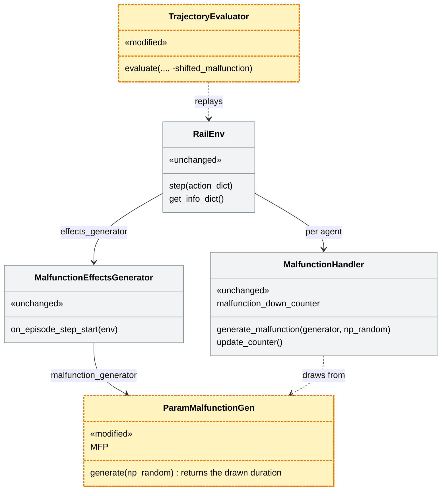
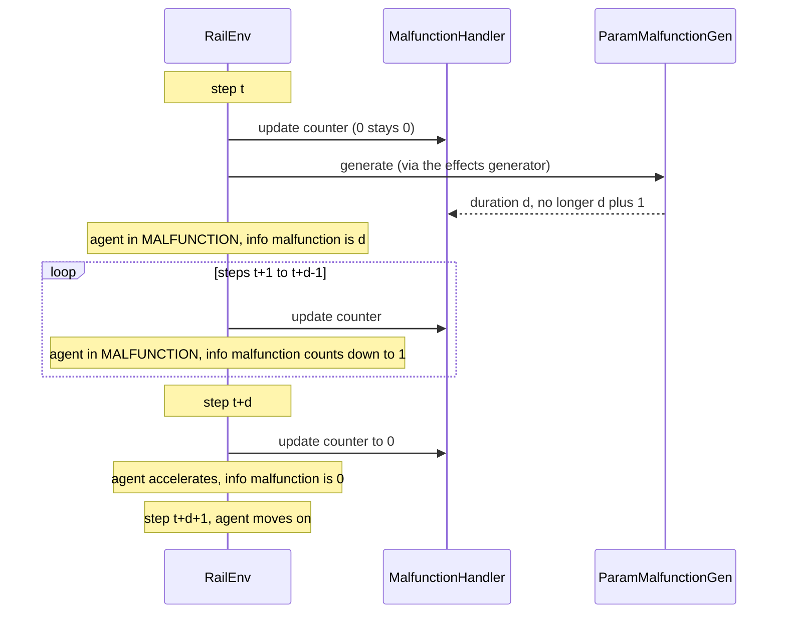

# Malfunction durations in the documented range (#565)

> **Status:** plan of 2026-11-23, decided 2026-11-26. Based on `main` 4856ebfe (planned on ac932d16; since then `main`
> changed only `env_generator.py` and `test_flatland_envs_rail_env.py` of the files below, not the `+ 1` sites). Issue
> [#565](https://github.com/flatland-association/flatland-rl/issues/565) ("ParamMalfunctionGen draws malfunction
> durations one step longer than documented", chenkins, milestone 5.0.0), found while documenting the default
> malfunction generator in [flatland-book#43](https://github.com/flatland-association/flatland-book/pull/43). Branch
> `565-malfunction-duration-range`, PR [#586](https://github.com/flatland-association/flatland-rl/pull/586). Open questions: none (§9.1).
>
> **Why:** `min_duration` and `max_duration` are documented as the range of a malfunction's duration, but every
> malfunction lasts one step longer. Users who set a duration get another one, and the flatland-book has to explain
> the gap in a warning box.

## 1. Introduction and goals

*What the change is for: the requirements, the qualities that matter, who has a stake, and what it leaves out.*

### 1.1 Requirements overview (functional requirements)

*The issue's text and the numbered requirements the rest of the plan refers to.*

> The docstrings say a malfunction lasts between `min_duration` and `max_duration` steps […].
> `ParamMalfunctionGen.generate()` adds 1 to the drawn value […]. So the duration is uniform in
> `min_duration + 1 … max_duration + 1`, and an agent is blocked for one step more than the parameters say.
>
> **Expected:** Either the duration is uniform in `[min_duration, max_duration]`, as documented, or the docstrings say
> that the generator adds 1 and why.
>
> **Proposal:** Decision: **a), fix the code** […]. With a), adjust the regression episodes and add a test that pins
> the drawn range to `[min_duration, max_duration]`.

Requirements:

- **REQ-1** `ParamMalfunctionGen.generate()` draws `num_broken_steps` uniformly in `[min_duration, max_duration]`
  (Q-1).
- **REQ-2** An agent is in `MALFUNCTION` (or `MALFUNCTION_OFF_MAP`) for exactly the drawn number of steps, starting
  with the step in which it is drawn.
- **REQ-3** A test pins the drawn range and the blocked steps (REQ-1, REQ-2).
- **REQ-4** The docstrings of all users of `ParamMalfunctionGen` state the range and when the malfunction starts
  blocking, and what a drawn 0 means (Q-3).
- **REQ-5** The regression episodes are adjusted to the shorter malfunctions (from the issue; how: Q-5).

### 1.2 Quality goals (non-functional requirements)

*The few qualities the design must reach, each with a concrete scenario.*

| ID | Priority | Quality goal | Scenario |
|---|---|---|---|
| NFR-1 | 1 | Correct as documented | `MalfunctionParameters(rate=1e9, min_duration=1, max_duration=3)`, 10,000 draws from `RandomState(0)`: only 1, 2 and 3, each about a third. |
| NFR-2 | 2 | Unchanged randomness | The fix consumes the same random numbers as `main`: the draws are positive in the same steps, with the same values minus 1 (§4.3). In `PINNED_COUNTERS` of `tests/test_malfunction_generators.py` (seed 42, 2 agents, 40 steps) the malfunctions start in the same steps, and each agent has as many as on `main`. |

### 1.3 Stakeholders

*Who asks for the change, decides on it, reviews it or works with the result, and what they expect.*

| Role | Name | Expectations |
|---|---|---|
| Author, maintainer | chenkins | The documented range holds in 5.0.0 (decided in the issue). |
| Benchmark and scenario owners | FAB, flatland-scenarios | Know that envs with malfunctions give other results from 5.0.0 on (§8.2). |
| flatland-baselines | maintainers | One pinned result changes (`test_policy_runner.py`, §8.2); their recorded trajectories are re-recorded anyway (§3). |
| flatland-book | maintainers | Update the Stochasticity page's warning box "Malfunction duration and steps lost" (§1.4). |

### 1.4 Follow-ups (not in this PR)

*What this PR leaves out, why, and where it goes later.*

| Follow-up | Why not in this PR | From | Findings | Issue |
|---|---|---|---|---|
| Update the flatland-book Stochasticity page: the warning box "Malfunction duration and steps lost" and the 4.3.0/5.0.0 table. In 5.0.0 the duration $D$ is the drawn $d$, a moving agent loses $d + 1$ steps (as in 4.3.0) if it gets back to its max speed in one step, and `info['malfunction']` counts $d … 1$. The 5.0.0 malfunction plot is computed at build time; the Agent page's counter note and the Evaluation page's `shifted_malfunction` (S-2) change too. | Another repo; the book's checks run against flatland-rl `main`, so the book PR merges after this one. | §6.1 | - | [flatland-book#66](https://github.com/flatland-association/flatland-book/pull/66) |
| Re-record the regression episodes (`tests/test_flatland_regression_episodes.py`) and flatland-baselines' `test_episodes_deadlock_avoidance.py` episodes as the v8 archive, on a flatland-rl with this fix. | They are skipped on `main` and already diverge from it (#178, flatland-scenarios#37); one re-recording covers both changes (Q-5). | Q-5 | - | [flatland-scenarios#37](https://github.com/flatland-association/flatland-scenarios/issues/37) |
| flatland-baselines: `test_policy_runner.py::test_env_path_and_seed[1003-...]` expects reward -19; with the fix it is -18 (normalized 0.99091 instead of 0.99041). Update the expectation on a flatland-baselines branch `565-malfunction-duration-range`, with `checks.yaml`'s `env.flatland-rl-ref` pointing at this branch until it is merged, then back to `main`. | Another repo (workspace rule for flatland-rl changes). | §8.2 | - | - |
| The perturbed tree observation never ends a "blind" period: `get_many()` draws, but nothing calls `MalfunctionHandler.update_counter()`, so a perturbed agent stays blind for the rest of the episode. | Another bug; this PR only changes the duration it draws (§3). | §3 | - | - |

## 2. Constraints

*What limits the design from outside: platform, organisation and conventions.*

| ID | Constraint | Kind | Explanation |
|---|---|---|---|
| C-1 | Fix the code, not the docstrings. | organisational | Decided in the issue (Q-1). |
| C-2 | Release 5.0.0. | organisational | Milestone 5.0.0; release-please writes the changelog from the commit messages, so the behaviour change goes into the commit message (Q-4). |
| C-3 | The persisted format stays. | technical | Env files and `MalfunctionEffectsGenerator` states store the parameters, `malfunction_cached_random_state` and `malfunction_rand_idx`, not durations; they load as before. |
| C-4 | Conventions of `AGENTS.md`. | convention | Tests with the episodes fixture, `flake8`, flatland-baselines' tests before calling it done; a PR that closes an issue leaves no TODO referencing it. |
| C-5 | Other 5.0.0 bug fixes in parallel. | organisational | #555, #554 and #519 change `flatland/envs/rewards.py`, #544 `EnvAgent.get_travel_time_on_shortest_path`. None touches the malfunction files; rewards of envs with malfunctions change by both, independently. Overlap in tests: S-1 updates the pinned sums of `test_rewards.py::test_rewards_via_policy_runner`, which the reward fixes may update too; whoever merges second recomputes them. Open PR [#556](https://github.com/flatland-association/flatland-rl/pull/556) (`ScheduledMalfunctionEffectsGenerator`) adds a generator to `malfunction_effects_generators.py`, apart from the lines S-1 changes; its docstring says "Unlike the rate-based generators, the duration is exact (no +1)", which this fix makes stale: whichever merges second drops that comparison. Its exact durations agree with this fix (DP-1). |

### 2.1 Limitations

*What the built code gets wrong or ignores, each with the TODO or issue that tracks it.*

- A malfunction blocks the agent from the step in which it is drawn; the agent can't act on the information before
  it is blocked. Unchanged; the flatland-book calls it "bug?" (§6.1). No issue.
- After the malfunction, a moving agent first accelerates, so it loses one step more than it is blocked (§6.1). By
  design of the speed model (#178), as after any stop. No issue.
- With `min_duration = 0`, a drawn 0 is no malfunction (Q-3); the effective malfunction rate is lower than the
  parameter says. Documented in the docstrings (S-1).

### 2.2 Assumptions

Not checked in code; they hold by construction of `MalfunctionHandler` and `RailEnv.step()`.

- The malfunction counter is decremented at the start of `step()`, before the effects generators draw
  (`rail_env.py:509-515`, since a2ba6382c). The blocked steps of REQ-2 count from there.
- `MalfunctionHandler.generate_malfunction()` ignores a duration of 0 and sets a new counter only when the old one is
  0 (`malfunction_handler.py:39-51`).
- No caller uses a positive rate with `min_duration = 0` (grep of `flatland/`, `tests/`, `benchmarks/`, `examples/`,
  `notebooks/` and flatland-baselines on 2026-11-23: all with `min_duration = 0` have rate 0).

## 3. Context and scope (checked 2026-11-23 on `main` ac932d16)

*The code on the base branch that the change works in, as it is before the change, and where the change stops.*

- **`ParamMalfunctionGen.generate()`** (`flatland/envs/malfunction_generators.py:107-119`): reads the next entry of
  the block (§10); on a positive draw it returns
  `np_random.randint(min_duration, max_duration + 1) + 1` (lines 116-117). The `+ 1` dates back to 03e8ed7d7
  (2019-10-25, "updated behavior of malfunction to reflect the concerns of participant"), when the counter was
  decremented in the step of the draw.
- **Deprecated generators** in the same file: `malfunction_from_file()` adds the same `+ 1` (lines 324-325);
  `malfunction_from_params()` has none (lines 374-375; its `+ 1` was dropped in cc04d63ff, 2021). Only
  `malfunction_from_params()` is used, in `tests/test_utils.py` and `tests/test_flatland_states_edge_cases.py`;
  neither is used in `flatland/` or flatland-baselines.
- **Users of `ParamMalfunctionGen`**, all documented as "duration in `[min_duration, max_duration]`" or "duration of
  malfunction":
  - `RailEnv`'s `MalfunctionEffectsGenerator` (`malfunction_effects_generators.py:12-35`), from `env_generator()`
    (`env_generation/env_generator.py:65-68`, defaults 20 and 50) and `PolicyRunner`'s CLI
    (`trajectories/policy_runner.py:305-315`);
  - `ConditionalMalfunctionEffectsGenerator` and `IntermediateStopMalfunctionEffectsGenerator`
    (`malfunction_effects_generators.py:89-92`);
  - the perturbed tree observation (`observations_perturbed.py:27-30`), whose `get_many()` draws but never counts
    down (lines 66-70): blind periods never end (follow-up §1.4).
- **`RailEnv.step()`** (`flatland/envs/rail_env.py:509-515`): (1) decrements every agent's counter, (2) lets the
  effects generators draw. `info['malfunction']` is the counter after the step (lines 442-444).
- **Persistence:** stores the parameters and the block's random state and position, not durations
  (`malfunction_effects_generators.py:37-48`, `persistence.py`). A loaded env draws the same steps, now one shorter.
- **Recorded episodes** (`episodes/`, archive v7):
  - `tests/test_flatland_regression_episodes.py`: 12 episodes replay recorded actions against the env and compare
    positions (`TrajectoryEvaluator`). The 6 "30x30 map" episodes have no malfunctions (their persisted parameters
    are placeholders, so `FileMalfunctionGen` falls back to none). The 6 `malfunction_deadlock_avoidance_heuristics`
    episodes have malfunctions (rate 1/540, 20-50); they pass `shifted_malfunction=True`
    (`trajectory_evaluator.py:128-130`: expect the recorded `info['malfunction']` one lower). All 12 are skipped on
    `main` (lines 82-83, #178, v8 regeneration pending).
  - `test_restore_episode` regenerates 40 envs from `metadata.csv` and compares only the initial positions: no
    malfunction involved.
  - `test_flatland_evaluators_trajectory_analysis.py` reads recorded files only.
  - flatland-baselines' `test_episodes_deadlock_avoidance.py` re-runs `DeadLockAvoidancePolicy` live on the 50
    malfunction episodes and compares with the recording; skipped too (line 24, flatland-scenarios#37).
  - Replaying 2 of them (Test_00_Level_8, Test_01_Level_3; positions only) fails on `main` and with the fix at the
    same step (8 and 6): the recordings already diverge from `main`, independently of this fix.

Reproduction of the issue on ac932d16 (the issue's script, plus `(0, 1)`), and with the `+ 1` removed:

| `(min_duration, max_duration)` | `main`: `num_broken_steps` (count of 10,000) | without `+ 1` |
|---|---|---|
| `(2, 2)` | 3 (10,000) | 2 (10,000) |
| `(1, 3)` | 2 (3,319), 3 (3,281), 4 (3,400) | 1 (3,319), 2 (3,281), 3 (3,400) |
| `(0, 1)` | 1 (5,056), 2 (4,944) | 0 (5,056), 1 (4,944) |

The countdown (one agent at speed 1 given `MOVE_FORWARD`, a malfunction drawn in step 6 with
`min_duration = max_duration = 2`, so $d = 2$; script and output in
[`malfunction-duration-range/countdown.txt`](malfunction-duration-range/countdown.txt)):

| Step | 6 | 7 | 8 | 9 | 10 | Steps blocked | Steps lost |
|---|---|---|---|---|---|---|---|
| 4.3.0 (`+ 1`, counter decremented at the end of `step()`) | 2 M | 1 M | 0 M | 0 moves | | 3 = $d + 1$ | 3 = $d + 1$ |
| `main` (`+ 1`, decremented at the start) | 3 M | 2 M | 1 M | 0 starts again, doesn't move | 0 moves | 3 = $d + 1$ | 4 = $d + 2$ |
| fix (no `+ 1`) | 2 M | 1 M | 0 starts again, doesn't move | 0 moves | | 2 = $d$ | 3 = $d + 1$ |

Each cell is `info['malfunction']` after the step and what the agent does in it (M = state `MALFUNCTION`, position
unchanged). "Steps lost": steps the agent arrives later than without the malfunction.

So the issue's hint holds for 4.3.0: there the `+ 1` made `info['malfunction']` after the draw step the drawn
value $d$, the number of steps the agent is still blocked. On `main` this is gone since a2ba6382c moved the decrement
to the start of `step()`: `info['malfunction']` is $d + 1$. Dropping the `+ 1` brings back 4.3.0's
`info['malfunction']` values and steps lost, and the agent is blocked for $d$ steps as documented.

**Scope:** the change drops the `+ 1` and states the range in the docstrings. It doesn't change when malfunctions
start, how they are drawn, the counter, the speed model or the persisted format.

## 4. Solution strategy

*The fundamental choices and why, the rules the design follows, how it is verified, and the design of each part.*

| Quality goal | Scenario | Solution approach | Details |
|---|---|---|---|
| NFR-1 Correct as documented | 10,000 draws in `[1, 3]` | Drop the `+ 1` in `generate()`; a test counts the drawn values. | §4.3 |
| NFR-2 Unchanged randomness | Same positive draws as `main` | Only the returned value changes; `randint` and the block are used as before. | §4.3 |

### 4.1 Design principles

*The rules the design follows, each with its decision, the concepts it reuses instead of building new ones, and what
is not new on purpose.*

- **DP-1 The parameters mean what they say.** `num_broken_steps` is the drawn duration, and it is the number of
  steps in `MALFUNCTION` (Q-1).
- **DP-2 One meaning of the counter.** `info['malfunction']` after a step is the number of steps the agent stays
  blocked, counting this one; the step loop and the counter stay as they are.
- **DP-3 Same draws.** The fix doesn't consume other random numbers, so a seeded env draws positively in the same
  steps (NFR-2). A positive draw that `main` discards because a malfunction is still running may now start one, as
  malfunctions end a step earlier.

Reused concepts:

| Need | Reused concept | Instead of |
|---|---|---|
| Duration of a malfunction | `np_random.randint(min_duration, max_duration + 1)` as drawn today | A new distribution or a duration offset parameter |
| Meaning of a drawn 0 | `MalfunctionHandler.generate_malfunction()` ignores 0 (Q-3 a)) | A check in `ParamMalfunctionGen` |
| Pinning malfunctions in tests | `PINNED_COUNTERS` of `tests/test_malfunction_generators.py` (#564) | A new fixture |

Not new on purpose: the persisted format, `MalfunctionParameters`, `RailEnv.step()`'s order, `info['malfunction']`'s
key, the speed model.

### 4.2 Verification

*How each requirement and quality goal is shown to work: tests, CI checks, before and after screenshots.*

No screenshots: nothing visible changes.

| ID | Requirement | Test or check | Result | Screenshots |
|---|---|---|---|---|
| REQ-1 | Range | New `test_param_malfunction_gen_draws_durations_in_documented_range`: `ParamMalfunctionGen` with rate `1e9`, `(1, 3)`, `(2, 2)` and `(0, 1)`, 10,000 draws: the values are exactly those of the range, each within 5% of its share. | With S-1: 3 cases pass; with the `+ 1` restored, all 3 fail. | - |
| REQ-2 | Blocked steps | New `test_malfunction_blocks_agent_for_drawn_duration`: a conditional malfunction of duration 2, drawn in step 4 as soon as the agent is on the map: `MALFUNCTION` in steps 4 and 5, `info['malfunction']` 2, 1, then 0 and `MOVING` in step 6; the agent leaves its cell in step 7. | With S-1: passes; with the `+ 1` restored, fails. | - |
| REQ-3 | Test of the issue | Rows REQ-1 and REQ-2. | Both fail on `main`. | - |
| REQ-4 | Docstrings | Review of the docstrings (S-1). | `ParamMalfunctionGen`: range, blocked steps, `info['malfunction']`, a drawn 0; `ConditionalMalfunctionEffectsGenerator`, the perturbed tree observation, `env_generator()`, `PolicyRunner`'s options: "in steps, inclusive". | - |
| REQ-5 | Regression episodes | Q-5: `shifted_malfunction` removed; the episodes stay skipped until v8. | - | - |
| NFR-1 | Correct as documented | Row REQ-1. | - | - |
| NFR-2 | Unchanged randomness | Updated `PINNED_COUNTERS`: the malfunctions start in the same steps as on `main`, each one step shorter. | With S-1: agent 0 `0000000000043210000004321000004321000032` becomes `0000000000032100000003210000003210000021`, agent 1 `0213210000000000021000321432121000321000` becomes `0102100000000000010000210321210000210000`; malfunctions per agent `[4, 7]` on both. | - |

Prototype check (2026-11-23, scratch copy of ac932d16 without the `+ 1`; core suite with the episodes fixture,
`-m "not slow"`): 18 failed, 1,245 passed, 58 skipped. One failure is on `main` too
(`test_flatland_envs_sparse_rail_generator.py::test_sparse_generator_changes_to_grid_mode`); the other 17 pin the
`+ 1` or results of envs with malfunctions and are updated in S-1 (§12.2). Nothing else fails.

With S-1 (2026-11-26, on 4856ebfe): core suite with the episodes fixture, `-m "not slow"`: 1,402 passed, 58 skipped;
flake8: nothing new. flatland-baselines' `deadlock_avoidance_heuristic/tests -m "not slow"`: 27 passed, 50 skipped,
1 xfailed, and the expected `test_env_path_and_seed[1003-expected1]` failure (reward -18 instead of -19, normalized
0.99091), fixed on the baselines branch of §1.4.

### 4.3 Drop the `+ 1` (REQ-1, REQ-2, REQ-4; Q-1–Q-3)

*One part of the change: what changes and why, with the requirements and decisions it implements.*

- `ParamMalfunctionGen.generate()` returns `np_random.randint(min_duration, max_duration + 1)`
  (`malfunction_generators.py:116-117`). The same for the deprecated `malfunction_from_file()` (Q-2).
- The class docstring says: the duration is uniform in `[min_duration, max_duration]`; the agent is blocked from the
  step of the draw on, for that many steps; `info['malfunction']` counts it down; a drawn 0 is no malfunction (Q-3).
- The docstrings of `env_generator()`, `ConditionalMalfunctionEffectsGenerator`, the perturbed tree observation and
  `PolicyRunner`'s `--malfunction-duration-min/max` options point to it ("inclusive, in steps").
- `TrajectoryEvaluator.evaluate()` and `run_episode()` lose `shifted_malfunction` (Q-5 a)): with the fix, a freshly
  computed `info['malfunction']` equals the recorded one again, so the shift would make a correct replay fail.

## 5. Building block view

*The components the change adds or changes: an overview, why the system is split this way, what each is responsible
for, the important interfaces, and the planned data model.*

### 5.1 Malfunctions in `RailEnv`

*One white box: its building blocks, why it is split this way, and the interfaces between them.*

Notation: [UML class diagram in Mermaid](https://mermaid.js.org/syntax/classDiagram.html); grey «unchanged», yellow
«modified», a removed parameter with a leading `-`. The conditional effects generators and the perturbed tree
observation own a `ParamMalfunctionGen` too (§3) and only get docstrings.

**Motivation:** the duration is decided in one place, the generator; the handler and the step loop only count it
down (DP-2).

**Contained building blocks:**

| Component | Responsibility | Change |
|---|---|---|
| `ParamMalfunctionGen` | Decides per agent and step whether a malfunction starts, and its duration. Not for counting it down (`MalfunctionHandler`). | 🟨 modified: a malfunction lasts as many steps as drawn from `[min_duration, max_duration]`. |
| `malfunction_from_file()` (deprecated) | Old function-style generator from a saved env. | 🟨 modified: same range as `ParamMalfunctionGen` (Q-2). |
| `TrajectoryEvaluator` | Replays a recorded trajectory and compares it with the recording. Not for recording. | 🟨 modified: no `shifted_malfunction` option; malfunction counters are compared as recorded (Q-5). |
| `env_generator()`, `ConditionalMalfunctionEffectsGenerator`, perturbed tree observation, `PolicyRunner` CLI | Pass the duration range on to a `ParamMalfunctionGen`. | 🟨 modified (docstrings only): say "inclusive, in steps". |
| `MalfunctionHandler`, `RailEnv` | Count a malfunction down; run the step. | ⬜ unchanged |

## 6. Runtime view

*How the components work together at runtime: the flows and modes the change adds or changes, when it changes behaviour.*

### 6.1 A malfunction of duration d (REQ-2)

*One flow or mode, as a sequence or state diagram.*

Notation: [sequence diagram in Mermaid](https://mermaid.js.org/syntax/sequenceDiagram.html).

A moving agent loses $d + 1$ steps: $d$ blocked, one to accelerate. On `main` it is $d + 2$, in 4.3.0 $d + 1$
(§3 countdown).

## 8. Crosscutting concepts

*What the change introduces that other code will follow, and what it changes for existing callers.*

### 8.1 New patterns

*What is new compared with the base branch.*

Compared with `main`. What is reused, and what is not new on purpose, is in §4.1.

| ID | New | Defined in |
|---|---|---|
| PAT-1 | The duration drawn by a malfunction generator is the number of steps the agent is in `MALFUNCTION`, counting the step of the draw. | §4.3, §6.1 |

### 8.2 Breaking changes

*What breaks for whom, and the migration path.*

None for callers: no signature changes, except the removed `shifted_malfunction` (unreleased, added after 4.3.0 in
7e36bbaf5). Changed behaviour, for every env with malfunctions:

- **Every malfunction is one step shorter** (`ParamMalfunctionGen`, and so `MalfunctionEffectsGenerator`,
  `env_generator()`, `PolicyRunner`, the conditional generators, the perturbed tree observation). The steps at which
  malfunctions start stay (NFR-2), but agents move earlier, so positions, rewards, success rates and later decisions
  of reactive policies differ. Benchmark results with malfunctions change against 4.x and against `main`. No
  migration: to keep the old durations, pass `min_duration + 1` and `max_duration + 1`.
- **`min_duration = 0` with a positive rate:** a drawn 0 is now no malfunction, so fewer malfunctions happen than
  the rate says (Q-3). `IntermediateStopMalfunctionEffectsGenerator` defaulted to `min_duration = max_duration = 0`,
  which drew 1-step malfunctions with the `+ 1`; its defaults become 1 and 1, so a caller that passes only a rate keeps
  its 1-step malfunctions (F-1, S-3). No other caller is known.
- **`info['malfunction']`** after the draw step is $d$ instead of $d + 1$ on `main`; it is the value of 4.3.0 again.
- **Recorded episodes** with malfunctions (regression episodes, flatland-baselines' episodes, FAB trajectories)
  don't replay on 5.0.0; they don't on `main` either (#178). Migration: re-record on 5.0.0 (§1.4).
- **flatland-baselines:** `deadlock_avoidance_heuristic/tests/test_policy_runner.py::test_env_path_and_seed[1003-expected1]`
  fails with the fix (reward -18 instead of -19; passes on ac932d16); the other 27 not-slow tests pass. Migration:
  the baselines branch of §1.4.
- **`TrajectoryEvaluator.evaluate(shifted_malfunction=...)`, `run_episode(shifted_malfunction=...)`** removed (Q-5
  a)). Only the skipped regression test passes it.

S-1 is marked breaking (`fix(malfunctions)!:`, Q-4), with a `BREAKING CHANGE:` footer naming the shorter
malfunctions.

## 9. Decisions

*The decisions behind the plan: the questions still open, the decisions taken, and how each review finding was settled.*

### 9.1 Open questions

*Choices not made yet, each with its options and a proposal.*

~~**(Q-1) Fix the code or the docstrings?**~~ **Decided 2026-11-11** (in the issue): a), fix the code.
- a) Drop the `+ 1`. Every env with `ParamMalfunctionGen` changes; the regression episodes need re-recording.
- b) Document the range `min_duration + 1 … max_duration + 1` and the reason for the `+ 1`; behaviour stays.

~~**(Q-2) Also drop the `+ 1` in the deprecated `malfunction_from_file()`?**~~
- a) Yes, in S-1: the same bug in a sibling; `malfunction_from_params()` already has no `+ 1`. No user in
  flatland-rl or flatland-baselines.
- b) No: it is deprecated and "to be removed"; leave it as it is.

*Proposal:* a): one line, and all generators then agree.

✅ **Decided 2026-11-26:** a).

~~**(Q-3) What does a drawn duration of 0 mean?**~~ With the fix, `min_duration = 0` can draw 0; today it can't
(the smallest value is 1).
- a) No malfunction: `MalfunctionHandler.generate_malfunction()` already ignores 0 and doesn't count it. Document in
  the docstrings that the effective rate is then lower.
- b) Reject `min_duration < 1` with a positive rate (`ValueError` in `ParamMalfunctionGen.__init__`).
  `NoMalfunctionGen` (`(0, 0, 0)`, rate 0) still works. Breaks callers that pass 0 with a rate; the only one found later is `IntermediateStopMalfunctionEffectsGenerator`'s defaults (F-1).
- c) Clamp to 1: keeps today's behaviour for `(0, x)`, but `(0, 1)` would no longer be uniform.

*Proposal:* a): no new check, and "0 steps" reads naturally as "no malfunction".

✅ **Decided 2026-11-26:** a).

~~**(Q-4) Mark the commit as breaking (`fix(malfunctions)!:`)?**~~
- a) `fix(malfunctions): …` with a body naming the changed behaviour (§8.2).
- b) `fix(malfunctions)!: …` with a `BREAKING CHANGE:` footer, so release-please lists it under breaking changes.

*Proposal:* b), as #564 did for its behaviour changes: benchmark results with malfunctions change.

✅ **Decided 2026-11-26:** b).

~~**(Q-5) How are the regression episodes "adjusted" (REQ-5)?**~~
- a) Not re-recorded here. They are skipped on `main` and already diverge from it (§3); the v8 re-recording for
  #178 (flatland-scenarios#37) runs on a flatland-rl with this fix and covers both. This PR removes the
  `shifted_malfunction` option and its six `True` flags, whose premise no longer holds (§4.3), and the skip reason
  names #565 next to #178.
- b) Re-record the 6 malfunction episodes in this PR (live `DeadLockAvoidancePolicy` reruns, a new archive version
  in flatland-scenarios, the URL in `checks.yml` and `DOWNLOAD_INSTRUCTIONS`). Duplicates the pending v8 work, and
  #178's divergence would be re-recorded in the same go.
- c) As a), but keep `shifted_malfunction` until v8.

*Proposal:* a).

✅ **Decided 2026-11-26:** a).

### 9.2 Decision log

*Every decision by date, with why it was taken and what follows from it.*

| Date | Decision | Why | Consequences |
|---|---|---|---|
| 2026-11-11 | ✅ Q-1 a): fix the code, drop the `+ 1` ([#565](https://github.com/flatland-association/flatland-rl/issues/565)). | The parameters should mean what the docstrings say. b) would keep a range nobody asks for; the reason for the `+ 1` (§3) is gone on `main` since a2ba6382c. | Every env with malfunctions changes (§8.2); recorded episodes need re-recording (Q-5); flatland-book follow-up (§1.4). |
| 2026-11-26 | ✅ Q-2 a): drop the `+ 1` in the deprecated `malfunction_from_file()` too. | The same bug in a sibling; one line; no known user. b) would leave one generator with the old range. | S-1 changes both generators. |
| 2026-11-26 | ✅ Q-3 a): a drawn 0 is no malfunction. | `MalfunctionHandler.generate_malfunction()` already ignores it; no new check. b) (reject, as #556 does for its exact durations) would break callers passing 0 with a rate; c) would skew the distribution. | Docstrings say so and that the effective rate is lower (§2.1, S-1). |
| 2026-11-26 | ✅ Q-4 b): mark S-1 as breaking, `fix(malfunctions)!:`. | Benchmark results with malfunctions change; release-please lists breaking changes apart, as for #564, #584, #585. | `BREAKING CHANGE:` footer naming the shorter malfunctions (§8.2). |
| 2026-11-26 | ✅ Q-5 a): don't re-record the regression episodes here; remove `shifted_malfunction`. | They are skipped on `main` and diverge already (#178); the v8 re-recording (flatland-scenarios#37) covers both. b) duplicates that work; c) keeps an option whose premise is gone. | S-2; follow-up in §1.4. |

### 9.3 Code Review Findings

*Findings from code reviews, PR comments and TODOs, with their status and the commits that fix them.*

PR [#586](https://github.com/flatland-association/flatland-rl/pull/586), based on `main` 4856ebfe. Code review findings
(F-1–F-5) were added on 2026-11-26, at e6341307; their line numbers refer to it. No PR review or conversation comments,
no TODOs added. Fixed: ✅; open: empty.

| Fixed | ID | Source | Category | Severity | Finding | Commit message |
|---|---|---|---|---|---|---|
| ✅ | F-1 | code review | bug | medium | `flatland/envs/malfunction_effects_generators.py:276-277`: `IntermediateStopMalfunctionEffectsGenerator` defaults to `min_duration = max_duration = 0`. Before the fix, every positive draw gave a 1-step malfunction; now every draw is 0, so a caller that passes only `malfunction_rate` (e.g. through the policy runner's `--effects-generator-kwargs`) silently gets no malfunctions at all. §8.2 and Q-3 say no caller with `min_duration = 0` and a rate is known: this default is one. Suggested fix: default both to 1, which keeps the old effective duration, and correct §8.2. Fixed in 1c9c616c (S-3): both default to 1; a test pins 1-step malfunctions for a caller passing only a rate. | fix(malfunctions): default the intermediate stop malfunctions to one step, as before the duration fix. |
| ✅ | F-2 | code review | test-coverage | low | `tests/test_malfunction_generators.py:126-138`: Q-3 a) ("a drawn 0 is no malfunction") is not pinned: the range test only shows that 0 is drawn, not that the agent then stays out of malfunction and `num_malfunctions` and the conditional generator's count stay 0. Suggested fix: an env test with `(0, 0)` and a high rate. Fixed in abc34a2b (S-4): a conditional generator with `(0, 0)` and a high rate: no agent breaks down, no malfunction is counted. | test(malfunctions): pin a drawn 0, a malfunction in the middle of a cell and the file generator's range. |
| ✅ | F-3 | code review | test-coverage | low | `tests/test_flatland_envs_rail_env.py:558-560`: `test_speed_after_malfunction_full_acceleration_braking` now pins distance 0, so its final `distance == previous_distance` is 0 == 0; `test_speed_after_malfunction` (`:492`) also hits at distance 0. No test checks any more that a malfunction in the middle of a cell keeps the distance and resumes from it (on `main` this test did, at 1/2). Suggested fix: a corridor test with a conditional malfunction at a step where the agent is at distance 1/2. Fixed in abc34a2b (S-4): a corridor test with max speed 1/2 and a malfunction at distance 1/2: the distance is kept and the agent goes on from it. | test(malfunctions): pin a drawn 0, a malfunction in the middle of a cell and the file generator's range. |
| ✅ | F-4 | code review | test-coverage | low | `flatland/envs/malfunction_generators.py:329`: dropping the `+ 1` in the deprecated `malfunction_from_file()` (Q-2) is untested: `test_malfanction_to_and_from_file` only compares the process data. Suggested fix: draw from the loaded generator with a high rate and check the range. Fixed in abc34a2b (S-4): the loaded generator draws exactly 2 to 5. | test(malfunctions): pin a drawn 0, a malfunction in the middle of a cell and the file generator's range. |
| ✅ | F-5 | code review | docs | low | `tests/test_malfunction_generators.py:130,147,225`, `tests/test_flatland_envs_rail_env.py:559`: the PR fixes #565, but test comments and docstrings still name it ("(#565)", "the durations of #565", "before #565"); S-2 plans to name it in the regression test's skip reason too. They describe history, not open work, but a closed issue number in the code sends readers to an issue with nothing left to do. Suggested fix: describe the rule without the number (the commit carries it), and let S-2's skip reason name the v8 re-recording (flatland-scenarios#37). Fixed in abc34a2b (S-4): the test comments describe the durations without the issue number. S-2, still open, will name flatland-scenarios#37 in the skip reason instead of #565. | test(malfunctions): pin a drawn 0, a malfunction in the middle of a cell and the file generator's range. |

## 10. Glossary

*The domain and technical words the plan uses, with their code symbols.*

- **Block** (`_cached_rand`, `_cached_broken`): the 1,000,000 random numbers a `ParamMalfunctionGen` decides from
  whether a malfunction starts. Not the durations, which come from `np_random` directly.
- **Draw** (`ParamMalfunctionGen.generate()`): one decision per agent and step whether a malfunction starts, and its
  duration.
- **Duration** ($d$, `num_broken_steps`): the value drawn from `[min_duration, max_duration]`. After the fix also the
  number of steps in `MALFUNCTION`. Not the steps lost.
- **Malfunction counter** (`MalfunctionHandler.malfunction_down_counter`, `info['malfunction']`): the steps the agent
  stays blocked, counting the current one. Not the number of malfunctions (`num_malfunctions`).
- **Steps lost:** how many steps later a moving agent arrives because of a malfunction: the duration plus one step to
  accelerate. Not the duration.

## 11. Execution plan and status

*The commits that build the change, in order, and which of them are done: the source of the PR's status.*

### 11.1 Steps

*One row per commit: what it does, the findings it fixes, its message, and its SHAs once committed.*

| ID | Findings | Step | Category | Severity | Commit message | Commit(s) | Needs | Blocked by |
|---|---|---|---|---|---|---|---|---|
| ✅ S-0 | - | Add this plan. | docs | low | docs(plans): plan drawing malfunction durations in the documented range (#565). | 93a3838e | - | - |
| ✅ S-1 | - | Drop the `+ 1` in `ParamMalfunctionGen.generate()` (and `malfunction_from_file()`, Q-2); docstrings on the range, the blocked steps, `info['malfunction']` and a drawn 0 (Q-3); new tests for REQ-1 and REQ-2; update the tests of §12.2. Body and `BREAKING CHANGE:` footer: every malfunction is one step shorter (§8.2). | bug | medium | fix(malfunctions)!: draw malfunction durations from min_duration to max_duration, as documented. | 44cf50d1 | - | - |
| 💡 S-2 | - | Remove `shifted_malfunction` from `TrajectoryEvaluator.evaluate()`, `run_episode()` and the regression test's parameters; the skip reason names the v8 re-recording (flatland-scenarios#37) next to #178, not the closed #565 (F-5). | test | low | test(regression): drop shifted_malfunction, recorded malfunction counters match again. |  | S-1 | - |
| ✅ S-3 | F-1 | Default `IntermediateStopMalfunctionEffectsGenerator`'s durations to 1 and 1, so that a caller passing only a rate keeps its 1-step malfunctions; test (§8.2). | bug | medium | fix(malfunctions): default the intermediate stop malfunctions to one step, as before the duration fix. | 1c9c616c | S-1 | - |
| ✅ S-4 | F-2, F-3, F-4, F-5 | Tests: a drawn 0 starts no malfunction; a malfunction in the middle of a cell keeps the distance (a corridor env); the deprecated `malfunction_from_file()` draws in the range. Test comments describe the durations without the issue number. | test-coverage | low | test(malfunctions): pin a drawn 0, a malfunction in the middle of a cell and the file generator's range. | abc34a2b | S-1 | - |

Before the PR: the core suite with the episodes fixture and flatland-baselines' tests (`AGENTS.md`), with the
flatland-baselines branch of §1.4.

## 12. Change inventory

*Every file the change adds, modifies, renames or removes, and what stays unchanged on purpose.*

### 12.1 New files

*The files the change adds, and what each adds.*

| File | Adds |
|---|---|
| `docs/plans/malfunction-duration-range.md` | This plan. |
| `docs/plans/malfunction-duration-range/countdown.txt` | The countdown of §3 on 4.3.0, `main` and the prototype, with its script. |

### 12.2 Modified files

*The files the change modifies, and what changes in each.*

| File | Changes |
|---|---|
| `flatland/envs/malfunction_generators.py` | `ParamMalfunctionGen.generate()` without `+ 1`, class docstring (S-1); `malfunction_from_file()` without `+ 1` (Q-2, S-1). |
| `flatland/envs/malfunction_effects_generators.py` | Docstring of `ConditionalMalfunctionEffectsGenerator`: inclusive range, a drawn 0 (S-1). `IntermediateStopMalfunctionEffectsGenerator`: defaults `min_duration = max_duration = 1` (S-3). |
| `flatland/env_generation/env_generator.py` | Docstring of `malfunction_duration_min/max` in `env_generator()` (`env_generator_legacy()` has none) (S-1). |
| `flatland/envs/observations_perturbed.py` | Docstring of `min_duration/max_duration` (S-1). |
| `flatland/trajectories/policy_runner.py` | Help texts of `--malfunction-duration-min/max` (S-1). |
| `tests/test_malfunction_generators.py` | New `test_param_malfunction_gen_draws_durations_in_documented_range` and `test_malfunction_blocks_agent_for_drawn_duration`; `PINNED_COUNTERS` recomputed, the old values in the comment (S-1). |
| `tests/test_known_flatland_bugs.py` | Expected counters `5 + 1` become `5` (lines 124, 174, 233, 265); the two "counter is 0" tests wait 4 steps instead of 5 for the last malfunction step, counter `1` (8 failing cases) (S-1). |
| `tests/test_envs_malfunction_effects_generator.py` | `test_conditional_earliest_and_max_num_malfunction`: `duration - (num_steps_run - earliest) + 1` without `+ 1` (line 158) (S-1). |
| `tests/trajectories/test_policy_runner.py` | `test_effects_generator`: 25 steps in malfunction instead of `25 + 1` (line 305) (S-1). |
| `tests/test_flatland_envs_rail_env.py` | `test_speed_after_malfunction_full_acceleration_braking`: the agent enters the map earlier, so its first on-map malfunction hits at the start of a cell, distance `0` instead of `1/2`; the test pins `0` (no nearby seed gives a mid-cell malfunction that ends before the episode does) (S-1). |
| `tests/test_flatland_envs_persistence.py` | `test_regression_forward`: pinned reward of `Test_0`/`Test_1` `Level_1.pkl` -557.0 becomes -561.0 (S-1). |
| `tests/test_rewards.py` | `test_rewards_via_policy_runner`: pinned sums recomputed: `BasicMultiObjectiveRewards` `(-1724.0, -1360.0, -858.1875)` becomes `(-1724.0, -1361.0, -860.1875)`, `ECML2026Rewards` and `BaseECML2026Rewards` -119536.5 become -119786.5; `DefaultRewards` -1724.0 stays (S-1; overlap C-5). |
| `flatland/evaluators/trajectory_evaluator.py`, `benchmarks/benchmark_episodes.py`, `tests/test_flatland_regression_episodes.py` | `shifted_malfunction` removed; skip reason (S-2). |

Unchanged on purpose: `MalfunctionHandler`, `RailEnv.step()`, the persisted format, `MalfunctionParameters`, the
draw of the block. flatland-baselines changes on its own branch (§1.4).
