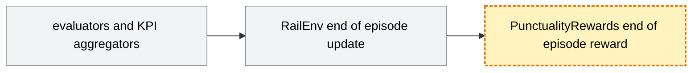
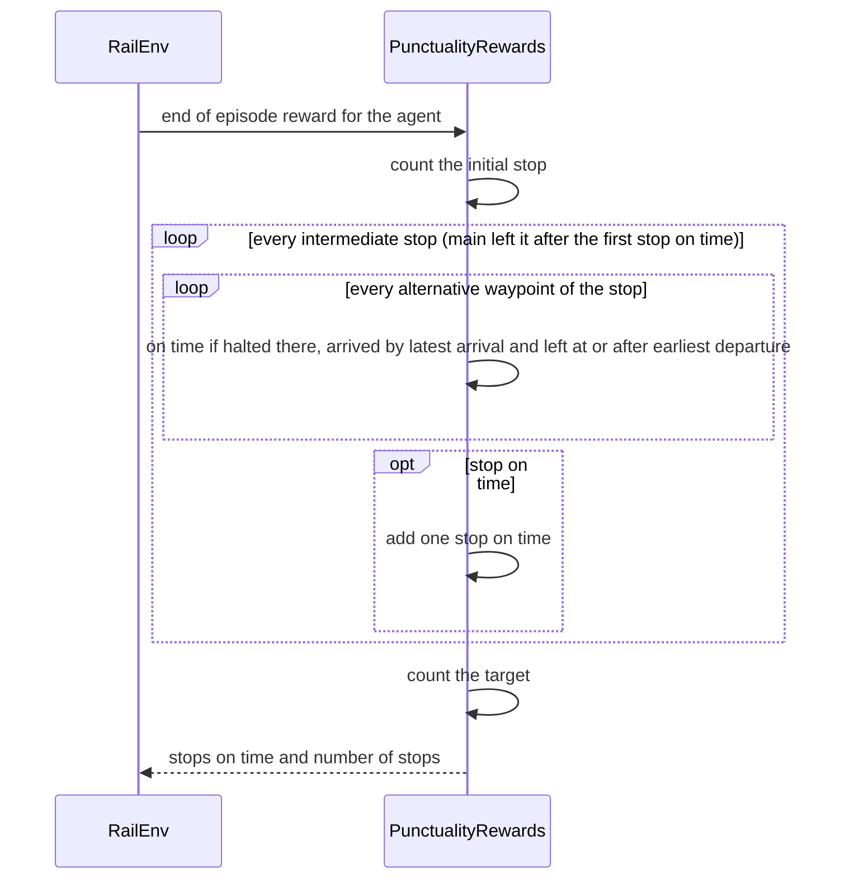

# `PunctualityRewards` counts every intermediate stop served on time (#555)

> **Status:** plan of 2026-11-23, built on 2026-11-25. Based on `main` 4856ebfe (planned on ac932d16; line numbers
> from `rewards.py:250` on are one higher on 4856ebfe, so the `break` is at `:611`). Issue
> [#555](https://github.com/flatland-association/flatland-rl/issues/555) ("PunctualityRewards counts at most one
> intermediate stop as on time.", chenkins, 2026-10-30, milestone 5.0.0). Branch `555-punctuality-intermediate-stops`,
> PR [#584](https://github.com/flatland-association/flatland-rl/pull/584). Open questions: none (§9.1).
>
> **Why:** punctuality is `n_stops_on_time / n_stops`, but after the first intermediate stop served on time
> `PunctualityRewards` stops looking at the other intermediate stops. An agent with two or more intermediate stops
> served on time gets a punctuality below 1, and benchmarks built on it (KPI-PF-026 and others) under-rate it.

## 1. Introduction and goals

*What the change is for: the requirements, the qualities that matter, who has a stake, and what it leaves out.*

### 1.1 Requirements overview (functional requirements)

*The issue's text and the numbered requirements the rest of the plan refers to.*

> `PunctualityRewards.end_of_episode_reward()` (`flatland/envs/rewards.py`) counts at most one intermediate stop as on
> time. After the first intermediate stop served on time, `n_stops_on_time += 1` is followed by a `break` that leaves
> the loop over all intermediate stops, not only the loop over the stop's alternatives. So with two or more
> intermediate stops served on time, the punctuality `(n_stops_on_time, n_stops)` is too low. […]
>
> **Expected behavior:** Each intermediate stop served on time counts: `(4, 4)` for two intermediate stops served on
> time.

Requirements:

- **REQ-1** Every intermediate stop served on time adds 1 to `n_stops_on_time`, whatever the number of intermediate
  stops and the result of the stops before it.
- **REQ-2** A stop with several alternative waypoints still counts at most once, and a stop not served, served late or
  left early counts 0, as on `main`.
- **REQ-3** The initial stop, the target and `n_stops` are counted as on `main`.
- **REQ-4** A test reproduces the issue: one agent, two and three intermediate stops served on time, gives
  `(n_stops, n_stops)`; it fails on `main`.
- **REQ-5** (added 2026-11-25, Q-2 revisited, Q-4) `BaseDefaultRewards` and `PunctualityRewards` share one rule for a
  served intermediate stop: the agent halts there, i.e. its speed is 0 after a step at the stop, not in a malfunction,
  whatever the action (`STOP_MOVING`, `DO_NOTHING` while stopped, a denied move). An agent that passes the stop
  without halting, or stands there only during a malfunction, does not serve it. After a malfunction at the stop, one
  more step there with speed 0 serves it, with `STOP_MOVING` or `DO_NOTHING`.

### 1.2 Quality goals (non-functional requirements)

*The few qualities the design must reach, each with a concrete scenario.*

| ID | Priority | Quality goal | Scenario |
|---|---|---|---|
| NFR-1 | 1 | Mergeable with #554 in either order | The branch of [#554](https://github.com/flatland-association/flatland-rl/issues/554) and this one, both on `main` ac932d16, merge without a textual conflict, and each one's test passes after both are in (§2 C-3). |
| NFR-2 | 2 | Minimal diff | One line removed in `rewards.py`, one test added; no other reward changes. |

### 1.3 Stakeholders

*Who asks for the change, decides on it, reviews it or works with the result, and what they expect.*

| Role | Name | Expectations |
|---|---|---|
| Issue author, maintainer | chenkins | The fix in 5.0.0, next to the other reward fixes (#554). |
| Benchmark owners | ai4realnet-orchestrators (KPI-PF-026, KPI-NF-045, KPI-AF-051, KPI-RS-058) | Punctuality as documented; they install flatland-rl from `main`, so they see the new values on merge (§8.2). |
| Evaluators | FAB, `flatland.evaluators` with `--rewards-cls PunctualityRewards` | Scores comparable across submissions of one release. |

### 1.4 Follow-ups (not in this PR)

*What this PR leaves out, why, and where it goes later.*

| Follow-up | Why not in this PR | From | Findings | Issue |
|---|---|---|---|---|
| Early departure at intermediate stops is penalised one step late: the departure is booked when the agent enters the next cell. Affects `PunctualityRewards`' `departure >= ed` in the same loop. | Own issue, other lines of `rewards.py` (C-3). | §3 | - | [#554](https://github.com/flatland-association/flatland-rl/issues/554) |

## 2. Constraints

*What limits the design from outside: platform, organisation and conventions.*

| ID | Constraint | Kind | Explanation |
|---|---|---|---|
| C-1 | `Rewards` interface stays | technical | `PunctualityRewards` keeps `step_reward()`/`end_of_episode_reward()` and the `(n_stops_on_time, n_stops)` tuple that the evaluators and KPI aggregators read. |
| C-2 | Release | organisational | Milestone 5.0.0; release-please writes the changelog from the squashed commit message (`AGENTS.md`, "Releases and versioning"). |
| C-3 | Parallel fix [#554](https://github.com/flatland-association/flatland-rl/issues/554) in the same file | organisational | #554 changes when a departure is booked (`rewards.py:220-231`, `:570-578`) and may touch the departure comparisons (`:592`, `:605`, `:331`). This fix touches `rewards.py:610`, four unchanged lines away from `:605`, and adds its tests in the middle of `tests/test_rewards.py`, not at its end. S-2 also touches `PunctualityRewards.__init__`, the top of its `step_reward()` and its docstring, each at least one unchanged line away from #554's changes there. Each test must hold with and without the other fix. |
| C-4 | Conventions | conventions | `AGENTS.md`: Conventional Commits, numpydoc, test docstrings in domain words ("Docstrings for tests that step `RailEnv`"), flatland-baselines' tests before calling a flatland-rl change done. |

### 2.1 Limitations

*What the built code gets wrong or ignores, each with the TODO or issue that tracks it.*

- The departure booked at a stop lags the start of the agent by `ceil(1 / max_speed)` steps since D1 (#496): tracked
  by [#554](https://github.com/flatland-association/flatland-rl/issues/554).

### 2.2 Assumptions

Not checked in code; they hold by construction of `PunctualityRewards.step_reward()` and `RailEnv.end_of_episode_update()`.

- Each entry point is booked at most once per agent (`rewards.py:563-565`, `:571`), so `zip(arrivals[wp],
  departures[wp])` pairs an arrival with its departure.
- `end_of_episode_reward()` runs once per agent and episode (`rail_env.py:456-462`), so each stop is counted once
  per episode.

## 3. Context and scope (checked 2026-11-23 on `main` ac932d16)

*The code on the base branch that the change works in, as it is before the change, and where the change stops.*

- **`PunctualityRewards`** (`flatland/envs/rewards.py:549-630`): docstring (`:550-555`): "If an agent is punctual at
  a stop, n_stops_on_time is increased by 1." `step_reward()` (`:562-580`) books the arrival at each new entry point
  and, in the same step, the departure from the previous one; it returns `(0, 0)`.
- **`end_of_episode_reward()`** (`:582-624`) counts:
  - the initial stop (`:588-596`): on time if a departure is `>= waypoints_earliest_departure[0]`;
  - each intermediate stop (`:597-610`), from `Rewards._intermediate_waypoints()` (`:95-102`): on time if any
    alternative `wp` has an arrival `<= la` paired with a departure `>= ed`. The `break` at `:607` leaves the loop
    over the arrival/departure pairs. The `break` at `:610`, after `n_stops_on_time += 1`, leaves the loop over the
    intermediate stops: **the bug**;
  - the target (`:612-622`): on time if the first arrival at any target direction is `<= waypoints_latest_arrival[-1]`;
  - `n_stops = len(agent.waypoints)` (`:623`).
- **Origin:** the `break` was right in 8711f863 (v4.2.2, the feature of
  [#272](https://github.com/flatland-association/flatland-rl/pull/272)), where it left the loop over the
  alternatives. Commit 56378ab8 ("feat(rewards): support multiple arrivals/departures.", in
  [#377](https://github.com/flatland-association/flatland-rl/pull/377), first released in v4.2.4) added the inner
  loop over the pairs with its own `break` and the `stop_on_time` flag, and moved the old `break` behind the flag,
  one loop too far out. So the bug is in every release since 4.2.4, not only 4.3.0.
- **Caller:** `RailEnv.end_of_episode_update()` (`rail_env.py:451-465`) adds `end_of_episode_reward()` to the agent's
  reward via `cumulate()` once the episode ends.
- **`BaseDefaultRewards`** (`rewards.py:121-361`) scores intermediate stops in its own loop
  (`_agent_done_or_max_episode_steps_reward()`, `:308-338`) without a `break`; it is not affected. It requires a halt
  at the stop (`stopped_waypoints`, `:183-187`, `:312-316`); `PunctualityRewards` does not.
- **Tests** (`tests/test_rewards.py`): `test_punctuality_rewards_initial` (`:521`), `test_punctuality_rewards_intermediate`
  (`:561-601`, one intermediate stop), `test_punctuality_rewards_target` (`:604`) and three more (`:655`, `:736`,
  `:766`) have at most one intermediate stop, so none sees the bug. `tests/flatland/envs/graph/test_graph_rail_env.py:22`
  compares grid and graph rewards, which share this code.
- **Dependants:**
  - flatland-baselines `flatland_baselines/deadlock_avoidance_heuristic/tests/test_policy_grid_runner_evaluator.py:42,61,73-74`
    pins `Raw scores: [(9, 14), (14, 14), (9, 14), (14, 14)]` for `env_data/tests/service_test`: 7 agents with two
    waypoints each in all four envs (loaded and counted on ac932d16), so no intermediate stop and no change.
  - ai4realnet-orchestrators `railway/test_runner_kpi_{pf_026,nf_045,af_051,rs_058}_railway.py` run
    `--rewards-cls PunctualityRewards`; `railway/requirements.txt` installs flatland-rl from `@main`. Its integration
    test pins punctuality `0.9285714285714286` (13/14), which also points to two waypoints per agent; not checked
    against its scenarios.
  - Stored data: none of the 212 `.tsv` files in `episodes/` holds tuple rewards (all recorded with
    `DefaultRewards`); `env_data/` holds envs, not rewards. No notebook, example or benchmark uses
    `PunctualityRewards`.
  - flatland-book `environment/environment/rewards.md:156-163` documents the intended behaviour; no change needed.

Reproduction on ac932d16 (the issue's script, a straight corridor, one agent at speed 1, intermediate stops with
`ed` 0 and `la` 40, all served on time):

```
1 intermediate stop(s), all served on time: (n_stops_on_time, n_stops) = (3, 3)
2 intermediate stop(s), all served on time: (n_stops_on_time, n_stops) = (3, 4)
```

With three intermediate stops (corridor of width 11) it gives `(3, 5)`. With `:610` deleted (patched in memory):
`(3, 3)`, `(4, 4)`, `(5, 5)`. Mixed cases give the same result before and after: first stop late, second on time
`(3, 4)`; first on time, second late `(3, 4)`; both late `(2, 4)`. Rolling through both stops without halting gives
`(3, 4)` on `main` and `(4, 4)` with the fix (§2.1).

**Scope:** the change deletes the `break` at `rewards.py:610` and adds a test. It does not change how arrivals and
departures are booked (#554), the initial stop, the target, `n_stops`, or `BaseDefaultRewards`.

## 4. Solution strategy

*The fundamental choices and why, the rules the design follows, how it is verified, and the design of each part.*

| Quality goal | Scenario | Solution approach | Details |
|---|---|---|---|
| NFR-1 Mergeable with #554 | Either merge order, no conflict | Touch only `:610`; insert the test between existing tests; the test uses `ed` 0, so it doesn't depend on when the departure is booked. | §4.3, C-3 |
| NFR-2 Minimal diff | One line, one test | Delete the misplaced `break`; keep the loop's structure (Q-1 a)). | §4.3 |

### 4.1 Design principles

*The rules the design follows, each with its decision, the concepts it reuses instead of building new ones, and what
is not new on purpose.*

- **DP-1 Each stop is judged on its own.** The result of one intermediate stop never decides whether the next one
  is looked at; only the loop over a stop's alternatives may end early. (Q-1)
- **DP-2 Fix the count, not the arrival and departure bookkeeping.** What counts as arrival and departure stays as
  on `main`; that is #554.
- **DP-3 One halt rule for both rewards.** A stop is served only with a halt, not in a malfunction, decided by one
  function that `BaseDefaultRewards` and `PunctualityRewards` both call, so the two can't disagree again. (Q-2
  revisited)
- **DP-4 Serving a stop is not the stop of the penalties.** Whether a halt serves a stop (speed 0 after the step) is
  decided apart from `BaseDefaultRewards`' `is_stopped_now` (the MOVING -> STOPPED transition), which keeps deciding
  the collision and invalid-action penalties as on `main`. (Q-4)

Reused concepts:

| Need | Reused concept | Instead of |
|---|---|---|
| Per-stop on-time flag | The existing `stop_on_time` flag of the intermediate loop (`rewards.py:598`) | A rewrite with `any()` or a helper method |
| Halt that serves a stop | `BaseDefaultRewards`' `stopped_waypoints`, filled by `_is_halt_serving_stop()`, which both classes call | A second copy of the condition in `PunctualityRewards`; widening `is_stopped_now`, which also decides the penalties (DP-4) |
| Test of the shared served rule | The multi-cell station tests and their `_visit()` helper, parametrized with the reward class | A separate env test for `PunctualityRewards` |
| Scenario for the test | The issue's corridor (`rail_from_grid_transition_map`, `Line`, `Timetable`), as in #554's reproduction | A hand-built `EnvAgent` with direct `step_reward()` calls, which would pin today's departure booking that #554 changes |

Not new on purpose: the `(n_stops_on_time, n_stops)` tuple, the flatland-book page.

### 4.2 Verification

*How each requirement and quality goal is shown to work: tests, CI checks, before and after screenshots.*

No screenshots: nothing visible changes.

| ID | Requirement | Test or check | Result | Screenshots |
|---|---|---|---|---|
| REQ-1 | Every on-time intermediate stop counts | New `test_punctuality_rewards_counts_every_intermediate_stop_on_time`, parametrised with 1, 2 and 3 intermediate stops served on time: `(n_stops, n_stops)`. | On 4856ebfe with S-1: `(3, 3)`, `(4, 4)`, `(5, 5)`, passes. | - |
| REQ-2 | Late, missed and alternative stops unchanged | Same test, cases "first late, second on time" `(3, 4)` and "first on time, second late" `(3, 4)`; existing `test_punctuality_rewards_intermediate`. | Both `(3, 4)`, passes; `test_punctuality_rewards_intermediate` passes. | - |
| REQ-3 | Initial stop, target, `n_stops` unchanged | Existing `test_punctuality_rewards_*` in `tests/test_rewards.py`; `tests/flatland/envs/graph/test_graph_rail_env.py`; flatland-baselines' `test_policy_grid_runner_evaluator.py` (pinned scores, §3). | With S-1: `tests/test_rewards.py` and `test_graph_rail_env.py` 170 passed; flatland-baselines' `deadlock_avoidance_heuristic/tests -m "not slow"` 28 passed, 50 skipped, 1 xfailed. With S-2: the 8 test modules that use the reward classes 459 passed, 3 skipped; flatland-baselines unchanged; flake8 nothing new. | - |
| REQ-4 | Test of the issue | The REQ-1 test fails on `main` for 2 and 3 stops. | Without S-1 (`break` restored): `two-on-time` and `three-on-time` fail, the other 3 pass. | - |
| REQ-5 | Served only with a halt | The multi-cell station tests `test_multicell_station_served_regardless_of_halting_cell` and `test_multicell_station_not_served_when_only_rolled_through`, parametrized with `BaseDefaultRewards` and `PunctualityRewards`: one body, the same expectation for both. The served test halts with `STOP_MOVING` or `DO_NOTHING`, directly or after a malfunction at the station (Q-4); the roll-through test also passes the station within its time window and stands at it only in a malfunction; `_visit()` gets a malfunction case and the halt's action. An env run of the issue's corridor checks the malfunction cases through `env.step()`. | With S-2: the 27 station test cases pass. Without S-2's `rewards.py`: the on-time roll-through and the malfunction case fail for `PunctualityRewards`, the `DO_NOTHING` halts for `BaseDefaultRewards`. Env run, a malfunction of 2 steps at the stop: moving on right after it leaves the stop not served in both rewards; one more step with `STOP_MOVING` or `DO_NOTHING` serves it (`INTERMEDIATE_NOT_SERVED` 0, punctuality `(3, 3)`). `test_punctuality_rewards_intermediate` and `test_punctuality_rewards_departure_recorded_on_done_with_removal` now halt at their stop and stay halted until the step before they leave, as an env run would. | - |
| NFR-1 | Mergeable with #554 | S-1 touches `rewards.py:610` only; S-2's hunks are at least one unchanged line away from #554's (C-3); the tests' `ed` 0 holds with any departure booking. Checked again when the second of the two PRs is rebased. | S-1: `rewards.py` 1 deletion. S-2: `git merge-tree` with #554's branch (bda8bb7e) has no conflict; `tests/test_rewards.py` on the merged tree: 74 passed. It needs the two hand-built tests to stay halted until the step before they leave: #554 dates the departure by the last halt. | - |
| NFR-2 | Minimal diff | `git diff --stat main`: `rewards.py` 1 deletion, `tests/test_rewards.py` one test, the plan; S-2 adds the shared halt rule and its test. | `rewards.py` 1 deletion, `tests/test_rewards.py` +56 (the test and 2 imports). | - |

### 4.3 Count each intermediate stop (REQ-1-REQ-4; Q-1)

*One part of the change: what changes and why, with the requirements and decisions it implements.*

- Delete the `break` at `rewards.py:610`. The loop at `:597` then runs over all intermediate stops; `stop_on_time`
  is reset per stop at `:598`, so each stop adds at most 1.
- The loop over a stop's alternatives (`:600`) keeps going after a match, as on `main`; a second matching
  alternative only sets the flag again, so REQ-2 holds (Q-1 a)).
- Test in `tests/test_rewards.py`, inserted after `test_punctuality_rewards_intermediate` (`:601`): the issue's
  corridor, widened to 11 cells for three stops; the agent brakes into each stop and moves on in the next step;
  intermediate `ed` 0, so the result does not depend on when the departure is booked (C-3). Docstring in domain
  words (C-4).

### 4.4 Serve a stop only with a halt (REQ-5; Q-2)

*One part of the change: what changes and why, with the requirements and decisions it implements.*

- `_is_halt_serving_stop(agent, agent_transition_data)` in `rewards.py`: on the map, not in a malfunction, and speed
  0 after the step (`candidate_speed == 0`) or a denied move, whatever the action (Q-4). `BaseDefaultRewards` fills
  `stopped_waypoints` with it instead of with `is_stopped_now` (DP-3); `is_stopped_now` stays for the penalties
  (DP-4). Without transition data (hand-built calls) the agent did not halt.
- `PunctualityRewards` keeps `stopped_waypoints` as `BaseDefaultRewards` does, filled at the top of `step_reward()`.
  In `end_of_episode_reward()` an intermediate alternative is only looked at if the agent halted there.
- The initial stop and the target need no halt, as in `BaseDefaultRewards`.
- Class docstring: an intermediate stop is served only with a halt, as for `BaseDefaultRewards`.
- Tests: the two hand-built tests that served a stop without transition data now pass the halt signal
  (`_stopped_here_transition_data()`), as the `DefaultRewards` tests already do. The multi-cell station tests, which
  pin the served rule for `BaseDefaultRewards`, are parametrized with the reward class, so one test body states the
  rule for both; the served test halts with `STOP_MOVING` or `DO_NOTHING`, also after a malfunction, and the
  roll-through test gets an on-time pass and a malfunction-only stand.

## 5. Building block view

*The components the change adds or changes: an overview, why the system is split this way, what each is responsible
for, the important interfaces, and the planned data model.*

### 5.1 Rewards at the end of an episode

*One white box: its building blocks, why it is split this way, and the interfaces between them.*



Notation: [flowchart in Mermaid](https://mermaid.js.org/syntax/flowchart.html); yellow modified, grey unchanged.
Arrows point from the caller to the code it calls.

**Motivation:** the count's fix is inside one method; the halt rule is shared with `BaseDefaultRewards` (DP-3); the callers keep reading the same tuple (C-1, DP-2).

**Contained building blocks:**

| Component | Responsibility | Change |
|---|---|---|
| `PunctualityRewards` | Counts per agent how many of its stops were served on time, out of all its stops. Not for penalties or delays (`DefaultRewards`, `DelayRewards`). | 🟨 modified: every intermediate stop served on time counts, so an agent on time everywhere scores 1; a stop counts as served only if the agent halts there, as for the default rewards. |
| `RailEnv` | Runs the episode and asks the rewards for the end-of-episode value of each agent. | ⬜ unchanged |
| Evaluators and KPI aggregators | Sum and divide the tuples into a punctuality score. | ⬜ unchanged |

## 6. Runtime view

*How the components work together at runtime: the flows and modes the change adds or changes, when it changes behaviour.*

### 6.1 End-of-episode punctuality of one agent (REQ-1, REQ-5; Q-1, Q-2)

*One flow or mode, as a sequence or state diagram.*



Notation: [sequence diagram in Mermaid](https://mermaid.js.org/syntax/sequenceDiagram.html).

## 8. Crosscutting concepts

*What the change introduces that other code will follow, and what it changes for existing callers.*

### 8.1 New patterns

*What is new compared with the base branch.*

Compared with `main`. What is reused, and what is not new on purpose, is in §4.1.

| ID | New | Defined in |
|---|---|---|
| PAT-1 | `_is_halt_serving_stop()`: one module-level rule for "halted here with speed 0, not in a malfunction", called by every reward class that decides whether a stop is served. | §4.4, DP-3, DP-4 |

### 8.2 Breaking changes

*What breaks for whom, and the migration path.*

None for callers: no signature, tuple shape or file format changes. Changed behaviour:

- **Punctuality scores rise** for agents with two or more intermediate stops of which a later one is served on time
  after an earlier one was (`n_stops_on_time` grows, `n_stops` stays). Who: evaluations and KPIs with
  `--rewards-cls PunctualityRewards`; ai4realnet-orchestrators sees it on merge, as it installs flatland-rl from
  `main`. Its and flatland-baselines' pinned scores come from scenarios without intermediate stops (§3) and stay.
  Scores from before and after the fix are not comparable for scenarios with intermediate stops. No migration:
  the new values are the documented ones.
- **Punctuality scores fall** for agents that pass an intermediate stop within its time window without halting
  there, or stand there only because of a malfunction (S-2): such a stop no longer counts as on time. Who: the same
  evaluations and KPIs. Pinned scores in flatland-baselines and ai4realnet-orchestrators come from scenarios without
  intermediate stops (§3) and stay. No migration: punctuality now uses the halt rule of the default rewards.
- **Fewer "not served" penalties in the default rewards** (`DefaultRewards`, `BaseDefaultRewards`, and the ECML 2026
  rewards built on them): a halt with speed 0 and `DO_NOTHING`, e.g. in the step a malfunction at the stop ends, now
  serves the stop; on `main` only `STOP_MOVING` or a denied move did (Q-4). Who: evaluations with these rewards,
  among them the ECML 2026 evaluation. Collision and invalid-action penalties are unchanged (DP-4). No migration:
  the stop is served as the documentation describes it, by halting there.
- **Stored data:** none affected (no stored episode holds `PunctualityRewards` tuples, §3).

The commits are marked breaking (`fix(rewards)!:`, Q-3).

## 9. Decisions

*The decisions behind the plan: the questions still open, the decisions taken, and how each review finding was settled.*

### 9.1 Open questions

*Choices not made yet, each with its options and a proposal.*

~~**(Q-1) How to end the loop over a stop's alternatives?**~~
- a) Delete the `break` at `:610` only. The loop over the alternatives runs to its end after a match, which costs
  nothing that matters (a few alternatives per stop) and changes no result. One-line diff, no lines next to #554's.
- b) Move the `break` into the loop over the alternatives (`if stop_on_time: break` after `:607`), as 8711f863 had
  it. Stops early, but changes `:606-610`, next to `:605`, which #554 may edit: a likely merge conflict.
- c) Rewrite the stop check as one `any(...)` over alternatives and pairs. Clearer, but a larger diff in the lines
  #554 is most likely to touch.

*Proposal:* a). Smallest diff and no conflict with #554 (NFR-1, NFR-2).

✅ **Decided 2026-11-25:** a), delete the `break` only.

~~**(Q-2) Should an intermediate stop count as served only when the agent halts there?**~~
- a) No, not in this PR: keep "passed the cell within the time window", as on `main`; open an issue for aligning
  `PunctualityRewards` with `BaseDefaultRewards`' halt rule.
- b) Yes, in this PR: book halts as `BaseDefaultRewards` does (`stopped_waypoints`) and count only stops with a halt.
  Changes the scores of every agent that rolls through a stop, also with one intermediate stop, and touches the
  booking that #554 changes.

*Proposal:* a). The issue asks only for the count; the halt rule is another behaviour change and collides with #554.
The maintainers decide whether the follow-up gets an issue.

~~✅ **Decided 2026-11-25:** a), not in this PR; a follow-up (§1.4), its issue still undecided.~~

✅ **Revisited 2026-11-25:** b), in this PR (S-2): the inconsistency between the two rewards is fixed with the count,
not left as a follow-up. The halt rule is shared with `BaseDefaultRewards` (DP-3).

~~**(Q-3) Mark the commit as breaking (`fix(rewards)!:`)?**~~
- a) No: it restores the behaviour the docstring and flatland-book describe.
- b) Yes, as #564's plan did for behaviour changes (its Q4 b)): punctuality scores change, and release-please lists
  breaking changes separately in the 5.0.0 notes.

*Proposal:* b). KPI owners read the release notes, and the score change is what they need to know; the body names
which agents' scores change.

✅ **Decided 2026-11-25:** b), `fix(rewards)!:` with the score change in the body.

~~**(Q-4) An agent stands at a stop only because of a malfunction, then keeps speed 0 one more step when it ends. Which
actions in that step serve the stop?**~~
- a) Only `STOP_MOVING`, as on `main` in `BaseDefaultRewards`; `DO_NOTHING` (also ending STOPPED at the stop) does
  not.
- b) Any action that leaves the agent at speed 0 (`STOP_MOVING`, `DO_NOTHING`), in both rewards; a rule of its own
  next to `is_stopped_now`, which keeps deciding the penalties. Changes the default rewards too (§8.2).

✅ **Decided 2026-11-25:** b), in this PR (S-2).

### 9.2 Decision log

*Every decision by date, with why it was taken and what follows from it.*

| Date | Decision | Why | Consequences |
|---|---|---|---|
| 2026-10-30 | ✅ Each intermediate stop served on time counts; two intermediate stops served on time give `(4, 4)` ([#555](https://github.com/flatland-association/flatland-rl/issues/555), "Expected behavior"). | The documented behaviour (`rewards.py:550-555`, flatland-book). | REQ-1, REQ-4; S-1. |
| 2026-11-25 | ✅ Q-1: delete the `break` after the stop's count, keep the loop over the alternatives as it is. | Smallest diff, clear of the lines #554 may touch; b) and c) change the comparison lines. | S-1 is a one-line deletion (NFR-2). |
| 2026-11-25 | ~~✅ Q-2: an intermediate stop passed without halting still counts as served.~~ Replaced by the later Q-2 row of 2026-11-25. | Not in the issue; a halt rule changes scores also with one intermediate stop and touches the booking #554 changes. | Follow-up in §1.4; §2.1 keeps the limitation. |
| 2026-11-25 | ✅ Q-3: mark S-1 as breaking, `fix(rewards)!:`. | Punctuality scores rise for agents with two or more on-time intermediate stops; release-please lists breaking changes apart, where KPI owners read them. | S-1's message and body (§8.2). |
| 2026-11-25 | ✅ Q-2 revisited: an intermediate stop is served only with a halt, not in a malfunction, in `PunctualityRewards` as in `BaseDefaultRewards`, in this PR. | With every stop counted (S-1), the two rewards disagreed on every stop an agent passes without halting; fixing it with the count keeps one release note for the punctuality change. | REQ-5, DP-3, PAT-1; S-2 (breaking); the follow-up and the limitation are gone. |
| 2026-11-25 | ✅ Q-4: a halt that serves a stop is speed 0 after a step there, not in a malfunction, whatever the action, in both rewards. | After a malfunction at the stop, `DO_NOTHING` leaves the agent STOPPED at speed 0 as `STOP_MOVING` does; only the latter served it, in `BaseDefaultRewards` on `main` as well. a) would keep that gap in both rewards. | REQ-5, DP-4; `BaseDefaultRewards` serves more stops, the ECML 2026 rewards too (§8.2); `is_stopped_now` unchanged. |

### 9.3 Code Review Findings

*Findings from code reviews, PR comments and TODOs, with their status and the commits that fix them.*

PR [#584](https://github.com/flatland-association/flatland-rl/pull/584), based on `main` 4856ebfe, checked at
a14be873 on 2026-11-25: no code review yet, no PR review or conversation comments, no TODOs added.

| Fixed | ID | Source | Category | Severity | Finding | Commit message |
|---|---|---|---|---|---|---|

## 10. Glossary

*The domain and technical words the plan uses, with their code symbols.*

- **Intermediate stop** (`agent.waypoints[1:-1]`, `Rewards._intermediate_waypoints()`): a stop between the initial
  stop and the target, given as a list of alternative waypoints. Not the initial stop or the target.
- **Alternative** (one `Waypoint` of a stop's list): one cell and direction at which the stop may be served, e.g. one
  platform. A stop counts once however many of its alternatives match.
- **On time** at an intermediate stop: an arrival `<= la` (`waypoints_latest_arrival`) paired with a departure
  `>= ed` (`waypoints_earliest_departure`) at one of its alternatives where the agent halted.
- **Served** intermediate stop (`stopped_waypoints`, `_is_halt_serving_stop()`): the agent halted at one of its
  alternatives, with speed 0 after a step or a denied move, not in a malfunction, whatever the action. Not passing it
  at speed, and not standing there only because of a malfunction.
- **Punctuality** (`PunctualityRewards`, `(n_stops_on_time, n_stops)`): the share of an agent's stops served on time.
  Not the delay at the target (`DelayRewards`) or the penalties of `DefaultRewards`.

## 11. Execution plan and status

*The commits that build the change, in order, and which of them are done: the source of the PR's status.*

### 11.1 Steps

*One row per commit: what it does, the findings it fixes, its message, and its SHAs once committed.*

| ID | Findings | Step | Category | Severity | Commit message | Commit(s) | Needs | Blocked by |
|---|---|---|---|---|---|---|---|---|
| ✅ S-0 | - | Add this plan. | docs | low | docs(plans): plan counting every intermediate stop served on time in PunctualityRewards (#555). | d76435fc | - | - |
| ✅ S-1 | - | Delete the `break` at `rewards.py:610` (Q-1); add `test_punctuality_rewards_counts_every_intermediate_stop_on_time` after `test_punctuality_rewards_intermediate` (REQ-1-REQ-4); body names the score change (§8.2) and "Fixes #555.". | bug | medium | fix(rewards)!: count every intermediate stop served on time in PunctualityRewards. | 3e6bf2a4 | S-0 | - |
| ✅ S-2 | - | One served rule `_is_halt_serving_stop()` for `BaseDefaultRewards` and `PunctualityRewards`: speed 0 after a step at the stop, not in a malfunction, whatever the action (§4.4, Q-2 revisited, Q-4); docstring; the two hand-built punctuality tests halt at their stop; the multi-cell station tests parametrized with both reward classes, with `DO_NOTHING` halts, halts after a malfunction, an on-time roll-through and a malfunction-only stand (REQ-5); body names the score changes (§8.2). | bug | medium | fix(rewards)!: serve an intermediate stop only with a halt at speed 0, in DefaultRewards and PunctualityRewards alike. | bb10fa8b | S-1 | - |

Before the PR: `tests/test_rewards.py`, `tests/flatland/envs/graph/test_graph_rail_env.py`, and flatland-baselines'
`deadlock_avoidance_heuristic/tests -m "not slow"` (`AGENTS.md`, C-4).

## 12. Change inventory

*Every file the change adds, modifies, renames or removes, and what stays unchanged on purpose.*

### 12.1 New files

*The files the change adds, and what each adds.*

| File | Adds |
|---|---|
| `docs/plans/punctuality-intermediate-stops.md` | This plan (S-0). |

### 12.2 Modified files

*The files the change modifies, and what changes in each.*

| File | Changes |
|---|---|
| `flatland/envs/rewards.py` | `PunctualityRewards.end_of_episode_reward()`: the `break` after `n_stops_on_time += 1` in the intermediate loop is gone (S-1). New `_is_halt_serving_stop()`; `BaseDefaultRewards.step_reward()` fills `stopped_waypoints` with it instead of `is_stopped_now`; `PunctualityRewards`: `stopped_waypoints`, filled in `step_reward()`, required in `end_of_episode_reward()`; class docstring (S-2). |
| `tests/test_rewards.py` | `test_punctuality_rewards_counts_every_intermediate_stop_on_time`, after `test_punctuality_rewards_intermediate` (S-1). `test_multicell_station_served_regardless_of_halting_cell` and `test_multicell_station_not_served_when_only_rolled_through` parametrized with the reward class; `_agent_with_two_cell_intermediate_station()` builds either class, `_visit()` gets a malfunction case and the halt's action, the served test `DO_NOTHING` and malfunction cases, new `_intermediate_stop_counted()`; `test_punctuality_rewards_intermediate` and `test_punctuality_rewards_departure_recorded_on_done_with_removal` halt at their stop (S-2). |

Unchanged on purpose: the arrival/departure booking (#554), the initial-stop and target checks, `BaseDefaultRewards`'
penalties (`is_stopped_now`, DP-4), the flatland-book rewards page.
