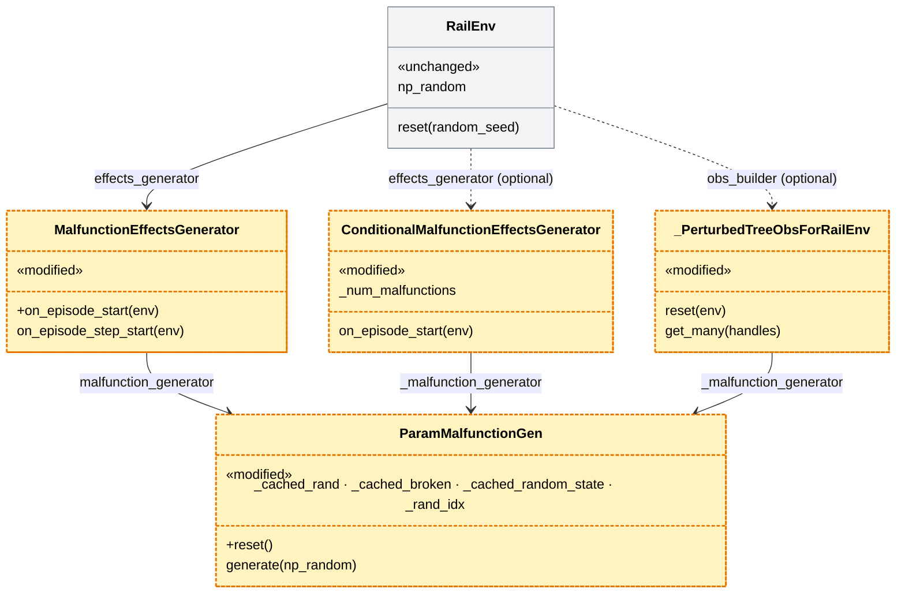
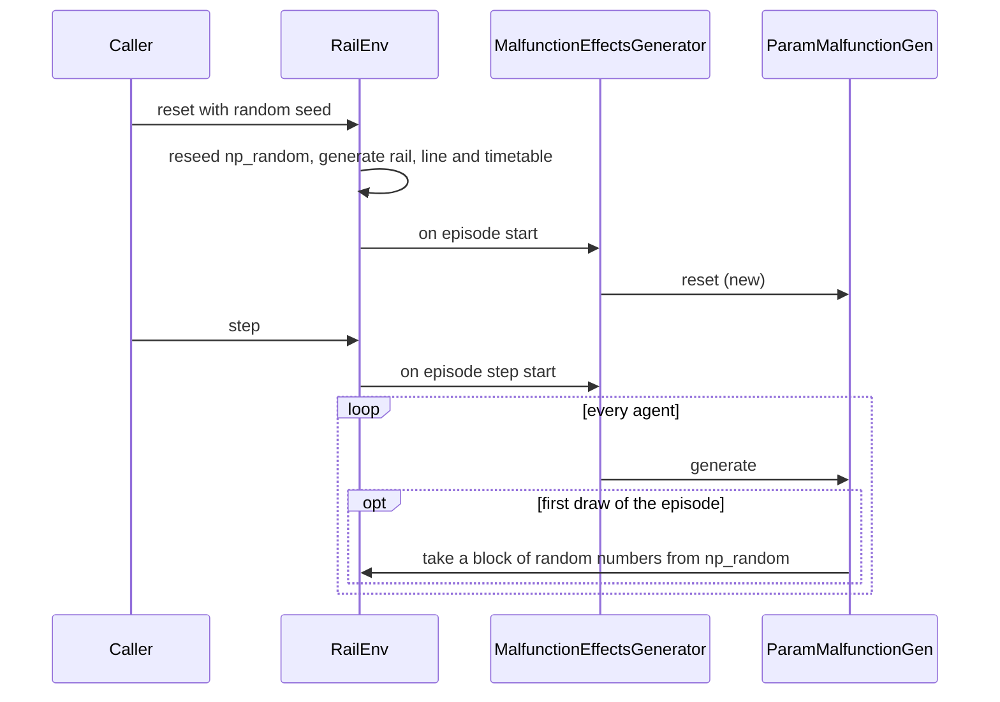

# Reset with a seed reproduces the malfunctions (#564)

> **Status:** plan of 2026-11-11, draft. Based on `main` d1417769. Issue
> [#564](https://github.com/flatland-association/flatland-rl/issues/564) ("env.reset(random_seed=s) does not reproduce
> the malfunctions of ParamMalfunctionGen", milestone 5.0.0), raised in a review of
> [flatland-book#43](https://github.com/flatland-association/flatland-book/pull/43#discussion_r4512243243). Branch
> `564-reset-reproduces-malfunctions`, no PR yet. All questions of §9.1 decided 2026-11-11.
>
> **Why:** an env that is reset with the same seed gets the same rail, line and timetable, but other malfunctions:
> the malfunction generator keeps its random numbers across resets. Training loops and evaluators that reuse one env
> therefore can't reproduce an episode from its seed.

## 1. Introduction and goals

*What the change is for: the requirements, the qualities that matter, who has a stake, and what it leaves out.*

### 1.1 Requirements overview (functional requirements)

*The issue's text and the numbered requirements the rest of the plan refers to.*

> `RailEnv.reset(random_seed=s)` reseeds `env.np_random`, so rail, line and timetable are the same as in the first
> episode with seed `s`. The malfunctions are not: `ParamMalfunctionGen` keeps state across resets that the reseeding
> does not touch. […]
>
> **Expected:** `env.reset(random_seed=s)` gives the same malfunctions as a new env reset with seed `s`, as it does
> for rail, line and timetable.
>
> **Proposal:** […] let the malfunction generator start over […]. Keep the persisted
> `malfunction_cached_random_state`/`malfunction_rand_idx` […]. Add a test: reset twice with the same seed and compare
> `info['malfunction']` over some steps.

Requirements:

1. `env.reset(random_seed=s)` gives the same malfunctions (steps and durations) as a new env reset with seed `s`.
2. The first episode of a new env has the same malfunctions as on `main`, so recorded trajectories, the regression
   episodes and benchmark environments stay valid.
3. An env restored from a mid-episode snapshot continues with the same malfunctions as before (no reset involved).
4. The malfunction generators that the conditional effects generators own behave the same way, and
   `max_num_malfunctions` counts per episode (Q2 b)).
5. A test resets an env twice with the same seed and compares `info['malfunction']` over some steps.
6. The perturbed tree observation builder (`perturbation_tree_observation_builder_wrapper`) starts its own
   malfunction generator over on `reset(env)` too, so its "blind" periods can be reproduced (Q5 a); added 2026-11-11).
7. The rule "Randomness per episode" (§4.1) is documented in the core hooks' docstrings (Q5 a); added 2026-11-11).
8. A conditional malfunction effects generator restored from a snapshot taken mid-episode continues as recorded: its
   malfunction count, the position in its block of random numbers and whether each agent was in malfunction carry
   over (finding 6; added 2026-11-11).

### 1.2 Quality goals (non-functional requirements)

*The few qualities the design must reach, each with a concrete scenario.*

| Priority | Quality goal | Scenario |
|---|---|---|
| 1 | Reproducibility | Two resets with seed 42 on one env, 40 steps each: `info['malfunction']` is equal in every step. |
| 2 | Compatibility | A new env reset with seed 42 has the same malfunctions as on `main` d1417769 (pinned in a test). |
| 3 | Performance | The extra cost is at most one new block per episode: about 7 ms (1,000,000 random numbers and a comparison, measured on the sandbox). |
| 4 | Persisted size | A saved env (pkl) doesn't grow considerably: without a conditional generator not at all; with one only by its episode state, a few KB (the random state the block was drawn from, 624 numbers, and the position), never by the block of 1,000,000 numbers (8 MB). |

### 1.3 Stakeholders

*Who asks for the change, decides on it, reviews it or works with the result, and what they expect.*

| Role | Name | Expectations |
|---|---|---|
| Reviewer who raised it | CleverManu (flatland-book#43) | Resetting with the same seed reproduces the episode. |
| Maintainers | flatland-rl maintainers | Fix in 5.0.0 without changing recorded episodes. |
| RL users | training loops (RLlib, PettingZoo with SuperSuit and Stable-Baselines3) | A new env (rail, line, timetable, malfunctions) per training episode; seeded evaluation episodes are reproducible. |
| Evaluators | FAB / `flatland.evaluators` | Results of an evaluation don't change: each test env is loaded and reset once. |

### 1.4 Follow-ups (not in this PR)

*What this PR leaves out, why, and where it goes later.*

| Follow-up | Why not in this PR | From | Findings | Issue |
|---|---|---|---|---|
| Update the flatland-book Stochasticity page: the reset now reproduces the malfunctions (it marks it as a bug to be fixed in 5.0.0). Document the global rule "Randomness per episode" (who reseeds what, how to reproduce an episode), also for the perturbed observations. | Another repo, once 5.0.0 is released. | §4.1, §4.3, Q5 | - | - |
| Malfunction duration one step longer than documented. | Own issue; same file, but another behaviour change. | - | - | [#565](https://github.com/flatland-association/flatland-rl/issues/565) |

## 2. Constraints

*What limits the design from outside: platform, organisation and conventions.*

| Constraint | Kind | Explanation |
|---|---|---|
| Recorded episodes stay valid | technical | Regression episodes (`tests/test_flatland_regression_episodes.py`) and flatland-baselines' trajectories replay from snapshots; their malfunctions must not change. |
| Persisted format | technical | `malfunction_cached_random_state` and `malfunction_rand_idx` are saved in env files and in the `MalfunctionEffectsGenerator` state; that format stays. The conditional generators' state only gains optional keys (S5): older files still load. |
| Release | organisational | Milestone 5.0.0; release-please writes the changelog from the commit messages. |
| Conventions | conventions | `AGENTS.md`: tests via `pytest` with the episodes fixture, `flake8`; flatland-baselines' tests before calling it done. |

### 2.1 Limitations

*What the built code gets wrong or ignores, each with the TODO or issue that tracks it.*

- Malfunction generators other than `ParamMalfunctionGen` and its subclasses are not reset: they have no reset hook.
  In the repo this is the deprecated `single_malfunction_generator` (`malfunction_generators.py`, a closure with its own
  `reset=True` path, used via `malfunction_generator_and_process_data`); its behaviour is unchanged. None in
  flatland-baselines.
- The perturbed tree observation builder draws from the `RandomState` its caller passes in, which
  `env.reset(random_seed=...)` doesn't reseed: its perturbations repeat only if the caller reseeds that `RandomState`
  before the reset (Q5; documented in its docstring).

### 2.2 Assumptions

Not checked in code; they hold by construction of `RailEnv.reset()` and `RailEnvPersister`.

- `reset()` is the only place where an episode starts: `RailEnv.reset()` calls `effects_generator.on_episode_start()`
  and nothing else does (grep on d1417769).
- `ObservationBuilder.reset()` is also called outside an episode start: by `RailEnvPersister.load()`/`load_new()`
  and `PolicyRunner.change_policy()`. For the perturbed tree observation builder this starts its perturbations over
  there too, as its `MalfunctionHandler`s are already recreated there today; its state is not persisted.
- Replaying a trajectory never calls `env.reset()`: `Trajectory.load_env()` restores a snapshot and steps on.
- Benchmark environments are saved before their first step, so they persist no block
  (`malfunction_cached_random_state` is `None`); checked for `env_data/` (16 of 17 files load, none has a block).

## 3. Context and scope (checked 2026-11-11 on `main` d1417769)

*The code on the base branch that the change works in, as it is before the change, and where the change stops.*

- **`ParamMalfunctionGen`** (`flatland/envs/malfunction_generators.py`): at its first `generate()` it takes
  `NBR_CHACHED_RAND = 1_000_000` random numbers from `env.np_random` (`generate_rand_numbers()`, which also keeps
  `_cached_random_state`) and caches `_cached_broken = _cached_rand < p`. Each draw increments `_rand_idx` (so entry 0
  is skipped on the first pass) and wraps cyclically. A positive draw draws the duration from `env.np_random`.
  Nothing resets these fields. `NoMalfunctionGen` is a subclass with rate 0, so it also draws a block.
  - **Where the block lives:** in the generator object, in four fields: `_cached_rand` (the 1,000,000 floats,
    ~8 MB), `_cached_broken` (`_cached_rand < p`, ~1 MB; what `generate()` reads), `_cached_random_state` (the state
    of `np_random` just before the block was drawn) and `_rand_idx` (the position of the next draw). The generator
    owns no random state of its own: every `generate(np_random)` gets it from the caller.
  - **When and how it is drawn:** lazily, at the generator's first `generate(np_random)`:
    `generate_rand_numbers()` keeps `np_random.get_state()` and takes `np_random.rand(1_000_000)`, which uses up
    1,000,000 numbers of that `np_random`; the durations come from it afterwards. For `MalfunctionEffectsGenerator`
    and `ConditionalMalfunctionEffectsGenerator` this is at the start of the first `step()`, for the first agent,
    from `env.np_random`, after `reset()` has used it for rail, line and timetable. For the perturbed tree
    observation builder it is at its first `get_many()`, which `env.reset()` already calls, from the caller's
    `RandomState`. When an env is loaded with a persisted block, it is drawn at load (see Persistence).
- **`MalfunctionEffectsGenerator`** (`flatland/envs/malfunction_effects_generators.py`): wraps the env's
  `malfunction_generator` (the same object for a new env, see `RailEnv.__init__`) and draws for every agent in
  `on_episode_step_start()`. It has no `on_episode_start()`. Its `__getstate__()` saves the parameters,
  `_cached_random_state` and `_rand_idx`.
- **`ConditionalMalfunctionEffectsGenerator`** (and `IntermediateStopMalfunctionEffectsGenerator`): own a
  `ParamMalfunctionGen` each. `on_episode_start()` resets only `_previous_in_malfunction`; the generator and
  `_num_malfunctions` (for `max_num_malfunctions`) carry over to the next episode.
- **`RailEnv.reset()`** (`flatland/envs/rail_env.py`): reseeds `np_random` when `random_seed` is given, regenerates
  rail/line/timetable, then calls `self.effects_generator.on_episode_start(self)`.
- **Persistence** (`flatland/envs/persistence.py`): `get_full_state()` saves `np_random_state` and the generator's
  `_cached_random_state`/`_rand_idx` (top level, from `env.malfunction_generator`, and in the effects generator's
  state). The block itself is not saved. `extract_malfunction_generator()` draws it again at load, from a new
  `RandomState` set to `_cached_random_state` (not from the env's `np_random`), when that is set; else it stays lazy.
  After `load_new()` there are two generator objects: `env.malfunction_generator` is a `FileMalfunctionGen` built
  from the top-level keys, and the effects generator restored from its state has its own `ParamMalfunctionGen`;
  `step()` draws from the latter. For a new env, both are the same object (`RailEnv.__init__`).
- **Callers that load and reset:** `flatland.evaluators.service`/`client` (`load_new()` then
  `reset(random_seed=...)`), `policy_runner` with `--env-path --post-seed`.
- **RL training loops** (checked in ray 2.59.0, pettingzoo 1.27.0, the installed SuperSuit and Stable-Baselines3):
  the wrappers (`RayMultiAgentWrapper`, `PettingZooParallelEnvWrapper`) pass the framework's `seed` on as `random_seed` and keep
  `reset()`'s defaults `regenerate_rail=True`, `regenerate_schedule=True`.
  - RLlib passes a seed only on the first reset of an env runner (`config.seed` + worker index, +1,000,000 for
    evaluation workers, + sub-env index; `_reset_envs()`: "Only seed (if seed provided) upon initial reset"). The
    auto-resets after each episode pass none. `sample(num_episodes=...)` (evaluation by episodes) and `force_reset`
    set `_needs_initial_reset` again, so each such call starts over with the same seeds.
  - Stable-Baselines3 passes the seed of `seed()` only to the next reset (`_reset_seeds()`); SuperSuit's vector env
    auto-resets with `reset()`, no seed. `parallel_api_test` and the example's evaluation reset with `seed=i`.
  - So in training every episode gets a new rail, line and timetable from the continuing `np_random`: training
    resets are unseeded.
- **Perturbed tree observation builder** (`perturbation_tree_observation_builder_wrapper`,
  `flatland/envs/observations_perturbed.py`): makes agents "blind" for a while with its own `ParamMalfunctionGen` and
  a `RandomState` the caller passes in (the tests pass an unseeded `RandomState()`). Its `reset(env)` new-creates
  the `MalfunctionHandler`s but keeps the generator, so the block carries over to the next episode, as in
  `MalfunctionEffectsGenerator`. `RailEnv.reset()` calls `obs_builder.reset()` after `on_episode_start()` and before
  the first observations (`get_many()`), where the first draw happens. Passing `env.np_random` doesn't help:
  `RailEnv._seed()` replaces the `np_random` object on each seeded reset. Not used in flatland-baselines.
- **Open PR in the same file:** #556 (`ScheduledMalfunctionEffectsGenerator`) adds a class to
  `malfunction_effects_generators.py`; no overlap with the changed methods.

Reproduction on d1417769 (2 agents, rate 1/5, 40 steps; steps at which a malfunction starts): a new env with seed 42
gives `[11, 21, 30, 38]`, `[1, 17, 22, 34]`; a second `reset(random_seed=42)` of the same env gives `[2, 16, 21]`,
`[1, 9, 24, 27, 32, 35]`; another new env with seed 42 gives the first result again.

**Scope:** the change resets the malfunction generators at the start of each episode. It doesn't change how draws
and durations are made, the persisted format, `RailEnv.reset()` or the evaluators.

## 4. Solution strategy

*The fundamental choices and why, the rules the design follows, how it is verified, and the design of each part.*

| Quality goal | Scenario | Solution approach | Details |
|---|---|---|---|
| Reproducibility | Two seeded resets, same malfunctions | At the start of each episode the generator forgets its block and index; the next draw takes a new block from the reseeded `np_random`, as in a new env. | §4.3 |
| Compatibility | First episode unchanged | A new generator is already in this state, so the first episode draws exactly as on `main`; snapshots are restored without a reset. | §4.3, §8.2 |
| Performance | ≤ 7 ms per episode | The block is drawn lazily, at the first draw of the episode, as today. | §4.3 |
| Persisted size | A few KB more, only with a conditional generator | Save the random state and position of the block, as #256 does, not the block (S5). | §4.1 |

### 4.1 Design principles

*The rules the design follows, each with its decision, the concepts it reuses instead of building new ones, and what
is not new on purpose.*

- **An episode starts like a new env.** After `reset()`, the malfunction generator is in the same state as a newly
  built one; the env's random state alone decides the malfunctions (Q1).
- **The effects generator owns the episode lifecycle.** The reset goes into `on_episode_start()`, the hook
  `RailEnv.reset()` already calls; `RailEnv` doesn't learn about generator internals.
- **Randomness per episode (global rule, Q5).** `env.reset(random_seed=s)` reseeds only `env.np_random`. Every
  component that keeps random state across steps (malfunction generators, effects generators, observation builders,
  and custom components of these kinds; the built-in predictors have none) starts it over at the start of an episode (`EffectsGenerator.on_episode_start()`,
  `ObservationBuilder.reset()`) and draws from the `RandomState` it is given. Drawing from `env.np_random`, it is
  reproducible from the env's seed alone; drawing from a `RandomState` its caller passes in, it is reproducible only
  if the caller reseeds that `RandomState` before `env.reset()`. Components don't seed themselves. Documented in
  the docstrings of both hooks (S4) and in flatland-book (§1.4).
- **Snapshots stay authoritative within an episode.** Restoring a snapshot keeps the persisted block and index; only
  a reset (a new episode) clears them.

Reused concepts:

| Need | Reused concept | Instead of |
|---|---|---|
| Hook at the start of an episode | `EffectsGenerator.on_episode_start()`, called by `RailEnv.reset()` | A new call in `RailEnv.reset()` to `self.malfunction_generator` |
| Draw the new block | The lazy `generate_rand_numbers()` at the first `generate()` | Drawing the block eagerly in the reset |
| Generator state of a new env | `ParamMalfunctionGen.__init__`'s initial values | A second seed or random state for malfunctions |
| Persist the conditional generators' block (S5) | The random state the block was drawn from plus the position in it, redrawn on load, as [#256](https://github.com/flatland-association/flatland-rl/pull/256) does for `MalfunctionEffectsGenerator` (~3 KB per generator) | The 1,000,000 cached numbers themselves (8 MB per generator); a seed (would change the drawn malfunctions, §9.2) |

Not new on purpose: the persisted format of the env and of `MalfunctionEffectsGenerator` (S5 only adds optional keys to the conditional generators' state, with the existing key names), `RailEnv.reset()`'s signature, the draw and duration logic, the block size.

### 4.2 Verification

*How each requirement and quality goal is shown to work: tests, CI checks, before and after screenshots.*

No screenshots: nothing visible changes.

| # | Requirement | Test or check | Result | Screenshots |
|---|---|---|---|---|
| 1 | Seeded reset reproduces | New test: reset one env twice with seed 42, 40 steps each, `info['malfunction']` equal; also equal to a new env with seed 42. | Prototype on d1417769: equal. | - |
| 2 | First episode unchanged | New test pins the malfunction counters after each step, and the number of malfunctions per agent, of a new env with seed 42, as recorded on `main`. The regression episodes can't confirm it: all 12 are skipped on `main` (#178). | Pin computed on `main` d1417769, equal on the branch. | - |
| 3 | Snapshot restore unchanged | Existing `tests/test_flatland_envs_persistence.py`, `tests/trajectories/`; flatland-baselines' tests. New test: a loaded env reset with a seed repeats its malfunctions, and a reset after loading a mid-episode snapshot starts them over (finding 1). | Persistence tests pass. | - |
| 8 | Conditional generator replays from a snapshot | New test (S5): a conditional generator with a maximum and the on-map condition, saved after 10 steps with malfunctions; loaded, the next 30 steps have the same malfunction counters. A state without the new keys still loads. | Fails on `HEAD` before S5, passes with it. | - |
| 4 | Conditional generators | New tests: `ConditionalMalfunctionEffectsGenerator` with a seeded double reset (S1); `max_num_malfunctions` reached in episode 1 allows malfunctions again in episode 2 (S2). | - | - |
| 5 | Test of the issue | Test of row 1. | - | - |
| 6 | Perturbed tree observation | New test (S3): reseed its `RandomState`, `reset(random_seed=42)`, twice; the blind periods are equal. | - | - |
| 7 | Rule documented | Review of the docstrings (S4). | - | - |
| Quality 1 | Reproducibility | Row 1. | - | - |
| Quality 2 | Compatibility | Row 2. | - | - |
| Quality 3 | Performance | `timeit` of a reset plus first step, before and after. | 6.6 ms for the block alone. | - |
| Quality 4 | Persisted size | Size of `RailEnvPersister.save()` after 10 steps, 60x60, `HEAD` before S5 and with S5. New test (S5): the saved state of a conditional generator after a draw pickles to less than 10 KB. | Without conditional generator: 28,769 / 41,403 bytes (2 / 50 agents) before and after. With one: 29,102 → 31,708 (+2,606) and 41,662 → 44,528 (+2,866). | - |

Prototype check (2026-11-11, scratch copy of d1417769 with S1's change): 178 passed, 3 skipped in
`tests/test_malfunction_generators.py`, `test_env_malfunction_effects_generator.py`, `test_flatland_malfunction.py`,
`test_flatland_envs_persistence.py`, `test_known_flatland_bugs.py`, `test_flatland_states_edge_cases.py`,
`test_flatland_envs_rail_env.py`, `test_flatland_envs_file_generators.py`.

### 4.3 Reset the generator per episode (requirements 1-7; Q1-Q5)

*One part of the change: what changes and why, with the requirements and decisions it implements.*

- `ParamMalfunctionGen.reset()` (no seed parameter, see its docstring in Q1) sets `_cached_rand`, `_cached_broken`,
  `_cached_random_state` to `None` and `_rand_idx` to 0, the values of `__init__`. The class docstring describes
  the block, the cyclic reuse, the reset, and the skipped entry 0 as intended behaviour (Q3 a)).
- `MalfunctionEffectsGenerator.on_episode_start()` calls it when its generator is a `ParamMalfunctionGen` (the same
  check as in `__getstate__()`).
- `ConditionalMalfunctionEffectsGenerator.on_episode_start()` also calls `self._malfunction_generator.reset()`
  (requirement 4, S1) and sets `_num_malfunctions` to 0 (Q2 b), S2).
- The next `generate()` draws a new block from `env.np_random`. After a seeded reset that is the same random state
  as in a new env with that seed, so the malfunctions repeat.
- The perturbed tree observation builder's `reset(env)` calls `self._malfunction_generator.reset()` (requirement 6,
  S3). Its first `get_many()` of the episode then draws a new block from the caller's `RandomState`; the docstring
  says to reseed it before `env.reset()` to reproduce the perturbations (Q5 a)).
- The docstrings of `EffectsGenerator.on_episode_start()` and `ObservationBuilder.reset()` state the rule
  "Randomness per episode" (requirement 7, S4).

## 5. Building block view

*The components the change adds or changes: an overview, why the system is split this way, what each is responsible
for, the important interfaces, and the planned data model.*

### 5.1 Malfunctions in `RailEnv`

*One white box: its building blocks, why it is split this way, and the interfaces between them.*



Notation: [UML class diagram in Mermaid](https://mermaid.js.org/syntax/classDiagram.html); grey «unchanged», yellow
«modified», new members with a leading `+`. `_PerturbedTreeObsForRailEnv` is the class that
`perturbation_tree_observation_builder_wrapper` returns.

**Motivation:** the generator keeps the per-episode state, the effects generators know when an episode starts
(§4.1). `RailEnv` stays as it is.

**Contained building blocks:**

| Component | Responsibility | Change |
|---|---|---|
| `ParamMalfunctionGen` | Decides per agent and step whether a malfunction starts, and its duration. Not for applying it to the agent (`MalfunctionHandler`). | 🟨 modified: can start over, so an episode draws as in a new env. |
| `MalfunctionEffectsGenerator` | Applies the env's malfunction generator to every agent in every step. Not for conditions or schedules. | 🟨 modified: a seeded reset now reproduces the malfunctions. |
| `ConditionalMalfunctionEffectsGenerator` | Applies malfunctions only to agents that meet a condition, up to a maximum number. | 🟨 modified: its malfunctions repeat after a seeded reset too, and a snapshot taken mid-episode replays as recorded. |
| Perturbed tree observation builder (`perturbation_tree_observation_builder_wrapper`) | Hides other agents from an agent's tree observation for a while ("blind" periods). Not a malfunction of the agent. | 🟨 modified: each episode starts its perturbations over; they repeat when its `RandomState` is reseeded. |
| `EffectsGenerator`, `ObservationBuilder` | Extension points for effects and observations; `RailEnv` calls their hooks at the start of each episode. | 🟨 modified (docstrings only): they state who starts random state over and who reseeds it. |
| `gauss_perturbation_observation_builder_wrapper` | Adds Gaussian noise to a numeric observation. | 🟨 modified (docstring only): says how to reproduce the noise. |
| `RailEnv` | Runs episodes; calls the effects generators at the start of each episode and step. | ⬜ unchanged |

**Important interfaces:** `ParamMalfunctionGen.reset()` (new, called by the two effects generators and the perturbed
tree observation builder).

## 6. Runtime view

*How the components work together at runtime: the flows and modes the change adds or changes, when it changes behaviour.*

### 6.1 Seeded reset and first step (requirement 1)

*One flow or mode, as a sequence or state diagram.*



Notation: [sequence diagram in Mermaid](https://mermaid.js.org/syntax/sequenceDiagram.html).

## 8. Crosscutting concepts

*What the change introduces that other code will follow, and what it changes for existing callers.*

### 8.1 New patterns

*What is new compared with the base branch.*

Compared with `main`. What is reused, and what is not new on purpose, is in §4.1.

| New | Defined in |
|---|---|
| A malfunction generator has a `reset()` that the effects generators call at the start of an episode. | §4.3 |
| Randomness per episode: components start their random state over at episode start; the env reseeds only `env.np_random`, callers reseed the `RandomState`s they pass in. | §4.1, Q5 |

### 8.2 Breaking changes

*What breaks for whom, and the migration path.*

None for callers: no signature changes beyond optional keyword arguments of the conditional generators, and the saved
format only gains keys (S5, last bullet). Changed behaviour, from the second reset of an env on:

- **Seeded resets** (any loop with `reset(random_seed=...)`; RLlib's evaluation by episodes, which reseeds each
  call; evaluation loops with `seed=i`): the malfunctions now repeat per seed; on `main` they depended on all
  earlier episodes. Intended (the fix): evaluation rounds now replay the same episodes, malfunctions included.
- **Unseeded resets** (RL training: RLlib and SuperSuit/Stable-Baselines3 auto-resets, §3): each episode still gets
  a new rail, line and timetable. It now also draws a new block from the continuing `np_random`, so its
  malfunctions, and the envs of later episodes, differ from `main`: still random, as before, but another sequence
  for the same training seed. About 7 ms more per episode. No migration.
- **Load then reset** (evaluators, `policy_runner --env-path --post-seed`): an env file with a persisted block
  (saved mid-episode) loses it on reset. Benchmark envs persist none (§2.2), so evaluations don't change.
- **`ConditionalMalfunctionEffectsGenerator`:** its malfunctions repeat per seed, and `max_num_malfunctions`
  counts per episode instead of per env (Q2 b), S2).
- **Perturbed tree observation builder:** from the second episode on, its blind periods come from a new block drawn
  from its `RandomState`, not from the old block; still random unless the caller reseeds. No migration.
- **Files saved with S5** carry the conditional generators' episode state as new keys; flatland-rl 4.x and earlier can't load them (`TypeError` for unexpected keyword arguments). Older files load in 5.0.0. No migration.

S1, S2 and S3 are marked breaking (`fix(...)!:`, Q4 b)), and their bodies name the changed behaviour.

## 9. Decisions

*The decisions behind the plan: the questions still open, the decisions taken, and how each review finding was settled.*

### 9.1 Open questions

*Choices not made yet, each with its options and a proposal.*

~~**(Q1) Reset the generator on every reset, or only on a reset with `random_seed`?**~~ **Decided 2026-11-11:** a),
on every reset. The discussion below is kept for the record.
- a) Every reset: an episode always starts like a new env. Simple, uses the existing hook as it is. RL training
  (unseeded auto-resets, §3) gets other, still random, malfunctions and envs than on `main` for the same training
  seed, and ~7 ms per episode.
- b) Only with `random_seed`: unseeded runs, so RL training, stay exactly as on `main`. `on_episode_start()` doesn't know the seed, so
  `RailEnv.reset()` would have to pass it (a new argument to the hook) or the generator would compare
  `env.random_seed`/`seed_history`, which can't tell a reset with the same seed from none.

a) and b) fix the seeded reset in the same way (requirement 1). Without a seed, both give new malfunctions, whatever
`regenerate_rail`/`regenerate_schedule` say; only the reason differs:

| Unseeded reset | Steps at which malfunctions start | Durations |
|---|---|---|
| b), and `main` | From the old block, continuing at the old `_rand_idx`. `np_random` is not involved, so `regenerate_*` doesn't matter. | From `np_random`, which has moved on. |
| a) | From a new block, drawn from `np_random` at the episode's first draw. `np_random` has always moved since the last block: by that block (1,000,000 numbers), the durations, and the regeneration if `regenerate_*=True`. | From `np_random`, which has moved on. |

Prototype on d1417769 (the reproduction of §3, one env, episodes stop when done; per agent `(start step, duration)`):

| Episode | `main` (= b) without a seed) | a) |
|---|---|---|
| 1: `reset(random_seed=42)` | (11,4) (21,4) (30,4) (38,3) / (1,2) (17,2) (22,3) (34,3) | same as `main` |
| 2: `reset()` | (2,2) (16,3) (21,3) / (1,4) (24,2) (27,2) | (0,2) (5,4) (17,3) (25,3) / (2,2) (13,4) (19,3) (23,4) |
| 3: `reset(False, False)` | (12,4) (20,2) (23,3) / (3,4) (17,2) | (1,3) (9,2) (21,2) (25,2) / (15,4) |

On `main`, episode 2's start steps of agent 0 (2, 16, 21) are those of a second seeded reset in §3: they depend only
on the block position. So a) and b) differ only in side effects:

- **Random sequence:** with b), unseeded runs (RL training) give the same results as on `main` for the same seed;
  with a) they don't.
- **Cost:** a) draws a block per episode (~7 ms); b) only per seeded reset.
- **Later envs:** a) takes 1,000,000 numbers from `np_random` per episode, so the rail, line and timetable of later
  unseeded episodes differ from `main` too.
- **Implementation:** a) uses `on_episode_start()` as it is; b) needs the hook to learn whether the reset was seeded.
  Diffs against d1417769:

  Both: `flatland/envs/malfunction_generators.py`

  ```diff
           self._cached_random_state = None
           self._rand_idx = 0
   
  +    def reset(self):
  +        """
  +        Start over as a new generator: the next `generate()` takes a new block of random numbers from the env's
  +        random state. Called by the malfunction effects generators at the start of an episode.
  +
  +        Takes no seed: the generator owns no random state of its own. Every `generate(np_random)` gets the env's
  +        `np_random`, and the first one after `reset()` draws the block from it (`generate_rand_numbers()`). After
  +        `env.reset(random_seed=s)`, `np_random` is already reseeded and has only been used by the (seeded) rail,
  +        line and timetable generation, so the block is the one of a new env with seed `s`. A seed here would be a
  +        second source of randomness next to `np_random`.
  +        """
  +        # No seed parameter on purpose: don't draw the block here. The next generate(np_random) draws it lazily
  +        # from the np_random it is given (the env's, already reseeded by env.reset(random_seed=...)).
  +        self._cached_rand = None
  +        self._cached_broken = None
  +        self._cached_random_state = None
  +        self._rand_idx = 0
  +
       def generate_rand_numbers(self, np_random: RandomState):
  ```

  a) `flatland/envs/malfunction_effects_generators.py`; `RailEnv.reset()` and the hook's signature stay:

  ```diff
   class MalfunctionEffectsGenerator(EffectsGenerator["RailEnv"]):
  @@
                   self.malfunction_generator = mal_gen.NoMalfunctionGen()
   
  +    def on_episode_start(self, env: "RailEnv", *args, **kwargs) -> "RailEnv":
  +        if isinstance(self.malfunction_generator, mfg.ParamMalfunctionGen):
  +            self.malfunction_generator.reset()
  +        return env
  +
       def on_episode_step_start(self, env: "RailEnv", *args, **kwargs) -> "RailEnv":
  @@
   class ConditionalMalfunctionEffectsGenerator(EffectsGenerator["RailEnv"]):
  @@
       def on_episode_start(self, env: "RailEnv", *args, **kwargs) -> "RailEnv":
           self._previous_in_malfunction = {}
  +        self._malfunction_generator.reset()
           return env
  ```

  b) `flatland/envs/rail_env.py`, in `reset()`:

  ```diff
  -        self.effects_generator.on_episode_start(self)
  +        self.effects_generator.on_episode_start(self, random_seed=random_seed)
  ```

  b) `flatland/envs/malfunction_effects_generators.py`:

  ```diff
   class MalfunctionEffectsGenerator(EffectsGenerator["RailEnv"]):
  @@
  +    def on_episode_start(self, env: "RailEnv", *args, random_seed: int = None, **kwargs) -> "RailEnv":
  +        if random_seed is not None and isinstance(self.malfunction_generator, mfg.ParamMalfunctionGen):
  +            self.malfunction_generator.reset()
  +        return env
  +
  @@
   class ConditionalMalfunctionEffectsGenerator(EffectsGenerator["RailEnv"]):
  @@
  -    def on_episode_start(self, env: "RailEnv", *args, **kwargs) -> "RailEnv":
  +    def on_episode_start(self, env: "RailEnv", *args, random_seed: int = None, **kwargs) -> "RailEnv":
           self._previous_in_malfunction = {}
  +        if random_seed is not None:
  +            self._malfunction_generator.reset()
           return env
  ```

  b) `flatland/core/effects_generator.py`, docstring of `on_episode_start()`:

  ```diff
           Parameters
           ----------
           env
           args
           kwargs
  +            `RailEnv.reset()` passes `random_seed`: the seed of this reset, `None` if it was not seeded.
  ```

  b) costs beyond these lines: `on_episode_start()` gets a new keyword. The built-in generators and
  `MultiEffectsGeneratorWrapped` take `**kwargs`, and `on_episode_step_end` already passes `action_dict=...` to the
  hook. But a function handed to `EffectsGenerator(on_episode_start=...)` that takes only the env (`lambda env: env`)
  would fail with a `TypeError`, as the base class passes the keyword on. In flatland-rl and flatland-baselines only
  `tests/test_effects_generator_callbacks.py` passes such a function, and it accepts `**kwargs`; external code is
  unknown. A hook test covers `random_seed`.

Why a) is deterministic: `ParamMalfunctionGen.reset()` draws nothing; it only sets the fields back to those of a
new generator. The first `generate(env.np_random)` of the next episode then finds `_cached_rand is None` and draws
the block from `env.np_random` (`generate_rand_numbers()`), as a new env does. After `env.reset(random_seed=s)`,
`env.np_random` is reseeded and has only been used by the seeded rail, line and timetable generation, so the block,
and the durations drawn after it, are those of a new env with seed `s`. Hence `reset()` takes no seed (see its
docstring in the diff): a seed there would be a second source of randomness next to `np_random`.

Variants considered on 2026-11-11:

- "Pass every reset on, but without a seed draw no new block and take nothing from `np_random`" is b): its diff
  calls `on_episode_start(self, random_seed=random_seed)` on every reset, and the generator acts only on a seed.
  An unseeded reset never reseeds `np_random` anyway.
- Rejected: without a seed, keep the block but set `_rand_idx` back to 0. Every unseeded episode of an env would
  start its malfunctions at the same steps (the block read again from its start), only the durations would differ:
  in training, every episode would get the same malfunction timings.

*Proposal:* a).

~~**(Q2) Should `ConditionalMalfunctionEffectsGenerator` also count `max_num_malfunctions` per episode?**~~
**Decided 2026-11-11:** b), in S2, with the docstrings updated to say "per episode".
- a) No: only reset its generator (requirement 4). `max_num_malfunctions` keeps counting over all episodes of an env.
- b) Yes: also set `_num_malfunctions` to 0 in `on_episode_start()`, in its own step S2. It is the same kind of bug
  (episode state carried over a reset), but a separate behaviour.

*Proposal:* b), as S2.

~~**(Q3) Fix the skipped entry 0 of the block?**~~ **Decided 2026-11-11:** a). It concerns only the block (which
steps a malfunction starts in), not the durations. Documented in `ParamMalfunctionGen`'s docstring as intended
behaviour, not a bug: it is not to be fixed, now or later.
- a) No: document it in the docstring. Fixing it shifts every draw by one, so every first episode and all recorded
  episodes change.
  - What happens: `generate()` increments `_rand_idx` before it reads (`_rand_idx += 1`, then
    `_cached_broken[_rand_idx]`). A new generator starts at 0, so its first draw reads entry 1. Entry 0 is read only
    after a wrap: the 999,999th draw reads entry 999,999, the next one wraps to 0.
  - Effect: none on the statistics. Entries are independent and identically distributed, so skipping one doesn't
    change the probability of a malfunction or its distribution; it only wastes one number per pass.
  - Cost of a fix (read, then increment): every draw reads the entry before the one it reads today, so all
    malfunctions of every env change, also in the first episode (against requirement 2). Recorded trajectories,
    the regression episodes and benchmark results would change, and persisted `malfunction_rand_idx` values would
    mean "next to read" instead of "last read", so snapshots would replay off by one without a migration.
- b) Yes, in this PR.

*Proposal:* a).

~~**(Q4) Mark the commit as breaking (`fix!:`)?**~~ **Decided 2026-11-11:** b), for the commits that change
behaviour after a reset (S1, S2, S3), so release-please lists them under breaking changes.
- a) `fix(malfunctions): …` with a body that names the changed behaviour (§8.2).
- b) `fix(malfunctions)!: …`, so release-please lists it under breaking changes.

*Proposal:* a): no API or format changes, and 5.0.0 is a major release anyway.

~~**(Q5) Where does the perturbed tree observation builder take its random numbers from after a reset?**~~
**Decided 2026-11-11:** a), and made a global design rule (§4.1 "Randomness per episode"), documented in the
core docstrings (S4) and in flatland-book (§1.4).
- a) From the `RandomState` its caller passes, as today: `reset(env)` only resets the generator, and the docstring
  says to reseed that `RandomState` to reproduce the perturbations. Minimal; no new coupling to the env.
- b) Make `np_random` optional: with `None`, draw from `self.env.np_random` at each `get_many()` (the env replaces
  that object on a seeded reset, so it must be read from the env, not kept). Reproducible with the env's seed alone,
  but the perturbations then consume the env's random numbers, so the env's malfunctions and later envs change
  whenever perturbation is on.

*Proposal:* a). Like the effects generators (Q1 a)), the builder resets on every reset.

### 9.2 Decision log

*Every decision by date, with why it was taken and what follows from it.*

| Date | Decision | Why | Consequences |
|---|---|---|---|
| 2026-11-11 | ✅ Fix #564 in flatland-rl 5.0.0 (flatland-book#43 marks it as a bug to be fixed in 5.0.0). | Reproducible seeded episodes; found while documenting the generator. | This plan; flatland-book follow-up (§1.4). |
| 2026-11-11 | ✅ Q1 a): reset the malfunction generator on every reset, seeded or not (§4.3). | Same determinism as b) for seeded resets; uses `on_episode_start()` as it is, so callables passed as hooks don't break. b) would keep unseeded runs as on `main`, but needs a new hook keyword. | Unseeded runs (RL training) get other, still random, malfunctions and envs than on `main`, and ~7 ms per episode (§8.2); the diff of a) in Q1 is S1. |
| 2026-11-11 | ✅ Q2 b): `max_num_malfunctions` counts per episode. | Same kind of bug as #564: episode state carried over a reset. | S2, docstrings say "per episode"; breaking for envs reset with a conditional generator (§8.2). |
| 2026-11-11 | ✅ Q3 a): the skipped entry 0 of the block stays; documented as intended behaviour, not a bug. | It concerns only the block, has no effect on the statistics, and a fix would change every recorded episode and the meaning of persisted `malfunction_rand_idx`. | Docstring in S1; no follow-up. |
| 2026-11-11 | ✅ Q4 b): S1-S3 are marked breaking (`fix(...)!:`). | They change behaviour from the second episode on; release notes should list them. | release-please lists them under breaking changes. |
| 2026-11-11 | ✅ The perturbed tree observation builder's generator is reset in this PR (requirement 6). | Same bug: its own `ParamMalfunctionGen` keeps its block across resets (§3). | Step S3; how it gets its random numbers is Q5. |
| 2026-11-11 | ✅ Fix finding 6 in this PR (S5), not as a follow-up. | A mid-episode snapshot with a conditional generator should replay as recorded; the fix is small and adds only optional keys. | Files saved with S5 can't be loaded by flatland-rl 4.x (its constructor rejects the new keys, §8.2); the follow-up row is gone. |
| 2026-11-11 | ✅ The saved env must not grow considerably (quality goal 4): save the random state the block was drawn from and the position (S5), not a seed. | The state adds about 2.6 KB per env with a conditional generator, 0 without (§4.2). A seed would save about 2.5 KB more, but the block is drawn from the env's `np_random` after rail and line generation, so no seed reproduces it: the generator would have to draw from its own `RandomState` seeded from `np_random`, which changes the malfunctions of every seeded env and the saved format of `MalfunctionEffectsGenerator`. | Quality goals 2 and 4 hold; the format of [#256](https://github.com/flatland-association/flatland-rl/pull/256) stays. |
| 2026-11-11 | ✅ Q5 a), as a global rule "Randomness per episode" (§4.1). | Components don't seed themselves; the env reseeds only its own `np_random`; callers reseed what they pass in. b) would couple perturbations to the env's random numbers. | S3, S4 (docstrings); flatland-book follow-up (§1.4). |

### 9.3 Code Review Findings

*Findings from code reviews, PR comments and TODOs, with their status and the commits that fix them.*

Code review findings (1-11) were added on 2026-11-11, at 41c29123 plus the uncommitted implementation of S1-S4 (since committed as 4a31b5c4, 181ca22f, 4051b1ad, 4dc4ce67); their line numbers refer to that state. Sources: `/code-review` and a manual review of the `main..HEAD` diff and the working tree. ✅ in Fixed marks a finding fixed on the branch, ⏭️ one taken over by a follow-up, `⚠️` one resolved on GitHub without a code change and without a reason, and ❌ next to ✅ one fixed in the code whose PR comment is not resolved on GitHub yet. "resolved" in Source marks threads resolved and checkboxes ticked on GitHub. No PR exists yet.

| Fixed | ID | Source | Category | Severity | Finding | Commit message |
|---|---|---|---|---|---|---|
| ✅ | 1 | code review | test-coverage | medium | `flatland/envs/malfunction_effects_generators.py:25`: `on_episode_start()` drops a block restored by `RailEnvPersister.load_new()` when the loaded env is reset afterwards (evaluator `service.py`/`client.py`, `policy_runner --post-seed`): an env saved after step 3 has `_rand_idx` 6 after loading, and 0 after `reset(False, False, random_seed=42)`. This is the decided behaviour (§8.2 "Load then reset"; no saved env in `env_data/`, `episodes/` or flatland-scenarios carries a block), but no test pins it: a test should show that a loaded step-0 env reset with a seed has the malfunctions of a new env, and that a reset after loading a mid-episode snapshot starts over. Fixed in 4a31b5c4 (S1): `test_loaded_env_reset_starts_malfunctions_over`. | test(malfunctions): pin the malfunctions of a loaded env after a seeded reset. |
| ✅ | 2 | code review | test-coverage | medium | `tests/test_malfunction_generators.py:181-197`: `test_seeded_reset_reproduces_conditional_malfunctions` mixes the env's own malfunctions with the conditional generator's and only asserts `first == second`. If the conditional generator never fires, or its reset is removed and the draws happen to match, the test still passes. Fix: an env without its own malfunction generator, assert the conditional generator fired, and compare with a new env too. Fixed in 4a31b5c4 (S1): the env has no malfunctions of its own, the test asserts that both agents break down, and it compares with a new env. | test(malfunctions): make the conditional seeded-reset test depend on the conditional generator alone. |
| ✅ | 3 | code review | test-coverage | medium | `tests/test_malfunction_generators.py:130-138`: `_run_malfunctions()` detects a malfunction start as a counter > 0 after a 0, so a malfunction that starts in the step right after another ends (counter 1, then the new duration) is missed. The equality tests compare only the detected starts, and the pinned first episode could hide such a start. Fix: compare the full per-step counter lists, and pin them. Fixed in 4a31b5c4 (S1): `_run_malfunctions()` returns the counters after each step and the number of malfunctions per agent; the pin shows agent 1 has 7 malfunctions, of which the old helper detected 4. | test(malfunctions): compare the full malfunction counters per step in the reset tests. |
| ✅ | 4 | code review | docs | low | `flatland/envs/malfunction_generators.py:80-86`: `reset()`'s docstring says every `generate(np_random)` gets the env's `np_random` (the perturbed tree observation builder passes its own `RandomState`), and that after a seeded reset `np_random` "has only been used by the rail, line and timetable generation" (another effects generator's `on_episode_start()`, or a conditional generator with `earliest_malfunction` drawing its block at step k after earlier duration draws, use it too). What holds: the random numbers are used in the same order as in a new env with that seed, so the block is the same. Fixed in 4a31b5c4 (S1). | docs(malfunctions): state precisely why reset() needs no seed. |
| ✅ | 5 | code review | docs | low | `flatland/envs/malfunction_generators.py:58`: the class docstring gives "the meaning of a persisted `malfunction_rand_idx`" as a reason to keep the skipped entry 0, but `reset()` now drops a persisted `_rand_idx` at the next episode; it only matters for a snapshot replayed within its episode. Say so. Fixed in 4a31b5c4 (S1). | docs(malfunctions): say that a persisted malfunction_rand_idx matters within its episode. |
| ✅ | 6 | code review | design | low | `flatland/envs/malfunction_effects_generators.py:136`: `ConditionalMalfunctionEffectsGenerator.__getstate__()` persists neither `_num_malfunctions` nor its generator's block state, so a snapshot restored mid-episode allows another malfunction under `max_num_malfunctions` and draws a new block: the replay differs from the recorded episode. On `main` as well (not persisted there either). Fixed in 4efc7824 (S5).: the state also keeps `_previous_in_malfunction`, which the conditions read. | fix(malfunctions): persist the conditional malfunction generator's count and block state. |
| ✅ | 7 | code review | design | low | `flatland/envs/observations_perturbed.py:64`: `ObservationBuilder.reset()` also runs mid-episode (`PolicyRunner.change_policy()`, `RailEnvPersister.load()`/`load_new()`), so the perturbations start over there and differ from an uninterrupted run. Recorded as an assumption in §2.2; on `main` the `MalfunctionHandler`s were already recreated there. Fixed in 4051b1ad (S3): the wrapper's docstring says so. | docs(observations): say that the perturbations start over whenever the observation builder is reset. |
| ✅ | 8 | code review | docs | low | `flatland/envs/malfunction_effects_generators.py:28`, `docs/plans/reset-reproduces-malfunctions.md` §2.1: only `ParamMalfunctionGen`s are reset. The deprecated `single_malfunction_generator` (`malfunction_generators.py:201`, a closure with its own `reset=True` path) is in the repo, so §2.1's "None is known in the repo" is wrong; its behaviour is unchanged. Fixed in b0284315 (plan §2.1). | docs(plans): name the deprecated single_malfunction_generator as not reset. |
| ✅ | 9 | code review | refactoring | low | `flatland/envs/malfunction_generators.py:70-73,87-91`: `reset()` repeats `__init__`'s four field initialisations; a field added to one of them only drifts. Fix: `__init__` calls `self.reset()`. Fixed in 4a31b5c4 (S1). | refactor(malfunctions): initialise the generator's cached state through reset(). |
| ✅ | 10 | code review | docs | low | `docs/plans/reset-reproduces-malfunctions.md:223,648,675`: the plan doesn't match the code: `IntermediateStopMalfunctionEffectsGenerator` has no `max_num_malfunctions` (no docstring change there, S2); the conditional tests are in `tests/test_malfunction_generators.py`, not `tests/test_env_malfunction_effects_generator.py`; and the regression episodes can't confirm requirement 2, as all 12 are skipped on `main` (#178), so only the pinned test covers it. Fixed in b0284315 (plan §4.2, S2, §12). | docs(plans): align the plan with the implemented tests and docstrings. |
| ✅ | 11 | code review | type-hints | low | `tests/test_malfunction_generators.py:121`, `tests/test_flatland_envs_observations.py:459`: `_env_with_malfunctions(effects_generator=None)` has no type hint (`Optional[EffectsGenerator]`), and `run()` assigns the observations of `env.reset()` to `obs` without using them. Fixed in 4a31b5c4 (S1), 4051b1ad (S3). | style(tests): type the malfunction test helper and drop an unused variable. |

**Issue references:** no PR yet; the `main..HEAD` diff references #564 in the plan and in the body of 4a31b5c4 ("Fixes #564."); no code comment references it.

## 10. Glossary

*The domain and technical words the plan uses, with their code symbols.*

- **Block** (`_cached_rand`, `_cached_broken`): the 1,000,000 random numbers a `ParamMalfunctionGen` takes from the
  `np_random` passed to its first draw (the env's for the effects generators, the caller's for the perturbed tree
  observation builder), kept in the generator object (§3). Not the durations, which come from `np_random` directly.
- **Draw** (`ParamMalfunctionGen.generate()`): one decision per agent and step whether a malfunction starts. Not the
  malfunction itself (`MalfunctionHandler`).
- **Episode:** the steps from one `reset()` to the next. Not the env, which lives over many episodes.
- **Seeded reset** (`reset(random_seed=s)`): a reset that reseeds `env.np_random`. Not the seed given to the
  constructor, which only applies to the first reset without a seed.
- **Snapshot:** an env saved mid-episode (`RailEnvPersister`, trajectories' `serialised_state/`). Restoring one is
  not a reset.

## 11. Execution plan and status

*The commits that build the change, in order, and which of them are done: the source of the PR's status.*

### 11.1 Steps

*One row per commit: what it does, the findings it fixes, its message, and its SHAs once committed.*

| ID | Findings | Step | Category | Severity | Commit message | Commit(s) | Needs | Blocked by |
|---|---|---|---|---|---|---|---|---|
| S0 | - | Add this plan. | docs | low | docs(plans): add the plan for reproducing malfunctions on reset. | 41c29123 | - | - |
| S1 | 1-5, 9, 11 | `ParamMalfunctionGen.reset()` with docstring and comment; class docstring on the block, its cyclic reuse and the skipped entry 0 (Q3 a)); call it in `MalfunctionEffectsGenerator.on_episode_start()` and `ConditionalMalfunctionEffectsGenerator.on_episode_start()`; tests for requirements 1, 2, 4. | bug | high | fix(malfunctions)!: start the malfunction generator over on reset, so a seeded reset reproduces the malfunctions. | 4a31b5c4 | - | - |
| S2 | - | Count `max_num_malfunctions` per episode: reset `_num_malfunctions` in `ConditionalMalfunctionEffectsGenerator.on_episode_start()`; the docstring of `ConditionalMalfunctionEffectsGenerator` says "per episode" (`IntermediateStopMalfunctionEffectsGenerator` has no `max_num_malfunctions`); with a test. | bug | medium | fix(malfunctions)!: count max_num_malfunctions per episode. | 181ca22f | S1 | - |
| S3 | 7 | Perturbed tree observation builder: `reset(env)` resets its malfunction generator; docstrings of `perturbation_tree_observation_builder_wrapper` and `gauss_perturbation_observation_builder_wrapper` on reproducing the perturbations (reseed the `RandomState` passed in); test: with its `RandomState` reseeded before each seeded reset, two episodes give the same blind periods. | bug | medium | fix(observations)!: start the perturbed tree observation's malfunction generator over on reset. | 4051b1ad | S1 | - |
| S4 | - | Document the rule "Randomness per episode" (§4.1) in the docstrings of `EffectsGenerator.on_episode_start()` and `ObservationBuilder.reset()` (requirement 7). | docs | medium | docs(core): document who starts random state over and who reseeds it at the start of an episode. | 4dc4ce67 | S1, S3 | - |
| S5 | 6 | Persist the conditional generators' episode state (malfunction count, generator block state and position, whether each agent was in malfunction) as optional keyword arguments of `ConditionalMalfunctionEffectsGenerator` and `IntermediateStopMalfunctionEffectsGenerator`; `ParamMalfunctionGen.restore()`, also used by `extract_malfunction_generator()`; tests (requirement 8, quality goal 4). | design | low | fix(malfunctions): persist the conditional malfunction generator's count and block state. | 4efc7824 | S2 | - |

Before the PR: the core suite with the episodes fixture and flatland-baselines' tests (`AGENTS.md`).

## 12. Change inventory

*Every file the change adds, modifies, renames or removes, and what stays unchanged on purpose.*

### 12.1 New files

*The files the change adds, and what each adds.*

| File | Adds |
|---|---|
| `docs/plans/reset-reproduces-malfunctions.md` | This plan. |

### 12.2 Modified files

*The files the change modifies, and what changes in each.*

| File | Changes |
|---|---|
| `flatland/envs/malfunction_generators.py` | `ParamMalfunctionGen.reset()`, also called by `__init__`; docstring on the block, its cyclic reuse, the reset, and the skipped entry 0 as intended behaviour, not a bug (Q3) (S1). `ParamMalfunctionGen.restore()`, used by `extract_malfunction_generator()` and the conditional generators (S5). |
| `flatland/envs/malfunction_effects_generators.py` | `MalfunctionEffectsGenerator.on_episode_start()` (new); `ConditionalMalfunctionEffectsGenerator.on_episode_start()` resets the generator (S1) and `_num_malfunctions` (S2); docstring: `max_num_malfunctions` per episode (S2). `ConditionalMalfunctionEffectsGenerator`/`IntermediateStopMalfunctionEffectsGenerator`: episode state as optional `__init__` arguments and in `__getstate__()` (`_episode_state()`) (S5). |
| `tests/test_malfunction_generators.py` | Seeded double reset vs a new env; pinned first-episode malfunction counters; loaded env reset with a seed; conditional generator: seeded double reset (S1); `max_num_malfunctions` per episode (S2); conditional generator replayed from a mid-episode snapshot (S5). |
| `tests/test_env_malfunction_effects_generator.py` | Pinned state of `IntermediateStopMalfunctionEffectsGenerator` with the episode state; a state without it still loads (S5). |
| `flatland/envs/observations_perturbed.py` | `_PerturbedTreeObsForRailEnv.reset()` resets `_malfunction_generator`; docstring of `perturbation_tree_observation_builder_wrapper` on reproducing the perturbations (S3). |
| `flatland/core/effects_generator.py`, `flatland/core/env_observation_builder.py` | Docstrings of `EffectsGenerator.on_episode_start()` and `ObservationBuilder.reset()`: the rule "Randomness per episode" (S4); the gauss wrapper's docstring (S3). |
| `tests/test_flatland_envs_observations.py` | Perturbed tree observation: same blind periods after a reseeded double reset (S3). |

Unchanged on purpose: `RailEnv.reset()`, `flatland/envs/persistence.py` and the persisted keys, the evaluators,
`NBR_CHACHED_RAND`, the draw and duration logic.
