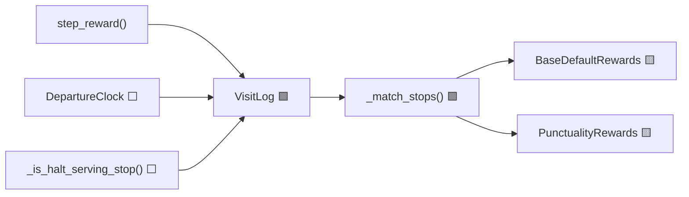

# Rewards serve intermediate stops in timetable order, each with its own halt (#557)

> **Status:** plan of 2026-11-27, draft. Based on PR [#589](https://github.com/flatland-association/flatland-rl/pull/589)
> (`554-early-departure-intermediate-stops`, c6d6776d), which is stacked on PR
> [#584](https://github.com/flatland-association/flatland-rl/pull/584) (`555-punctuality-intermediate-stops`,
> af502621) on `main` 9864941c (§11.2). Issue [#557](https://github.com/flatland-association/flatland-rl/issues/557)
> ("Rewards: serve intermediate stops in timetable order, each with its own halt; a target entry point must not be an
> intermediate stop", chenkins, rescoped 2026-11-27). Branch `557-waypoint-groups-disjoint`, PR: none yet. Open
> questions: none (§9.1).
>
> **Why:** the rewards judge each intermediate stop on its own, by entry point: the order of the stops is ignored, one
> halt can serve two stops, and a second visit of an entry point is lost or counted twice. The env enforces only the
> initial entry point and the target; everything else in the timetable is the rewards' job, so they need one
> semantics that holds for any line.

## 1. Introduction and goals

*What the change is for: the requirements, the qualities that matter, who has a stake, and what it leaves out.*

### 1.1 Requirements overview (functional requirements)

*The issue's text and the numbered requirements the rest of the plan refers to.*

> The env takes two things from the timetable and enforces them: the agent enters the map at its unique initial entry
> point, and it is done when it enters one of its target entry points. Everything else in the timetable (intermediate
> stops, their order, their times) is judged by the rewards only. […]
>
> - The timetable gives the order of the intermediate stops.
> - Each stop (waypoint group) is served by its own halt at one of its entry points (a halt as #584 defines it). One
>   halt serves at most one stop, and later stops are served by later halts.
> - Of all such assignments of the agent's halts to the stops, the one with the least penalty counts. A stop without
>   a halt is not served.
>
> […] the one disjointness to enforce: no target entry point is in an intermediate waypoint group. Checked when the
> agents are created or loaded, with a clear error. Intermediate groups may overlap each other, and an entry point may
> repeat among them.

Requirements:

- **REQ-1** The rewards book the agent's visits, not entry points: each visit of an entry point has its own arrival,
  departure (as dated by #589) and whether the agent halted there (#584's rule). A second visit of the same entry point
  is a new visit.
- **REQ-2** Intermediate stops are matched to visits in timetable order: each stop gets at most one halted visit at
  one of its entry points, each visit serves at most one stop, and a later stop gets a later visit. Of all such
  matchings, the one with the least penalty counts; a stop without a visit is not served.
- **REQ-3** Both `BaseDefaultRewards` (and the rewards built on it) and `PunctualityRewards` use the same booking
  (REQ-1) and matching (REQ-2), each with its own penalty: the default rewards' late arrival, early departure and not
  served terms; punctuality's on time or not.
- **REQ-4** An agent whose target entry point is also in one of its intermediate waypoint groups is rejected when the
  agents are created or loaded, with an error naming the agent and the entry point. Overlapping intermediate groups
  and repeated entry points among them stay allowed.
- **REQ-5** The semantics are documented in the rewards' docstrings; the "visited once" comments go.

### 1.2 Quality goals (non-functional requirements)

*The few qualities the design must reach, each with a concrete scenario.*

| ID | Priority | Quality goal | Scenario |
|---|---|---|---|
| NFR-1 | 1 | Unchanged results for ordinary lines | A line with disjoint stops, each visited once, in order, gets the same rewards as on #589's head (the existing tests keep their expectations). |
| NFR-2 | 2 | Step cost | Booking stays O(1) per step; the matching runs once per agent at the end of the episode, O(stops × visits). |

### 1.3 Stakeholders

*Who asks for the change, decides on it, reviews it or works with the result, and what they expect.*

| Role | Name | Expectations |
|---|---|---|
| Issue owner | chenkins | One semantics for the rewards; the env enforces only initial and target. |
| Competition and benchmark users | ECML 2026 participants, FAB evaluations | Scores of ordinary lines unchanged; no double counting. |
| TravelWise | PR [#528](https://github.com/flatland-association/flatland-rl/pull/528) | Journeys that return to a station are judged correctly. |

### 1.4 Follow-ups (not in this PR)

*What this PR leaves out, why, and where it goes later.*

| Follow-up | Why not in this PR | From | Findings | Issue |
|---|---|---|---|---|
| `UnilateralTimetablePredictor._advance()` counts consecutive groups sharing an entry point as reached by one visit. (`BoardForTargetPassengerPolicy._may_depart()`, also named in the issue, uses the passenger's stop index on #528's head 0dc9466e: fixed there.) | The code exists only in PR #528, not on this branch's base. | Issue | - | Review comment on [#528](https://github.com/flatland-association/flatland-rl/pull/528) |
| flatland-book rewards page: the stops' order and the one-halt-per-stop matching. | Another repo; the book runs against flatland-rl `main`, so it merges after this PR. | REQ-5 | - | - |
| Lines whose shortest route to a stop passes the target cell end there (25 of 150 runs in the [issue comment](https://github.com/flatland-association/flatland-rl/issues/557#issuecomment-7218832433)). | The rewards' semantics working as intended; avoiding such lines belongs to the line generator. | Issue | - | - |

## 2. Constraints

*What limits the design from outside: platform, organisation and conventions.*

| ID | Constraint | Kind | Explanation |
|---|---|---|---|
| C-1 | Stacked on #589 and #584 | organisational | Both change `rewards.py` and `tests/test_rewards.py`: #584 the halt that serves a stop, #589 the departure dating (`DepartureClock`). This PR reuses both and is rebased once they are merged (§11.2). |
| C-2 | The env enforces only initial and target | technical | Decided with the issue (2026-11-27); #559 goes the same way. No timetable logic in `step()`. |
| C-3 | Rewards read only this step's signals | technical | As #589's C-1: `step_reward()` works from `AgentTransitionData` and the agent; the rewards keep their own per-episode bookkeeping, not persisted (`persistence.py:205`). |
| C-4 | Conventions | conventions | `AGENTS.md`: Conventional Commits, `NamedTuple` for structured data, a class for state with several methods, comments describe current behaviour. |
| C-5 | flatland-baselines stays green | organisational | Workspace rule for flatland-rl changes. |

### 2.1 Limitations

*What the built code gets wrong or ignores, each with the TODO or issue that tracks it.*

- An agent done at its target before its last stops (route passing the target) gets those stops not served; §1.4.

### 2.2 Assumptions

*What must hold for the design to be correct, but is not checked in code.*

Not checked in code; they hold by construction of the env.

- An agent enters its target at most once: entering it makes the agent done (`rail_env.py:676`, `:512`). With REQ-4,
  no intermediate stop lies at the target, so the target visit never competes for a stop.
- Every visit starts with an arrival booked in `step_reward()`; the visit at the initial entry point starts with the
  map entry, which is its arrival (Q-3).

## 3. Context and scope (checked 2026-11-27 on c6d6776d)

*The code on the base branch that the change works in, as it is before the change, and where the change stops.*

- `flatland/envs/rewards.py`:
  - `BaseDefaultRewards.__init__()` `:261-267`: `arrivals[handle][entry_point]`, `departures[handle][entry_point]`
    (lists of steps), `stopped_waypoints[handle]` (set of entry points halted at, `_is_halt_serving_stop()` `:179`),
    `departure_clock` (`DepartureClock` `:115`, #589).
  - `BaseDefaultRewards.step_reward()` `:299-313`: books a halt, an arrival on entering a new entry point and the
    departure from the old one.
  - `BaseDefaultRewards._agent_done_or_max_episode_steps_reward()` `:392-422`: per intermediate group on its own:
    served if any of its entry points is in `stopped_waypoints`; the best window over all arrivals and departures of
    those entry points (`zip(arrivals[wp], departures[wp] + [None])`). Order ignored; one halt may serve two groups.
  - `PunctualityRewards.step_reward()` `:657-682`: books the first arrival of an entry point only (`entry_point not in
    self.arrivals[...]`); a second visit gets no arrival and no departure (`:678`).
  - `PunctualityRewards.end_of_episode_reward()` `:684-726`: per intermediate group, on time if any of its entry points
    has a halt and an arrival/departure pair within the window.
  - `DelayRewards` `:734`: all intermediate factors 0; unaffected.
- Readers of the bookkeeping: only `tests/test_rewards.py` (52 assertions on `arrivals`, `departures`,
  `stopped_waypoints`); none in flatland-rl's code or flatland-baselines.
- Agent creation: `EnvAgent.from_line()` (`agent_utils.py:356`, targets = the target cell in all directions), filtered
  to valid entry points in `RailEnv._agents_from_line()`; `GraphRailEnv._agents_from_line()` (`graph_rail_env.py:235`);
  loading in `agent_utils.py:145-152`.
- Generated lines: 280 agents of `env_generator` (line lengths 3-5, seeds 0-19): no intermediate stop in the target
  cell, no overlapping intermediate groups.

Scope: the two rewards' booking and end-of-episode matching, and a check when agents are created or loaded. The env's
`step()` and the policies stay as they are.

## 4. Solution strategy

*The fundamental choices and why, the rules the design follows, how it is verified, and the design of each part.*

| Quality goal | Scenario | Solution approach | Details |
|---|---|---|---|
| NFR-1 | Ordinary lines unchanged | With disjoint stops visited once in order, the matching has one candidate per stop: the same window as today | §4.4 |
| NFR-2 | Step cost | Append one visit per entry point entered; match once per agent at the end | §4.3, §4.4 |

### 4.1 Design principles

*The rules the design follows, each with its decision, the concepts it reuses instead of building new ones, and what
is not new on purpose.*

- **DP-1 The env enforces initial and target only; the rewards judge the rest.** (C-2)
- **DP-2 A visit is the unit.** Arrival, departure and halt belong to a visit, not to an entry point. (REQ-1)
- **DP-3 One matching, two penalties.** Both rewards share the booking and the matching; each gives its own cost of
  serving a stop with a visit and of not serving it. (REQ-3)
- **DP-4 Least penalty decides.** Among all order-preserving matchings the cheapest counts, ties to the earliest
  visits (Q-2).

Reused concepts:

| Need | Reused concept | Instead of |
|---|---|---|
| Whether a halt serves a stop | `_is_halt_serving_stop()` (#584) | a new halt rule |
| Departure step of a visit | `DepartureClock` (#589) | dating the departure again |
| Stop order and windows | `agent.waypoints`, `waypoints_latest_arrival`, `waypoints_earliest_departure` via `_intermediate_waypoints()` | a new timetable view |

Not new on purpose: no new reward term, parameter or `DefaultPenalties` member; no env or `EnvAgent` field; no
change to `step()`.

### 4.2 Verification

*How each requirement and quality goal is shown to work: tests, CI checks, before and after screenshots.*

No screenshots: nothing visible changes.

| ID | Requirement | Test or check | Result | Screenshots |
|---|---|---|---|---|
| REQ-1 | Visits booked | Unit test: a round trip A -> B -> A books two visits of A with their own arrival, departure and halt. | | - |
| REQ-2 | Order-preserving least-penalty matching | Unit tests of the matching: wrong order (B halted before A: the cheaper one of the two is served), overlapping groups (one halt at a shared entry point serves one stop, two halts serve both), round trip A -> B -> A -> C, two halts at one stop (the better window counts). | | - |
| REQ-3 | Both rewards | The REQ-2 cases through `DefaultRewards` and `PunctualityRewards`, parametrized as #584's station tests. | | - |
| REQ-4 | Validation | A line with an intermediate stop in the target cell raises on `reset()` (grid and graph) and on load; overlapping intermediate groups pass. | | - |
| REQ-5 | Docs | Docstrings of both rewards; no "visited once" left (`grep`). | | - |
| NFR-1 | Ordinary lines unchanged | `tests/test_rewards.py` keeps its expectations (assertions on the old bookkeeping rewritten to visits); the regression episodes and flatland-baselines' tests unchanged. | | - |
| NFR-2 | Step cost | One list append per entry point entered; the matching at episode end only. | | - |

### 4.3 Book visits (REQ-1; Q-1)

*One part of the change: what changes and why, with the requirements and decisions it implements.*

A `Visit(entry_point, arrival, departure, halted)` (`NamedTuple`, `departure` and `arrival` may be `None`) and a
`VisitLog` class shared by both rewards: per agent a list of visits in time order. `step_reward()` calls it once per
step:

- on entering a new entry point: close the current visit (departure from `DepartureClock`) and open a new one
  (arrival `elapsed_steps`);
- on leaving the map: close the current visit;
- when `_is_halt_serving_stop()`: mark the current visit halted.

It replaces `arrivals`, `departures` and `stopped_waypoints` of both rewards (Q-1). The visit at the initial entry
point opens with the map entry, the step of the map entry being its arrival; like any visit it can serve a stop whose
group contains the initial entry point, if the order fits (Q-3).

### 4.4 Match stops to visits (REQ-2, REQ-3; Q-2, Q-3)

*One part of the change: what changes and why, with the requirements and decisions it implements.*

`_match_stops(stops, visits, cost, not_served_cost)`: stops `0..m-1` in timetable order, the halted visits `0..n-1`
in time order, the initial visit included (Q-3). Dynamic program `best[j][i]` = least penalty for the first `j` stops
using visits before `i`: stop `j` is not served (`not_served_cost`) or served by visit `i'` whose entry point is in its
group (`cost(stop, visit)`), with later stops only after `i'`. O(m × n). Returns, per stop, the visit or `None`.

- `BaseDefaultRewards`: cost = late arrival + early departure as today (`min(la - arrival, 0)`,
  `min(departure - ed, 0)`, no early penalty without a departure); not served = `intermediate_not_served_penalty`.
  The three terms are summed per stop as today.
- `PunctualityRewards`: cost 0 when on time (arrival <= la, departure >= ed), else 1; not served 1. The number of
  stops on time is `m` minus the least cost.

### 4.5 Validate the target against intermediate stops (REQ-4; Q-4)

*One part of the change: what changes and why, with the requirements and decisions it implements.*

A helper that raises `ValueError` when an agent's target entry points (`agent.targets`) meet one of its intermediate
groups, called where the targets are final (Q-4): `RailEnv._agents_from_line()`, `GraphRailEnv._agents_from_line()`
and loading (`agent_utils.py:145-152`).

## 5. Building block view

*The components the change adds or changes: an overview, why the system is split this way, what each is responsible
for, the important interfaces, and the planned data model.*

### 5.1 Rewards in `rewards.py`

*One white box: its building blocks, why it is split this way, and the interfaces between them.*

Notation: boxes are building blocks of `rewards.py`, arrows are "is used by"; 🟩 added, 🟨 modified, ⬜ unchanged.

**Motivation:** booking (per step) and matching (per episode) are apart, so both rewards share them and keep only
their penalties (DP-3).

**Contained building blocks:**

| Component | Responsibility | Change |
|---|---|---|
| `VisitLog` | Keeps each agent's visits of entry points in time order, with arrival, departure and whether it halted. Not the penalties. | 🟩 added: a second visit of a station counts on its own. |
| `_match_stops()` | Matches the stops in timetable order to the halted visits with the least penalty. Not the penalty of a stop. | 🟩 added: one halt serves one stop, in order. |
| `BaseDefaultRewards` | Default penalties of an agent's run. | 🟨 modified: stops judged in order, each with its own halt. |
| `PunctualityRewards` | Counts the stops reached and left on time. | 🟨 modified: the same matching; a second visit counts. |
| `DepartureClock`, `_is_halt_serving_stop()` | Date a departure; decide a serving halt (#589, #584). | ⬜ unchanged |

## 6. Runtime view

*How the components work together at runtime: the flows and modes the change adds or changes.*

### 6.1 Round trip A -> B -> A -> C (REQ-1, REQ-2)

*One flow or mode, as a sequence or state diagram.*

Visits: A (initial, halted until its departure), B (halted), A (halted), C (target). Stops in order: B, A. The
matching gives B the halted visit at B and A the second visit of A: the initial visit of A is a candidate (Q-3), but
comes before B, so it can only serve the first stop, and B is not at A.

## 8. Crosscutting concepts

*What the change introduces that other code will follow, and what it changes for existing callers.*

### 8.1 New patterns

*What is new compared with the base branch.*

Compared with #589's head c6d6776d. What is reused, and what is not new on purpose, is in §4.1.

| ID | New | Defined in |
|---|---|---|
| PAT-1 | Visits as the unit of the rewards' bookkeeping | §4.3 |
| PAT-2 | Order-preserving least-penalty matching of stops to visits | §4.4 |
| PAT-3 | The env rejects a line with an intermediate stop at the target | §4.5 |

### 8.2 Breaking changes

*What breaks for whom, and the migration path.*

None for callers of the rewards' public methods. Changed:

- **Reward values** for lines that visit stops out of order, share entry points between stops, or visit an entry
  point twice: such runs were scored too well (one halt counted for two stops, order ignored) or too badly (a second
  visit lost in punctuality). Ordinary lines are unchanged (NFR-1). S-1's commit is marked `!`.
- **Bookkeeping attributes** `arrivals`, `departures`, `stopped_waypoints` of `BaseDefaultRewards` and
  `PunctualityRewards` are replaced by the visits (Q-1). Used only by `tests/test_rewards.py`, rewritten in S-1.
- **Lines with an intermediate stop at the target** are rejected on `reset()` and on load (REQ-4). None of 280
  generated agents has one; hand-built lines must move the stop. S-2's commit is marked `!`.

## 9. Decisions

*The decisions behind the plan: the questions still open, the decisions taken, and how each review finding was settled.*

### 9.1 Open questions

*Choices not made yet, each with its options and a proposal.*

✅ ~~**(Q-1) Keep the old bookkeeping attributes?**~~ **Decided 2026-11-27:** a) replace them by the visit log.
- a) Replace `arrivals`, `departures`, `stopped_waypoints` by the visits; rewrite the 52 test assertions.
- b) Keep them next to the visits, filled as before.

*Proposal:* a). Only tests read them; two copies of the same data would drift.

✅ ~~**(Q-2) Ties between matchings with the same penalty?**~~ **Decided 2026-11-27:** a) earliest visits.
- a) Earliest visits (deterministic, the first serving halt).
- b) Latest visits.

*Proposal:* a). Ties only change which window is reported per term in `DefaultRewards`, not the total.

✅ ~~**(Q-3) May the visit at the initial entry point serve an intermediate stop?**~~ **Decided 2026-11-27:** b) yes,
if the order fits. A line A -> B -> A -> C with stops
B and A: the halt before the departure from A is the origin, not the later stop A.
- a) No: the initial visit is the origin only.
- b) Yes, if it fits the order (it can only serve the first stop).

*Proposal was* a). The origin is judged separately (`PunctualityRewards`' initial departure, the cancellation term).
Decided b): the initial visit is a visit like the others; its arrival is the map entry step.

✅ ~~**(Q-4) Where is REQ-4 checked?**~~ **Decided 2026-11-27:** a) where the targets are final.
- a) Where the targets are final: `RailEnv._agents_from_line()`, `GraphRailEnv._agents_from_line()` and loading
  (`agent_utils.py:145-152`), through one helper.
- b) In `EnvAgent.from_line()` only (targets not yet filtered; graph and load not covered).
- c) In the line generators.

*Proposal:* a). It covers every way agents come in, with the targets the env really uses.

### 9.2 Decision log

*Every decision by date, with why it was taken and what follows from it.*

| Date | Decision | Why | Consequences |
|---|---|---|---|
| 2026-11-27 | ✅ The semantics go into the rewards only; the env enforces the initial entry point and the target, nothing else. | Same direction as #559; validation alone would not fix order or double counting. | Rescoped #557; REQ-1–REQ-3. |
| 2026-11-27 | ✅ Validate only: no target entry point in an intermediate group. | Entering the target ends the run, so a stop there cuts off the later ones; other overlaps are handled by the matching. | REQ-4, S-2. |
| 2026-11-27 | ✅ Stack on #584 and #589 (#585 continued). | They define the halt and the departure this PR books. | §11.2. |
| 2026-11-27 | ✅ The TravelWise parts are raised as review comments on #528. | The code is not on this branch's base. | §1.4. |
| 2026-11-27 | ✅ Q-1: the visit log replaces `arrivals`, `departures` and `stopped_waypoints`; it lives in each rewards instance, per agent handle, not persisted, as they did. | Only tests read the old attributes; two copies would drift. | §4.3, §8.2; S-1 rewrites the 52 test assertions. |
| 2026-11-27 | ✅ Q-2: ties go to the earliest visits. | Deterministic; ties change only how `DefaultRewards` splits the total. | §4.4. |
| 2026-11-27 | ✅ Q-3: the visit at the initial entry point may serve a stop, if the order fits. | One rule for all visits; the proposal (origin only) not taken. | §4.3, §4.4, §6.1; arrival of the initial visit = map entry step. |
| 2026-11-27 | ✅ Q-4: the target check runs where the targets are final: both `_agents_from_line()` and loading, one helper. | Covers every way agents come in, with the targets the env uses. | §4.5, S-2. |

### 9.3 Code Review Findings

*Findings from code reviews, PR comments and TODOs, with their status and the commits that fix them.*

None yet.

## 10. Glossary

*The domain and technical words the plan uses, with their code symbols.*

- **Stop** (intermediate waypoint group, `agent.waypoints[1:-1]`): a set of entry points; the agent serves it at any of
  them. Not the origin or the target.
- **Visit** (`Visit`): the agent's stay at one entry point, from entering it to leaving it, with arrival, departure
  and whether it halted. Not an entry point: one entry point can have several visits.
- **Halt** (`_is_halt_serving_stop()`, #584): speed 0 after a step at the entry point, not in a malfunction.
- **Matching** (`_match_stops()`): which visit serves which stop, in timetable order, one visit per stop.

## 11. Execution plan and status

*The commits that build the change, in order, and which of them are done: the source of the PR's status.*

### 11.1 Steps

*One row per commit: what it does, the findings it fixes, its message, and its SHAs once committed.*

| ID | Findings | Step | Category | Severity | Commit message | Commit(s) | Needs | Blocked by |
|---|---|---|---|---|---|---|---|---|
| 💡 S-1 | - | `Visit`, `VisitLog`, `_match_stops()`; both rewards book visits and match stops; docstrings; tests (REQ-1–REQ-3, REQ-5). | bug | medium | `fix(rewards)!: serve intermediate stops in timetable order, each with its own halt, with the least penalty.` |  | - | - |
| 💡 S-2 | - | Reject a target entry point in an intermediate group, with tests (REQ-4). | bug | low | `fix(env)!: reject lines whose target is also an intermediate stop.` |  | - | - |

### 11.2 Rebase and merge

*How the branch is rebased or merged when it builds on other open PRs, and the known conflicts.*

Chain: `main` ← #584 (`555-punctuality-intermediate-stops`) ← #589 (`554-early-departure-intermediate-stops`) ← this
branch. The PR targets #589's branch. When #589 is merged (into #584's branch or `main`): `git rebase --onto <its
target> c6d6776d`, then retarget the PR.

## 12. Change inventory

*Every file the change adds, modifies, renames or removes, and what stays unchanged on purpose.*

### 12.1 New files

*The files the change adds, and what each adds.*

| File | Adds |
|---|---|
| `docs/plans/rewards-stop-order.md` | This plan. |

### 12.2 Modified files

*The files the change modifies, and what changes in each.*

| File | Changes |
|---|---|
| `flatland/envs/rewards.py` | `Visit`, `VisitLog`, `_match_stops()`; both rewards book visits and match stops. |
| `tests/test_rewards.py` | Matching tests; bookkeeping assertions on visits. |
| `flatland/envs/rail_env.py`, `flatland/envs/graph_rail_env.py`, `flatland/envs/agent_utils.py` | The target check (Q-4). |
| `tests/test_flatland_envs_rail_env.py` (or a new test module) | Validation tests. |

Unchanged on purpose: `step()`, `EnvAgent`'s fields, `DelayRewards`, the policies, persistence formats.
