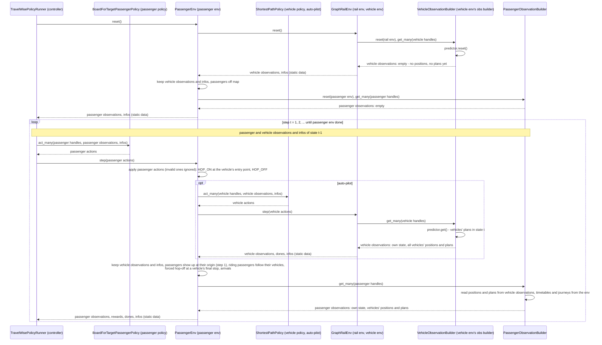

# Plan: TravelWise passenger env spike

PR [#528](https://github.com/flatland-association/flatland-rl/pull/528), branch
`feature/travelwise-passenger-overlway-spike`, based on `main` 3a66efe9. Status of 2026-11-05: phases 0-5 done, phase 6
(refactorings and cleanup) in progress: C6.1-C6.6, C6.9, C6.10 and C6.12 done, C6.7, C6.8 and C6.13 open; phase 7 (the
TravelWise data model in this repo) done.

## Goal

A technical spike of the TravelWise passenger env, in line with the
[data model](https://github.com/flatland-association/flatland-book/blob/main/resources/travelwise/data_model.md):

- The spike and its tests run on `GraphRailEnv` only, in the subpackage `flatland/envs/travelwise/` (phase 0).
- Each vehicle's remaining route is projected with optimistic times (phase 1).
- Passengers ride one vehicle from origin to target (phase 2), then with changes of trains at given stops (phase 5).
- Passengers observe the vehicles' positions and plans and decide themselves when to hop on and off; a controller
  holding the passenger policy steps `PassengerEnv`, which steps the vehicles with their own policy (phase 3).
- Passengers are rewarded for lateness (phase 4).
- Refactorings and cleanup: a runner instead of the test loop, and the code review findings fixed (phase 6).
- The review findings on the TravelWise data model fixed in this repo's copy (phase 7).

## Status

| Phase | ID | Commit message | Status |
|---|---|---|---|
| 0 | C0.1 | `refactor(envs): move the passenger env and its tests into the travelwise subpackage.` | ✅ 052da2a6 |
| 0 | C0.2 | `refactor(policies): inject the router into ShortestPathPolicy and let it serve intermediate stops.` | ✅ c62fffed |
| 0 | - | `refactor(graph): make the resource map of a graph converted from a grid public.` | ✅ bce9e133 |
| 0 | C0.3 | `refactor(envs): run the passenger env spike and its tests on GraphRailEnv only.` | ✅ f90b72da |
| 1 | C1.1 | `feat(envs): predict vehicles' remaining routes along their timetable in a new TimetablePredictor.` | ✅ d1283828 |
| 2 | C2.1 | `feat(envs): give passengers single-ride journeys with earliest departure and latest arrival.` | ✅ 14578ec9 |
| 3 | C3.0 | `refactor(policies): let ShortestPathPolicy act on a dedicated observation instead of the whole env.` | ✅ 6ebe3c72 |
| 3 | C3.1 | `feat(envs): let passengers hop on and off via actions, decided by a passenger policy on their observations.` | ✅ 2711d24d |
| 4 | C4.1 | `feat(envs): reward passengers for lateness and report per-passenger dones.` | ✅ 93a6de3f |
| 5 | C5.1 | `feat(envs): support passenger journeys with changes of trains at given stops.` | ✅ d2837293 |
| 5 | - | `docs: add conventions for envs, observations, policies, step timing, routing and travelwise to AGENTS.md.` | ✅ 69bbf968 |
| 6 | - | `docs(travelwise): copy the TravelWise concept and data model from flatland-book 1:1.` | ✅ 0b3b3f60 |
| 6 | - | `docs(travelwise): update the TravelWise concept and data model to the passenger env spike's decisions.` | ✅ 9f19e26a |
| 6 | C6.1 | `feat(envs): add a TravelWisePolicyRunner running a passenger env episode with a passenger policy.` | ✅ b5324b2b |
| 6 | C6.2 | `fix(policies): reset ShortestPathPolicy's routes when a new episode starts.` | ✅ d19bbc88 |
| 6 | C6.3 | `fix(policies): fail when ShortestPathPolicy cannot route through all waypoint groups.` | ✅ 673953fd |
| 6 | - | `docs(travelwise): define a vehicle's route in the passenger env plan and the TravelWise docs.` | ✅ 8fce64aa |
| 6 | C6.4 | `fix(envs): let the passenger policy read the earliest departure of the group it waits at from its observation.` | ✅ 6835da3e |
| 6 | - | `docs(travelwise): add a glossary with the implementing classes and their status to the TravelWise data model.` | ✅ 3da330b2 |
| 6 | C6.5 | `fix(envs): warn on and ignore malformed passenger actions and unknown vehicle handles.` | ✅ 6b453276 |
| 6 | C6.9 | `fix(envs): let passengers board only vehicles planned to stop at an entry point of their next stop.` | ✅ 5f2a7b1c |
| 6 | C6.6 | `refactor(policies): extract the stop decision and the first projected step into their own methods.` | ✅ 02d31f8d |
| 6 | C6.10 | `refactor(envs): move the passenger rewards into a rewards class that PassengerEnv takes as a parameter.` | ✅ 21b54296 |
| 6 | C6.12 | `refactor(envs): keep each passenger's state in a Passenger object with an EnvAgent-like API.` | ✅ 01a386dd |
| 6 | C6.13 | `feat(envs): let passengers board and alight only where the vehicle stops.` | open |
| 6 | C6.7 | `refactor(envs): tighten the type hints of the passenger env.` | open |
| 6 | C6.8 | `perf(envs): compute a vehicle's stops serving a passenger once per observation.` | open |
| 7 | C7.1 | `docs(travelwise): align the data model diagram with flatland-rl's names and add its missing classes.` | ✅ a6605e10 |
| 7 | C7.2 | `docs(travelwise): add the TravelWise concepts not built yet to the data model's glossary.` | ✅ dfc46d70 |
| 7 | C7.3 | `docs(travelwise): colour the data model diagram by its change against flatland-book and describe its building blocks.` | ✅ be9e1e21 |

## Design principles

- RL split (flatland-book, RLlib): an env's `step()` takes its agents' actions, updates its state and returns
  observations, rewards, dones and infos. It never runs the policy of its own agents; a policy (or a controller)
  takes the observations and issues the actions. Entities that are not the env's agents may be driven inside
  `step()` as part of the env's dynamics: `PassengerEnv` steps the vehicles with their own policy.
- The env is dull: it applies an action if it is physically feasible and ignores it otherwise. What to do - which
  vehicle to board, when to depart (the earliest departure), where to alight - is the policy's decision (Q23).
  A malformed action (not an `(action, handle)` pair, or an unknown vehicle handle) is ignored too, but with a
  warning, as it points to a bug in the policy (C6.5). Hopping on or off a vehicle is physically feasible only where
  the vehicle stops: standing still (speed 0) at a stop of its line, not where it passes through (Q26).
- Observations hold dynamic data only (positions, plans); they hold no position and no plan after `reset()`.
  Data shared by all agents is one immutable object referenced by every observation, not copied per agent.
- Static data (timetables, journeys, the map) is not part of the observations: it reaches the policies through the
  infos, as a reference to one immutable object (Q19). Observation builders, part of the env, read the env.

Reused concepts:

| Need | Reused concept | Instead of |
|---|---|---|
| Vehicle projection | `PredictionBuilder` (like `ShortestPathPredictorForRailEnv`: "as if no other agent is in the environment"), owned by the vehicles' observation builder, as `TreeObsForRailEnv` owns its predictor | a decorator around the rail env's observation builder; `PassengerEnv` owning the predictor |
| Passenger journey | `EnvAgent`'s `waypoints`, `waypoints_earliest_departure`, `waypoints_latest_arrival` and their `None` conventions | new fields `origin`, `target`, `via`, ... |
| Stop reached | exact entry point of a waypoint group, as in `BaseDefaultRewards` | resource (cell) matching |
| Vehicle's final stop | `EnvAgent.target_entry_point`, set by `handle_done_state()` | keeping the vehicles' entry points of the previous step |
| Observations | `ObservationBuilder` for vehicles and passengers | the whole env as observation (`FullEnvObservation`) |
| Static data | infos (RLlib: infos keyed by agent id; Flatland: `action_required` in the infos) | static data in every observation; policies reading the env |
| Policies | `Policy`/`act`, the `rail_env_policy.py`/`rail_env_policies.py` layout | - |
| Controller | the usual env/policy loop, with `PolicyRunner`'s `FlatlandCallbacks` hooks (C6.1) | the passenger policy inside `PassengerEnv.step()`; reusing `PolicyRunner`, bound to `RailEnv` and trajectories |
| Passenger actions | an enum like `RailEnvActions` | - |
| Graph routing | `networkx` on `rail.g`, injected into `ShortestPathPolicy` and the predictor as a router | a hand-written search |

## Terms

Mapped to the TravelWise terms of flatland-book's
[TravelWise page](https://github.com/flatland-association/flatland-book/blob/main/resources/travelwise.md) and
[data model](https://github.com/flatland-association/flatland-book/blob/main/resources/travelwise/data_model.md)
(no glossary there; terms from its environments table, prose and diagram notes). "-": no TravelWise term. Both pages
are copied into this repo, [`docs/travelwise.md`](../travelwise.md) and
[`docs/travelwise/data_model.md`](../travelwise/data_model.md), and updated to the decisions of this plan.

| Term (code) | TravelWise term | Meaning here, and what it is not |
|---|---|---|
| vehicle (`GraphRailEnv` agent, `handle`) | vehicle; agent of the infrastructure (ground) level | A train running on the rail env, on auto-pilot, with no notion of passengers. The tests also say "train"; not a passenger's ride (a leg). |
| rail env, vehicle env (`GraphRailEnv`) | `InfrastructureEnv` (a generalized `RailEnv`) | The vehicles' env on the network (graph) view. Rail only: no multimodal edges, no walkways. |
| passenger (`PassengerEnv` agent, `handle`) | passenger (a group of N people) | One agent per passenger; group size and capacities are not modelled. |
| passenger env (`PassengerEnv`) | `PassengerEnv` (passenger level) | Steps the passengers on top of a rail env it holds. Not a subclass of the rail env, as the data model draws it; no `TravelWiseEnv` combining both. |
| entry point (graph node), resource | configuration (aka node, grid cell entry point) | Where a vehicle or a waiting passenger is; a resource is what two vehicles cannot occupy at once (a cell). |
| stop (one entry point) | `StoppingPoint` (Haltepunkt) | A station track where a vehicle stops. Not a station: stations are not modelled. |
| waypoint group (`waypoints[i]`) | `LineFlexibleStoppingPoint` | Alternative stops of which a vehicle uses one, or at which a passenger boards, changes or arrives. |
| line and timetable (`EnvAgent.waypoints`, `Timetable`) | line; timetable | A vehicle's stops, and its earliest departure and latest arrival per stop. |
| route (list of `EntryPointT`, from a `Router`) | - | Every entry point a vehicle passes, in order (on the grid each cell entered, with its direction; on the graph each node), from its initial entry point through one alternative per waypoint group. Neighbouring entries are connected by a transition. The waypoints are the few entries the stop indices point to. Found greedily per group, so not the shortest over all alternatives. Not its line (the stops only), not a passenger's itinerary. |
| journey (`PassengerJourney`) | journey (origin and destination); partly initial itinerary | Origin, given changes and target, with earliest departure and latest arrival per group. More than TravelWise's journey (the changes and times), less than an itinerary (no vehicles chosen). |
| change (intermediate group of a journey) | transfer | Where the passenger gets off and waits for the next vehicle. Given, not planned; no minimum transfer time. Its meaning may change with the query view (see follow-ups). |
| ride (two consecutive groups of a journey) | leg | Part of a journey on one vehicle. |
| itinerary | initial itinerary | Not modelled: the passenger policy picks the vehicle at each stop at runtime. |
| hop on, hop off (`PassengerAction.HOP_ON`, `HOP_OFF`) | hop down on, hop back up | Board a vehicle at the passenger's resource where the vehicle stops (standing still at a stop of its line); get off where the vehicle stops, at its current entry point (C6.13). |
| wait (`PassengerAction.WAIT`) | move to edge (the passenger's only action) | Stay where it is. Passengers do not walk: no walkways. |
| passenger mode (`passenger_mode`, `PassengerMode`) | - | Where a passenger is: waiting at a resource, or riding a vehicle. Not TravelWise's mode of transport. |
| next stop (`Passenger.next_stop()`) | - | The passenger's next change or its target. |
| plan (tuple of `ProjectedEntryPoint`) | - | A vehicle's predicted remaining route and stop times, as if it ran alone and on time. Not its timetable, not its policy's intent. |
| query view | global observation of the graph and timetables | All vehicles' future stops, to plan connections. Not built (follow-up). |
| vehicle policy, auto-pilot (`ShortestPathPolicy`) | auto-pilot; `FlatlandPolicy` | Drives the vehicles inside `PassengerEnv.step()`. |
| passenger policy (`BoardForTargetPassengerPolicy`) | `PassengerPolicy` | Decides the passengers' actions. Not an itinerary planner yet, which TravelWise expects it to become. |
| controller, runner (`TravelWisePolicyRunner`) | `TravelWisePolicyRunner` | Holds the passenger policy and steps `PassengerEnv`; the vehicles are stepped by `PassengerEnv`. A library class since C6.1. |
| static data (`infos["static"]`) | - | What doesn't change during an episode (map, timetables, journeys), handed to the policies in the infos. |
| milestone, event | milestone; event | Not modelled in this PR. |

## Components

Added and modified by this PR (🟩 added, 🟨 modified):

| Component | Responsibility | Change |
|---|---|---|
| `PassengerEnv` | Simulates passengers travelling on the trains of a rail env: applies their hop-on and hop-off decisions, carries riding passengers along, and rewards punctual arrival. Not for deciding what passengers do (that is the passenger policy), nor for driving the trains (it delegates them to the vehicle policy). | 🟩 added: passengers ride the trains of a rail env on the network (graph) view, decide themselves when to board and get off, can change vehicles at given stops, and are rewarded for being on time. |
| `Passenger` | A passenger's state: where it is (waiting, or on the vehicle it rides), where it is in its journey, and when it arrived. Not its decisions. | 🟩 added: each passenger is one object with an API like a vehicle's. |
| `PassengerJourney` | A passenger's travel request: where it starts, where it changes vehicles, where it ends, and when. Not a plan of which vehicles to take. | 🟩 added: passengers get an origin, changes and a target with earliest departures and latest arrivals, written like a train's timetable. |
| `PassengerAction` | What a passenger can do in a step: wait, board a vehicle, or get off. Not whether doing so is wise. | 🟩 added: boarding and getting off are passenger actions instead of happening automatically. |
| `PassengerObservation` (`PassengerObservationBuilder`) | What a passenger sees in a step: its own situation and the vehicles it could take towards its next stop. Not the static journey or timetable data, which come with the infos. | 🟩 added: passengers can see which vehicles will take them to their next stop, and when. |
| `BoardForTargetPassengerPolicy` | A simple passenger behaviour: board the first suitable vehicle towards the next stop and get off there. Not a journey planner: it does not choose connections. | 🟩 added: a ready-made passenger behaviour to run the env with, and a baseline to compare others to. |
| `VehicleObservation` (`VehicleObservationBuilder`) | What each vehicle (and, through it, every passenger) knows of all vehicles in a step: where they are and where and when they will stop. Not the timetable itself. | 🟩 added: every vehicle's position and announced stops are visible to all, shared rather than copied per agent. |
| `TimetablePredictor` (`UnilateralTimetablePredictor`) | Announces each vehicle's remaining route and stop times, assuming it runs undisturbed and on time. Not a forecast of delays or of conflicts between vehicles. | 🟩 added: vehicles announce where they will stop and when, so passengers can plan their boarding. |
| `ShortestPathObservation` (`ShortestPathObservationBuilder`) | What the auto-pilot needs to know of its own vehicle in a step. Not the map or the timetable, which come with the infos. | 🟩 added: the auto-pilot can run on a small observation instead of the whole env. |
| `RailEnvStaticData` (`AgentStaticData`) | The rail env's data that doesn't change during an episode (map, routes, timetables), handed to policies once instead of in every observation. Not dynamic state. | 🟩 added: policies get the map and timetables through the infos, without reading the env. |
| `ShortestPathPolicy` | The auto-pilot: drives each vehicle along a shortest route through its stops, keeping to its timetable at intermediate stops on request. Not for avoiding conflicts with other vehicles. | 🟨 modified: trains can now wait at intermediate stops until their departure, run on the graph, and use the small observation; existing callers keep working unchanged. |
| Routers (`greedy_grid_route_through_waypoints`, `greedy_graph_route_through_waypoints`) | Find a route through a vehicle's stops on the grid or the graph, shared by the auto-pilot and the predictor so both agree. Not optimal over all alternatives (greedy per stop). | 🟩 added: routing is pluggable, and what the vehicles announce matches how they drive. |
| `PassengerRewards` (`DefaultPassengerRewards`) | What a passenger is rewarded and penalized for: arriving on time, boarding too early, not arriving. Not for deciding what the passenger does. | 🟩 added (C6.10): the passenger rewards can be replaced without changing the env. |
| `TravelWisePolicyRunner` | Runs a passenger episode: resets the passenger env, then steps it until it is done, each time with the passenger policy's actions on the previous observations and infos. Not for stepping the vehicles (`PassengerEnv` does) and not for recording trajectories. | 🟩 added: a passenger episode runs in one call, without writing the loop. |
| `GraphTransitionMap` (`grid_to_digraph`, `grid_to_resource_map`) | Converts a grid map into the network (graph) view. Not a native graph builder. | 🟨 modified: a graph and its resources can be built from a grid map without creating a `RailEnv` first. |

## Phase 0: graph-only spike (done)

- Goal: the passenger simulation runs on the network (graph) view only, and trains run exactly on their timetable,
  including waiting at intermediate stops until their departure.
- `ShortestPathPolicy` takes an injected router (`greedy_grid_route_through_waypoints()` by default,
  `greedy_graph_route_through_waypoints()` for graphs, `networkx` over `rail.g`) and a flag
  `serve_intermediate_stops` (default off, the previous behaviour): with it, the agent halts at each intermediate
  stop until its earliest departure. TODO in the graph router: replace it by `get_k_shortest_paths()` once that is
  generalized to graphs.
- The corridor graph is built from a `GridTransitionMap` with `GraphTransitionMap.grid_to_digraph()` and
  `grid_to_resource_map()`, without `RailEnv` (TODO: build the graph natively).
- `PassengerEnv.clone_from()` is removed: no caller, and `GraphRailEnv` has no `clone_from()`.
- Graph edges count as length 1 until [#542](https://github.com/flatland-association/flatland-rl/pull/542).

## Phase 1: per-vehicle projection (done)

- Goal: each vehicle announces where it will be and when, assuming it runs undisturbed and on time.
- `TimetablePredictor` (interface, overrides `get()` only) and `UnilateralTimetablePredictor` in
  `flatland/envs/travelwise/timetable_predictor.py`: per vehicle, its remaining route as a list of
  `ProjectedEntryPoint(entry_point, step, stop)` - `stop` the index of the waypoint group if the vehicle stops
  there. `get()` advances each vehicle's waypoint progress (exact entry points, as `BaseDefaultRewards`), then
  routes from the current (or initial) entry point through the remaining groups with the injected router.
- Times: off map, the vehicle enters at `max(earliest departure, elapsed + 1)`; each move takes
  `ceil((1 - distance) / max_speed)` steps; at an intermediate stop it moves again at
  `max(arrival + 1, earliest departure)`. Exact for a single vehicle alone on the map, otherwise optimistic.
- Not the query view: a multi-vehicle projection of all vehicles' future stops comes later.

## Phase 2: single-ride journeys (done)

- Goal: each passenger has a journey from an origin to a destination, with an earliest departure and a latest
  arrival, on a single train that stops at the destination.
- `PassengerJourney(waypoints, waypoints_earliest_departure, waypoints_latest_arrival)`, the same fields and
  conventions as `EnvAgent`; exactly two groups (origin with one entry point, target).
- A vehicle serves a passenger if one of its future stop groups shares an entry point with the passenger's next
  stop (Q10). The vehicle stops at one entry point of the group, chosen by its policy - possibly outside the
  passenger's next stop: then the passenger misses it and stays on board up to the vehicle's final stop (until C6.9,
  which boards by the planned entry point, Q10).
- Boarding and alighting were automatic in this phase; phase 3 replaces them by actions.
- A vehicle reaching its target is removed in that step: riding passengers are forced off at
  `EnvAgent.target_entry_point`.

## Phase 3: passenger decisions (done)

### Goal

- Passengers decide themselves when to board a vehicle and when to leave it, based on what they observe of the
  vehicles.
- The vehicles' policy acts on a dedicated observation instead of the whole env (C3.0).

### C3.0: `ShortestPathPolicy` on a dedicated observation

Today `ShortestPathPolicy` needs `FullEnvObservation` (the whole env). It reads the transition map (`env.rail`),
`env._elapsed_steps` and, from `env.agents[handle]`: `handle`, `state` (done only), `current_entry_point`,
`next_entry_point`, `speed_counter.is_cell_exit()`, `initial_entry_point`, `waypoints` and
`waypoints_earliest_departure`.

- `ShortestPathObservation` (frozen dataclass), the dynamic part: `handle`, `elapsed_steps`, `done`,
  `current_entry_point`, `next_entry_point`, `is_cell_exit` - `elapsed_steps` only for now (Q18). After `reset()` it
  has no position.
- The static part - the map, and per vehicle `initial_entry_point`, `waypoints`, `waypoints_earliest_departure` -
  reaches the policy through the infos (Q19), added by the runner (Q20): `PassengerEnv` for the vehicles, the test
  loops in the tests.
- `ShortestPathObservationBuilder(ObservationBuilder[AbstractRailEnv, ShortestPathObservation])` builds it.
- `ShortestPathPolicy` reads the observation and the static data instead of `env`/`agent`.
- Backwards compatible: with `FullEnvObservation` (the env as observation), the policy derives both from the env, so
  existing callers keep working (Q22).
- Tests: the existing ones unchanged (compatibility path), plus the policy with the new builder on grid and graph;
  the travelwise tests switch to the new builder.

### C3.1: actions, observations and policy

Actions and validation:

- Action per passenger: `(PassengerAction, vehicle)`, `PassengerAction` one of `WAIT`, `HOP_ON`, `HOP_OFF`
  (`flatland/envs/travelwise/passenger_env_action.py`); the vehicle handle only with `HOP_ON`.
- The env applies an action if it is physically feasible and ignores it otherwise. `HOP_ON`: the passenger waits
  and the vehicle is on the map at the passenger's resource - checked on the state the passenger observed.
  `HOP_OFF`: while riding, at the vehicle's current entry point. Since C6.13 both only where the vehicle stops: standing still at a stop of its line (Q26). Whether the vehicle serves the passenger and
  whether the passenger's earliest departure has passed are the policy's decisions (Q23).
- The forced hop-off at a vehicle's final stop stays (phase 2).
- Arrived: alighted at an entry point of the target; the passenger is done, and its further actions are ignored.

Observations:

- `VehicleObservationBuilder` (`flatland/envs/travelwise/vehicle_observations.py`, for now) is the rail env's observation builder: it owns
  the predictor and builds, per vehicle, its `ShortestPathObservation` plus a reference to the shared, immutable
  positions and plans of all vehicles (Q12, Q14) - a plan is a tuple of `ProjectedEntryPoint`s.
- `PassengerObservation` (`flatland/envs/travelwise/passenger_env_observations.py`): the elapsed steps (for now, as
  for the vehicles, Q18), the passenger's mode and stop index (the journey's group it is at or last left; its next
  stop is the group after it, read from the journey in the static data, Q11), the vehicles it can hop on now that serve it, with their future stops serving its next stop, and whether
  the vehicle it rides stops at its next stop now. Built by `PassengerObservationBuilder` from the vehicle
  observations `PassengerEnv` keeps, and from the journeys and timetables in the env. No position and no plan after
  `reset()`: passengers and vehicles are off the map (Q11, Q15).

Policy:

- `BoardForTargetPassengerPolicy` (`flatland/envs/travelwise/passenger_env_policies.py`) acts on the observation,
  with the passenger's journey from the static data in the infos:
  - riding, its vehicle stopping at its next stop: `HOP_OFF`;
  - waiting, boarding not before its earliest departure, with vehicles to board: `HOP_ON` - first a vehicle stopping
    at an entry point of the next stop, then the one stopping there soonest. The action applies in the step after the
    one observed, so it boards if `elapsed_steps + 1 >= earliest departure` - the rule `ShortestPathPolicy` departs
    a vehicle by;
  - otherwise `WAIT`.

### Controller and step

The controller (`TravelWisePolicyRunner`, the data model's name, C6.1) holds the passenger policy and
steps only `PassengerEnv`, with the passengers' actions. `PassengerEnv` holds the rail env and the vehicle policy
(the auto-pilot), and is the runner of the vehicles: it keeps their last observations and infos, the vehicle policy
acts on them in the next step, and the passengers' observations are built from them - each state is observed once.

Within `PassengerEnv.step()`, the passengers' actions are applied first, on the state they observed at the end of
the previous step; then the vehicles move, and the riding passengers with them. So passengers and vehicles both
decide on the same state. A passenger boards, or alights at an intermediate stop, in the step after it observed
the vehicle there - e.g. T0 stands at A only in step 2: a passenger observing it there boards in step 3, as T0
moves on. A passenger arrives in the step its `HOP_OFF` is applied; the forced hop-off at a vehicle's final stop
happens in the step the vehicle arrives.

## Phase 4: lateness rewards and dones (done)

- Goal: passengers are rewarded the earlier they arrive before their latest arrival, penalized for arriving late or
  not at all; each passenger's journey is done once it arrives.
- Rewards per passenger, in the step they occur, otherwise 0. They can be positive (early arrival), unlike
  Flatland's `DefaultRewards` (`min(latest_arrival - arrival_time, 0)`, never positive): good enough for the
  spike, to be revisited (follow-up):
  - at its arrival step: `waypoints_latest_arrival[-1] - arrival_time` (late negative);
  - at boarding before the earliest departure of the group it waits at: `-(earliest departure - boarding step)`,
    the boarding step being the step the `HOP_ON` is applied (Q23);
  - when the rail env is done and it has not arrived: `-max_episode_steps` (Q6).
- `step()` returns the passenger observations, rewards per passenger, dones per passenger (arrived) plus
  `'__all__'` (rail env done), and the infos.

## Phase 5: journeys with changes of trains (done)

- Goal: passengers can change trains at given stops along their journey.
- `PassengerJourney.waypoints` may have intermediate groups, the stops where the passenger changes; each pair of
  consecutive groups is one ride. `next_stop(p)` is the first group not yet reached; boarding, alighting, the
  forced hop-off and the missed stop apply per ride.
- At a change the passenger alights, waits and boards the next vehicle serving it; respecting the group's earliest
  departure is the passenger policy's decision (Q23). No minimum transfer time (TODO).
- Arrived and rewards: at the target only.
- Tests: passenger 0 of the shuttle tests becomes A -> B -> C and arrives again.

## Phase 6: refactorings and cleanup (in progress)

Goal: clean up the spike's code before merging - a runner instead of the test loop (C6.1), and the code review
findings 19, 38 and 39-48 fixed (C6.2-C6.10, C6.12, C6.13). No new feature but C6.13's feasibility rule, and no
change to the test traces but C6.13's hop-off test. Each step is one commit, green
on its own, with its tests.

### C6.1: the runner as a library class (done)

- Goal: a library user runs a passenger episode in one call instead of copying the test loop; the tests use the
  same runner (finding 16).
- Today the controller is the test helper `_run()` in `tests/flatland/envs/travelwise/test_passenger_env_scenario.py`.
  `PolicyRunner` is not reused: it is bound to `RailEnv` and trajectories (it loads the env from a trajectory and
  records actions, positions and rewards per train), and it does not pass the infos (static data, Q19) to the
  policy. Recording passenger runs in trajectories stays a follow-up (finding 22).
- `TravelWisePolicyRunner(passenger_env, passenger_policy, callbacks=None)` in
  `flatland/envs/travelwise/travelwise_policy_runner.py` (Q24):
  - `reset()`: resets the passenger env, keeps the observations and infos and returns them;
  - `step()`: the passenger policy's actions on the kept observations and infos, then `passenger_env.step()`; keeps
    the new observations and infos, sums the rewards per passenger (`total_rewards`), returns
    `(observations, rewards, dones, infos)`;
  - `run()`: `reset()`, then `step()` until `passenger_env.done`; calls `FlatlandCallbacks`' `on_episode_start`,
    `on_episode_step` and `on_episode_end` with `env=passenger_env`, as `PolicyRunner` does; returns
    `total_rewards`.
- Unchanged: `PassengerEnv` steps the vehicles with the vehicle policy (Controller and step, Q25); no trajectories.
- Tests: the test loops (`_run()` in the scenario test, the changes test in the spike test) step the runner
  (`runner.reset()`/`runner.step()`), still recording mode changes and rewards per step, with the traces unchanged; a
  new test checks the rewards `run()` returns and the order of the callbacks. A second `run()` on the same passenger
  env needs C6.2: the vehicle policy keeps its routes across episodes (finding 40); C6.2's test covers it.
- Docs: `PassengerEnv`'s docstring loop example uses the runner; the controller in the terms, the components and the
  sequence diagram is the runner.

### C6.2-C6.12: code review findings

| ID | Finding | Change | Tests |
|---|---|---|---|
| C6.2 | 40 | `ShortestPathPolicy` drops its routes when a new episode starts: at the first observation with `elapsed_steps == 0` (or the env as observation at step 0). Also fixes the failure on `main` for agents not done in the first episode. | The policy reused for two episodes on different lines; both run to the end. `TravelWisePolicyRunner.run()` twice on the same passenger env returns the same total rewards. |
| C6.3 | 43 | `ShortestPathPolicy` raises when the router routes fewer waypoint groups than given, as `main` asserted. The routers keep returning the groups they reached; the predictor keeps ending its plan there. | An unreachable group raises in `act_many()`. |
| C6.4 | 41 | `PassengerObservation` gets `stop_index` (`PassengerEnv.stop_index()`), the index of the journey's group the passenger is at or last left, in place of `next_stop`: the observation keeps only dynamic data (Q11), the groups and their times are static data in the infos. `BoardForTargetPassengerPolicy` reads the earliest departure and the next stop from the journey at that index, instead of searching the journey by `next_stop`. Repeated visits stay tracked in [#557](https://github.com/flatland-association/flatland-rl/issues/557). | The observation test asserts the field; the scenario traces stay unchanged. A policy test on a journey A -> B -> A boards at B not before B's earliest departure (with the search by `next_stop`, it boards too early). |
| C6.5 | 42 | `PassengerEnv` ignores, with a warning, an action that is not an `(action, handle)` pair, and a `HOP_ON` whose vehicle handle is not one of the rail env's. `BoardForTargetPassengerPolicy` never sends such actions (it boards only vehicles from its observation); they come from other policies, e.g. an RL policy whose action space does not bound the vehicle handle, so the env warns instead of hiding the bug. The rail env's handles are its agents' indices `0, ..., n - 1` (`AbstractRailEnv.get_agent_handles()`), so the handle is checked by range (an integer, numpy integers included, with `0 <= handle < get_num_agents()`): a negative handle no longer boards a vehicle counted from the end, one out of range no longer raises. Infeasible but well-formed actions (e.g. hopping on a vehicle elsewhere) stay ignored without a warning. | A passenger waiting at a vehicle gets a warning for scripted actions with a negative handle, one out of range, one not an integer, a negative numpy integer, and a bare `PassengerAction`, and boards one step later by its policy. The other tests run without the warning. |
| C6.9 | 39, 47 | A vehicle serves a passenger if one of its future stops, as planned, is at an entry point of the passenger's next stop (`PassengerObservationBuilder.future_stops_serving()`: the planned entry point, not the overlap of the groups; Q10 revisited). The plan holds the entry point the vehicle stops at, as the vehicle policy and the predictor use the same router (Q14). `PassengerEnv`'s and `BoardForTargetPassengerPolicy`'s docstrings drop the missed stop and its TODO. A fix, so before the refactorings. | A station B with two tracks B1 and B2, a vehicle with the group `{B1, B2}` planned to stop at B2: a passenger heading to `{B1}` does not board it (it boards with the overlap rule and misses its stop), one heading to `{B2}` boards and arrives. The corridor traces stay unchanged, as every group there has one entry point. |
| C6.6 | 46 | `ShortestPathPolicy._act()`: the stop decision at intermediate stops moves into its own method. `UnilateralTimetablePredictor._predict()`: the first projected step (off the map, halted, moving) moves into its own method. No behaviour change. | The existing policy and predictor tests. |
| C6.10 | 48 | The passenger rewards move out of `PassengerEnv` into a rewards class it takes as a constructor parameter, as `RailEnv` takes `rewards` (Q27): `PassengerRewards` (`abc`) in `flatland/envs/travelwise/passenger_env_rewards.py`, with `step_reward(journey, transition, elapsed_steps)`, `end_of_episode_reward(journey, arrived, max_episode_steps)`, `cumulate()` and `empty()`; `PassengerTransitionData` (`NamedTuple`), what a passenger's step did: the step and stop index it boarded at, the step it arrived in; `DefaultPassengerRewards`, today's rewards, with their description moved from `PassengerEnv`'s docstring. `PassengerEnv(..., rewards=None)` defaults to it. `step()` calls it as `AbstractRailEnv.step()` calls its `Rewards`: `empty()` per passenger, the actions record what happened, after the vehicles and riding passengers moved `step_reward()`, and when the rail env is done `end_of_episode_reward()`. `PassengerJourney` moves to `flatland/envs/travelwise/passenger_journey.py`, so the rewards module imports it without a cycle; `passenger_env.py` imports it, so existing imports keep working. No behaviour change. | The existing reward tests, unchanged. A test passing another rewards class to `PassengerEnv` gets its rewards. |
| C6.12 | 19 | `PassengerEnv.passengers: Dict[int, Passenger]` (by handle, as `passenger_journeys`), one mutable `Passenger` (`attrs`, like `EnvAgent`) per handle with `handle`, `journey`, `mode` (`PassengerMode`), `current_entry_point`, `stop_index`, `target_entry_point` and `arrival_time`, named as on `EnvAgent`; it replaces `PassengerEnv`'s per-passenger dicts. `next_stop()` and `stop_index` (an attribute) move onto it. No `next_configuration()`: a passenger does not move by itself. No behaviour change. The data model's `Passenger` class came with C7.3. | The existing tests, reading the passengers' state from `passengers` with the same values. |
| C6.13 | 38 | `PassengerEnv.can_hop_on()` and the `HOP_OFF` check accept a vehicle only where it stops (Q26): it stands still (`speed_counter.speed == 0`) and its current entry point is an entry point of one of its waypoint groups (its line's stops), the exact entry point as the predictor marks stops. Both conditions: a vehicle passing through a stop, or stopped between stops (e.g. a malfunction, a blocked track), does not stop for passengers. With the auto-pilot (`serve_intermediate_stops`) a vehicle halts at least one step at each intermediate stop; it enters the map at its origin already moving (speed 1) and leaves the map in the step it reaches its target (riding passengers are forced off there, phase 2), so boarding at the origin needs Q28 (b), blocked by the core change entering the map with `STOP_MOVING`). Other `HOP_ON`/`HOP_OFF` actions are infeasible and ignored without a warning, as other infeasible actions. `PassengerEnv`'s docstring describes it as the rule and drops the two TODOs; the observation's `vehicles_to_board` follows `can_hop_on()`. | The test hopping off between stops (`test_passenger_env_scenario_ignores_invalid_actions_and_hops_off_anywhere`) now has the hop-off ignored. New tests: a passenger at an entry point a vehicle passes through without stopping cannot board it; a passenger at a stop boards while the vehicle stands still there, not in the step it moves on. The scenario traces stay unchanged. |
| C6.7 | 44 | `PassengerObservation.mode` is a `PassengerMode`; `BoardForTargetPassengerPolicy.act()` requires `journey`; `PassengerEnv.vehicle_observations` is a `Dict[int, VehicleObservation]`. | flake8 and the existing tests. |
| C6.8 | 45 | `PassengerObservationBuilder.get()` computes `future_stops_serving()` once per vehicle and keeps the non-empty results; `serves()` goes if unused. | The existing observation tests. |

Not in phase 6: the spike's test module keeps its name until the design is stable (finding 15); the other open
findings are follow-ups, or phase 7 (23-33).

## Phase 7: the TravelWise data model in this repo (done)

Goal: the review findings on the TravelWise data model (23-33) are fixed in this repo's copy,
[`docs/travelwise/data_model.md`](../travelwise/data_model.md) (copied from flatland-book in 0b3b3f60, updated in
9f19e26a, 8fce64aa and 3da330b2). flatland-book is updated later from it (a follow-up): each step adds its changes to a
TODO in the copy's header note, the list of what to port back. No code change. Each step is one commit, its mermaid
diagram parsing.

| ID | Findings | Change | Tests |
|---|---|---|---|
| C7.1 | 30, 31, 32, 33 | The diagram shows what is implemented on this branch, with flatland-rl's names, and marks the target design (not implemented yet: classes `<<target>>`, members "target"; C7.3 replaces the marking by colours): entry points instead of configurations and coordinates (`TransitionMap`'s `get_successor_entry_points()`, `get_predecessor_entry_points()`, `is_valid_entry_point()`); `EnvAgent` with its fields as on `main` (`current_entry_point`, `next_entry_point`, `speed_counter`, `waypoints`, `waypoints_earliest_departure`, `waypoints_latest_arrival`) and `next_stop()` as target; `Line` and `Timetable` as the `NamedTuple`s of `timetable_utils.py`, no `AgentTimetable` (not on `main`; fixes `LineFlexibleStop`, `AgentTimeTable`, `latesttArrival` and the missing `Timetable` edge); `Policy` (with `ShortestPathPolicy` and `BoardForTargetPassengerPolicy`) instead of `FlatlandPolicy` and `PassengerPolicy`; `Station` and `StoppingPoint` as target (today a stop is an entry point of a waypoint group); the events generator and event topics as target. It adds the missing classes: `ResourceMap`, `MalfunctionGenerator`, `ObservationBuilder` (with `VehicleObservationBuilder` and `PassengerObservationBuilder`), `PredictionBuilder` (with `TimetablePredictor`, the per-vehicle view of which stops a vehicle still serves; the query view stays unbuilt), `Rewards`, `Trajectory` and `PolicyRunner`. | The mermaid validator; the diagram's class and member names checked against the code. |
| C7.2 | 23, 24, 25, 26, 27, 28, 29 | The glossary gets the TravelWise concepts not built yet, each with its status (🔴, with the follow-up it waits for): the itinerary and its legs in the diagram (a note on `PassengerJourney`), the passenger's state (`PassengerMode`, `Passenger`), the passenger graph, the group size, modes of transportation and conditional paths on the edges, capacities, milestones and messages to the external Travel Wise layer, and the demand generator. The diagram notes that `RailEnv`/`GraphRailEnv` play the `InfrastructureEnv` and `PassengerEnv` the `TravelWiseEnv` (finding 26). The passenger rewards stay described in the glossary; a rewards class enters the diagram with C6.10. | The mermaid validator. |
| C7.3 | 32 | The building block view is split up, with arc42's terms ([building block view](https://docs.arc42.org/section-5/), [runtime view](https://docs.arc42.org/section-6/)) and the notation named (UML class and sequence diagrams in Mermaid): two class diagrams, the domain building blocks (infrastructure, services, vehicles, passengers, disturbances, as flatland-book's "Railway Features") and the RL building blocks (envs, policies, observations, rewards, runners, as its "Simulation Model"), `RailEnv` and `PassengerEnv` in both with the members of the concern; a new runtime view with the step as a sequence diagram (the step loop of "Controller and step") and the text on who steps whom, moved there from the building blocks; flatland-rl's modules as namespaces, with `_` for `.` as mermaid takes no dots there (`flatland_core`, `flatland_envs`, `flatland_envs_travelwise`, `flatland_trajectories`). Both diagrams colour each class by its change against flatland-book's diagram (0b3b3f60), with a colour legend in bullets: 🟩 added, 🟨 modified (new members with a leading `+`), 🟦 not implemented yet (`Station`, `StoppingPoint`), ⬜ unchanged; members not built yet are labelled "not implemented yet" (mermaid cannot colour members). flatland-book's classes never in flatland-rl (`Coordinate`, `AgentTimetable`, `AgentTimetableItem`, `FlatlandPolicy`, `PassengerPolicy`) are left out, the legend naming what replaces them. A table maps the rail layer to the passenger layer (`EnvAgent` to `Passenger`, the waypoints with their times to `PassengerJourney`, actions, observations, policies, rewards, runners): corresponding, not subclasses. A table gives each building block's concern, namespace, responsibility in one sentence, and colour. | The mermaid validator; the tables' classes checked against the diagrams' and the code's modules. |

## Limitations (`PassengerEnv`'s docstring)

- The changes are given, not planned: no search for connections (comes with the query view). No minimum transfer
  time (TODO).
- A passenger may board where the vehicle does not stop, and hop off at any step (TODOs); C6.13 removes it.
- The per-vehicle projection is optimistic; no query view yet.
- Stops are station tracks (entry points), not stations.
- Graph edges count as length 1 ([#542](https://github.com/flatland-association/flatland-rl/pull/542)).

## Test scenario (on the graph)

Corridor A-B-C in `tests/flatland/envs/travelwise/`. Vehicles: T0 A -> B -> C, stopping at B until its earliest
departure there; T1 C -> B; T2 a later A -> B. Passengers:

- A -> C rides T0 through B;
- A -> B on T0 hops off at the intermediate stop B, late (negative reward in phase 4);
- B -> C boards T0 at B;
- A -> B with earliest departure 4, after T0 has left A (boarding T0 at A would be in step 3), takes T2;
- C -> B on T1: forced hop-off at the vehicle's final stop;
- C -> A: no vehicle stops at A heading west, so it never arrives.

Tests per phase: predictor unit tests and a single-vehicle exactness test (speeds 1, 1/2, 1/3; departure before and
after the vehicle is on the map); mode changes and arrivals (phase 2); decisions via the passenger policy and the
observations (phase 3); rewards and dones (phase 4); changes of trains in the shuttle tests (phase 5); the runner and
the fixes of phase 6.

## Assumptions

Not checked in code; they hold by construction of the tests and the env's setup:

- Vehicles have no capacity limit: any number of passengers can ride one vehicle.
- Static data (the map, the timetables, the journeys) does not change during an episode; the objects handed out in
  the infos are read-only by convention.
- The vehicles follow the routes the predictor computes: both use the same router (Q1, Q14). A vehicle policy with
  another router makes the plans wrong.
- Waypoint groups are disjoint and visited once per vehicle and per journey (see the follow-ups).
- The rail env is a `GraphRailEnv`: the spike and its tests do not run on the grid view.

## New patterns

Compared with `main`; the reused concepts are listed under the design principles.

| New | Reuses | Defined in |
|---|---|---|
| Static data handed to policies in the infos (`infos["static"]`, passed to `act_many()`), not in the observations | RLlib's infos, Flatland's `action_required` in the infos | Design principles, Q19, Q20 |
| An env that is the runner of another env's agents: `PassengerEnv` steps the vehicles with their policy inside its `step()` | the usual env/policy loop | Controller and step |
| Data shared by all agents as one immutable object referenced by every observation | - | Q12 |
| A rewards class for passengers, injected into `PassengerEnv` | `Rewards`' split into step and end-of-episode rewards, `RailEnv`'s `rewards` parameter | C6.10, Q27 |
| A policy and a predictor with an injected router, so both pick the same entry points | - | Phase 0, Q1 |

Not new on purpose: the rail env's observations, infos and rewards, the trajectory format, `PolicyRunner` and the
dependencies (`networkx` is already one) stay as they are.

## Breaking changes

None for callers: `ShortestPathPolicy()` keeps its defaults, and the env as observation (`FullEnvObservation`) keeps
working (Q22). Everything under `flatland/envs/travelwise/` is new. Changes visible only to subclasses or type checks:

- `ShortestPathPolicy` no longer subclasses `RailEnvPolicy`, which binds the env to `RailEnv`: it is a `Policy` over
  `AbstractRailEnv`, to run on `GraphRailEnv` too. An `isinstance(policy, RailEnvPolicy)` check fails; there is none
  in flatland-rl or flatland-baselines.
- `ShortestPathPolicy`'s private `_act()` and `_update_agent()` take the observation and the static data instead of
  the env and the agent: a subclass overriding them breaks; none is known.
- `GraphRailEnv._grid_resource_map()` (private) is replaced by the public `GraphTransitionMap.grid_to_resource_map()`.

## Follow-ups (not in this PR)

| Follow-up | Why not in this PR | From | Findings | Issue |
|---|---|---|---|---|
| Minimum transfer time at a change. | Not needed for the spike's scenario. | Limitations, phase 5 | - | - |
| Query view: a multi-vehicle projection of all vehicles' future stops, replacing the per-vehicle predictor. With it, passengers plan their connections, and a journey may go back to only an origin and a target (as TravelWise's journey). If journeys keep intermediate groups, fix what they mean: hints where to change, or stops the passenger must make for their own sake (an activity such as shopping or leisure, maybe with a dwell time). | A design of its own. | Limitations (TODO) | 7 | [#562](https://github.com/flatland-association/flatland-rl/issues/562) |
| Rewards, what they reward: align with Flatland's `DefaultRewards` (no bonus for arriving early, `min(latest arrival - arrival, 0)`) or keep the bonus; maybe penalize late arrivals at changes, as `DefaultRewards` does at intermediate stops. Today (`PassengerEnv`'s docstring), per passenger in the step it occurs: • arrival at the target: `waypoints_latest_arrival[-1] - arrival step`, rewarded when early, penalized when late; • boarding before the earliest departure of the group it waits at: penalized by `earliest departure - boarding step`; • not arrived when the rail env is done: penalized by `max_episode_steps`; • not penalized: arrival times at changes, missed changes, transfers, waiting and travel time. | Waits for the TravelWise rewards to be settled. | Phase 4 | 37 | - |
| Validate or support repeated visits of waypoint groups (rail env target check, rewards, `BoardForTargetPassengerPolicy`, the predictor). | Concerns the rail env too: a separate PR. | Assumptions | - | [#557](https://github.com/flatland-association/flatland-rl/issues/557) |
| An RL wrapper for the passenger env (e.g. for RLlib or gymnasium): its action space bounds the vehicle handle of `HOP_ON` to the rail env's `0, ..., n - 1`, so an RL policy cannot send the unknown handles that `PassengerEnv` warns on and ignores. | No RL training in the spike. | C6.5 | - | - |
| Elapsed steps in the rail env's infos: `AbstractRailEnv.get_info_dict()` gets an `elapsed_steps` key (`{handle: elapsed steps}`, the same value for every agent, in the per-handle shape of Flatland's infos); then `elapsed_steps` leaves `ShortestPathObservation` and `PassengerObservation`, and the policies read it from the infos. | A core rail env change (Q18). | Q18 (TODOs) | 36 | [#561](https://github.com/flatland-association/flatland-rl/issues/561) |
| Static data in the rail env's infos: `AbstractRailEnv` hands out the vehicles' static data (map, initial entry points, waypoints, earliest departures) in the infos of `reset()` and `step()`, and trajectory persistence skips it; then `PassengerEnv` no longer builds the vehicles' static data itself, and any runner, `PolicyRunner` included, can run `ShortestPathPolicy` on `ShortestPathObservation` instead of `FullEnvObservation`. | A core change of the rail env and of trajectories: `PolicyRunner` persists the infos per agent and step, and the map does not serialize (Q20). | Q20 | - | [#561](https://github.com/flatland-association/flatland-rl/issues/561) |
| `get_k_shortest_paths()` generalized to graphs, replacing the `networkx` routing. | A core routing change. | Phase 0 (TODO) | - | [#553](https://github.com/flatland-association/flatland-rl/issues/553) |
| `EnvAgent.waypoints` of `EntryPointT` on grid and graph, instead of `List[List[Waypoint]]` (the grid-era `Waypoint` with `position` and `direction`; the graph env puts node strings into the same field). Then `ShortestPathPolicy` routes on the waypoints as they are, dropping its conversion (`Waypoint._to_tuple()` for a `Waypoint`, anything else passed through), and the other consumers drop theirs (e.g. `BaseDefaultRewards._sanitize_waypoints()`). | A core change of `EnvAgent`: line generators, persistence of old pickles with `Waypoint`s, the rewards and Cython; the spike only reads the waypoints, and the conversion is enough for that. | C0.2 (TODO) | - | [#527](https://github.com/flatland-association/flatland-rl/issues/527) |
| Promote the spike's test module out of spike status (rename, drop the exploratory framing). | Waits for the design to be stable. | Phase 6 | 15 | - |
| Build the test corridor as a graph natively (`_make_three_station_graph_env()`), instead of converting a grid with `GraphTransitionMap.grid_to_digraph()`: an east and a west node per cell, edges with their `actions`, nodes with their `prohibited_actions` (pairwise disjoint, covering all 5 actions, as the conversion yields them), the dead ends (or none, as no vehicle reaches them), and a resource per cell shared by both directions. Keep the grid-style node names, so the expected traces stay unchanged; check once that the native graph and resource map equal the converted ones, then drop the grid. Also eases a station with two tracks (C6.9). | Comes with building the TravelWise scenarios. | Phase 0 (TODO) | 34 | [flatland-scenarios#29](https://github.com/flatland-association/flatland-scenarios/issues/29) |
| Passenger events (boarded, missed connection, arrived late, ...) raised by `PassengerEnv`, with the [data model](https://github.com/flatland-association/flatland-book/blob/main/resources/travelwise/data_model.md)'s effects and events generators and event topics; the base for TravelWise's milestones and messages to the external Travel Wise layer. | Waits for the event generator hook and interface in Flatland. | - | 20 | [#424](https://github.com/flatland-association/flatland-rl/issues/424) |
| A passenger journey generator: `PassengerEnv.reset()` generates the journeys, as `RailEnv.reset()` generates lines and timetables, instead of taking them as fixed constructor input; every episode has the same passengers today. | Beyond the spike. | - | 21 | - |
| Record `PassengerEnv` runs in trajectories, as `PolicyRunner` records `RailEnv` runs, so they can be replayed and evaluated; `TravelWisePolicyRunner` records nothing (C6.1). Ties in with the static data in the rail env's infos, as trajectories persist the infos. | Beyond the spike. | C6.1 | 22 | - |
| Port this repo's data model changes (phase 7, the TODO in [`docs/travelwise/data_model.md`](../travelwise/data_model.md)'s header note) to flatland-book's `resources/travelwise/data_model.md`, and the concept page's changes to `resources/travelwise.md`. | Another repo; once this PR is merged. | C7.1-C7.3 (TODO) | 23-33, 49 | - |

## Findings

Code review findings, PR review comments and TODOs added in the PR, as of 2b784b9b (`main` 3a66efe9).

- Code review findings (40-46) were added on 2026-11-02, at 24b61b7c; their line numbers refer to it. 47 and 48 were
  added on 2026-11-05, at 2b784b9b.
- PR review comments (1-12) were added on 2026-10-28. Their line numbers refer to the commit the comment was made on:
  1-4 to 14f2ab3e, 5-10 to fb6d6a52, 11-12 to an earlier version of fb6d6a52 (before a rebase).
- Items of the "Remaining" table in the PR description (13-15) were added on 2026-10-28.
- Gaps of the spike against the TravelWise [data model](https://github.com/flatland-association/flatland-book/blob/main/resources/travelwise/data_model.md)
  (16-22, source "data model gap") and findings on the data model itself in flatland-book (23-33, source "data model
  review") were added on 2026-10-28. 23-33 are fixed in this repo's copy (phase 7), and ported to flatland-book later
  (a follow-up).
- 34 and 35 (source "planning") were added on 2026-10-29 from decisions of this plan (phases 0 and 5).
- 49 (source "TODO", the data model's header note) was added on 2026-11-06.
- TODOs added in the PR (36-39) were added on 2026-11-02. Grouped with an existing finding: the corridor graph (34),
  planning connections with the query view (7). TODOs referring to other issues are tracked there: #527
  (`flatland/envs/rail_env_policies.py`), #553 (`flatland/envs/graph/graph_routing.py`), and
  since 2026-11-05 #561 (finding 36's TODOs) and #562 (finding 7's TODO).
- Findings keep the path and line they were reviewed at. Renames since: `flatland/envs/travelwise_overlay_env.py` is
  `flatland/envs/passenger_env.py` (c02af811), and since 052da2a6 `flatland/envs/travelwise/passenger_env.py`;
  `tests/test_travelwise_passenger_overlay_spike.py` is `tests/flatland/envs/travelwise/test_passenger_env_spike.py`;
  `rail_env_heading_info_wrapper.py` is gone (d1283828).
- Fixed: ✅ fixed, ⏭️ open and taken over by a follow-up (see the follow-ups), empty for open, — for dropped. Each
  open finding says where it goes: "planned in" a step of this plan, or "follow-up".
  "resolved" in Source marks threads resolved on GitHub. ❌ next to ✅ marks a finding fixed in the code whose PR
  comment thread is not resolved on GitHub yet.

| Fixed | ID | Source | Category | Severity | Finding | Commit message |
|---|---|---|---|---|---|---|
| ✅ | 1 | [PR comment](https://github.com/flatland-association/flatland-rl/pull/528#discussion_r4047200328), resolved | design | medium | `flatland/envs/travelwise_overlay_env.py:173`: make the env compliant with `AbstractRailEnv`. `step()` returned `(rail_env_dones, overlay_dones)`. Fixed in fb6d6a52: `step()` now returns `(obs, rewards, dones, info)` as per `Environment`. Accepting an `AbstractRailEnv` as rail env followed in f9e1f98d (finding 10). | refactor(envs): make TravelwiseOverlayEnv implement the Environment interface. |
| ✅ | 2 | [PR comment](https://github.com/flatland-association/flatland-rl/pull/528#discussion_r4047216530), resolved | design | medium | `flatland/envs/travelwise_overlay_env.py:29`: the class should inherit from `Environment` at least. Fixed in fb6d6a52: `TravelwiseOverlayEnv(Environment)` with `reset`/`step`/`get_agent_handles`/`clone_from`. | refactor(envs): make TravelwiseOverlayEnv implement the Environment interface. |
| ✅ | 3 | [PR comment](https://github.com/flatland-association/flatland-rl/pull/528#discussion_r4047229163), resolved | design | low | `flatland/envs/travelwise_overlay_env.py:123`: verify the terminology of the shadow `overlay_env` `RailEnv` against the [TravelWise data model](https://github.com/flatland-association/flatland-book/blob/main/resources/travelwise/data_model.md). Fixed in 03581a66: the shadow `overlay_env` is gone. The terminology check for the whole module is open in finding 5. | refactor(envs): drop TravelwiseOverlayEnv's shadow overlay_env RailEnv. |
| ✅ | 4 | [PR comment](https://github.com/flatland-association/flatland-rl/pull/528#discussion_r4047242428), resolved | design | medium | `flatland/envs/travelwise_overlay_env.py:60`: `rail_env` next to `overlay_env` is confusing; should `overlay_env` be `passenger_env`? Fixed in 03581a66: `overlay_env` is gone, only the underlying `rail_env` remains. The "overlay" naming is part of the terminology check in finding 5. | refactor(envs): drop TravelwiseOverlayEnv's shadow overlay_env RailEnv. |
| ✅ | 5 | [PR comment](https://github.com/flatland-association/flatland-rl/pull/528#discussion_r4047942249), resolved | design | medium | `flatland/envs/travelwise_overlay_env.py:27`: check terminology and modelling against the [TravelWise data model](https://github.com/flatland-association/flatland-book/blob/main/resources/travelwise/data_model.md) (overlay agent vs. passenger, overlay env, stops). Fixed in c02af811: the module is now `flatland/envs/passenger_env.py` with class `PassengerEnv`; overlay agents are passengers, the underlying env is the rail env with its vehicles, `overlay_stops` are `passenger_journeys`, `overlay_policy` is `passenger_policy`, and the test is `tests/test_passenger_env_spike.py`. The modelling points stay open in finding 8 (`PassengerConfiguration`); finding 10 (f9e1f98d) generalized the rail env to `AbstractRailEnv`. | refactor(envs): align TravelwiseOverlayEnv terminology with the TravelWise data model. |
| ✅ | 6 | [PR comment](https://github.com/flatland-association/flatland-rl/pull/528#discussion_r4047945105), resolved | design | medium | `flatland/envs/travelwise_overlay_env.py:160`: refine rewards, dones and infos. `step()` returns the underlying env's tuple verbatim; overlay agents get no rewards, dones or infos of their own. [Refined](https://github.com/flatland-association/flatland-rl/pull/528#discussion_r4403466565): implement the `Environment` interface's `step()` formally for passengers, but with empty rewards, dones and infos for now. Fixed in 56fccf5e: `get_agent_handles()` returns the passengers' handles; `step()` takes passenger actions (ignored for now), steps the rail env with a new `vehicle_policy` constructor argument, updates the passengers, and returns empty observations, rewards and infos with `dones == {'__all__': <rail env done>}`; `reset()` returns empty dicts. The vehicles' rewards and infos stay on the rail env. | feat(envs): implement PassengerEnv's step() interface for passengers with empty rewards, dones and infos. |
| ✅ | 9 | [PR comment](https://github.com/flatland-association/flatland-rl/pull/528#discussion_r4047964307), resolved | design | low | `flatland/envs/travelwise_overlay_env.py:16`: `OVERLAY_EARLIEST_DEPARTURE = 2` works around `RailEnv`'s departure edge cases at earliest departure 0 and 1. Bad smell: fix those edge cases where they come from. Fixed in 284418af: the constant is gone, with the schedule derived from it (`passenger_earliest_departures`/`passenger_latest_arrivals`/`passenger_earliest_departure`/`passenger_latest_arrival`, computed with grid-only column distances). The workaround was obsolete since 03581a66, as passengers are no longer `RailEnv` agents. Passengers now show up at their first stop on the first step; all later steps of the test traces are unchanged. The `RailEnv` 0/1 departure quirk is tracked in issue #280. Per-passenger departures as input (the itinerary in the data model) are not part of this fix; they are part of the passenger timetable in finding 13. | refactor(envs): drop PassengerEnv's PASSENGER_EARLIEST_DEPARTURE and its derived schedule. |
| ✅ | 10 | [PR comment](https://github.com/flatland-association/flatland-rl/pull/528#discussion_r4047981178), resolved | design | medium | `flatland/envs/travelwise_overlay_env.py:57`: `rail_env` should be typed `AbstractRailEnv`, to support graph envs. The env also reads grid internals (`rail_env._elapsed_steps`, `current_entry_point[0]` as a grid position). Fixed in f9e1f98d: `rail_env` is an `AbstractRailEnv`, journeys are entry points, and locations are compared as resources via `rail_env.resource_map`. `RailEnvHeadingInfoWrapper` returns entry points. A new test runs the scenario on a `GraphRailEnv` and gets the same trace as on the grid. `rail_env._elapsed_steps` stays: it is an `AbstractRailEnv` attribute, so it works on graphs. `PassengerEnv` still wraps the rail env instead of extending it, as the data model has it. | refactor(envs): accept any AbstractRailEnv as PassengerEnv's rail env. |
| ✅ | 11 | [PR comment](https://github.com/flatland-association/flatland-rl/pull/528#discussion_r4098370551), resolved | docs | low | `flatland/envs/travelwise_overlay_env.py:30`: docstring wording suggestion ("the underlying env's rail topology, but are otherwise independent of it - separate agents,"). Fixed in b9c6d084: suggestion applied. | chore: reduce mental overload. |
| ✅ | 12 | [PR comment](https://github.com/flatland-association/flatland-rl/pull/528#discussion_r4098588944), resolved | correctness | medium | `flatland/envs/rail_env_heading_info_wrapper.py:45`: `heading` holds only the train's final waypoint. A passenger going A -> B on a train A -> B -> C never boards (`travelwise_overlay_env.py:215` compares against the next stop). Intermediate stops are neglected for now. The reply asks to make this and further assumptions explicit and to compile a prioritized list: grid not graph, underlying trains have no alternatives at intermediate stops, A/B/C are station tracks, not stations. Grid not graph is addressed by f9e1f98d (finding 10). [Refined](https://github.com/flatland-association/flatland-rl/pull/528#discussion_r4403558487): add a passenger timetable (source, target, earliest departure, latest arrival), a passenger policy respecting the earliest departure, and passenger rewards (as in finding 13). Fixed in 14578ec9, d1283828, 2711d24d, 93a6de3f and d2837293: the heading wrapper is gone (d1283828), vehicles announce their remaining stops (`TimetablePredictor`), passengers have journeys with earliest departure and latest arrival (14578ec9), a passenger policy boards at intermediate stops and respects the earliest departure (2711d24d), passengers get rewards (93a6de3f) and change trains (d2837293). The assumptions are explicit in `PassengerEnv`'s docstring (Limitations) and in this plan (Limitations, Assumptions): graph only, station tracks not stations, the missed stop at another alternative. | feat(envs): let passengers hop on and off via actions, decided by a passenger policy on their observations. |
| ✅ | 13 | PR description (Remaining) | design | low | `flatland/envs/travelwise_overlay_env.py:57`: `overlay_policy` is a required constructor argument, but its actions are ignored (docstring at line 38). Still open after the rename in c02af811: `passenger_policy` in `flatland/envs/passenger_env.py:52`. Refined in the PR description's "Remaining" table (no review thread): add a passenger timetable (source, target, earliest departure, latest arrival), a passenger policy respecting the earliest departure, and passenger rewards. Fixed in 14578ec9, 2711d24d and 93a6de3f: journeys with earliest departure and latest arrival (14578ec9); the unused `passenger_policy` argument is gone, a passenger policy outside the env decides the passengers' actions, the earliest departure is its decision (2711d24d); rewards for lateness and early boarding (93a6de3f). | feat(envs): let passengers hop on and off via actions, decided by a passenger policy on their observations. |
| ✅ | 14 | PR description (Remaining) | test-coverage | medium | `tests/test_passenger_env_spike.py:247`: the test runs a single overlay agent (one A -> B -> C route). No test covers several overlay agents sharing the same trains. Fixed in 721ad3f2: `test_multiple_passengers_share_trains` (`tests/test_passenger_env_spike.py:424`) runs five passengers on the four trains: two board one train together, three wait at B and only the one heading to A boards leg 2. It asserts each passenger's mode changes and arrivals. It runs on the grid only; the graph test keeps one passenger. | test(envs): cover multiple concurrent passengers in PassengerEnv. |
| ✅ | 16 | data model gap | design | medium | `flatland/envs/passenger_env.py:103`: the [data model](https://github.com/flatland-association/flatland-book/blob/main/resources/travelwise/data_model.md) has a `TravelWisePolicyRunner` that steps the rail env with a Flatland policy, then the passenger env with a passenger policy based on the new rail state. `PassengerEnv.step()` steps the rail env itself and updates passengers as a side effect; there is no separate passenger step and no runner. Related to finding 6. Partly addressed by 56fccf5e: `PassengerEnv.step()` now steps the rail env with its `vehicle_policy`, then updates the passengers - the runner lives inside the env. Since 2711d24d the passenger policy runs outside the env, in the controller (for now the test loop), which steps `PassengerEnv` with the passengers' actions; `PassengerEnv` steps the vehicles with their policy by design (the plan's controller and step). Fixed in b5324b2b (C6.1): `TravelWisePolicyRunner` in `flatland/envs/travelwise/` holds the passenger policy and runs passenger env episodes; the tests use it instead of their own loop. It steps the passenger env only, which steps the vehicles itself (Q25). | feat(envs): add a TravelWisePolicyRunner running a passenger env episode with a passenger policy. |
| ✅ | 17 | data model gap | design | low | `flatland/envs/passenger_env.py:52`: the [data model](https://github.com/flatland-association/flatland-book/blob/main/resources/travelwise/data_model.md) has passenger journeys as a `Line` with `LineFlexibleStoppingPoint`s (alternative stopping points per stop). `passenger_journeys` holds one fixed entry point per stop. Fixed in 14578ec9: `PassengerJourney.waypoints` are groups of alternative entry points, as `EnvAgent.waypoints` (the data model's `LineFlexibleStoppingPoint`). | feat(envs): give passengers single-ride journeys with earliest departure and latest arrival. |
| ✅ | 18 | data model gap | design | low | `flatland/envs/passenger_env.py:20`: the [data model](https://github.com/flatland-association/flatland-book/blob/main/resources/travelwise/data_model.md) has `PassengerEnv` inherit from `RailEnv` (travelwise.md: from `InfrastructureEnv`) and refer to a rail env. `PassengerEnv` uses composition only. Either inherit, or drop the inheritance from the data model. Fixed in 9f19e26a: composition is kept by design, and this repo's copy (`docs/travelwise/data_model.md`) drops the inheritance: `PassengerEnv` refers to the rail env (`rail_env`) and its vehicle policy (`vehicle_policy`). The flatland-book data model still has the inheritance (finding 26). | docs(travelwise): update the TravelWise concept and data model to the passenger env spike's decisions. |
| ✅ | 19 | data model gap | design | medium | `flatland/envs/passenger_env.py:63-67`: the [data model](https://github.com/flatland-association/flatland-book/blob/main/resources/travelwise/data_model.md)'s `EnvAgent` has `current()`, `next_configuration()`, `timetable` and `next_stop()`. Passengers are not `EnvAgent`s: their state is in separate per-passenger dicts (`passenger_current_entry_point`, ...), and the next stop is only the internal `_passenger_stop_index`. Partly addressed in 2711d24d: `PassengerEnv.next_stop()` is public. Fixed in 01a386dd (C6.12): `PassengerEnv.passengers` holds one `Passenger` per handle, named as on `EnvAgent`, instead of the per-passenger dicts. | refactor(envs): keep each passenger's state in a Passenger object with an EnvAgent-like API. |
| ✅ | 23 | data model review | docs | medium | flatland-book `resources/travelwise/data_model.md`: Journey and Itinerary don't match [travelwise.md](https://github.com/flatland-association/flatland-book/blob/main/resources/travelwise.md). There a journey is origin and destination, and an itinerary a sequence of modes of transport (legs) that can be updated. The data model equates Journey with `Line` (stops served by a vehicle) and Itinerary with `Timetable` (time windows). `Leg` and `Transfer` (a defined term in travelwise.md) are missing. Partly addressed in this repo's copy (`docs/travelwise/data_model.md`) (0b3b3f60, 9f19e26a, 3da330b2): `Line` and `Timetable` no longer say journey and initial itinerary, and the glossary defines journey, itinerary, leg and transfer with their implementation status. Fixed in dfc46d70 (C7.2) in this repo's copy (`docs/travelwise/data_model.md`); the flatland-book data model in the follow-ups. | docs(travelwise): add the TravelWise concepts not built yet to the data model's glossary. |
| ✅ | 24 | data model review | docs | medium | flatland-book `resources/travelwise/data_model.md`: the passenger state is missing: hop on/hop off (travelwise.md), a passenger configuration (a stopping point while waiting, a vehicle while riding), the passenger graph (a subgraph of the infrastructure graph) and the group size (N=1..n). The spike needed three modes: off map, waiting, riding. Partly addressed in this repo's copy (`docs/travelwise/data_model.md`) (9f19e26a): hop on and hop off are `PassengerAction`s, and `PassengerObservation.mode` is the passenger's state. Fixed in dfc46d70 (C7.2) in this repo's copy (`docs/travelwise/data_model.md`); the flatland-book data model in the follow-ups. | docs(travelwise): add the TravelWise concepts not built yet to the data model's glossary. |
| ✅ | 25 | data model review | docs | medium | flatland-book `resources/travelwise/data_model.md`: passenger actions are a TODO ("what are the actions"), though travelwise.md answers it (move to edge; hopping on is implicit). Passenger observations (global view, list of itineraries), rewards/metrics (shortest time, fewest transfers, longer transfer times) and the passenger timetable (source, target, earliest departure, latest arrival) are missing. Partly addressed in this repo's copy (`docs/travelwise/data_model.md`) (9f19e26a, 3da330b2): `PassengerAction`, `PassengerObservation` and `PassengerJourney` (with earliest departures and latest arrivals) are in the diagram, and the glossary describes the passenger rewards. Fixed in dfc46d70 (C7.2) and 21b54296 (C6.10) in this repo's copy (`docs/travelwise/data_model.md`): the global view and itineraries in the glossary, as not built, and the rewards class `PassengerRewards` in the diagram; the flatland-book data model in the follow-ups. | refactor(envs): move the passenger rewards into a rewards class that PassengerEnv takes as a parameter. |
| ✅ | 26 | data model review | docs | medium | flatland-book `resources/travelwise/data_model.md`: [travelwise.md](https://github.com/flatland-association/flatland-book/blob/main/resources/travelwise.md) names the generalized env `InfrastructureEnv`, has `PassengerEnv` inherit from it, and calls both together `TravelWiseEnv`. The data model only has `RailEnv`, has `PassengerEnv` inherit from it, and has no composite env. Partly addressed in this repo's copy (`docs/travelwise/data_model.md`) (9f19e26a, 3da330b2): no inheritance, and the glossary maps `InfrastructureEnv` to `RailEnv`/`GraphRailEnv` and `TravelWiseEnv` to `PassengerEnv`. Fixed in dfc46d70 (C7.2) in this repo's copy (`docs/travelwise/data_model.md`); the flatland-book data model in the follow-ups. | docs(travelwise): add the TravelWise concepts not built yet to the data model's glossary. |
| ✅ | 27 | data model review | docs | medium | flatland-book `resources/travelwise/data_model.md`: multimodality is missing: travelwise.md has modes of transport (train, bus, plane, walkway) on edges, conditional paths (walkways for reduced mobility, fast-track lanes) and optional capacities. Neither `TransitionMap` nor `EnvAgent` has a mode or vehicle type. Fixed in dfc46d70 (C7.2) in this repo's copy (`docs/travelwise/data_model.md`); the flatland-book data model in the follow-ups. | docs(travelwise): add the TravelWise concepts not built yet to the data model's glossary. |
| ✅ | 28 | data model review | docs | medium | flatland-book `resources/travelwise/data_model.md`: milestones, events and messages to the external Travel Wise layer, the core output in travelwise.md, are missing. The diagram has only `register()`/`deregister()` for event topics. Fixed in dfc46d70 (C7.2) in this repo's copy (`docs/travelwise/data_model.md`); the flatland-book data model in the follow-ups. | docs(travelwise): add the TravelWise concepts not built yet to the data model's glossary. |
| ✅ | 29 | data model review | docs | low | flatland-book `resources/travelwise/data_model.md`: the demand generator that travelwise.md envisages (generalizing line and timetable generators to journeys and itineraries) is missing. Fixed in dfc46d70 (C7.2) in this repo's copy (`docs/travelwise/data_model.md`); the flatland-book data model in the follow-ups. | docs(travelwise): add the TravelWise concepts not built yet to the data model's glossary. |
| ✅ | 30 | data model review | docs | low | flatland-book `resources/travelwise/data_model.md`: `ResourceMap`, malfunctions, `ObservationBuilder`, `Rewards` and `Trajectory` are mentioned in the text or used by Flatland, but missing from the diagram. Fixed in a6605e10 (C7.1) in this repo's copy (`docs/travelwise/data_model.md`); the flatland-book data model in the follow-ups. | docs(travelwise): align the data model diagram with flatland-rl's names and add its missing classes. |
| ✅ | 31 | data model review | docs | medium | flatland-book `resources/travelwise/data_model.md`: a waiting passenger needs to know which stops a vehicle still serves (the spike's `RailEnvHeadingInfoWrapper`, finding 7's query view, finding 12's intermediate stops). The diagram reaches this only through `EnvAgent.timetable`; a query view is missing. Fixed in a6605e10 (C7.1) in this repo's copy (`docs/travelwise/data_model.md`); the flatland-book data model in the follow-ups. | docs(travelwise): align the data model diagram with flatland-rl's names and add its missing classes. |
| ✅ | 32 | data model review | docs | low | flatland-book `resources/travelwise/data_model.md`: the data model still says Configuration, though flatland-rl renamed it to EntryPoint (7599b962). `TransitionMap.configurations: Set[Coordinate]` mixes a cell coordinate with a configuration (which includes the direction). `EnvAgent`'s `current()`/`next_configuration()`/`offset`/`timetable` don't match the code's `current_entry_point`/`next_entry_point`/speed counter/waypoints with their times. The diagram shows `EnvAgent`'s fields as on `main`, and labels `next_stop()` "not implemented yet". Fixed in a6605e10 (C7.1), colours instead of the target marking in be9e1e21 (C7.3), in this repo's copy (`docs/travelwise/data_model.md`); the flatland-book data model in the follow-ups. | docs(travelwise): align the data model diagram with flatland-rl's names and add its missing classes. |
| ✅ | 33 | data model review | docs | low | flatland-book `resources/travelwise/data_model.md`: diagram inconsistencies: `LineFlexibleStop` (in `AgentTimetable.timetable`, `EnvAgent.next_stop()`) vs. the class `LineFlexibleStoppingPoint`; `AgentTimeTable` vs. `AgentTimetable`; the typo `latesttArrival`; `Timetable` relates to `AgentTimetable` only through an attribute, with no edge. Fixed in a6605e10 (C7.1) in this repo's copy (`docs/travelwise/data_model.md`); the flatland-book data model in the follow-ups. | docs(travelwise): align the data model diagram with flatland-rl's names and add its missing classes. |
| ✅ | 35 | planning (the plan, phase 5) | design | medium | `flatland/envs/passenger_env.py`: single ride only (decided for phase 2, Q2 in the plan). A journey with a change of trains (A -> B on one train, B -> C on another, as passenger 0 of the shuttle tests) never arrives. Planned in phase 5: intermediate waypoint groups in `PassengerJourney.waypoints` (the vehicles' shape) for the stops where the passenger changes trains; the boarding rule (a vehicle's future stop group shares an entry point with the passenger's next stop, Q10) applies per ride. Fixed in d2837293: passenger 0 of the shuttle tests goes A -> B -> C and arrives. | feat(envs): support passenger journeys with changes of trains at given stops. |
| ✅ | 39 | TODO | test-coverage | low | `flatland/envs/travelwise/passenger_env.py:125`: no test covers a vehicle stopping at another alternative of the passenger's next stop group (the passenger stays on board), as every group on the test corridor has one entry point. Fixed in 5f2a7b1c (C6.9): `test_board_for_target_passenger_policy_boards_only_vehicles_planned_to_stop_at_its_next_stop` covers a station with two tracks; the TODO is removed. | fix(envs): let passengers board only vehicles planned to stop at an entry point of their next stop. |
| ✅ | 40 | code review | bug | medium | `flatland/envs/rail_env_policies.py:119,147`: `ShortestPathPolicy` routes each agent once and keeps the route for good. Reused for a second episode (another line), it follows the first episode's routes and fails with "off its route". On `main` the policy failed as well (`IndexError`), but only for agents not done in the first episode, as it dropped the routes of agents once done. Reset the routes when a new episode starts (e.g. `elapsed_steps == 0`), and cover a policy reused across two episodes in a test. Fixed in d19bbc88 (C6.2): the policy re-routes an agent at its first observation of an episode (`elapsed_steps == 0`); a test reuses it for two episodes on different lines. | fix(policies): reset ShortestPathPolicy's routes when a new episode starts. |
| ✅ | 41 | code review | bug | medium | `flatland/envs/travelwise/passenger_env_policies.py:48`: `_may_depart()` finds the group the passenger waits at by `journey.waypoints.index(next_stop) - 1`, the first match. On a journey visiting a group twice (A -> B -> A), waiting at B it gets index -1, the target's `None`, and boards before its earliest departure at B. `PassengerEnv` itself counts the stop index correctly. Hand the earliest departure (or the stop index) out in the observation instead. Repeated visits are tracked in [#557](https://github.com/flatland-association/flatland-rl/issues/557). Fixed in 6835da3e (C6.4): `PassengerObservation` hands out the stop index (`PassengerEnv.stop_index()`) in place of `next_stop`, so the observation keeps only dynamic data (Q11); the policy reads the earliest departure and the next stop from the journey at that index. | fix(envs): let the passenger policy read the earliest departure of the group it waits at from its observation. |
| ✅ | 42 | code review | robustness | low | `flatland/envs/travelwise/passenger_env.py:233,262,266`: the docstring says invalid actions are ignored. A `HOP_ON` with a negative vehicle handle indexes from the end (`-1` boards the last vehicle, if at the passenger's resource); a handle out of range raises `IndexError`; an action that is not an `(action, handle)` tuple fails to unpack. Check the handle against `rail_env.get_agent_handles()` and ignore malformed actions. Fixed in 6b453276 (C6.5): malformed actions and `HOP_ON` with a handle outside the rail env's `0, ..., n - 1` (checked by range, as the handles are the agents' indices) are ignored with a warning. `BoardForTargetPassengerPolicy` never sends them; they come from other policies, e.g. an RL policy whose action space does not bound the handle (a follow-up). | fix(envs): warn on and ignore malformed passenger actions and unknown vehicle handles. |
| ✅ | 43 | code review | robustness | medium | `flatland/envs/rail_env_policies.py:154`: with an unreachable waypoint group, the router returns a truncated route, and `ShortestPathPolicy` keeps it. The agent then fails later with "off its route", at an entry point past the route's end, without naming the unreachable group. On `main` the policy asserted that a path was found. Fail (or warn) when fewer groups are routed than given, and cover it in a test. Fixed in 673953fd (C6.3): the policy asserts at the agent's first observation that all groups were routed, naming the agent, the last routed entry point and the unreachable group. | fix(policies): fail when ShortestPathPolicy cannot route through all waypoint groups. |
| ✅ | 46 | code review | style | low | Two long methods: `ShortestPathPolicy._act()` (`flatland/envs/rail_env_policies.py:167`) mixes stopping at intermediate stops with steering; extract the stop decision into its own method. `UnilateralTimetablePredictor._predict()` (`flatland/envs/travelwise/timetable_predictor.py:109`) mixes the first step (off map, halted, moving) with the loop over the route; extract the first step. The greedy loops of the grid and graph routers duplicate each other, tracked in [#553](https://github.com/flatland-association/flatland-rl/issues/553). Fixed in 02d31f8d (C6.6): `ShortestPathPolicy._halts_at_intermediate_stop()` and `UnilateralTimetablePredictor._first_steps()`; the routers' duplicated loops stay with #553. | refactor(policies): extract the stop decision and the first projected step into their own methods. |
| ✅ | 47 | code review | correctness | medium | `flatland/envs/travelwise/passenger_env_observations.py:62-73`: a vehicle serves a passenger if one of its future stop groups shares an entry point with the passenger's next stop (Q10), though its plan already holds the entry point it stops at. With the passenger's next stop `{B1}` and a vehicle planned to stop at B2 of its group `{B1, B2}`, `BoardForTargetPassengerPolicy` boards it, misses its stop and rides on to the vehicle's final stop. Test the planned entry point instead of the groups' overlap. Fixed in 5f2a7b1c (C6.9): a vehicle serves a passenger only with a planned stop at an entry point of its next stop. | fix(envs): let passengers board only vehicles planned to stop at an entry point of their next stop. |
| ✅ | 48 | code review | design | low | `flatland/envs/travelwise/passenger_env.py:214,281,315`: `PassengerEnv` sums up the passenger rewards itself, while `RailEnv` takes a `Rewards` implementation as a parameter (`DefaultRewards` by default). Other passenger rewards need a change of the env. Fixed in 21b54296 (C6.10): `PassengerEnv` takes a `PassengerRewards` (`DefaultPassengerRewards` by default). | refactor(envs): move the passenger rewards into a rewards class that PassengerEnv takes as a parameter. |
| ⏭️ | 7 | [PR comment](https://github.com/flatland-association/flatland-rl/pull/528#discussion_r4047955787) | design | medium | `flatland/envs/travelwise_overlay_env.py:136`: refine passenger actions/policy while the agent waits (mode 2). Today it boards the first train heading to its next stop, without a decision of its own. Related to finding 13. [Refined](https://github.com/flatland-association/flatland-rl/pull/528#discussion_r4403466997): add a query view and a passenger policy following it, including hopping on at intermediate stops (see finding 12). Partly addressed in 2711d24d: `BoardForTargetPassengerPolicy` decides `HOP_ON`/`HOP_OFF`/`WAIT` on the passenger's observation, including hopping on and off at intermediate stops; since d2837293 also at changes. Still open: the query view (all vehicles' future stops) - the observation holds per-vehicle predictions only. Same concern: the TODO in `flatland/envs/travelwise/passenger_env.py:119` (plan connections with the query view). Open: follow-up (the query view), tracked in [#562](https://github.com/flatland-association/flatland-rl/issues/562). | feat(envs): add a query view and a passenger policy following it to PassengerEnv. |
| ⏭️ | 15 | PR description (Remaining) | style | low | `tests/test_travelwise_passenger_overlay_spike.py`: the test module is still named a "spike" (`tests/test_passenger_env_spike.py` since c02af811). Promote it (rename, drop the exploratory framing) once the design is stable. Open: follow-up, once the design is stable; still `tests/flatland/envs/travelwise/test_passenger_env_spike.py`. | refactor(envs): promote PassengerEnv spike out of spike status. |
| ⏭️ | 20 | data model gap | design | medium | `flatland/envs/passenger_env.py:20`: the [data model](https://github.com/flatland-association/flatland-book/blob/main/resources/travelwise/data_model.md)'s `RailEnv` has `effects_generator`, `events_generator` and `register()`/`deregister()` for event topics, which `PassengerEnv` would inherit. The spike has none of them on the passenger side, so passenger milestones and events can't be raised. Open: follow-up, waits for the event generator hook and interface in Flatland ([#424](https://github.com/flatland-association/flatland-rl/issues/424)), see the follow-ups. | feat(envs): raise passenger events in PassengerEnv. |
| ⏭️ | 21 | data model gap | design | low | `flatland/envs/passenger_env.py:75`: in the [data model](https://github.com/flatland-association/flatland-book/blob/main/resources/travelwise/data_model.md), `reset()` re-generates rail, line and timetable. `PassengerEnv.reset()` resets the rail env only; passenger journeys are fixed constructor input, with no passenger line or timetable generator. Open: follow-up. | feat(envs): add a passenger journey generator to PassengerEnv. |
| ⏭️ | 22 | data model gap | design | low | `flatland/envs/passenger_env.py:20`: the [data model](https://github.com/flatland-association/flatland-book/blob/main/resources/travelwise/data_model.md) collects the run in a trajectory. `PassengerEnv` is not integrated with trajectories or `PolicyRunner`. Open: follow-up. | feat(trajectories): record PassengerEnv runs in trajectories. |
| ⏭️ | 34 | planning (the plan, phase 0) | test-coverage | low | `tests/test_passenger_env_spike.py`: the corridor graph is built from a `GridTransitionMap` with `GraphTransitionMap.grid_to_digraph()` (decided for phase 0): no `RailEnv`, but a grid as construction aid. Build the graph natively (nodes, edge `actions`, node `prohibited_actions`) and its resource map without a grid. Open: follow-up, with building the scenarios as graphs ([flatland-scenarios#29](https://github.com/flatland-association/flatland-scenarios/issues/29)); the TODO is in `tests/flatland/envs/travelwise/test_passenger_env_spike.py:85` (f90b72da). | test(envs): build the passenger env spike's corridor graph without a grid. |
| ⏭️ | 36 | TODO | design | low | `flatland/envs/rail_env_policies.py:52`, `flatland/envs/travelwise/passenger_env_observations.py:17`: the elapsed steps are in the observations of the vehicles and the passengers, but belong into the infos (Q18). Waits for the rail env to hand them out (Q20). Open: follow-up, tracked in [#561](https://github.com/flatland-association/flatland-rl/issues/561); the TODOs refer to it. | refactor(envs): move the elapsed steps from the observations to the infos. |
| ⏭️ | 37 | TODO | design | low | `flatland/envs/travelwise/passenger_env.py:83`: passenger rewards can be positive (an early arrival), unlike `DefaultRewards`. Align with them or keep the bonus once the TravelWise rewards are settled. Open: follow-up, once the TravelWise rewards are settled; the TODO is removed from the docstring. | fix(envs): align the passenger rewards with Flatland's DefaultRewards. |
|  | 38 | TODO | correctness | medium | `flatland/envs/travelwise/passenger_env.py:121-122`: a passenger may board a vehicle where it doesn't stop (passing through), and hop off at any step. Board and alight only where the vehicle stops. Open: planned in C6.13 (Q26). It was dropped as by design by mistake: the design is boarding and alighting only where the vehicle stops. | feat(envs): let passengers board and alight only where the vehicle stops. |
|  | 44 | code review | type-hints | low | `flatland/envs/travelwise/passenger_env_observations.py:29`: `PassengerObservation.mode` spells out `PassengerMode` again. `flatland/envs/travelwise/passenger_env_policies.py:31`: `act(journey: PassengerJourney = None)` is not `Optional`, and `_may_depart()` fails on `None` - make `journey` required. `flatland/envs/travelwise/passenger_env.py:153`: `vehicle_observations: Dict[int, object]` can be `Dict[int, VehicleObservation]`. Open: planned in C6.7. | refactor(envs): tighten the type hints of the passenger env. |
|  | 45 | code review | performance | low | `flatland/envs/travelwise/passenger_env_observations.py:57-58`: per passenger and vehicle, `get()` computes `future_stops_serving()` twice: once in `serves()`, once for the value. Compute it once and keep non-empty results. Open: planned in C6.8. | perf(envs): compute a vehicle's stops serving a passenger once per observation. |
| ⏭️ | 49 | TODO | docs | low | `docs/travelwise/data_model.md:6-20`: this repo's copy of the data model diverges from flatland-book's `resources/travelwise/data_model.md` (phase 7: the glossary, the building block view with domain and RL building blocks, the runtime view, the colours against flatland-book's diagram); the header note's TODO lists what to port back. Open: kept for later, taken over by the follow-up "Port this repo's data model changes ... to flatland-book" (decided 2026-11-06). | docs(travelwise): port the data model changes to flatland-book. |
| — | 8 | [PR comment](https://github.com/flatland-association/flatland-rl/pull/528#discussion_r4047962172), resolved | design | low | `flatland/envs/travelwise_overlay_env.py:24`: use `GraphRailEnv` as the rail env once #542 (edge lengths) is merged. With it, model the `OverlayMode` tuple as a `PassengerConfiguration`; modes 1/2/3 can be derived from it. Since f9e1f98d the tuple is `PassengerMode` and holds the rail env's resource as the passenger's location. A resource is the trains' occupancy unit, not a passenger location: it can be coarser or finer than a stopping point. [Refined](https://github.com/flatland-association/flatland-rl/pull/528#discussion_r4403462760): hold the configuration (entry point) instead of the resource in `PassengerConfiguration`. Partly addressed in f90b72da: the spike and its tests run on `GraphRailEnv` only. The `PassengerConfiguration` holding the entry point is still open (`PassengerMode` still holds the resource); it does not depend on #542, as it changes no distances, only where a passenger is recorded. Dropped: won't do; resolved on GitHub without a code change ("let's drop for now"). | refactor(envs): hold a passenger's entry point instead of its resource in a PassengerConfiguration. |

Issue references: the PR description links no issue, so the PR closes none. The `main..HEAD` diff references #527,
#553, #561 and #562 (TODOs, see above); the PR closes none of them.

## Decisions

- ✅ Q1 Routing: a shared greedy `networkx` router over `rail.g` (nearest alternative per group), injected into
  `ShortestPathPolicy` and the predictor, so both pick the same entry points.
- ✅ Q2 Existing shuttle tests keep their setup; passenger 0 (A -> C) never arrives with single rides, and becomes
  A -> B -> C in phase 5.
- ✅ Q3 Boarding only from the passenger's earliest departure on - since Q23 the passenger policy's decision, not
  checked by the env.
- ✅ Q5 Layout: `flatland/envs/travelwise/` with `passenger_env.py`, `passenger_env_action.py`,
  `passenger_env_observations.py`, `passenger_env_policies.py`, `timetable_predictor.py`, following
  `rail_env.py`/`rail_env_action.py`/`rail_env_policies.py`; no `PassengerEnvPolicy` base class.
- ✅ Q6 An arrival in the step the rail env finishes is rewarded as an arrival.
- ✅ Q7 The test timetable generator takes a departure time per stop.
- ✅ Q8 The late passenger is the A -> B passenger on T0.
- ✅ Q9 The passenger without a vehicle is C -> A.
- ✅ Q10 Boarding rule: a vehicle's future stop group shares an entry point with the passenger's next stop. Revisited
  2026-11-05: the entry point the vehicle is planned to stop at is in the passenger's next stop, so a passenger does
  not board a vehicle stopping at another alternative of the group (C6.9, finding 47).
- ✅ Q11 Observations are empty after `reset()` and hold only dynamic data; static data via the infos (Q19).
- ✅ Q12 Data shared by all agents (positions and plans) is one immutable object referenced by every observation: with
  n vehicles, a copy per vehicle would be n * n plans.
- ✅ Q13 The plan is the projection, per entry point with stop marks; the timetable is static data.
- ✅ Q14 The plans are the env's prediction (same router as the vehicle policy), not the policy's intent.
- ✅ Q15 Passengers are off the map after `reset()`.
- ✅ Q16 The vehicles' dedicated observation comes first, as C3.0.
- ✅ Q17 `VehicleObservationBuilder` lives in `flatland/envs/travelwise/` for now.
- ✅ Q18 The vehicle's state (`done`, entry points, `is_cell_exit`) is dynamic: it goes into the observation. The
  elapsed steps belong into the infos, but the rail env's infos do not have them, and adding them is a rail env
  change: for now they go into the observation too (`ShortestPathObservation.elapsed_steps`). TODO: move them to the
  infos with the rail env change of Q20.
- ✅ Q19 Static data reaches the policies through the infos, as a reference to one immutable object; runners pass the
  infos to `act_many()` through `**kwargs`. Follows RLlib (infos keyed by agent id, `"__common__"` for data shared
  by all agents; the old API's `Policy.compute_actions(..., info_batch=...)`) and Flatland's own decision data in the
  infos (`action_required`); gymnasium describes infos as auxiliary.
- ✅ Q20 Who puts the vehicles' static data into the infos: Flatland's infos are `infos[key][handle]` (RLlib:
  `infos[handle][key]`), and `PolicyRunner` persists `{key: infos[key][handle]}` per agent and step into the
  trajectory - static data in the rail env's infos would be persisted every step, and the map does not serialize.
  Decided: the rail env's infos stay unchanged in this PR. `PassengerEnv`, the vehicles' runner, adds the vehicles'
  static data to the infos it passes to the vehicle policy (`infos["static"]`, the role of an RLlib env-to-module
  connector), and hands out the passengers' static data in its own infos. Other runners (`PolicyRunner`) keep
  using `ShortestPathPolicy` with `FullEnvObservation` until the rail env hands out its static data (a follow-up, a
  core change with trajectory persistence skipping it).
- ✅ Q22 Backwards compatibility of `ShortestPathPolicy` with `FullEnvObservation` (the env as observation): one
  helper - if an observation is the env, `act_many()` first derives the `ShortestPathObservation` and the static data
  from it, then runs the same code as for the new observation; one code path for the routing and stop logic.
- ✅ Q23 Boarding before the earliest departure: the env does not enforce it (the env is dull, the policy decides); the
  rewards penalize it per step boarded too early, `earliest departure - boarding step`, on the same scale as the
  lateness reward, so a policy gains nothing by ignoring the constraint.
- ✅ Q24 The runner is `TravelWisePolicyRunner`, the data model's name, in `flatland/envs/travelwise/`, for the
  passenger env only; a generic runner for any `Environment` waits for a second env needing it (decided 2026-11-03).
- ✅ Q25 The runner does not step the vehicles: `PassengerEnv` keeps stepping them with the vehicle policy (Controller
  and step), unlike the data model's rail env step before the passenger env step (decided 2026-11-03).
- ✅ Q26 A passenger boards and alights only where the vehicle stops: hopping on a vehicle passing through, or off
  between stops, is physically not possible, so the env ignores it as infeasible (C6.13). Design, not a limitation
  (decided 2026-11-05; first recorded the other way round, as boarding and alighting anywhere, corrected the same
  day). The vehicle stops where it stands still (speed 0) at an entry point of one of its waypoint groups (corrected
  2026-11-05: first recorded without standstill). Boarding at the vehicle's origin: Q28.
- ✅ Q27 The passenger rewards class is a `PassengerRewards` base class of its own (C6.10), following `Rewards`' split
  into step and end-of-episode rewards and its `cumulate()`/`empty()`, with signatures for passengers: the journey,
  what the step did (boarding, arrival) and the step, and `max_episode_steps` for the end of the episode. Not a
  `Rewards[int]` subclass: `Rewards` takes an `EnvAgent`, its `AgentTransitionData` and a `DistanceMap`, which passengers
  do not have, and does not pass `max_episode_steps`; generalizing `Rewards` is a core change (decided 2026-11-05).
- 💡 Q28 Boarding at a vehicle's origin: b), the auto-pilot halts each vehicle at its origin for at least one step,
  so the standstill rule (Q26) holds everywhere (decided 2026-11-06; a: the origin counts as a stop in the entry step,
  c: boarding off the map, not taken). Not possible with the core today: a vehicle enters the map only with a moving
  action, at speed `min(max_speed, acceleration_delta)`, and a `STOP_MOVING` in the next step completes the crossing,
  so it halts one cell past its origin (scenario: vehicle 0 enters `(0, 1, 1)` at speed 1 and stops at `(0, 2, 1)`).
  It needs a core change for flatland-rl 5.0.0: entering the map with `STOP_MOVING`, at the initial entry point at
  speed 0 (issue drafted, not created yet). Open remainder: what C6.13 does at the origin until then.