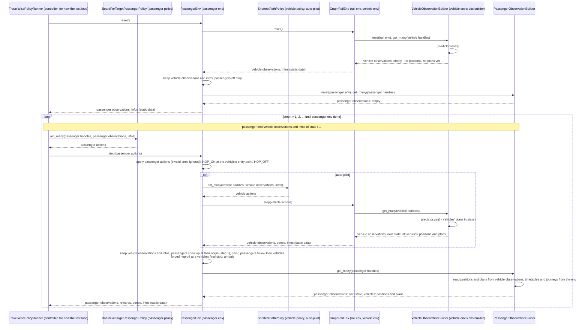

# Plan: TravelWise passenger env spike

PR [#528](https://github.com/flatland-association/flatland-rl/pull/528), branch
`feature/travelwise-passenger-overlway-spike`.

## Goal

A technical spike of the TravelWise passenger env, in line with the
[data model](https://github.com/flatland-association/flatland-book/blob/main/resources/travelwise/data_model.md):

- The spike and its tests run on `GraphRailEnv` only, in the subpackage `flatland/envs/travelwise/` (phase 0).
- Each vehicle's remaining route is projected with optimistic times (phase 1).
- Passengers ride one vehicle from origin to target (phase 2); changes of trains at given stops follow (phase 5).
- Passengers observe the vehicles' positions and plans and decide themselves when to hop on and off; a controller
  holding the passenger policy steps `PassengerEnv`, which steps the vehicles with their own policy (phase 3).
- Passengers are rewarded for lateness (phase 4).

## Status

| Phase | ID | Commit message | Status |
|---|---|---|---|
| 0 | C0.1 | `refactor(envs): move the passenger env and its tests into the travelwise subpackage.` | 052da2a6 |
| 0 | C0.2 | `refactor(policies): inject the router into ShortestPathPolicy and let it serve intermediate stops.` | c62fffed |
| 0 | - | `refactor(graph): make the resource map of a graph converted from a grid public.` | bce9e133 |
| 0 | C0.3 | `refactor(envs): run the passenger env spike and its tests on GraphRailEnv only.` | f90b72da |
| 1 | C1.1 | `feat(envs): predict vehicles' remaining routes along their timetable in a new TimetablePredictor.` | d1283828 |
| 2 | C2.1 | `feat(envs): give passengers single-ride journeys with earliest departure and latest arrival.` | 14578ec9 |
| 3 | C3.0 | `refactor(policies): let ShortestPathPolicy act on a dedicated observation instead of the whole env.` | 6ebe3c72 |
| 3 | C3.1 | `feat(envs): let passengers hop on and off via actions, decided by a passenger policy on their observations.` | next |
| 4 | C4.1 | `feat(envs): reward passengers for lateness and report per-passenger dones.` | |
| 5 | C5.1 | `feat(envs): support passenger journeys with changes of trains at given stops.` | |

## Design principles

- RL split (flatland-book, RLlib): an env's `step()` takes its agents' actions, updates its state and returns
  observations, rewards, dones and infos. It never runs the policy of its own agents; a policy (or a controller)
  takes the observations and issues the actions. Entities that are not the env's agents may be driven inside
  `step()` as part of the env's dynamics: `PassengerEnv` steps the vehicles with their own policy.
- The env is dull: it applies an action if it is physically feasible and ignores it otherwise. What to do - which
  vehicle to board, when to depart (the earliest departure), where to alight - is the policy's decision (Q23).
- Observations hold dynamic data only (positions, plans); they hold no position and no plan after `reset()`.
  Data shared by all agents is one immutable object referenced by every observation, not copied per agent.
- Static data (timetables, journeys, the map) is not part of the observations: it reaches the policies through the
  infos, as a reference to one immutable object (Q19). Observation builders, part of the env, read the env.

Reused concepts:

| Need | Reused concept | Instead of |
|---|---|---|
| Vehicle projection | `PredictionBuilder` (like `ShortestPathPredictorForRailEnv`: "as if no other agent is in the environment"), owned by the vehicles' observation builder, as `TreeObsForRailEnv` owns its predictor | a decorator around the rail env's observation builder; `PassengerEnv` owning the predictor |
| Passenger journey | `EnvAgent`'s `waypoints`, `waypoints_earliest_departure`, `waypoints_latest_arrival` and their `None` conventions | new fields `origin`, `target`, `via`, ... |
| Stop reached | exact entry point of a waypoint group, as in `BaseDefaultRewards` | resource (cell) matching |
| Vehicle's final stop | `EnvAgent.target_entry_point`, set by `handle_done_state()` | keeping the vehicles' entry points of the previous step |
| Observations | `ObservationBuilder` for vehicles and passengers | the whole env as observation (`FullEnvObservation`) |
| Static data | infos (RLlib: infos keyed by agent id; Flatland: `action_required` in the infos) | static data in every observation; policies reading the env |
| Policies | `Policy`/`act`, the `rail_env_policy.py`/`rail_env_policies.py` layout | - |
| Controller | the usual env/policy loop | the passenger policy inside `PassengerEnv.step()` |
| Passenger actions | an enum like `RailEnvActions` | - |
| Graph routing | `networkx` on `rail.g`, injected into `ShortestPathPolicy` and the predictor as a router | a hand-written search |

## Phase 0: graph-only spike (done)

- Goal: the passenger simulation runs on the network (graph) view only, and trains run exactly on their timetable,
  including waiting at intermediate stops until their departure.
- `ShortestPathPolicy` takes an injected router (`greedy_grid_route_through_waypoints()` by default,
  `greedy_graph_route_through_waypoints()` for graphs, `networkx` over `rail.g`) and a flag
  `serve_intermediate_stops` (default off, the previous behaviour): with it, the agent halts at each intermediate
  stop until its earliest departure. TODO in the graph router: replace it by `get_k_shortest_paths()` once that is
  generalized to graphs.
- The corridor graph is built from a `GridTransitionMap` with `GraphTransitionMap.grid_to_digraph()` and
  `grid_to_resource_map()`, without `RailEnv` (TODO: build the graph natively).
- `PassengerEnv.clone_from()` is removed: no caller, and `GraphRailEnv` has no `clone_from()`.
- Graph edges count as length 1 until [#542](https://github.com/flatland-association/flatland-rl/pull/542).

## Phase 1: per-vehicle projection (done)

- Goal: each vehicle announces where it will be and when, assuming it runs undisturbed and on time.
- `TimetablePredictor` (interface, overrides `get()` only) and `UnilateralTimetablePredictor` in
  `flatland/envs/travelwise/timetable_predictor.py`: per vehicle, its remaining route as a list of
  `ProjectedEntryPoint(entry_point, step, stop)` - `stop` the index of the waypoint group if the vehicle stops
  there. `get()` advances each vehicle's waypoint progress (exact entry points, as `BaseDefaultRewards`), then
  routes from the current (or initial) entry point through the remaining groups with the injected router.
- Times: off map, the vehicle enters at `max(earliest departure, elapsed + 1)`; each move takes
  `ceil((1 - distance) / max_speed)` steps; at an intermediate stop it moves again at
  `max(arrival + 1, earliest departure)`. Exact for a single vehicle alone on the map, otherwise optimistic.
- Not the query view: a multi-vehicle projection of all vehicles' future stops comes later.

## Phase 2: single-ride journeys (done)

- Goal: each passenger has a journey from an origin to a destination, with an earliest departure and a latest
  arrival, on a single train that stops at the destination.
- `PassengerJourney(waypoints, waypoints_earliest_departure, waypoints_latest_arrival)`, the same fields and
  conventions as `EnvAgent`; exactly two groups (origin with one entry point, target).
- A vehicle serves a passenger if one of its future stop groups shares an entry point with the passenger's next
  stop (Q10). The vehicle stops at one entry point of the group, chosen by its policy - possibly outside the
  passenger's next stop: then the passenger misses it and stays on board up to the vehicle's final stop.
- Boarding and alighting were automatic in this phase; phase 3 replaces them by actions.
- A vehicle reaching its target is removed in that step: riding passengers are forced off at
  `EnvAgent.target_entry_point`.

## Phase 3: passenger decisions

### Goal

- Passengers decide themselves when to board a vehicle and when to leave it, based on what they observe of the
  vehicles.
- The vehicles' policy acts on a dedicated observation instead of the whole env (C3.0).

### C3.0: `ShortestPathPolicy` on a dedicated observation

Today `ShortestPathPolicy` needs `FullEnvObservation` (the whole env). It reads the transition map (`env.rail`),
`env._elapsed_steps` and, from `env.agents[handle]`: `handle`, `state` (done only), `current_entry_point`,
`next_entry_point`, `speed_counter.is_cell_exit()`, `initial_entry_point`, `waypoints` and
`waypoints_earliest_departure`.

- `ShortestPathObservation` (frozen dataclass), the dynamic part: `handle`, `elapsed_steps`, `done`,
  `current_entry_point`, `next_entry_point`, `is_cell_exit` - `elapsed_steps` only for now (Q18). After `reset()` it
  has no position.
- The static part - the map, and per vehicle `initial_entry_point`, `waypoints`, `waypoints_earliest_departure` -
  reaches the policy through the infos (Q19), added by the runner (Q20): `PassengerEnv` for the vehicles, the test
  loops in the tests.
- `ShortestPathObservationBuilder(ObservationBuilder[AbstractRailEnv, ShortestPathObservation])` builds it.
- `ShortestPathPolicy` reads the observation and the static data instead of `env`/`agent`.
- Backwards compatible: with `FullEnvObservation` (the env as observation), the policy derives both from the env, so
  existing callers keep working (Q22).
- Tests: the existing ones unchanged (compatibility path), plus the policy with the new builder on grid and graph;
  the travelwise tests switch to the new builder.

### C3.1: actions, observations and policy

Actions and validation:

- Action per passenger: `(PassengerAction, vehicle)`, `PassengerAction` one of `WAIT`, `HOP_ON`, `HOP_OFF`
  (`flatland/envs/travelwise/passenger_env_action.py`); the vehicle handle only with `HOP_ON`.
- The env applies an action if it is physically feasible and ignores it otherwise. `HOP_ON`: the passenger waits
  and the vehicle is on the map at the passenger's resource - checked on the state the passenger observed.
  `HOP_OFF`: while riding, at the vehicle's current entry point. Whether the vehicle serves the passenger and
  whether the passenger's earliest departure has passed are the policy's decisions (Q23).
- The forced hop-off at a vehicle's final stop stays (phase 2).
- Arrived: alighted at an entry point of the target; the passenger is done, and its further actions are ignored.

Observations:

- `VehicleObservationBuilder` (`flatland/envs/travelwise/vehicle_observations.py`, for now) is the rail env's observation builder: it owns
  the predictor and builds, per vehicle, its `ShortestPathObservation` plus a reference to the shared, immutable
  positions and plans of all vehicles (Q12, Q14) - a plan is a tuple of `ProjectedEntryPoint`s.
- `PassengerObservation` (`flatland/envs/travelwise/passenger_env_observations.py`): the elapsed steps (for now, as
  for the vehicles, Q18), the passenger's mode and next stop, the vehicles it can hop on now that serve it, with their future stops serving its next stop, and whether
  the vehicle it rides stops at its next stop now. Built by `PassengerObservationBuilder` from the vehicle
  observations `PassengerEnv` keeps, and from the journeys and timetables in the env. No position and no plan after
  `reset()`: passengers and vehicles are off the map (Q11, Q15).

Policy:

- `BoardForTargetPassengerPolicy` (`flatland/envs/travelwise/passenger_env_policies.py`) acts on the observation,
  with the passenger's journey from the static data in the infos:
  - riding, its vehicle stopping at its next stop: `HOP_OFF`;
  - waiting, from its earliest departure on (in the step it observed), with vehicles to board: `HOP_ON` - first a
    vehicle stopping at an entry point of the next stop, then the one stopping there soonest;
  - otherwise `WAIT`.

### Controller and step

The controller (the data model's `TravelWisePolicyRunner`, for now the test loop) holds the passenger policy and
steps only `PassengerEnv`, with the passengers' actions. `PassengerEnv` holds the rail env and the vehicle policy
(the auto-pilot), and is the runner of the vehicles: it keeps their last observations and infos, the vehicle policy
acts on them in the next step, and the passengers' observations are built from them - each state is observed once.

Within `PassengerEnv.step()`, the passengers' actions are applied first, on the state they observed at the end of
the previous step; then the vehicles move, and the riding passengers with them. So passengers and vehicles both
decide on the same state. A passenger boards, or alights at an intermediate stop, in the step after it observed
the vehicle there - e.g. T0 stands at A only in step 2: a passenger observing it there boards in step 3, as T0
moves on. A passenger arrives in the step its `HOP_OFF` is applied; the forced hop-off at a vehicle's final stop
happens in the step the vehicle arrives.

### Limitations (`PassengerEnv`'s docstring)

- Single ride only (phase 5 replaces it).
- A passenger may board where the vehicle does not stop, and hop off at any step (TODOs).
- Missed stop at another alternative of a stop group: not covered by a test, as every group on the corridor has one
  entry point (TODO).
- The per-vehicle projection is optimistic; no query view yet.
- Stops are station tracks (entry points), not stations.
- Graph edges count as length 1 ([#542](https://github.com/flatland-association/flatland-rl/pull/542)).

## Phase 4: lateness rewards and dones

- Goal: passengers are rewarded the earlier they arrive before their latest arrival, penalized for arriving late or
  not at all; each passenger's journey is done once it arrives.
- Reward per passenger, once: at its arrival step `waypoints_latest_arrival[-1] - arrival_time` (late negative);
  when the rail env is done and it has not arrived, `-max_episode_steps` (Q6); otherwise 0. Whether boarding before
  the earliest departure is penalized is open (Q23).
- `step()` returns the passenger observations, rewards per passenger, dones per passenger (arrived) plus
  `'__all__'` (rail env done), and the infos.

## Phase 5: journeys with changes of trains

- Goal: passengers can change trains at given stops along their journey.
- `PassengerJourney.waypoints` may have intermediate groups, the stops where the passenger changes; each pair of
  consecutive groups is one ride. `next_stop(p)` is the first group not yet reached; boarding, alighting, the
  forced hop-off and the missed stop apply per ride.
- At a change the passenger alights, waits and boards the next vehicle serving it, not before the group's earliest
  departure. No minimum transfer time (TODO).
- Arrived and rewards: at the target only.
- The stops are given, not planned: no search for connections (that comes with the query view).
- Tests: passenger 0 of the shuttle tests becomes A -> B -> C and arrives again.

## Test scenario (on the graph)

Corridor A-B-C in `tests/flatland/envs/travelwise/`. Vehicles: T0 A -> B -> C, stopping at B until its earliest
departure there; T1 C -> B; T2 a later A -> B. Passengers:

- A -> C rides T0 through B;
- A -> B on T0 hops off at the intermediate stop B, late (negative reward in phase 4);
- B -> C boards T0 at B;
- A -> B with earliest departure after T0 has left A takes T2;
- C -> B on T1: forced hop-off at the vehicle's final stop;
- C -> A: no vehicle stops at A heading west, so it never arrives.

Tests per phase: predictor unit tests and a single-vehicle exactness test (speeds 1, 1/2, 1/3; departure before and
after the vehicle is on the map); mode changes and arrivals (phase 2); decisions via the passenger policy and the
observations (phase 3); rewards and dones (phase 4).

## Follow-ups (not in this PR)

- Board only where the vehicle stops; hop off only at stops; missed stop at another alternative.
- Minimum transfer time (phase 5).
- Query view: a multi-vehicle projection of all vehicles' future stops, replacing the per-vehicle predictor.
- `get_k_shortest_paths()` generalized to graphs, replacing the `networkx` routing.
- Build the test corridor as a graph natively.
- `TravelWisePolicyRunner` as a library class instead of the test loop.

## Decisions

- Q1 Routing: a shared greedy `networkx` router over `rail.g` (nearest alternative per group), injected into
  `ShortestPathPolicy` and the predictor, so both pick the same entry points.
- Q2 Existing shuttle tests keep their setup; passenger 0 (A -> C) never arrives with single rides.
- Q3 Boarding only from the passenger's earliest departure on - since Q23 the passenger policy's decision, not
  checked by the env.
- Q5 Layout: `flatland/envs/travelwise/` with `passenger_env.py`, `passenger_env_action.py`,
  `passenger_env_observations.py`, `passenger_env_policies.py`, `timetable_predictor.py`, following
  `rail_env.py`/`rail_env_action.py`/`rail_env_policies.py`; no `PassengerEnvPolicy` base class.
- Q6 An arrival in the step the rail env finishes is rewarded as an arrival.
- Q7 The test timetable generator takes a departure time per stop.
- Q8 The late passenger is the A -> B passenger on T0.
- Q9 The passenger without a vehicle is C -> A.
- Q10 Boarding rule: a vehicle's future stop group shares an entry point with the passenger's next stop.
- Q11 Observations are empty after `reset()` and hold only dynamic data; static data via the infos (Q19).
- Q12 Data shared by all agents (positions and plans) is one immutable object referenced by every observation: with
  n vehicles, a copy per vehicle would be n * n plans.
- Q13 The plan is the projection, per entry point with stop marks; the timetable is static data.
- Q14 The plans are the env's prediction (same router as the vehicle policy), not the policy's intent.
- Q15 Passengers are off the map after `reset()`.
- Q16 The vehicles' dedicated observation comes first, as C3.0.
- Q17 `VehicleObservationBuilder` lives in `flatland/envs/travelwise/` for now.
- Q18 The vehicle's state (`done`, entry points, `is_cell_exit`) is dynamic: it goes into the observation. The
  elapsed steps belong into the infos, but the rail env's infos do not have them, and adding them is a rail env
  change: for now they go into the observation too (`ShortestPathObservation.elapsed_steps`). TODO: move them to the
  infos with the rail env change of Q20.
- Q19 Static data reaches the policies through the infos, as a reference to one immutable object; runners pass the
  infos to `act_many()` through `**kwargs`. Follows RLlib (infos keyed by agent id, `"__common__"` for data shared
  by all agents; the old API's `Policy.compute_actions(..., info_batch=...)`) and Flatland's own decision data in the
  infos (`action_required`); gymnasium describes infos as auxiliary.
- Q20 Who puts the vehicles' static data into the infos: Flatland's infos are `infos[key][handle]` (RLlib:
  `infos[handle][key]`), and `PolicyRunner` persists `{key: infos[key][handle]}` per agent and step into the
  trajectory - static data in the rail env's infos would be persisted every step, and the map does not serialize.
  Decided: the rail env's infos stay unchanged in this PR. `PassengerEnv`, the vehicles' runner, adds the vehicles'
  static data to the infos it passes to the vehicle policy (`infos["static"]`, the role of an RLlib env-to-module
  connector), and hands out the passengers' static data in its own infos. Other runners (`PolicyRunner`) keep
  using `ShortestPathPolicy` with `FullEnvObservation` until the rail env hands out its static data (TODO, a core
  change with trajectory persistence skipping it).
- Q22 Backwards compatibility of `ShortestPathPolicy` with `FullEnvObservation` (the env as observation): one
  helper - if an observation is the env, `act_many()` first derives the `ShortestPathObservation` and the static data
  from it, then runs the same code as for the new observation; one code path for the routing and stop logic.

## Open questions

- Q23 Earliest departure: the env no longer enforces it (the env is dull, the policy decides), so a policy may board
  before it, e.g. the scripted passenger 3 in the scenario test, arriving early. Should the rewards (phase 4)
  penalize it?
  - (a) no penalty: the earliest departure is the passenger's own constraint, and arriving early is rewarded
    anyway - a policy ignoring it gains;
  - (b) a fixed penalty per passenger boarding before its earliest departure (as Flatland's rewards count an
    intermediate stop not served);
  - (c) a penalty per step boarded too early, `earliest departure - boarding step`, symmetric to the lateness reward.
  Proposal: (c) - one scale with the lateness reward, and no gain from ignoring the constraint.
