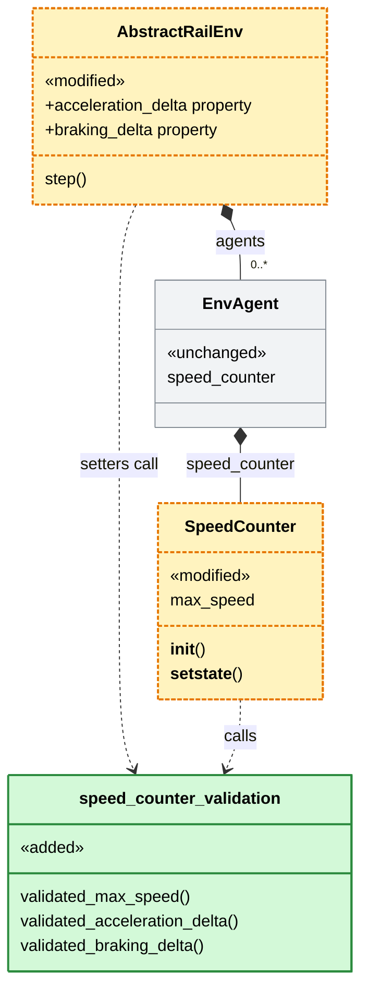

# Validate the speed parameters when the env is built (#578)

> **Status:** plan of 2026-11-23, built by 2026-11-23. Based on `main` ac932d16. Issue
> [#578](https://github.com/flatland-association/flatland-rl/issues/578) ("refactor(core): validate acceleration_delta,
> braking_delta and max speed when the env is built.", chenkins, from a
> [comment on #526](https://github.com/flatland-association/flatland-rl/issues/526#issuecomment-6635579968)). Branch
> `578-validate-speed-parameters`, PR [#579](https://github.com/flatland-association/flatland-rl/pull/579). Open questions: none; Q-1–Q-4 decided 2026-11-23, Q-5 2026-11-24.
>
> **Why:** `RailEnv` accepts any `acceleration_delta`, `braking_delta` and agent max speed. Invalid values fail much
> later, in the middle of an episode, with an `AssertionError` or a `ZeroDivisionError` that does not name the
> parameter. A `ValueError` when the env is built points the user to the wrong value.

## 1. Introduction and goals

*What the change is for: the requirements, the qualities that matter, who has a stake, and what it leaves out.*

### 1.1 Requirements overview (functional requirements)

*The issue's text and the numbered requirements the rest of the plan refers to.*

> Nothing validates the speed parameters of `RailEnv` when it is built. Invalid values are accepted and fail later,
> with an `AssertionError` in the middle of an episode. […]
>
> 1. `acceleration_delta` is not checked to be > 0. With `acceleration_delta=Fraction(0)` (or `Fraction(-1)`), a
>    train enters the map with speed 0 and is `STOPPED`; with `RailEnvStateMachineWrapper`, `step()` then fails the
>    derived-state postcondition […].
> 2. A float `acceleration_delta` (e.g. `0.5`) is accepted, but fails the `Fraction` assertion of `_cap_speed()`
>    (`speed_counter.py:58`) once a train enters or accelerates. `RailEnv`'s defaults are `Fraction(1)`/`-Fraction(1)`.
>
> Proposal: Validate in `RailEnv.__init__()`, and for the agents' max speeds when the lines are loaded or generated:
> `acceleration_delta > 0`, `braking_delta < 0`, max speed in (0, 1]; whole numbers or `Fraction`s only, as for edge
> lengths (#542): reject floats with a `ValueError`, or convert them to `Fraction`. A `ValueError` at construction
> names the parameter, instead of an `AssertionError` in a later step.

Requirements:

- **REQ-1** `acceleration_delta` must be > 0 (and ≤ `MAX_SPEED`, Q-5).
- **REQ-2** `braking_delta` must be < 0 (and ≥ -`MAX_SPEED`, Q-5).
- **REQ-3** Every agent's max speed must be in (0, `MAX_SPEED`] (`MAX_SPEED` = 1), for lines that are generated,
  loaded from a pickle or built from a static env.
- **REQ-4** Floats are either rejected or converted to `Fraction` (Q-1). After validation, the env and the speed
  counter hold `Fraction`s only.
- **REQ-5** An invalid value raises a `ValueError` that names the parameter and the value, when the env is built
  (or the agents are created), not in a later step.

### 1.2 Quality goals (non-functional requirements)

*The few qualities the design must reach, each with a concrete scenario.*

| ID | Priority | Quality goal | Scenario |
|---|---|---|---|
| NFR-1 | 1 | Compatible | Existing code that passes valid floats (`acceleration_delta=1.0`, `speed_ratio_map={0.33: 1.0}`) keeps working with the same behaviour; the regression episodes replay unchanged. |
| NFR-2 | 2 | No slowdown | `step()` does no extra work: the values are checked once, when they are set. |

### 1.3 Stakeholders

*Who asks for the change, decides on it, reviews it or works with the result, and what they expect.*

| Role | Name | Expectations |
|---|---|---|
| Author, maintainer | chenkins | Early, named errors for invalid speed parameters; raised while documenting 5.0.0 in the flatland-book. |
| Users of `RailEnv`, `env_generator`, `GraphRailEnv` | researchers, `flatland-baselines` | Valid configurations keep working (NFR-1); know what breaks (§8.2). |

### 1.4 Follow-ups (not in this PR)

*What this PR leaves out, why, and where it goes later.*

| Follow-up | Why not in this PR | From | Findings | Issue |
|---|---|---|---|---|
| Persist `acceleration_delta` and `braking_delta` with the env, so a loaded env keeps them. | Changes the persisted format; independent of validation. A loaded env gets the defaults today. | §2.2 | - | - |
| Validate the other `RailEnv` parameters (`number_of_agents`, `width`, `height`, …) the same way. | Not asked; the issue is about the speed parameters. | - | - | - |

## 2. Constraints

*What limits the design from outside: platform, organisation and conventions.*

| ID | Constraint | Kind | Explanation |
|---|---|---|---|
| C-1 | Speeds and distances are `Fraction`s | Technical | `_cap_speed()` asserts `isinstance(v, Fraction)`; edge lengths are `int` or `Fraction` (#542), so the sums stay exact. |
| C-2 | Floats are the existing way to give a max speed | Technical | `speed_ratio_map` keys (`{1.0: 0.25, 0.5: 0.25, 0.33: 0.25, 0.25: 0.25}` in `env_generator`), `SpeedCounter(max_speed=1.0)` defaults, tests and notebooks pass floats; `SpeedCounter` converts them with `_pseudo_fractional()`. |
| C-3 | `step()` is a profiled hot path | Technical | Per-step checks cost; AGENTS.md documents the profiling. Validation goes where values are set. |
| C-4 | Conventional commits, release-please | Conventions | AGENTS.md: a breaking change needs `!` in the squashed message. |

### 2.1 Limitations

*What the built code gets wrong or ignores, each with the TODO or issue that tracks it.*

None.

### 2.2 Assumptions

*What must hold for the design to be correct, but is not checked in code.*

Not checked in code; they hold by construction of `RailEnv` and `SpeedCounter`.

- The deltas are only changed through `RailEnv`'s attributes (`env.acceleration_delta = …`, as the tests do), which
  validate (Q-2); nobody writes the private fields.
- A loaded env (`RailEnvPersister`) gets the deltas of the constructor, not of the saved env: they are not persisted
  (§1.4).
- `_pseudo_fractional()`'s tolerant conversion (`0.33` → `Fraction(1, 3)`) is wanted for max speeds, as on `main`
  (Q-1); a float delta means its decimal value (Q-4).

## 3. Context and scope (checked 2026-11-23 on `main` ac932d16)

*The code on the base branch that the change works in, as it is before the change, and where the change stops.*

Context:

- `AbstractRailEnv.__init__()` (`flatland/envs/rail_env.py`) takes `acceleration_delta: Fraction = Fraction(1)`,
  `braking_delta: Fraction = -Fraction(1)` and stores them unchecked as plain attributes. `RailEnv.__init__()`,
  `GraphRailEnv.__init__()` (`flatland/envs/graph_rail_env.py`) and `env_generator()`/`env_generator_legacy()`
  (`flatland/env_generation/env_generator.py`) default them to floats `1.0`/`-1.0`, and the docstrings type them as
  `float`. The issue's "`RailEnv`'s defaults are `Fraction(1)`" holds only for `AbstractRailEnv`.
- `step()` reads `self.acceleration_delta`/`self.braking_delta` per agent and passes them to `_candidate_speed()`,
  `SpeedCounter.speed_after_acceleration()`/`speed_after_braking()` and the postcondition checks. The distance map's
  `eta()` divides by `acceleration_delta`. `trajectory_analysis.py` writes both into `env_stats.csv`.
- Tests set the deltas after construction (`env.acceleration_delta = Fraction(1, 2)`, about 30 places in
  `tests/test_flatland_envs_rail_env.py`, `test_variable_speed.py`, `test_flatland_malfunction.py`,
  `test_flatland_rail_agent_status.py`, `test_flatland_edge_lengths.py`).
- `SpeedCounter.__init__()` (`flatland/envs/step_utils/speed_counter.py`) converts `max_speed` with
  `_pseudo_fractional()` and asserts `<= MAX_SPEED`; there is no check for > 0. `__setstate__()` (pickles) converts
  without a check. Every agent gets its `SpeedCounter` there: `EnvAgent`'s default, `EnvAgent.from_line()`,
  `EnvAgent.load_legacy_static_agent()` (`agent_utils.py`), `GraphRailEnv._agents_from_line()`.
- `_pseudo_fractional()` accepts `Fraction`, `Decimal`, `int` (also `bool`) and `float`, raises `ValueError` for other
  types (also numpy integers).
- `validated_edge_length()` (`flatland/core/transition_map.py`, #542) is the existing validation helper for a speed
  related quantity: `ValueError` naming type and value, floats rejected.

Reproduced on `main` ac932d16 (the issue's script, 60 steps, `MOVE_FORWARD` with every third step `STOP_MOVING`):

| Value | Result on `main` |
|---|---|
| `acceleration_delta=Fraction(0)` or `Fraction(-1)` (wrapped) | `AssertionError: (0, STOPPED, MOVING)` in `step()` |
| `acceleration_delta=0.5`, max speed 1 | `AssertionError` in `_cap_speed()` |
| `acceleration_delta=1.0`, `braking_delta=-1.0`, max speed 1/2 | works: `min(1.0, Fraction(1, 2))` returns the `Fraction` |
| `braking_delta=Fraction(1)` (wrapped) | `AssertionError` in `step()` |
| max speed 0 (`speed_ratio_map={0.0: 1.0}`) | `ZeroDivisionError` in `reset()` |

Scope: the change checks and converts the three values where they are set (`RailEnv`'s deltas, `SpeedCounter`'s max
speed). It only reads `step()`, the speed formulas and the distance map; they keep working on `Fraction`s.

## 4. Solution strategy

*The fundamental choices and why, the rules the design follows, how it is verified, and the design of each part.*

| Quality goal | Scenario | Solution approach | Details |
|---|---|---|---|
| NFR-1 Compatible | `acceleration_delta=1.0`, `speed_ratio_map={0.33: …}` | Convert floats: max speeds with `_pseudo_fractional()` as on `main`, deltas exactly from their decimal value (Q-1, Q-4). | §4.3 |
| NFR-2 No slowdown | `step()` per agent | Check once when the value is set; `step()` reads the stored `Fraction` (Q-2). | §4.4 |

### 4.1 Design principles

*The rules the design follows, each with its decision, the concepts it reuses instead of building new ones, and what
is not new on purpose.*

- **DP-1 Check where the value is set, not where it is used.** The deltas are checked by `RailEnv`'s setters, the max
  speed by `SpeedCounter`, which every agent creation path goes through. `step()` and the formulas keep trusting
  their inputs. (Q-2, Q-3)
- **DP-2 Floats are converted, each speed quantity by its own convention.** Max speeds snap to the nearest 1/n
  (`_pseudo_fractional()`, as on `main`), because a `speed_ratio_map`'s `0.33` means `1/3`. Deltas are rates written
  as decimals and are converted exactly from their decimal value (`0.15` → `3/20`, `0.33` → `33/100`). The two rules
  differ on purpose; the validators' and `RailEnv`'s docstrings and `AGENTS.md` name both, with examples. (Q-1, Q-4)
- **DP-3 Errors as `validated_edge_length()` raises them.** `ValueError`, naming the parameter, the expected range
  and the value found.

Reused concepts:

| Need | Reused concept | Instead of |
|---|---|---|
| Float to `Fraction` | `_pseudo_fractional()` (`speed_counter.py`) for max speeds; `Fraction` of the decimal string for deltas | Rejecting floats as `validated_edge_length()` does (Q-1); one conversion for both (Q-4). |
| Validation helper shape and error | `validated_edge_length()` (`transition_map.py`): `validated_*` function returning the checked value | A validator class or `attrs` validators. |
| Upper bound of a speed | `MAX_SPEED` (`transition_map.py`) | A literal `1`. |
| One place for every agent's max speed | `SpeedCounter.__init__()`/`__setstate__()` | Checks in each line generator and loader. |

Not new on purpose: the `RailEnv`/`GraphRailEnv`/`env_generator` parameters (names, order, meaning), the persisted
env format, `speed_ratio_map`'s float keys.

### 4.2 Verification

*How each requirement and quality goal is shown to work: tests, CI checks, before and after screenshots.*

Screenshots: none, nothing is visible.

| ID | Requirement | Test or check | Result | Screenshots |
|---|---|---|---|---|
| REQ-1 | `acceleration_delta` in (0, 1] | `test_flatland_envs_rail_env.py`: `RailEnv(acceleration_delta=0)`, `-1`, `2`, and `env.acceleration_delta = 0` raise `ValueError` naming `acceleration_delta` (S-2, S-9); `test_speed_counter.py`: `1` is accepted, `1.01` rejected, a delta above an agent's max speed is capped, not rejected (S-9). | ✅ passes | - |
| REQ-2 | `braking_delta` in [-1, 0) | Same for `braking_delta` `0`, `1` and `-2` (S-2, S-9). | ✅ passes | - |
| REQ-3 | Max speed in (0, 1] | `test_speed_counter.py`: `SpeedCounter(max_speed=0)`, `-1/2`, `3/2`, `True` raise `ValueError`; a `sparse_line_generator({0.0: 1.0})` env raises in `reset()` (S-1). | ✅ passes | - |
| REQ-4 | `Fraction`s after validation | `RailEnv(acceleration_delta=0.5)` holds `Fraction(1, 2)` and runs the issue's 60 steps; `SpeedCounter(max_speed=0.33).max_speed == Fraction(1, 3)` (S-1, S-2); float deltas exact (`0.15` → `3/20`, `-0.004` → `-1/250`) while max speeds snap (`0.15` → `1/7`); `np.float32` accepted; NaN and infinities raise `ValueError` (S-3, S-4). | ✅ passes | - |
| REQ-5 | Named `ValueError` at build | The tests above match the parameter name in the message (`pytest.raises(ValueError, match="acceleration_delta")`). | ✅ passes | - |
| NFR-1 | Compatible | Full test suite incl. `test_flatland_regression_episodes.py`; `flatland-baselines` unit tests (workspace rule). | ✅ core suite green at c8475ff9 (1321 passed, 58 skipped; `test_episode`'s 12 regression episodes are skipped on `main` too); `flatland-baselines`' tests can't import `ObservationType`, also against `main`. After S-3–S-9 the affected test files pass (245 passed, 2 skipped); after S-10–S-15 the env, speed, malfunction, edge-length, graph, regression-episode and trajectory-analysis tests pass (334 passed, 15 skipped); the full suite runs in CI (not repeated locally, decided 2026-11-24) | - |
| NFR-2 | No slowdown | `step()` unchanged except reading the private field (S-2); CI profiling job. | ✅ `step()` reads `_acceleration_delta`/`_braking_delta` | - |

### 4.3 Values and conversion (REQ-1–REQ-5; Q-1, Q-4)

New functions in `speed_counter.py`, next to `_pseudo_fractional()`:

- `validated_max_speed(max_speed) -> Fraction`: 0 < value <= `MAX_SPEED`.
- `validated_acceleration_delta(acceleration_delta) -> Fraction`: 0 < value <= `MAX_SPEED` (Q-5).
- `validated_braking_delta(braking_delta) -> Fraction`: -`MAX_SPEED` <= value < 0 (Q-5).

All three, and `SpeedCounter`'s initial speed (0 <= value <= max speed), check their range with one private helper,
`_validated_in_range()` (F-9, F-15).

Each rejects `bool`, `None`, NaN and infinities, keeps `int`s (numpy integers too), `Fraction`s and `Decimal`s
exactly, converts floats (numpy floats too), then checks the range. Floats are converted differently (Q-4):

| Float | Max speed (`_pseudo_fractional()`, nearest 1/n within 0.01) | Delta (exact decimal value) |
|---|---|---|
| `0.5` | `1/2` | `1/2` |
| `0.33` | `1/3` | `33/100` |
| `0.15` | `1/7` | `3/20` |
| `0.99` | `1` | `99/100` |
| `-0.004` | - | `-1/250` |

Message, as `validated_edge_length()`: `"acceleration_delta must be in (0, 1], found 0."`.

Bounds of the deltas (Q-5), as the validators' and `RailEnv`'s docstrings explain:

- **Checked, fails:** `acceleration_delta` in (0, `MAX_SPEED`], `braking_delta` in [-`MAX_SPEED`, 0). `MAX_SPEED` (1)
  is the highest speed the env supports, so that an agent never jumps over a cell or edge in one step. A delta beyond
  ±1 changes the speed by more than its whole range in one step and has no meaning of its own (`2` acts as `1`).
- **Not checked, does not fail:** a delta beyond an agent's max speed (or below minus its speed). The deltas are
  global, the same for all agents, while max speeds differ per agent; `_cap_speed()` caps the new speed at each
  agent's max speed and floors it at 0.

### 4.4 Where the values are checked (REQ-3, REQ-5; Q-2, Q-3)

- `AbstractRailEnv.acceleration_delta`/`braking_delta` become properties; the setter validates and stores
  `_acceleration_delta`/`_braking_delta`. `__init__()` assigns through the setters, so construction and later
  assignments (`env.acceleration_delta = …`) are both checked. `step()` and the postcondition check read the private
  fields (NFR-2). (Q-2)
- The float defaults of `RailEnv.__init__()`, `GraphRailEnv.__init__()`, `env_generator()` and
  `env_generator_legacy()` become `Fraction(1)`/`-Fraction(1)`, and the docstrings say "`Fraction` or a number
  converted to one".
- `SpeedCounter.__init__()` and `__setstate__()` call `validated_max_speed()` (replacing the `assert`). (Q-3)

## 5. Building block view

*The components the change adds or changes: an overview, why the system is split this way, what each is responsible
for, the important interfaces, and the planned data model.*

### 5.1 Speed parameters in the env

*One white box: its building blocks, why it is split this way, and the interfaces between them.*

Notation: [UML class diagram in Mermaid](https://mermaid.js.org/syntax/classDiagram.html). Green «added», yellow
«modified» (dashed border), grey «unchanged». `speed_counter_validation` stands for the three module-level functions
in `speed_counter.py`, not a class.

**Motivation:** the env owns the deltas, the speed counter owns the max speed (DP-1). The checks live next to the
existing float conversion, so both owners use the same rules (DP-2).

**Contained building blocks:**

| Component | Responsibility | Change |
|---|---|---|
| `AbstractRailEnv` (and `RailEnv`, `GraphRailEnv`) | Holds the env-wide acceleration and braking rates every agent uses. Not for an agent's own max speed, which stays with its speed counter. | 🟨 modified: an invalid rate raises a `ValueError` when set, a float rate is converted to `Fraction`. |
| `SpeedCounter` | Holds an agent's max speed, speed and distance along its edge. Not for the env-wide rates. | 🟨 modified: a max speed outside (0, 1] raises a `ValueError` when the agent is created or loaded. |
| `validated_max_speed()`, `validated_acceleration_delta()`, `validated_braking_delta()` | Check and convert one speed parameter. Not for edge lengths, which keep `validated_edge_length()`. | 🟩 added: one rule set for all speed parameters. |
| `env_generator()`, `env_generator_legacy()` | Build an env from a spec. | 🟨 modified: defaults are `Fraction`s; behaviour unchanged. |

**Important interfaces:** `AbstractRailEnv.acceleration_delta`/`braking_delta` keep their names and stay assignable;
they now always return a `Fraction`.

## 8. Crosscutting concepts

*What the change introduces that other code will follow, and what it changes for existing callers.*

### 8.1 New patterns

*What is new compared with the base branch.*

Compared with `main`. What is reused, and what is not new on purpose, is in §4.1.

| ID | New | Defined in |
|---|---|---|
| PAT-1 | An env parameter validated by a property setter (checked on construction and on later assignment). | §4.4, Q-2 |

### 8.2 Breaking changes

*What breaks for whom, and the migration path.*

None for callers with valid values: floats keep working and are converted (Q-1). Changed:

- **Invalid values raise `ValueError` early.** `acceleration_delta <= 0`, `braking_delta >= 0`, max speed `<= 0` or
  `> 1`, and `bool` values: before, they were accepted and failed in `reset()` or `step()` (§3), except a max speed
  `> 1`, which raised an `AssertionError` in `SpeedCounter`. `acceleration_delta > 1` and `braking_delta < -1` were
  accepted and acted as `1`/`-1`; they now raise (Q-5), migration: pass `1`/`-1`. No known user relies on them (grep of `flatland-rl`,
  `flatland-baselines`). Migration: none, the configuration was broken.
- **Type of `env.acceleration_delta`/`env.braking_delta`:** `Fraction` instead of the float passed in, a float delta
  as its exact decimal value (`0.15` → `3/20`, Q-4). `env_stats.csv` of `trajectory_analysis.py` keeps writing floats
  (S-6). Migration: `float(env.acceleration_delta)` where a float is needed.
- **Whole `RailEnv` objects pickled before this change** (`pickle.dump(env)`, not `RailEnvPersister`) raise an
  `AttributeError` in `step()` after loading: their `__dict__` has `acceleration_delta`, not `_acceleration_delta`
  (F-6, accepted). Backwards compatibility lives in `RailEnvPersister`, which saves `get_full_state()`'s dict, not the
  env, and stores no deltas, so it is unaffected; whole-env pickles bypass it and are not supported across versions
  (`AGENTS.md`, "Persistence", S-13). Nothing in `flatland-rl` or `flatland-baselines` pickles whole envs.
  Migration: save envs with `RailEnvPersister.save()`; for an existing pickle, set `env.acceleration_delta`/
  `env.braking_delta` after loading.
- **Pickles with an invalid max speed** no longer load (Q-3). None known; the regression episodes check it.
- **`SpeedCounter(speed=...)` out of [0, max speed]** raises `ValueError` instead of `AssertionError` (F-15). Only
  `flatland-rl`'s own tests pass an initial speed; they are updated.

## 9. Decisions

*The decisions behind the plan: the questions still open, the decisions taken, and how each review finding was settled.*

### 9.1 Open questions

*Choices not made yet, each with its options and a proposal.*

✅ ~~**(Q-1) Floats: reject or convert?**~~ **Decided 2026-11-23:** b), convert with `_pseudo_fractional()`.
- a) Reject with `ValueError`, as `validated_edge_length()` does (#542). Exact by construction, but breaks every
  `speed_ratio_map` with float keys, `env_generator`'s defaults and the float max speeds in tests and notebooks (C-2).
- b) Convert with `_pseudo_fractional()`, as `SpeedCounter` does for max speeds today. Keeps all callers working;
  `0.33` becomes `1/3`, as for speeds.
- c) Reject for the deltas, convert for max speeds. Two rules for speed quantities; still breaks
  `RailEnv(acceleration_delta=1.0)` callers and the float defaults.

*Proposal:* b), DP-2. Edge lengths were new data with no float callers; speeds have floats everywhere.

✅ ~~**(Q-2) Check the deltas only in `__init__()`, or on every assignment?**~~ **Decided 2026-11-23:** b), validating
property.
- a) Only in `__init__()`, as the issue proposes. Simplest; `env.acceleration_delta = 0` after construction still
  fails later (about 30 test sites assign after construction).
- b) Property with a validating setter; `__init__()` assigns through it; `step()` reads the private field. Covers both;
  one property pair more.

*Proposal:* b). Assigning after construction is the common pattern in the tests, so users likely do it too.

✅ ~~**(Q-3) Check the max speed in `SpeedCounter`, also when loading a pickle?**~~ **Decided 2026-11-23:** a), in
`__init__()` and `__setstate__()`.
- a) In `SpeedCounter.__init__()` and `__setstate__()`. One place for all creation paths (generated lines,
  `load_legacy_static_agent()`, `GraphRailEnv`, pickles).
- b) Only in `__init__()`. A pickle with max speed 0 loads and fails later.
- c) In the line generators and `EnvAgent.from_line()`. Several places; misses pickles and tests that build a
  `SpeedCounter` directly.

*Proposal:* a). Old pickles derive the max speed from the agent's constant speed, which is > 0; the regression
episodes confirm it.

✅ ~~**(Q-4) (Q-1) revisited: how exactly are float deltas converted?**~~ **Decided 2026-11-23:** b), deltas exact,
max speeds snap to 1/n; the different rounding is documented (DP-2, §4.3). F-2: `_pseudo_fractional()` snaps to the
nearest 1/n within an absolute 0.01, so `acceleration_delta=0.15` becomes `1/7` and `0.99` becomes `1`. Q-1 took over
the max speeds' conversion for the deltas (DP-2) without this in view.
- a) Keep it and document it with examples in the docstrings. No code change; the surprise stays.
- b) Deltas exactly from their decimal value (`Fraction(str(v))`: `0.15` → `3/20`, `0.33` → `33/100`); max speeds keep
  the 1/n snapping, as `speed_ratio_map`'s `0.33` means `1/3` by convention. Two conversions, so DP-2 changes to "max
  speeds snap to 1/n, deltas are exact".
- c) Exact decimal for both. `env_generator`'s default `speed_ratios` key `0.33` then means `33/100`, which changes
  every generated timetable and the regression episodes.

*Proposal:* b). A delta is a rate the user writes down as a decimal; only max speeds have the 1/n convention.

✅ ~~**(Q-5) (Q-1) revisited: bound the deltas by `MAX_SPEED`?**~~ **Decided 2026-11-24:** a), user request. §4.3 had
no upper bound on `acceleration_delta` or lower bound on `braking_delta`, as `_cap_speed()` caps the speed anyway.
- a) `acceleration_delta` in (0, `MAX_SPEED`], `braking_delta` in [-`MAX_SPEED`, 0); docstrings say what is checked
  (the env's range) and what is only capped (each agent's max speed, as the deltas are global).
- b) No bound: `2` acts as `1`, a typo such as a percentage (`20`) goes unnoticed.

*Proposal:* a). No caller in `flatland-rl` or `flatland-baselines` passes a delta beyond ±1.

### 9.2 Decision log

*Every decision by date, with why it was taken and what follows from it.*

| Date | Decision | Why | Consequences |
|---|---|---|---|
| 2026-11-23 | ✅ Floats are converted with `_pseudo_fractional()`, for deltas and max speeds (Q-1, §4.3). | Floats are the existing way to give speeds (C-2); rejecting them breaks `speed_ratio_map`s and the defaults. Not taken: rejecting as `validated_edge_length()` does. | No caller breaks; `env.acceleration_delta` is a `Fraction` (§8.2). The deltas' conversion is changed by Q-4 (2026-11-23). |
| 2026-11-23 | ✅ Float deltas are converted exactly from their decimal value; max speeds keep the 1/n snapping (Q-4, §4.3). | F-2: the snapping turned `acceleration_delta=0.15` into `1/7`. Max speeds keep it, as `speed_ratio_map`'s `0.33` means `1/3`. Not taken: keeping the snapping for deltas, exact conversion for max speeds too (changes every generated timetable). | DP-2 has two rules, documented in the docstrings and `AGENTS.md`; S-4. |
| 2026-11-23 | ✅ The deltas are validating properties; `step()` reads the private fields (Q-2, §4.4). | Tests and users assign after construction. Not taken: checking only in `__init__()`. | PAT-1; no per-step cost (NFR-2). |
| 2026-11-23 | ✅ The max speed is checked in `SpeedCounter.__init__()` and `__setstate__()` (Q-3, §4.4). | One place for every creation path, pickles included. Not taken: only `__init__()`, or the line generators. | A pickle with an invalid max speed no longer loads (§8.2). |
| 2026-11-24 | ✅ The deltas are bounded by `MAX_SPEED`: `acceleration_delta` in (0, 1], `braking_delta` in [-1, 0); a delta beyond an agent's max speed is capped, not rejected (Q-5, §4.3). | A delta beyond ±1 has no meaning of its own, as no speed may exceed `MAX_SPEED`; the deltas are global, so per-agent max speeds can only cap. Not taken: no bound. | `acceleration_delta > 1`/`braking_delta < -1` now raise (§8.2); S-9. |

### 9.3 Code Review Findings

*Findings from code reviews, PR comments and TODOs, with their status and the commits that fix them.*

PR [#579](https://github.com/flatland-association/flatland-rl/pull/579), base `main` ac932d16. Code review findings
(F-1–F-9) were added on 2026-11-23, at ce7a4b3d; their line numbers refer to it. Code review findings (F-10–F-15) were added on 2026-11-24, at 4761d09e; their line numbers refer to it.

| Fixed | ID | Source | Category | Severity | Finding | Commit message |
|---|---|---|---|---|---|---|
| ✅ | F-1 | code review | bug | medium | `flatland/envs/step_utils/speed_counter.py:46-49,121`: `_pseudo_fractional()` snaps small negative floats to 0 (`-0.004 % 1 = 0.996` is close to 1, giving `1 + int(-0.004 // 1) = 0`), so `validated_braking_delta(-0.004)` rejects a valid braking delta with "must be < 0", while `acceleration_delta=0.004` is accepted. Fix: convert negatives by symmetry (`-_pseudo_fractional(-v)`), which also drops the third `elif`. Fixed in 76655cf4. | fix(core): convert small negative float speed deltas to Fractions instead of 0. |
| ✅ | F-2 | code review | design | medium | `flatland/envs/step_utils/speed_counter.py:42-49,71`: the absolute tolerance `atol=1e-2` snaps floats to 1/n far from their value: `0.15` becomes `1/7`, `0.12` becomes `1/8`, `0.21` becomes `1/5`, `0.505` becomes `1/2`, `0.99` becomes `1`. For max speeds this is so on `main`. Since Q-1 the float deltas are snapped too, so `acceleration_delta=0.15` changes the time to max speed without a warning. Reopens Q-1 as Q-4, decided b) on 2026-11-23. Fixed in 7e20387a. | fix(core): convert float speed deltas exactly from their decimal value. |
| ✅ | F-3 | code review | robustness | low | `flatland/envs/step_utils/speed_counter.py:66-72`: only `numbers.Integral` is normalised, so `np.float32(0.5)` (not a `float` subclass) is rejected with "must be a number, found float32 0.5", for the deltas and the max speed. On `main` `SpeedCounter(max_speed=np.float32(0.25))` failed as well. Fix: convert other `numbers.Real` with `float()` first. Fixed in 76655cf4. | fix(core): accept numpy float speed parameters. |
| ✅ | F-4 | code review | robustness | low | `flatland/envs/step_utils/speed_counter.py:69-72`: `Fraction.from_decimal(Decimal("Infinity"))` raises `OverflowError`, which `_validated_fraction()` does not catch, so `validated_max_speed(Decimal("Infinity"))` breaks the documented "raises `ValueError`". Fix: catch `ArithmeticError` too. Fixed in 76655cf4. | fix(core): raise ValueError for infinite Decimal speed parameters. |
| ✅ | F-5 | code review | robustness | low | `flatland/evaluators/trajectory_analysis.py:61-62`: `env_stats` now holds `Fraction`s, so `env_stats.csv` shows `1`, `-1` or `1/2` instead of `1.0`/`-1.0`/`0.5`; `pd.read_csv` gives a string column for `1/2`. Listed in §8.2 as a change. Fix: write `float(env.acceleration_delta)`/`float(env.braking_delta)`, so the CSV stays as on `main`. Fixed in bdf51ad5. | fix(evaluators): write the speed deltas to env_stats as floats, as before. |
| ✅ | F-7 | code review | docs | low | `tests/test_flatland_envs_rail_env.py:1454-1458`: the comment says `RailEnv.__init__`'s `acceleration_delta` default is the plain float `1.0` and forces a `Fraction`; both are stale since the default is `Fraction(1)`. Fix: remove the comment and the override. Fixed in f5143ee8. | test(rail_env): drop the stale float-default workaround in the eta test. |
| ✅ | F-8 | code review | robustness | low | `flatland/envs/step_utils/speed_counter.py:412`: an old pickle without `max_speed` takes the max speed from its speed; a speed of `None` or 0 there raises "max_speed must be a number, found NoneType None", naming a field the pickle doesn't have. The fixture pickles load (`test_restore_episode`). Fix: say in the message that the max speed was taken from the pickled speed. Fixed in 14ddee30. | fix(core): name the pickled speed when an old pickle's max speed is invalid. |
| ✅ | F-9 | code review | design | low | `flatland/envs/step_utils/speed_counter.py:76-121`: `validated_max_speed()`, `validated_acceleration_delta()` and `validated_braking_delta()` are three near-identical bodies (convert, compare, raise). A shared helper with a range argument would need fixes such as F-1 and F-3 only once; they already share `_validated_fraction()`, where both fixes go. Dropped 2026-11-23 (one function per quantity, as `validated_edge_length()`), reopened 2026-11-24 at the user's request: the three keep their docstrings and call one `_validated_in_range()`. Fixed in 0ff73885. | refactor(core): fold the three speed parameter checks into one helper. |
| ✅ | F-10 | code review | bug | medium | `flatland/envs/step_utils/speed_counter.py:17,81,100,125`: `_pseudo_fractional()`'s `lru_cache` is not typed, and a float and the equal `Decimal` hash and compare equal. So the exact delta path (`Decimal(str(v))`) and the snapping max speed path (`v`) share cache entries for floats that are exact in binary: after `validated_max_speed(0.328125)` (→ `1/3`), `validated_acceleration_delta(0.328125)` returns `1/3` instead of `21/64`; in the other order the max speed becomes `21/64`. The result depends on what ran first in the process. The same happens on `main` with a `Fraction` cached first: after `_pseudo_fractional(Fraction(21, 64))`, `SpeedCounter(max_speed=0.328125)` gets `21/64`. Fix: `lru_cache(typed=True)`, and convert the deltas with `Fraction(Decimal(str(v)))` directly. Fixed in a7e646a3. | fix(core): keep exact delta conversion out of the max speed conversion cache. |
| ✅ | F-11 | code review | bug | low | `flatland/envs/step_utils/speed_counter.py:82-83`: a max speed given as a numpy float that is not a Python `float` (`np.float32(0.3)`) is widened with `float()` to `0.30000001192092896` before snapping and becomes `937500037252903/3125000000000000`, while the delta path gives `3/10`. Values near 1/n still snap (`np.float32(0.25)` → `1/4`). On `main` `np.float32` max speeds were rejected (F-3). Fix: convert with `float(str(value))`. Fixed in 70b1f637. | fix(core): convert numpy float max speeds from their decimal value before snapping. |
| ✅ | F-12 | code review | robustness | low | `flatland/envs/step_utils/speed_counter.py:79-87`: the conversion error names the converted value, not the one passed in: `validated_acceleration_delta(float("nan"))` raises "acceleration_delta must be a number, found Decimal NaN.". Fix: build the message from the original value. Fixed in a7e646a3. | fix(core): name the value passed in when a speed parameter is not a number. |
| ✅ | F-13 | code review | robustness | low | `flatland/envs/step_utils/speed_counter.py:100-102`: a tiny positive max speed snaps to 0 and is rejected with a message that contradicts itself: `validated_max_speed(1e-9)` raises "max_speed must be in (0, 1], found 1e-09.". Fix: name the converted value too when it differs ("found 1e-09, converted to 0"). Fixed in 802bc8e6. | fix(core): name the converted value when a snapped max speed is out of range. |
| ✅ | F-15 | code review | robustness | low | `flatland/envs/step_utils/speed_counter.py:219-222`: `SpeedCounter.__init__()` checks `speed` with `assert`s (skipped under `python -O`) while `max_speed` now raises a `ValueError`. As on `main`. Planned 2026-11-24 at the user's request: `speed` is checked by `_validated_in_range()` in [0, max speed], with a `ValueError`. Fixed in 10e1601e. | refactor(core): check SpeedCounter's initial speed with a ValueError. |
|  | F-6 | code review | robustness | low | `flatland/envs/rail_env.py:269-289,701,1608`: a `RailEnv` pickled as a whole object before this change has `acceleration_delta` in its `__dict__`; the property ignores it and `step()` reads the missing `_acceleration_delta` (`AttributeError`). `RailEnvPersister` stores no deltas, and nothing in the repo pickles whole envs. Fix: name it in §8.2; no code change. Dropped 2026-11-24: accepted as a breaking change (§8.2, S-8 73552eff). Whole-env pickles bypass `RailEnvPersister`, which holds all backwards compatibility and is unaffected (it saves `get_full_state()`'s dict, without deltas); nothing in `flatland-rl` or `flatland-baselines` pickles whole envs; `AGENTS.md` says so (S-13). | docs(plans): name whole-object RailEnv pickles as a breaking change. |
|  | F-14 | code review | performance | low | `flatland/envs/step_utils/speed_counter.py:125-127,149-151`: deltas have no lower bound, and a float delta is converted exactly, so `acceleration_delta=1e-300` becomes a `Fraction` with a 301-digit denominator that all speed and distance arithmetic carries, slowing `step()` without an error. Dropped 2026-11-24: no realistic configuration uses such a delta, and any lower bound (e.g. reaching max speed within an episode) would be a new rule without a use case; the cost shows as a slow `step()`, not a wrong result. | fix(core): reject speed deltas too small to reach a speed within an episode. |

## 10. Glossary

*The domain and technical words the plan uses, with their code symbols.*

- **Acceleration delta** (`acceleration_delta`): env-wide speed gained per step on `MOVE_FORWARD` (or starting from
  rest), capped at the agent's max speed. Not an agent property.
- **Braking delta** (`braking_delta`): env-wide (negative) speed change per step on `STOP_MOVING`, floored at 0.
  `-1` means "stop at once". Not the forced stop of a denied move or a malfunction.
- **Max speed** (`SpeedCounter.max_speed`): an agent's top speed, in (0, `MAX_SPEED`], sampled from
  `speed_ratio_map` by the line generator. Not the current speed (`SpeedCounter.speed`).
- **`MAX_SPEED`** (`flatland.core.transition_map.MAX_SPEED`): 1, the highest speed of any agent; equal to
  `MIN_EDGE_LENGTH`.
- **Pseudo-fractional conversion** (`_pseudo_fractional()`): float to `Fraction`, mapping near-inverses of integers
  to exact ones (`0.33` → `1/3`). Not `Fraction.from_float()`, which keeps the binary float error.

## 11. Execution plan and status

*The commits that build the change, in order, and which of them are done: the source of the PR's status.*

### 11.1 Steps

*One row per commit: what it does, the findings it fixes, its message, and its SHAs once committed.*

| ID | Findings | Step | Category | Severity | Commit message | Commit(s) | Needs | Blocked by |
|---|---|---|---|---|---|---|---|---|
| ✅ S-1 | - | Add `validated_max_speed()`, `validated_acceleration_delta()`, `validated_braking_delta()`; `SpeedCounter.__init__()`/`__setstate__()` validate the max speed; tests in `test_speed_counter.py`. | correctness | medium | `refactor(core): validate the max speed of an agent when its speed counter is built.` | a65db8b8 | - | - |
| ✅ S-2 | - | `AbstractRailEnv.acceleration_delta`/`braking_delta` as validating properties, `step()` reads the private fields; `Fraction` defaults and docstrings in `RailEnv`, `GraphRailEnv`, `env_generator()`, `env_generator_legacy()`; tests incl. the issue's reproduction in `test_flatland_envs_rail_env.py`. | correctness | medium | `refactor(core): validate acceleration_delta and braking_delta when they are set.` | c8475ff9 | S-1 | - |
| ✅ S-3 | F-1, F-3, F-4 | `_pseudo_fractional()` converts negatives by symmetry; `_validated_fraction()` converts other `numbers.Real` with `float()` and catches `ArithmeticError`; tests for `-0.004`, `np.float32(0.5)`, `Decimal("Infinity")`. | bug | medium | `fix(core): convert small negative and numpy float speed parameters to Fractions.` | 76655cf4 | S-1 | - |
| ✅ S-4 | F-2 | Deltas converted exactly from their decimal value, max speeds keep the 1/n snapping (Q-4); the validators', `RailEnv`'s and `env_generator()`'s docstrings and `AGENTS.md` name both rules with examples; tests for `0.15` → `3/20` as a delta and `1/7` as a max speed. | design | medium | `fix(core): convert float speed deltas exactly from their decimal value.` | 7e20387a | S-3 | - |
| ✅ S-5 | F-8 | The error of an old pickle without `max_speed` names the pickled speed it came from. | robustness | low | `fix(core): name the pickled speed when an old pickle's max speed is invalid.` | 14ddee30 | S-1 | - |
| ✅ S-6 | F-5 | `trajectory_analysis.py` writes `float()` of the deltas, so `env_stats.csv` stays as on `main`; §8.2 drops that item. | robustness | low | `fix(evaluators): write the speed deltas to env_stats as floats, as before.` | bdf51ad5 | S-2 | - |
| ✅ S-7 | F-7 | Remove the stale float-default comment and override in the eta test. | docs | low | `test(rail_env): drop the stale float-default workaround in the eta test.` | f5143ee8 | S-2 | - |
| ✅ S-9 | - | Bound `acceleration_delta` to (0, `MAX_SPEED`] and `braking_delta` to [-`MAX_SPEED`, 0) (Q-5); docstrings of the validators, `RailEnv`, `env_generator()` and `AGENTS.md` say what is checked and what is capped; tests. | correctness | low | `fix(core): bound acceleration_delta and braking_delta by MAX_SPEED.` | a5203551 | S-4 | - |
| ✅ S-8 | F-6 | §8.2 names whole-object `RailEnv` pickles made before this change (no code change). | docs | low | `docs(plans): name whole-object RailEnv pickles as a breaking change.` | 73552eff | - | - |
| ✅ S-10 | F-10, F-12 | `_pseudo_fractional()`'s cache is typed, so a float never gets the result of an equal `Fraction` or `Decimal`; `_validated_fraction()` converts float deltas with `Fraction(Decimal(str(v)))` directly; both error messages name the value passed in; tests: `validated_max_speed(0.328125)` then `validated_acceleration_delta(0.328125)` give `1/3` and `21/64` (and in the other order), a float NaN delta's error names `float`. | bug | medium | `fix(core): keep exact delta conversion out of the max speed conversion cache.` | a7e646a3 | S-9 | - |
| ✅ S-11 | F-11 | Numpy float max speeds are converted with `float(str(v))` before snapping; test: `validated_max_speed(np.float32(0.3)) == Fraction(3, 10)`. | bug | low | `fix(core): convert numpy float max speeds from their decimal value before snapping.` | 70b1f637 | S-10 | - |
| ✅ S-12 | F-13 | `validated_max_speed()`'s range error names the converted value when it differs from the one passed in ("found 1e-09, converted to 0"); test. | robustness | low | `fix(core): name the converted value when a snapped max speed is out of range.` | 802bc8e6 | S-10 | - |
| ✅ S-13 | F-6 | `AGENTS.md`'s "Persistence": backwards compatibility lives in `RailEnvPersister` only; whole `RailEnv` pickles bypass it and are not supported across versions. | docs | low | `docs(agents): say that backwards compatibility lives in RailEnvPersister, not in whole-env pickles.` | 688e1ba7 | - | - |
| ✅ S-14 | F-9 | `_validated_in_range()` checks the range for `validated_max_speed()`, `validated_acceleration_delta()` and `validated_braking_delta()`, which keep their docstrings; the note on a snapped value (S-12) moves there; test of the exact messages. | design | low | `refactor(core): check the range of all speed parameters in one helper.` | 0ff73885 | S-12 | - |
| ✅ S-15 | F-15 | `SpeedCounter.__init__()` checks the initial `speed` with `_validated_in_range()` in [0, max speed], raising `ValueError` instead of `assert`; tests expect `ValueError`. | robustness | low | `fix(core): check SpeedCounter's initial speed with a ValueError.` | 10e1601e | S-14 | - |

## 12. Change inventory

*Every file the change adds, modifies, renames or removes, and what stays unchanged on purpose.*

### 12.1 New files

*The files the change adds, and what each adds.*

| File | Adds |
|---|---|
| `docs/plans/validate-speed-parameters.md` | This plan. |

### 12.2 Modified files

*The files the change modifies, and what changes in each.*

| File | Changes |
|---|---|
| `flatland/envs/step_utils/speed_counter.py` | `validated_max_speed()`, `validated_acceleration_delta()`, `validated_braking_delta()`; `SpeedCounter.__init__()`/`__setstate__()` call `validated_max_speed()` instead of the `assert` (S-1). `_pseudo_fractional()` converts negative floats by symmetry; numpy floats, NaN and infinities (S-3). Float deltas exact, max speeds snapped (S-4). Old pickles' error names the pickled speed (S-5). Deltas bounded by `MAX_SPEED`, docstrings on checked vs. capped (S-9). Exact delta conversion outside the cache, errors name the value passed in (S-10); numpy float max speeds (S-11); snapped max speed in the error (S-12). One range check for all speed parameters (S-14); the initial speed raises `ValueError` (S-15). |
| `flatland/evaluators/trajectory_analysis.py` | `env_stats` writes the deltas as floats (S-6). |
| `flatland/envs/rail_env.py` | `AbstractRailEnv.acceleration_delta`/`braking_delta` properties with validating setters; `step()` and the postcondition check read `_acceleration_delta`/`_braking_delta`; `RailEnv.__init__()` defaults `Fraction(1)`/`-Fraction(1)`; docstrings (S-2); the docstrings name the exact delta conversion (S-4), the bounds and what is only capped (S-9). |
| `flatland/envs/graph_rail_env.py` | `GraphRailEnv.__init__()` defaults `Fraction(1)`/`-Fraction(1)` (S-2). |
| `flatland/env_generation/env_generator.py` | `env_generator()`, `env_generator_legacy()` defaults and docstrings (S-2); the docstrings name the exact delta conversion (S-4) and the bounds (S-9). |
| `tests/test_speed_counter.py` | Max speed validation and conversion (S-1); negatives, numpy floats, NaN and infinities (S-3); exact deltas vs. snapped max speeds (S-4); old pickles' error (S-5); delta bounds and capping (S-9); cache order, error names the value passed in (S-10); numpy float max speeds (S-11); snapped value in the error (S-12); exact messages (S-14); initial speed `ValueError` (S-15). |
| `tests/test_flatland_envs_rail_env.py` | Delta validation on construction and assignment; the issue's reproduction with `acceleration_delta=0.5` (S-2); `0.33` → `33/100`, `0.15`/`-0.004` deltas (S-4); the eta test's stale float-default workaround removed (S-7); deltas `2`/`-2` rejected (S-9). |
| `AGENTS.md` | "Speed/distance are `Fraction`s": floats passed as deltas are converted and checked, no longer a pitfall (S-2); the two float conversions (S-4); the delta bounds, checked vs. capped (S-9). "Persistence": backwards compatibility lives in `RailEnvPersister`, whole-env pickles are not supported across versions (S-13). |

Unchanged on purpose: `_pseudo_fractional()`'s conversion of non-negative values, `_cap_speed()` and its asserts (internal invariants), the speed
formulas, `distance_map.py`'s `eta()`, `validated_edge_length()`, the persisted env format.
