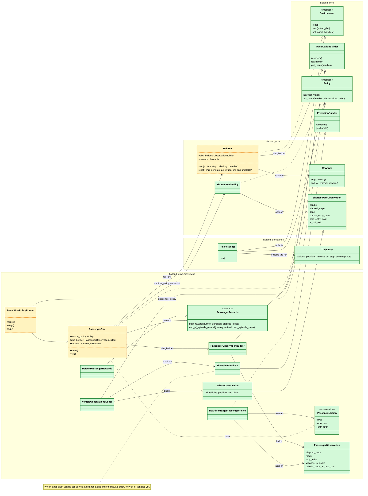
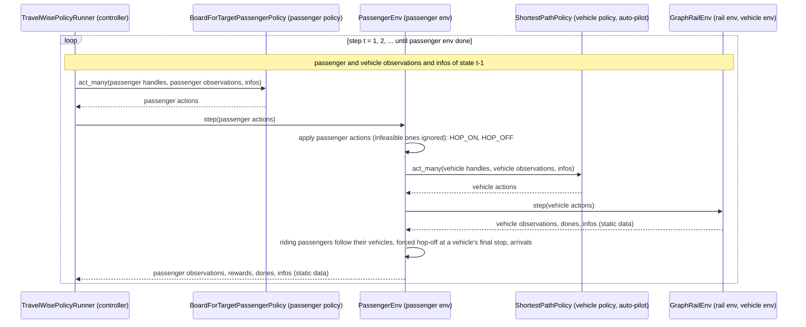

# Travel Wise Data Model

> Copied from flatland-book (`resources/travelwise/data_model.md`, 2724ac39) and updated to the decisions of the
> passenger env spike, see [the plan](../plans/travelwise-passenger-env.md) (PR #528).
>
> TODO port back to flatland-book (`resources/travelwise/data_model.md`), once PR #528 is merged:
>
> - the updates to the spike's decisions: composition over the rail env, passenger actions, journeys and
>   observations, the runner, a vehicle's route, the glossary;
> - the diagram shows what is implemented, with flatland-rl's names (entry points, `EnvAgent`'s fields, `Line`,
>   `Timetable`, `Policy`, `BoardForTargetPassengerPolicy`; no `AgentTimetable`), split into domain and RL building
>   blocks with flatland-rl's modules as namespaces, coloured by its change against flatland-book's diagram, and adds `ResourceMap`, `MalfunctionGenerator`, `ObservationBuilder`, `PredictionBuilder`,
>   `Rewards` and `Trajectory`;
> - the glossary names the TravelWise concepts not built yet (passenger state, group size, modes of transportation,
>   conditional paths, capacities, milestones, the demand generator), and the diagram notes the roles of
>   `InfrastructureEnv` and `TravelWiseEnv` and what a journey is;
> - the passenger rewards class (`PassengerRewards`);
> - the building block view and the runtime view (arc42), the step as a sequence diagram, the table of rail layer
>   and passenger layer, and the table of the building blocks' responsibilities.

This page gives technical details to the general approach of [Travel Wise](../travelwise.md).

## Glossary

The terms of [Travel Wise](../travelwise.md) (its introduction and its environments), with the class implementing each (as in the diagram below)
and its implementation status in flatland-rl: ✅ implemented, 💡 partly implemented, 🔴 open.

| Term | Description | Implementing class | Status |
|---|---|---|---|
| journey | A journey is a travel from point A to point B using potentially different modes of transportation. | `PassengerJourney` | 💡 origin, given transfers and destination with their times; no modes of transportation (any vehicle of the rail env) |
| itinerary | The itinerary describes the planned route (space and time) for a given journey. The initial itinerary might be updated during the scenario according to a given metric (default: shortest time). | - | 🔴 not modelled: the passenger policy (`BoardForTargetPassengerPolicy`) picks the vehicle at each stop at runtime; planning it needs a query view of all vehicles' future stops ([#562](https://github.com/flatland-association/flatland-rl/issues/562)) |
| transfer | Each change of mode of transportation is a transfer, even if the mode is the same, e.g. from one train to another. | `PassengerJourney.waypoints[1:-1]`, `LineFlexibleStoppingPoint` | 💡 the groups between origin and destination, each a `LineFlexibleStoppingPoint`; given, not planned; no minimum transfer time; no walkways |
| leg | The part of a journey on one vehicle, between two transfers (in flatland-rl: a ride). | `PassengerJourney.waypoints[i:i + 2]` | 💡 two consecutive groups; the vehicle ridden is not recorded, and a ride may use several vehicles (e.g. forced off at a vehicle's final stop) |
| route | In flatland-rl, a vehicle's route is every entry point it passes, in order (on the grid each cell entered, with its direction; on the graph each node), from its initial entry point through one alternative per stop. Its stops are a few of these entries. Not the passenger's itinerary. | `Policy`, `ShortestPathPolicy`, `Router` | ✅ the auto-pilot (`ShortestPathPolicy`) follows the route its `Router` finds |
| `InfrastructureEnv` | The infrastructure layer: a generalized version of the `RailEnv`, a graph representation of the infrastructure with different transportation modes as properties of the edges, including walkways. | `RailEnv`, `GraphRailEnv` | 💡 the rail env on the graph view; no modes of transportation on the edges, no walkways |
| `PassengerEnv` | The passenger layer: all properties correspond to those of the `InfrastructureEnv` (inheritance in OO terms), and it depends on an existing `InfrastructureEnv` to be generated. | `PassengerEnv` | ✅ composition instead of inheritance: it holds the rail env and implements `Environment` for the passengers |
| `TravelWiseEnv` | `InfrastructureEnv` and `PassengerEnv` together. | `PassengerEnv` | ✅ `PassengerEnv` steps the vehicles with the auto-pilot, so it plays this role; no class of its own |
| infrastructure (`InfrastructureEnv`) | Graph consisting of nodes and multimodal edges. | `TransitionMap`, `GraphTransitionMap` | 💡 nodes are entry points; edges carry no mode of transportation |
| mode of transportation (`InfrastructureEnv`) | Train, bus, plane, ship, walkway, ..., as properties of the edges. | - | 🔴 not modelled: rail only, no walkways |
| conditional path (`InfrastructureEnv`) | Optional paths and the conditions under which they can be used, e.g. a shorter walkway for passengers with reduced mobility, or fast-track lanes for delayed passengers. | - | 🔴 not modelled |
| capacity (`InfrastructureEnv`) | Capacities of (some) modes of transportation. | - | 🔴 not modelled: any number of passengers rides a vehicle |
| passenger graph (`PassengerEnv`) | The passenger's own graph, a subgraph of the infrastructure graph. | - | 🔴 not modelled: the passenger sees the vehicles it can board and their planned stops |
| passenger (`PassengerEnv`) | A group of people (N=1..n). | `Passenger` | 💡 one agent per passenger; no group size |
| passenger state (`PassengerEnv`) | Where a passenger is: at a stopping point while waiting, on a vehicle while riding; it changes by hopping on and off. | `Passenger`, `PassengerMode` | 💡 one object per passenger (`Passenger`) with its mode: off the map, waiting at a resource, or riding a vehicle; no passenger configuration (the entry point instead of the resource) |
| line (`InfrastructureEnv`) | List of stations that are served successively. | `Line`, `LineFlexibleStoppingPoint` | ✅ a vehicle's waypoint groups (`EnvAgent.waypoints`), each with alternative stops; stations are not modelled |
| timetable (`InfrastructureEnv`) | List of time windows (latest arrival, earliest departure) for a given line. | `Timetable`, `EnvAgent.waypoints_earliest_departure`, `EnvAgent.waypoints_latest_arrival` | ✅ |
| action (`InfrastructureEnv`) | Generalized version of the railway case actions, including _move to edge a1_, _accelerate_, _brake_ (a larger action space, since there can be more than two outgoing edges at a node). | `RailEnvActions` | 💡 the railway actions (left, forward, right, stop), also on the graph; no generalized _move to edge_ |
| action (`PassengerEnv`) | In principle the same actions; in practice only _move to edge a1_, since passengers leave their graph as soon as they _hop on_ a vehicle. | `PassengerAction` | ✅ `WAIT`, `HOP_ON` a given vehicle, `HOP_OFF`; hopping on is an explicit action, and passengers do not walk |
| observation (`InfrastructureEnv`) | Conventional `RailEnv` observations, e.g. tree observation. | `ShortestPathObservation`, `VehicleObservation` | ✅ the auto-pilot's own observation, with the positions and plans of all vehicles; the conventional observations (e.g. tree observation) remain for `RailEnv` on the grid |
| observation (`PassengerEnv`) | Global observation of the infrastructure graph and timetables; potentially a list of itineraries to choose from. | `PassengerObservation` | 💡 its own situation and the vehicles it can board now with their planned stops; the map, timetables and journeys come with the infos; no global view of all vehicles' future stops (query view, [#562](https://github.com/flatland-association/flatland-rl/issues/562)), no itineraries |
| event (`InfrastructureEnv`, `PassengerEnv`) | Triggers for milestones, e.g. delayed trains, trains passing a specific node, or passenger specific: _my_ train is delayed. | - | 🔴 not modelled; waits for an event generator in Flatland ([#424](https://github.com/flatland-association/flatland-rl/issues/424)) |
| milestone (`PassengerEnv`) | Passed on a journey; passing it triggers communication with the Travel Wise layer, which is above and outside Flatland. | - | 🔴 not modelled; builds on events |
| reward (`InfrastructureEnv`) | Conventional `RailEnv` rewards. | `Rewards`, `DefaultRewards` | ✅ |
| reward (`PassengerEnv`) | What the passenger policy optimizes, e.g. shortest time, fewest transfers, longer transfer times (e.g. for passengers with reduced mobility). | `PassengerRewards`, `DefaultPassengerRewards` | 💡 arriving before the latest arrival is rewarded; arriving late or not at all and boarding before the earliest departure are penalized; transfers and transfer times are not rewarded |
| malfunction (`InfrastructureEnv`) | Includes breakdowns, departure delays, ... | `MalfunctionGenerator` | ✅ also on the graph view; the auto-pilot does not react to them (it waits on its fixed route) |
| demand generator | A generalization of the line and timetable generators to journeys and itineraries. | - | 🔴 not modelled: the journeys are fixed input to `PassengerEnv` |

## Building Block View

The static decomposition into building blocks, in the sense of arc42's
[building block view](https://docs.arc42.org/section-5/); how they interact at runtime is in the
[runtime view](#runtime-view).

Flatland represents RL view of the world: agent policies act on the env upon receiving a (partial) observation of the env state.
The world is run by a controller loop and the run is collected in a trajectory.

External effects can be modelled by effects generators, modifying the environment state before or after an env step, reflecting e.g.

- random disruptions of trains (due to door not closing, passenger delaying departure etc.)
- availability of infrastructure (e.g. opening a passenger fast-lane at airports)

The railway domain is reflected at the microscopic level:

- infrastructure/topology is defined by the transition map and stations and stops in the map
- services are defined spatially by lines and spatio-temporally by timetables

The Travel Wise extension `PassengerEnv` reflects passenger journeys.

Technically, it implements the `Environment` interface for the passengers and holds an underlying rail env
(`GraphRailEnv`) where trains, ships etc. run - composition, not inheritance.

Agents controlled in rail env are vehicles, agents controlled in the passenger env are passengers.

A passenger waits at an entry point or rides a vehicle. Its actions are `WAIT`, `HOP_ON` a given vehicle and
`HOP_OFF`; the env applies an action if it is feasible and ignores it otherwise: a passenger hops on and off only
where the vehicle stops, standing still at a stop of its line. It observes the vehicles it can board
and their planned stops (`TimetablePredictor`); static data (map, timetables, journeys) comes with the infos.

### Class diagrams

Notation: [UML class diagram in Mermaid](https://mermaid.js.org/syntax/classDiagram.html).

Two diagrams of the same building blocks: the domain building blocks (what is simulated: infrastructure, services, vehicles, passengers,
disturbances - the areas of flatland-book's "Railway Features") and the RL building blocks (how it is run: envs, policies,
observations, rewards, runners - flatland-book's "Simulation Model"). `RailEnv` and `PassengerEnv` are in both, each
with the members of the concern. Namespaces are flatland-rl's modules, with `_` for `.` (mermaid takes no dots in
namespaces): `flatland_core` is `flatland.core`, likewise `flatland_envs`, `flatland_envs_travelwise`,
`flatland_trajectories`.

The diagrams show what is implemented on this branch, coloured by its change against flatland-book's data model;
new members of a modified class have a leading `+`, and members not implemented yet say so. Colour legend:

- 🟩 green, added: new against flatland-book, implemented on this branch;
- 🟨 yellow, modified: in flatland-book, changed on this branch;
- 🟦 blue, not implemented yet: in the design, not in the code;
- ⬜ grey, unchanged: in flatland-book and implemented as designed (none at the moment).

flatland-book's classes that never existed in flatland-rl are left out: `Coordinate` (here `EntryPoint`),
`AgentTimetable` and `AgentTimetableItem` (here `Timetable` and `EnvAgent`'s waypoints with their times),
`FlatlandPolicy` and `PassengerPolicy` (here `Policy`).

#### Domain building blocks

```mermaid
classDiagram
    direction LR
    note for RailEnv "Agents reflect trains/ships/etc. Positions are entry points: graph nodes or grid cell entry points (r,c,d). RailEnv and GraphRailEnv play the InfrastructureEnv."
    note for PassengerEnv "Agents reflect passengers, waiting at an entry point or riding a vehicle. Plays the TravelWiseEnv: it steps the vehicles itself."
    note for PassengerJourney "A journey: origin, given transfers and destination, each a waypoint group, with their times. A leg is two consecutive groups. No itinerary: the vehicles are picked at runtime."
    note for TransitionMap "Topology"
    note for Line "Services in Space. Waypoints are Waypoint objects on the grid, entry points on the graph. Passenger journeys have the same shape."
    note for Timetable "Services in Space and Time"
    note for StoppingPoint "aka. Haltepunkt. The physical location where a vehicle takes up and sets down passengers when it stands still there. Today the entry points of a vehicle's waypoint groups serve as its stopping points."
    RailEnv --> TransitionMap : rail
    RailEnv --> ResourceMap : resource_map
    RailEnv "1" --> "1.." EnvAgent : agents
    RailEnv --> MalfunctionGenerator : malfunction_generator
    TransitionMap ..> EntryPoint : nodes
    ResourceMap ..> EntryPoint : maps to resources
    Timetable "1" --> "1" Line : per agent, aligned with its waypoints
    Line "1" --> "1.." LineFlexibleStoppingPoint
    EnvAgent "1" --> "2.." LineFlexibleStoppingPoint : waypoints
    LineFlexibleStoppingPoint "1" --> "1.." EntryPoint : alternatives
    StoppingPoint "1.." --> "1" Station
    StoppingPoint "1" --> "1" EntryPoint
    PassengerEnv --> RailEnv : rail_env, passengers use trains, ships etc.
    PassengerEnv "1" --> "1.." PassengerJourney : passenger_journeys
    PassengerEnv "1" --> "1.." Passenger : passengers
    Passenger --> PassengerJourney : journey
    Passenger ..> EnvAgent : rides (mode)
    PassengerJourney "1" --> "2.." LineFlexibleStoppingPoint : waypoints

    namespace flatland_core {
        class EntryPoint {
            "a graph node or a grid cell entry point (r,c,d)"
        }
        class TransitionMap {
            +get_transitions(entry_point)
            apply_action_independent(action, entry_point)
            +get_successor_entry_points(entry_point)
            +get_predecessor_entry_points(entry_point)
            +is_valid_entry_point(entry_point)
        }
        class ResourceMap {
            get_resource(from_entry_point, to_entry_point) "the occupancy unit for conflicts, e.g. a cell"
        }
    }
    namespace flatland_envs {
        class RailEnv {
            +rail: TransitionMap
            +resource_map: ResourceMap
            +agents: List[EnvAgent]
            +malfunction_generator: MalfunctionGenerator
            effects_generator
            events_generator "not implemented yet"
            register() "register for event topics, not implemented yet"
            deregister() "de-register from event topics, not implemented yet"
        }
        class EnvAgent {
            +current_entry_point: Optional[EntryPoint]
            +next_entry_point: Optional[EntryPoint]
            +speed_counter: SpeedCounter "speed, and distance on the edge"
            +waypoints: List[List[Waypoint]]
            +waypoints_earliest_departure: List[int]
            +waypoints_latest_arrival: List[int]
            next_stop() LineFlexibleStoppingPoint "not implemented yet"
        }
        class Line {
            +agent_waypoints: Dict[int, List[List[Waypoint]]]
            +agent_speeds: List[float]
        }
        class LineFlexibleStoppingPoint {
            "a waypoint group: alternative entry points, one of them served"
        }
        class Timetable {
            +earliest_departures: List[List[int]]
            +latest_arrivals: List[List[int]]
            +max_episode_steps: int
        }
        class Station {
            description: Any
        }
        class StoppingPoint {
            description: Any
        }
        class MalfunctionGenerator {
            "breakdowns, departure delays, ..."
        }
    }
    namespace flatland_envs_travelwise {
        class PassengerEnv {
            +rail_env: RailEnv
            +passenger_journeys: Dict[int, PassengerJourney]
            +passengers: Dict[int, Passenger]
        }
        class Passenger {
            handle
            journey: PassengerJourney
            mode: PassengerMode "resource, and the vehicle ridden"
            current_entry_point
            stop_index
            target_entry_point
            arrival_time
            next_stop()
        }
        class PassengerJourney {
            waypoints
            waypoints_earliest_departure
            waypoints_latest_arrival
        }
    }

    style EntryPoint fill:#d3f9d8,stroke:#2b8a3e,stroke-width:2px,color:#000
    style ResourceMap fill:#d3f9d8,stroke:#2b8a3e,stroke-width:2px,color:#000
    style MalfunctionGenerator fill:#d3f9d8,stroke:#2b8a3e,stroke-width:2px,color:#000
    style Passenger fill:#d3f9d8,stroke:#2b8a3e,stroke-width:2px,color:#000
    style PassengerJourney fill:#d3f9d8,stroke:#2b8a3e,stroke-width:2px,color:#000
    style RailEnv fill:#fff3bf,stroke:#e67700,stroke-width:2px,stroke-dasharray:4 2,color:#000
    style TransitionMap fill:#fff3bf,stroke:#e67700,stroke-width:2px,stroke-dasharray:4 2,color:#000
    style Line fill:#fff3bf,stroke:#e67700,stroke-width:2px,stroke-dasharray:4 2,color:#000
    style LineFlexibleStoppingPoint fill:#fff3bf,stroke:#e67700,stroke-width:2px,stroke-dasharray:4 2,color:#000
    style Timetable fill:#fff3bf,stroke:#e67700,stroke-width:2px,stroke-dasharray:4 2,color:#000
    style EnvAgent fill:#fff3bf,stroke:#e67700,stroke-width:2px,stroke-dasharray:4 2,color:#000
    style PassengerEnv fill:#fff3bf,stroke:#e67700,stroke-width:2px,stroke-dasharray:4 2,color:#000
    style Station fill:#e7f5ff,stroke:#1971c2,stroke-width:2px,stroke-dasharray:2 2,color:#000
    style StoppingPoint fill:#e7f5ff,stroke:#1971c2,stroke-width:2px,stroke-dasharray:2 2,color:#000
```

#### RL building blocks

### Rail layer and passenger layer

The passenger layer mirrors the rail layer: each passenger class corresponds to a vehicle class, with the same fields
and conventions where they overlap, but none is a subclass - `PassengerEnv` holds the rail env (composition).

| Concept | Rail layer (vehicles) | Passenger layer |
|---|---|---|
| env | `RailEnv`, `GraphRailEnv` | `PassengerEnv`, holding the rail env |
| agent state | `EnvAgent` | `Passenger` |
| plan | `EnvAgent.waypoints` with `waypoints_earliest_departure` and `waypoints_latest_arrival` | `PassengerJourney` (same fields) |
| actions | `RailEnvActions` | `PassengerAction` |
| observation | `ShortestPathObservation`, `VehicleObservation` (`VehicleObservationBuilder`) | `PassengerObservation` (`PassengerObservationBuilder`) |
| policy | `ShortestPathPolicy` (auto-pilot) | `BoardForTargetPassengerPolicy` |
| rewards | `Rewards`, `DefaultRewards` | `PassengerRewards`, `DefaultPassengerRewards` |
| runner | `PolicyRunner` | `TravelWisePolicyRunner` |

### Building blocks

Each building block's responsibility, by concern (domain, RL or both) and namespace (colours as in the legend above):

| Building block | Concern | Namespace | Responsibility | Change |
|---|---|---|---|---|
| `EntryPoint` | domain | `flatland.core` | Names a position on the infrastructure: a graph node, or a grid cell with the direction it is entered in. | 🟩 |
| `TransitionMap` | domain | `flatland.core` | Holds the infrastructure's topology: which entry point follows which, under which action. | 🟨 |
| `ResourceMap` | domain | `flatland.core` | Maps entry points to the resources they occupy, so that no two vehicles hold the same resource. | 🟩 |
| `Station` | domain | `flatland.envs` | Groups the stopping points where passengers change between vehicles and walkways. | 🟦 |
| `StoppingPoint` | domain | `flatland.envs` | The physical location where a vehicle takes up and sets down passengers when it stands still there; today the entry points of a vehicle's waypoint groups serve as its stopping points. | 🟦 |
| `Line` | domain | `flatland.envs` | Describes the services in space: each vehicle's waypoint groups and its speed. | 🟨 |
| `LineFlexibleStoppingPoint` | domain | `flatland.envs` | Lists the alternatives a vehicle (or passenger) may stop at for one waypoint group. | 🟨 |
| `Timetable` | domain | `flatland.envs` | Adds the times to the line: earliest departure and latest arrival per waypoint group, and the episode's length. | 🟨 |
| `EnvAgent` | domain | `flatland.envs` | Holds a vehicle's state in the rail env: where it is, its speed, and its waypoints with their times. | 🟨 |
| `MalfunctionGenerator` | domain | `flatland.envs` | Breaks vehicles down at random, for a number of steps. | 🟩 |
| `Passenger` | domain | `flatland.envs.travelwise` | Holds a passenger's state in the passenger env: where it is, the vehicle it rides, how far along its journey it is, and its arrival - the passenger's `EnvAgent`, not a subclass. | 🟩 |
| `PassengerJourney` | domain | `flatland.envs.travelwise` | Describes what a passenger wants to travel: origin, transfers and destination as waypoint groups, with their times - the passenger's counterpart of `EnvAgent`'s waypoints with their times. | 🟩 |
| `RailEnv` | both | `flatland.envs` | Moves the vehicles on the infrastructure according to their actions, and reports their observations, rewards and infos per step. | 🟨 |
| `PassengerEnv` | both | `flatland.envs.travelwise` | Moves the passengers between waiting and riding according to their actions, steps the rail env with the auto-pilot, and reports the passengers' observations, rewards and infos per step. | 🟨 |
| `Environment` | RL | `flatland.core` | The interface every env implements: `reset()`, `step()` with the agents' actions, and the agents' handles. | 🟩 |
| `Policy` | RL | `flatland.core` | Decides the agents' actions from their observations. | 🟩 |
| `ObservationBuilder` | RL | `flatland.core` | Builds each agent's observation from the env's state. | 🟩 |
| `PredictionBuilder` | RL | `flatland.core` | Predicts the agents' future positions for the observation builders. | 🟩 |
| `Rewards` | RL | `flatland.envs` | Computes the vehicles' rewards per step and at the end of the episode. | 🟩 |
| `ShortestPathPolicy` | RL | `flatland.envs` | Drives each vehicle along the shortest route through its waypoints (the auto-pilot). | 🟩 |
| `ShortestPathObservation` | RL | `flatland.envs` | Gives the auto-pilot the positions and plans of all vehicles. | 🟩 |
| `PolicyRunner` | RL | `flatland.trajectories` | Runs a policy on the rail env for an episode and records the run as a trajectory. | 🟩 |
| `Trajectory` | RL | `flatland.trajectories` | Stores a run (actions, positions, rewards per step, env snapshots) for replay and evaluation. | 🟩 |
| `PassengerAction` | RL | `flatland.envs.travelwise` | Lists what a passenger can do in a step: wait, hop on a given vehicle, or hop off. | 🟩 |
| `PassengerObservation` | RL | `flatland.envs.travelwise` | Tells a passenger its own situation and the vehicles it can board now, with their planned stops. | 🟩 |
| `BoardForTargetPassengerPolicy` | RL | `flatland.envs.travelwise` | Boards a vehicle that stops at the passenger's next stop, and hops off there. | 🟩 |
| `VehicleObservationBuilder` | RL | `flatland.envs.travelwise` | Builds the auto-pilot's observation of the vehicles inside the passenger env. | 🟩 |
| `VehicleObservation` | RL | `flatland.envs.travelwise` | A vehicle's `ShortestPathObservation` plus all vehicles' positions and plans, so the passengers can read them. | 🟩 |
| `PassengerObservationBuilder` | RL | `flatland.envs.travelwise` | Builds each passenger's observation. | 🟩 |
| `TimetablePredictor` | RL | `flatland.envs.travelwise` | Predicts which stops each vehicle still serves, as if it ran alone and on time. | 🟩 |
| `PassengerRewards` | RL | `flatland.envs.travelwise` | Computes the passengers' rewards per step and at the end of the episode. | 🟩 |
| `DefaultPassengerRewards` | RL | `flatland.envs.travelwise` | Rewards an early arrival, and penalizes a late or missing arrival and boarding before the earliest departure. | 🟩 |
| `TravelWisePolicyRunner` | RL | `flatland.envs.travelwise` | Runs the passenger policy on the passenger env for an episode; the vehicles are stepped by the passenger env, not by the runner. | 🟨 |

## Runtime View

How the building blocks interact at runtime, in the sense of arc42's
[runtime view](https://docs.arc42.org/section-6/).

The passenger env steps the rail env itself, with an "auto-pilot" Flatland policy for the vehicles
(`ShortestPathPolicy`): in each step it first applies the passengers' actions, then steps the rail env, and the riding
passengers move with their vehicles. So passengers and vehicles decide on the same state.
The auto-pilot drives each vehicle along a route: every entry point the vehicle passes, in order (on the grid each
cell entered, with its direction; on the graph each node), through one alternative of each waypoint group (aka.
`LineFlexibleStoppingPoint`) of its line. The waypoints are a few entries of the route.
The Travel Wise policy runner holds the passenger policy and steps the passenger env only, with the passengers'
actions based on their observations of the previous step.

### Step

Notation: [UML sequence diagram in Mermaid](https://mermaid.js.org/syntax/sequenceDiagram.html).

One step of the TravelWise loop: the runner steps the passenger env only, and the passenger env steps the rail env with
the auto-pilot. `reset()` runs the same way; the full sequence, with the observation builders, is in
[the plan](../plans/travelwise-passenger-env.md) ("Controller and step").

