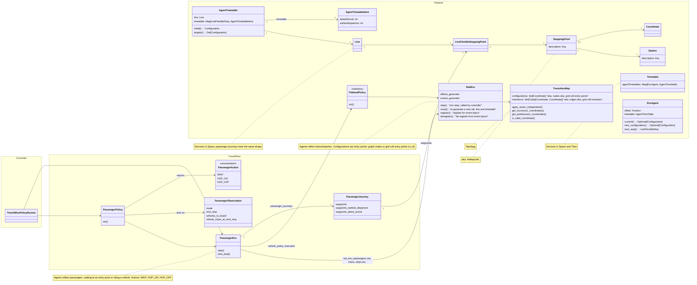

# Travel Wise Data Model

> Copied from flatland-book (`resources/travelwise/data_model.md`, 2724ac39) and updated to the decisions of the
> passenger env spike, see [the plan](../plans/travelwise-passenger-env.md) (PR #528).

This page gives technical details to the general approach of [Travel Wise](../travelwise.md).

## Building Blocks

Flatland represents RL view of the world: agent policies act on the env upon receiving a (partial) observation of the env state.
The world is run by a controller loop and the run is collected in a trajectory.

External effects can be modelled by effects generators, modifying the environment state before or after an env step, reflecting e.g.

- random disruptions of trains (due to door not closing, passenger delaying departure etc.)
- availability of infrastructure (e.g. opening a passenger fast-lane at airports)

The railway domain is reflected at the microscopic level:

- infrastructure/topology is defined by the transition map and stations and stops in the map
- services are defined spatially by lines and spatio-temporally by timetables

The Travel Wise extension `PassengerEnv` reflects passenger journeys.

Technically, it implements the `Environment` interface for the passengers and holds an underlying rail env
(`GraphRailEnv`) where trains, ships etc. run - composition, not inheritance.

The passenger env steps the rail env itself, with an "auto-pilot" Flatland policy for the vehicles
(`ShortestPathPolicy`): in each step it first applies the passengers' actions, then steps the rail env, and the riding
passengers move with their vehicles. So passengers and vehicles decide on the same state.
The auto-pilot drives each vehicle along a route: every entry point the vehicle passes, in order (on the grid each
cell entered, with its direction; on the graph each node), through one alternative of each waypoint group (aka.
`LineFlexibleStoppingPoint`) of its line. The waypoints are a few entries of the route.
The Travel Wise policy runner holds the passenger policy and steps the passenger env only, with the passengers'
actions based on their observations of the previous step.
Agents controlled in rail env are vehicles, agents controlled in the passenger env are passengers.

A passenger waits at an entry point or rides a vehicle. Its actions are `WAIT`, `HOP_ON` a given vehicle and
`HOP_OFF`; the env applies an action if it is feasible and ignores it otherwise. It observes the vehicles it can board
and their planned stops (`TimetablePredictor`); static data (map, timetables, journeys) comes with the infos.

